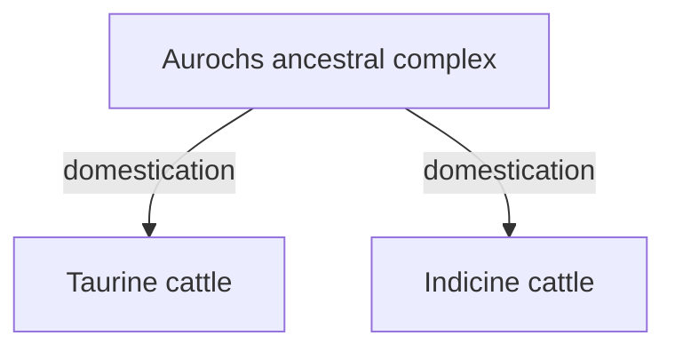

# Optional scientific reference

**Gameplay entities are general categories. This scientific reference does not require splitting foxes, bears or oaks into species.**

[JSON](animals.biological.catalog.json) · [Model and boundaries](../../lang/en/biology.md)

Scientific names matched to the provider; representative choices, native ranges, habitats and outputs still need review. Retired source IDs are preserved through explicit aliases. No table authorizes initial spawning or gameplay transformations. Related reference forms are not a wild-spawn list.

## Coverage

| Metric | Count |
| --- | --- |
| `taxonCount` | 168 |
| `biologicalFormCount` | 28 |
| `lineageRelationCount` | 12 |
| `excludedLineageRelationCount` | 2 |
| `sourceCandidateCount` | 101 |
| `cropCandidateCount` | 0 |

## Original labels and concrete selection

| Candidate | Reference name | Selected taxa | Selection | Related forms |
| --- | --- | --- | --- | --- |
| `ANM#000170` | Moose | `ANM#000001` Alces alces; `ANM#000002` Alces americanus | `optional_scientific_reference` |  |
| `ANM#000171` | Antelopes | `ANM#000140` Raphicerus melanotis; `ANM#000139` Raphicerus campestris; `ANM#000037` Cephalophus silvicultor; `ANM#000156` Tragelaphus scriptus | `optional_scientific_reference` |  |
| `animal_australian_scrub_birds` | Australian Scrub Birds | `ANM#000009` Atrichornis clamosus | `representative_species_selection` |  |
| `animal_birds_of_paradise` | Birds of Paradise | `ANM#000123` Paradisaea raggiana | `representative_species_selection` |  |
| `animal_shorebirds_and_waterbirds` | Shorebirds and Waterbirds | `ANM#000008` Ardea cinerea; `ANM#000102` Numenius arquata | `representative_species_selection` |  |
| `ANM#000172` | Baboons | `ANM#000122` Papio ursinus; `ANM#000121` Papio anubis | `optional_scientific_reference` |  |
| `animal_atlantic_cod` | Atlantic Cod | `ANM#000059` Gadus morhua | `specific_name_interpretation` |  |
| `animal_regional_migratory_whales` | Regional Migratory Whales | `ANM#000093` Megaptera novaeangliae; `ANM#000011` Balaenoptera musculus | `representative_species_selection` |  |
| `animal_american_bison` | American Bison | `ANM#000012` Bison bison | `specific_name_interpretation` |  |
| `animal_muskox` | Muskox | `ANM#000112` Ovibos moschatus | `specific_name_interpretation` |  |
| `animal_african_buffalo` | African Buffalo | `ANM#000150` Syncerus caffer | `specific_name_interpretation` |  |
| `animal_snowy_owl` | Snowy Owl | `ANM#000021` Bubo scandiacus | `specific_name_interpretation` |  |
| `animal_przewalski_horse` | Przewalski Horse | `ANM#000055` Equus przewalskii | `specific_name_interpretation` | `FRM#000073` |
| `animal_cockatoos_and_savanna_birds` | Cockatoos and Savanna Birds | `ANM#000022` Cacatua galerita; `ANM#000053` Eolophus roseicapilla | `representative_species_selection` |  |
| `animal_wild_bactrian_camel` | Wild Bactrian Camel | `ANM#000025` Camelus ferus | `specific_name_interpretation` | `FRM#000075` |
| `ANM#000173` | Crabs | `ANM#000103` Ocypode ceratophthalmus; `ANM#000146` Scylla serrata | `optional_scientific_reference` |  |
| `ANM#000174` | Kangaroos | `ANM#000108` Macropus antilopinus; `ANM#000090` Macropus fuliginosus; `ANM#000109` Macropus rufus; `ANM#000048` Dendrolagus goodfellowi | `optional_scientific_reference` |  |
| `animal_capybara` | Capybara | `ANM#000075` Hydrochoerus hydrochaeris | `specific_name_interpretation` |  |
| `animal_woodland_caribou` | Woodland Caribou | `ANM#000137` Rangifer tarandus caribou | `specific_name_interpretation` |  |
| `animal_tundra_caribou` | Tundra Caribou | `ANM#000138` Rangifer tarandus groenlandicus | `specific_name_interpretation` |  |
| `animal_southern_cassowary` | Southern Cassowary | `ANM#000036` Casuarius casuarius | `specific_name_interpretation` |  |
| `animal_plains_zebra` | Plains Zebra | `ANM#000056` Equus quagga | `specific_name_interpretation` |  |
| `animal_chimpanzee` | Chimpanzee | `ANM#000116` Pan troglodytes | `specific_name_interpretation` |  |
| `ANM#000175` | Deer | `ANM#000010` Axis axis; `ANM#000038` Cervus elaphus; `ANM#000039` Cervus nippon; `ANM#000074` Hippocamelus bisulcus; `ANM#000131` Pudu puda; `ANM#000104` Odocoileus virginianus; `ANM#000115` Ozotoceros bezoarticus | `optional_scientific_reference` |  |
| `animal_european_rabbit` | European Rabbit | `ANM#000106` Oryctolagus cuniculus | `specific_name_interpretation` | `FRM#000054`, `FRM#000055` |
| `animal_roadrunner` | Roadrunner | `ANM#000064` Geococcyx californianus | `specific_name_interpretation` |  |
| `animal_coyote` | Coyote | `ANM#000026` Canis latrans | `specific_name_interpretation` |  |
| `animal_cuscuses_and_other_arboreal_marsupials` | Cuscuses and Other Arboreal Marsupials | `ANM#000147` Spilocuscus maculatus | `representative_species_selection` |  |
| `animal_andean_condor` | Andean Condor | `ANM#000168` Vultur gryphus | `specific_name_interpretation` |  |
| `animal_rock_hyraxes` | Rock Hyraxes | `ANM#000130` Procavia capensis | `specific_name_interpretation` |  |
| `animal_dingo` | Dingo | `ANM#000028` Canis lupus dingo | `specific_name_interpretation` |  |
| `animal_introduced_domestic_or_feral_dromedary` | Introduced Domestic or Feral Dromedary | `ANM#000024` Camelus dromedarius | `specific_name_interpretation` | `FRM#000077` |
| `ANM#000176` | African elephants | `ANM#000085` Loxodonta cyclotis; `ANM#000084` Loxodonta africana | `optional_scientific_reference` |  |
| `ANM#000177` | Asian elephants | `ANM#000052` Elephas maximus | `optional_scientific_reference` |  |
| `animal_coastal_elephant_seals` | Coastal Elephant Seals | `ANM#000096` Mirounga leonina | `specific_name_interpretation` |  |
| `animal_emu` | Emu | `ANM#000051` Dromaius novaehollandiae | `specific_name_interpretation` |  |
| `animal_short_beaked_echidna` | Short-Beaked Echidna | `ANM#000151` Tachyglossus aculeatus | `specific_name_interpretation` |  |
| `animal_regional_seals` | Regional Seals | `ANM#000133` Pusa hispida; `ANM#000081` Leptonychotes weddellii | `representative_species_selection` |  |
| `animal_coastal_seals_and_sea_lions` | Coastal Seals and Sea Lions | `ANM#000126` Phoca vitulina; `ANM#000111` Otaria byronia | `representative_species_selection` |  |
| `ANM#000178` | Gazelles | `ANM#000129` Procapra gutturosa; `ANM#000062` Gazella dorcas; `ANM#000063` Gazella marica | `optional_scientific_reference` |  |
| `animal_red_junglefowl` | Red Junglefowl | `ANM#000060` Gallus gallus | `specific_name_interpretation` | `FRM#000057` |
| `animal_gelada` | Gelada | `ANM#000155` Theropithecus gelada | `specific_name_interpretation` |  |
| `animal_subarctic_wolverine` | Subarctic Wolverine | `ANM#000071` Gulo gulo | `specific_name_interpretation` |  |
| `animal_western_gorilla` | Western Gorilla | `ANM#000070` Gorilla gorilla | `specific_name_interpretation` |  |
| `animal_macaws` | Macaws | `ANM#000007` Ara macao; `ANM#000006` Ara ararauna | `representative_species_selection` |  |
| `ANM#000179` | Guanacos | `ANM#000079` Lama glama guanicoe | `optional_scientific_reference` | `FRM#000058` |
| `ANM#000180` | Wild boars | `ANM#000148` Sus scrofa | `optional_scientific_reference` | `FRM#000050` |
| `animal_jaguar` | Jaguar | `ANM#000118` Panthera onca | `specific_name_interpretation` |  |
| `animal_regional_jerboas_and_gerbils` | Regional Jerboas and Gerbils | `ANM#000050` Dipus sagitta; `ANM#000095` Meriones meridianus | `representative_species_selection` |  |
| `animal_giraffe` | Giraffe | `ANM#000065` Giraffa camelopardalis; `ANM#000067` Giraffa reticulata; `ANM#000068` Giraffa tippelskirchi; `ANM#000066` Giraffa giraffa | `representative_species_selection` |  |
| `animal_antarctic_krill` | Antarctic Krill | `ANM#000058` Euphausia superba | `specific_name_interpretation` |  |
| `animal_lemming` | Lemming | `ANM#000080` Lemmus lemmus | `specific_name_interpretation` |  |
| `animal_snow_leopard` | Snow Leopard | `ANM#000120` Uncia uncia | `specific_name_interpretation` |  |
| `animal_lion` | Lion | `ANM#000117` Panthera leo | `specific_name_interpretation` |  |
| `animal_arctic_hare` | Arctic Hare | `ANM#000082` Lepus arcticus | `specific_name_interpretation` |  |
| `animal_eurasian_lynx` | Eurasian Lynx | `ANM#000088` Lynx lynx | `specific_name_interpretation` |  |
| `animal_maned_wolf` | Maned Wolf | `ANM#000042` Chrysocyon brachyurus | `specific_name_interpretation` |  |
| `animal_ethiopian_wolf` | Ethiopian Wolf | `ANM#000030` Canis simensis | `specific_name_interpretation` |  |
| `animal_grey_wolf` | Grey Wolf | `ANM#000027` Canis lupus | `specific_name_interpretation` | `FRM#000052` |
| `ANM#000181` | Marmots | `ANM#000092` Marmota marmota; `ANM#000091` Marmota bobak | `optional_scientific_reference` |  |
| `animal_regional_mussels_and_oysters` | Regional Mussels and Oysters | `ANM#000099` Mytilus edulis; `ANM#000110` Ostrea edulis | `representative_species_selection` |  |
| `animal_tropical_mollusks_and_bivalves` | Tropical Mollusks and Bivalves | `ANM#000157` Tridacna maxima; `ANM#000127` Pinctada margaritifera | `representative_species_selection` |  |
| `animal_howler_monkey` | Howler Monkey | `ANM#000003` Alouatta seniculus | `specific_name_interpretation` |  |
| `animal_okapi` | Okapi | `ANM#000105` Okapia johnstoni | `specific_name_interpretation` |  |
| `animal_giant_anteater` | Giant Anteater | `ANM#000098` Myrmecophaga tridactyla | `specific_name_interpretation` |  |
| `ANM#000182` | Bears | `ANM#000158` Ursus americanus; `ANM#000161` Ursus thibetanus; `ANM#000159` Ursus arctos; `ANM#000160` Ursus maritimus | `optional_scientific_reference` |  |
| `animal_estuarine_oysters_and_other_bivalves` | Estuarine Oysters and Other Bivalves | `ANM#000044` Crassostrea virginica | `representative_species_selection` |  |
| `animal_ocellated_turkey` | Ocellated Turkey | `ANM#000094` Meleagris ocellata | `specific_name_interpretation` |  |
| `animal_indian_peafowl` | Indian Peafowl | `ANM#000124` Pavo cristatus | `specific_name_interpretation` |  |
| `animal_collared_peccary` | Collared Peccary | `ANM#000125` Pecari tajacu | `specific_name_interpretation` |  |
| `animal_regional_reef_fish` | Regional Reef Fish | `ANM#000086` Lutjanus campechanus; `ANM#000083` Lethrinus nebulosus | `representative_species_selection` |  |
| `animal_juvenile_estuarine_fish` | Juvenile Estuarine Fish | `ANM#000097` Mugil cephalus | `representative_species_selection` |  |
| `animal_regional_polar_fish` | Regional Polar Fish | `ANM#000013` Boreogadus saida; `ANM#000128` Pleuragramma antarctica | `representative_species_selection` |  |
| `animal_perentie` | Perentie | `ANM#000162` Varanus giganteus | `specific_name_interpretation` |  |
| `animal_prairie_dog` | Prairie Dog | `ANM#000047` Cynomys ludovicianus | `specific_name_interpretation` |  |
| `animal_island_petrels_and_albatrosses` | Island Petrels and Albatrosses | `ANM#000089` Macronectes giganteus; `ANM#000049` Diomedea exulans | `representative_species_selection` |  |
| `ANM#000183` | Penguins | `ANM#000004` Aptenodytes patagonicus; `ANM#000134` Pygoscelis adeliae; `ANM#000135` Pygoscelis antarcticus | `optional_scientific_reference` |  |
| `animal_puma` | Puma | `ANM#000132` Puma concolor | `specific_name_interpretation` |  |
| `ANM#000184` | Bearded vultures | `ANM#000072` Gypaetus barbatus | `optional_scientific_reference` |  |
| `animal_chamois` | Chamois | `ANM#000142` Rupicapra rupicapra | `specific_name_interpretation` |  |
| `animal_reindeer` | Reindeer | `ANM#000136` Rangifer tarandus | `specific_name_interpretation` |  |
| `animal_eurasian_saiga` | Eurasian Saiga | `ANM#000143` Saiga tatarica | `specific_name_interpretation` |  |
| `animal_regional_sardines` | Regional Sardines | `ANM#000144` Sardina pilchardus; `ANM#000145` Sardinops sagax | `representative_species_selection` |  |
| `animal_regional_rattlesnakes` | Regional Rattlesnakes | `ANM#000045` Crotalus atrox; `ANM#000046` Crotalus cerastes | `representative_species_selection` |  |
| `animal_himalayan_tahr` | Himalayan Tahr | `ANM#000073` Hemitragus jemlahicus | `specific_name_interpretation` |  |
| `ANM#000185` | Tapirs | `ANM#000154` Tapirus terrestris; `ANM#000152` Tapirella bairdii; `ANM#000153` Acrocodia indica | `optional_scientific_reference` |  |
| `animal_tiger` | Tiger | `ANM#000119` Panthera tigris | `specific_name_interpretation` |  |
| `animal_desert_tortoise` | Desert Tortoise | `ANM#000069` Gopherus agassizii | `specific_name_interpretation` |  |
| `animal_sea_turtles` | Sea Turtles | `ANM#000040` Chelonia mydas; `ANM#000057` Eretmochelys imbricata | `representative_species_selection` |  |
| `animal_regional_land_tortoises` | Regional Land Tortoises | `ANM#000041` Chersina angulata | `representative_species_selection` |  |
| `animal_regional_wallabies` | Regional Wallabies | `ANM#000100` Macropus agilis; `ANM#000101` Macropus eugenii | `representative_species_selection` |  |
| `animal_vicuna` | Vicuna | `ANM#000164` Vicugna vicugna | `specific_name_interpretation` | `FRM#000060` |
| `animal_andean_viscacha` | Andean Viscacha | `ANM#000076` Lagidium peruanum | `specific_name_interpretation` |  |
| `animal_rock_dwelling_viscachas` | Rock-Dwelling Viscachas | `ANM#000077` Lagidium viscacia | `specific_name_interpretation` |  |
| `animal_wild_yak` | Wild Yak | `ANM#000016` Bos grunniens mutus | `specific_name_interpretation` | `FRM#000062` |
| `ANM#000169` | Foxes | `ANM#000165` Vulpes corsac; `ANM#000087` Lycalopex culpaeus; `ANM#000167` Vulpes zerda; `ANM#000166` Vulpes lagopus | `optional_scientific_reference` |  |
| `animal_golden_eagle` | Golden Eagle | `ANM#000005` Aquila chrysaetos | `specific_name_interpretation` |  |
| `ANM#000186` | Ibexes | `ANM#000033` Capra ibex; `ANM#000035` Capra walie; `ANM#000034` Capra sibirica | `optional_scientific_reference` |  |
| `animal_greater_rhea` | Greater Rhea | `ANM#000141` Rhea americana | `specific_name_interpretation` |  |
| `animal_wildebeest` | Wildebeest | `ANM#000043` Connochaetes taurinus | `specific_name_interpretation` |  |
| `animal_arabian_oryx` | Arabian Oryx | `ANM#000107` Oryx leucoryx | `specific_name_interpretation` |  |

## Complete taxon registry

Latin names are identical across languages. A `SUBSPECIES` is not presented as a new species. Full names with authority and synonym evidence remain in JSON.

| ID | Tag | Scientific name | Rank | Group | Provider |
| --- | --- | --- | --- | --- | --- |
| `ANM#000001` | `alces_alces` | Alces alces (Linnaeus, 1758) | `SPECIES` | `animal` | [GBIF Backbone 2440940](https://www.gbif.org/species/2440940) |
| `ANM#000002` | `alces_americanus` | Alces americanus (Clinton, 1822) | `SPECIES` | `animal` | [GBIF Backbone 4262283](https://www.gbif.org/species/4262283) |
| `ANM#000003` | `alouatta_seniculus` | Alouatta seniculus (Linnaeus, 1766) | `SPECIES` | `animal` | [GBIF Backbone 2436648](https://www.gbif.org/species/2436648) |
| `ANM#000004` | `aptenodytes_patagonicus` | Aptenodytes patagonicus J.F.Miller, 1778 | `SPECIES` | `animal` | [GBIF Backbone 2481660](https://www.gbif.org/species/2481660) |
| `ANM#000005` | `aquila_chrysaetos` | Aquila chrysaetos (Linnaeus, 1758) | `SPECIES` | `animal` | [GBIF Backbone 2480506](https://www.gbif.org/species/2480506) |
| `ANM#000006` | `ara_ararauna` | Ara ararauna (Linnaeus, 1758) | `SPECIES` | `animal` | [GBIF Backbone 5959231](https://www.gbif.org/species/5959231) |
| `ANM#000007` | `ara_macao` | Ara macao (Linnaeus, 1758) | `SPECIES` | `animal` | [GBIF Backbone 5959227](https://www.gbif.org/species/5959227) |
| `ANM#000008` | `ardea_cinerea` | Ardea cinerea Linnaeus, 1758 | `SPECIES` | `animal` | [GBIF Backbone 9797180](https://www.gbif.org/species/9797180) |
| `ANM#000009` | `atrichornis_clamosus` | Atrichornis clamosus (Gould, 1844) | `SPECIES` | `animal` | [GBIF Backbone 2495098](https://www.gbif.org/species/2495098) |
| `ANM#000010` | `axis_axis` | Axis axis (Erxleben, 1777) | `SPECIES` | `animal` | [GBIF Backbone 2440934](https://www.gbif.org/species/2440934) |
| `ANM#000011` | `balaenoptera_musculus` | Balaenoptera musculus (Linnaeus, 1758) | `SPECIES` | `animal` | [GBIF Backbone 2440735](https://www.gbif.org/species/2440735) |
| `ANM#000012` | `bison_bison` | Bison bison (Linnaeus, 1758) | `SPECIES` | `animal` | [GBIF Backbone 2441176](https://www.gbif.org/species/2441176) |
| `ANM#000013` | `boreogadus_saida` | Boreogadus saida (Lepechin, 1774) | `SPECIES` | `animal` | [GBIF Backbone 2415752](https://www.gbif.org/species/2415752) |
| `ANM#000014` | `bos_grunniens` | Bos grunniens Linnaeus, 1766 | `SPECIES` | `animal` | [GBIF Backbone 2441019](https://www.gbif.org/species/2441019) |
| `ANM#000015` | `bos_taurus_indicus` | Bos taurus indicus Linnaeus, 1758 | `SUBSPECIES` | `animal` | [GBIF Backbone 4262587](https://www.gbif.org/species/4262587) |
| `ANM#000016` | `bos_grunniens_mutus` | Bos grunniens mutus (Przewalski, 1883) | `SUBSPECIES` | `animal` | [GBIF Backbone 6165160](https://www.gbif.org/species/6165160) |
| `ANM#000017` | `bos_taurus_primigenius` | Bos taurus primigenius Bojanus, 1827 | `SUBSPECIES` | `animal` | [GBIF Backbone 4262590](https://www.gbif.org/species/4262590) |
| `ANM#000018` | `bos_taurus` | Bos taurus Linnaeus, 1758 | `SPECIES` | `animal` | [GBIF Backbone 2441022](https://www.gbif.org/species/2441022) |
| `ANM#000019` | `bubalus_bubalis_arnee` | Bubalus bubalis arnee (Kerr, 1792) | `SUBSPECIES` | `animal` | [GBIF Backbone 7559792](https://www.gbif.org/species/7559792) |
| `ANM#000020` | `bubalus_bubalis` | Bubalus bubalis (Linnaeus, 1758) | `SPECIES` | `animal` | [GBIF Backbone 7422937](https://www.gbif.org/species/7422937) |
| `ANM#000021` | `bubo_scandiacus` | Bubo scandiacus (Linnaeus, 1758) | `SPECIES` | `animal` | [GBIF Backbone 5959143](https://www.gbif.org/species/5959143) |
| `ANM#000022` | `cacatua_galerita` | Cacatua galerita (Latham, 1790) | `SPECIES` | `animal` | [GBIF Backbone 2479888](https://www.gbif.org/species/2479888) |
| `ANM#000023` | `camelus_bactrianus` | Camelus bactrianus Linnaeus, 1758 | `SPECIES` | `animal` | [GBIF Backbone 2441238](https://www.gbif.org/species/2441238) |
| `ANM#000024` | `camelus_dromedarius` | Camelus dromedarius Linnaeus, 1758 | `SPECIES` | `animal` | [GBIF Backbone 9055455](https://www.gbif.org/species/9055455) |
| `ANM#000025` | `camelus_ferus` | Camelus ferus Przewalski, 1878 | `SPECIES` | `animal` | [GBIF Catalogue of Life XR 5WWKW](https://www.gbif.org/taxon/5WWKW) |
| `ANM#000026` | `canis_latrans` | Canis latrans Say, 1823 | `SPECIES` | `animal` | [GBIF Backbone 5219153](https://www.gbif.org/species/5219153) |
| `ANM#000027` | `canis_lupus` | Canis lupus Linnaeus, 1758 | `SPECIES` | `animal` | [GBIF Backbone 5219173](https://www.gbif.org/species/5219173) |
| `ANM#000028` | `canis_lupus_dingo` | Canis lupus dingo Meyer, 1793 | `SUBSPECIES` | `animal` | [GBIF Backbone 6164184](https://www.gbif.org/species/6164184) |
| `ANM#000029` | `canis_lupus_familiaris` | Canis lupus familiaris Linnaeus, 1758 | `SUBSPECIES` | `animal` | [GBIF Backbone 6164210](https://www.gbif.org/species/6164210) |
| `ANM#000030` | `canis_simensis` | Canis simensis Rüppell, 1840 | `SPECIES` | `animal` | [GBIF Backbone 5219143](https://www.gbif.org/species/5219143) |
| `ANM#000031` | `capra_hircus_aegagrus` | Capra hircus aegagrus Erxleben, 1777 | `SUBSPECIES` | `animal` | [GBIF Backbone 4262706](https://www.gbif.org/species/4262706) |
| `ANM#000032` | `capra_hircus` | Capra hircus Linnaeus, 1758 | `SPECIES` | `animal` | [GBIF Backbone 2441056](https://www.gbif.org/species/2441056) |
| `ANM#000033` | `capra_ibex` | Capra ibex Linnaeus, 1758 | `SPECIES` | `animal` | [GBIF Backbone 2441055](https://www.gbif.org/species/2441055) |
| `ANM#000034` | `capra_sibirica` | Capra sibirica (Pallas, 1776) | `SPECIES` | `animal` | [GBIF Backbone 2441052](https://www.gbif.org/species/2441052) |
| `ANM#000035` | `capra_walie` | Capra walie Rüppell, 1835 | `SPECIES` | `animal` | [GBIF Backbone 2441048](https://www.gbif.org/species/2441048) |
| `ANM#000036` | `casuarius_casuarius` | Casuarius casuarius (Linnaeus, 1758) | `SPECIES` | `animal` | [GBIF Backbone 5231783](https://www.gbif.org/species/5231783) |
| `ANM#000037` | `cephalophus_silvicultor` | Cephalophus silvicultor (Afzelius, 1815) | `SPECIES` | `animal` | [GBIF Backbone 2441163](https://www.gbif.org/species/2441163) |
| `ANM#000038` | `cervus_elaphus` | Cervus elaphus Linnaeus, 1758 | `SPECIES` | `animal` | [GBIF Backbone 2440958](https://www.gbif.org/species/2440958) |
| `ANM#000039` | `cervus_nippon` | Cervus nippon Temminck, 1838 | `SPECIES` | `animal` | [GBIF Backbone 2440954](https://www.gbif.org/species/2440954) |
| `ANM#000040` | `chelonia_mydas` | Chelonia mydas (Linnaeus, 1758) | `SPECIES` | `animal` | [GBIF Backbone 2442225](https://www.gbif.org/species/2442225) |
| `ANM#000041` | `chersina_angulata` | Chersina angulata (Schweigger, 1812) | `SPECIES` | `animal` | [GBIF Backbone 5220285](https://www.gbif.org/species/5220285) |
| `ANM#000042` | `chrysocyon_brachyurus` | Chrysocyon brachyurus (Illiger, 1815) | `SPECIES` | `animal` | [GBIF Backbone 2434450](https://www.gbif.org/species/2434450) |
| `ANM#000043` | `connochaetes_taurinus` | Connochaetes taurinus (Burchell, 1823) | `SPECIES` | `animal` | [GBIF Backbone 2441105](https://www.gbif.org/species/2441105) |
| `ANM#000044` | `crassostrea_virginica` | Crassostrea virginica (Gmelin, 1791) | `SPECIES` | `animal` | [GBIF Backbone 2286079](https://www.gbif.org/species/2286079) |
| `ANM#000045` | `crotalus_atrox` | Crotalus atrox Baird & Girard, 1853 | `SPECIES` | `animal` | [GBIF Backbone 2444356](https://www.gbif.org/species/2444356) |
| `ANM#000046` | `crotalus_cerastes` | Crotalus cerastes Hallowell, 1854 | `SPECIES` | `animal` | [GBIF Backbone 2444360](https://www.gbif.org/species/2444360) |
| `ANM#000047` | `cynomys_ludovicianus` | Cynomys ludovicianus (Ord, 1815) | `SPECIES` | `animal` | [GBIF Backbone 2437232](https://www.gbif.org/species/2437232) |
| `ANM#000048` | `dendrolagus_goodfellowi` | Dendrolagus goodfellowi Thomas, 1908 | `SPECIES` | `animal` | [GBIF Backbone 2440222](https://www.gbif.org/species/2440222) |
| `ANM#000049` | `diomedea_exulans` | Diomedea exulans Linnaeus, 1758 | `SPECIES` | `animal` | [GBIF Backbone 5229302](https://www.gbif.org/species/5229302) |
| `ANM#000050` | `dipus_sagitta` | Dipus sagitta (Pallas, 1773) | `SPECIES` | `animal` | [GBIF Backbone 2439463](https://www.gbif.org/species/2439463) |
| `ANM#000051` | `dromaius_novaehollandiae` | Dromaius novaehollandiae (Latham, 1790) | `SPECIES` | `animal` | [GBIF Backbone 2495134](https://www.gbif.org/species/2495134) |
| `ANM#000052` | `elephas_maximus` | Elephas maximus Linnaeus, 1758 | `SPECIES` | `animal` | [GBIF Backbone 5219461](https://www.gbif.org/species/5219461) |
| `ANM#000053` | `eolophus_roseicapilla` | Eolophus roseicapilla (Vieillot, 1817) | `SPECIES` | `animal` | [GBIF Backbone 2479598](https://www.gbif.org/species/2479598) |
| `ANM#000054` | `equus_caballus` | Equus caballus Linnaeus, 1758 | `SPECIES` | `animal` | [GBIF Backbone 2440886](https://www.gbif.org/species/2440886) |
| `ANM#000055` | `equus_przewalskii` | Equus przewalskii Poliakov, 1881 | `SPECIES` | `animal` | [GBIF Backbone 5787169](https://www.gbif.org/species/5787169) |
| `ANM#000056` | `equus_quagga` | Equus quagga Boddaert, 1785 | `SPECIES` | `animal` | [GBIF Backbone 2440892](https://www.gbif.org/species/2440892) |
| `ANM#000057` | `eretmochelys_imbricata` | Eretmochelys imbricata (Linnaeus, 1766) | `SPECIES` | `animal` | [GBIF Backbone 8841716](https://www.gbif.org/species/8841716) |
| `ANM#000058` | `euphausia_superba` | Euphausia superba Dana, 1850 | `SPECIES` | `animal` | [GBIF Backbone 2228010](https://www.gbif.org/species/2228010) |
| `ANM#000059` | `gadus_morhua` | Gadus morhua Linnaeus, 1758 | `SPECIES` | `animal` | [GBIF Backbone 8084280](https://www.gbif.org/species/8084280) |
| `ANM#000060` | `gallus_gallus` | Gallus gallus (Linnaeus, 1758) | `SPECIES` | `animal` | [GBIF Backbone 9326020](https://www.gbif.org/species/9326020) |
| `ANM#000061` | `gallus_gallus_spadiceus` | Gallus gallus spadiceus (Bonnaterre, 1792) | `SUBSPECIES` | `animal` | [GBIF Backbone 5227770](https://www.gbif.org/species/5227770) |
| `ANM#000062` | `gazella_dorcas` | Gazella dorcas (Linnaeus, 1758) | `SPECIES` | `animal` | [GBIF Backbone 5220149](https://www.gbif.org/species/5220149) |
| `ANM#000063` | `gazella_marica` | Gazella marica Thomas, 1897 | `SPECIES` | `animal` | [GBIF Backbone 9091848](https://www.gbif.org/species/9091848) |
| `ANM#000064` | `geococcyx_californianus` | Geococcyx californianus (Lesson, 1829) | `SPECIES` | `animal` | [GBIF Backbone 2496459](https://www.gbif.org/species/2496459) |
| `ANM#000065` | `giraffa_camelopardalis` | Giraffa camelopardalis (Linnaeus, 1758) | `SPECIES` | `animal` | [GBIF Backbone 2441205](https://www.gbif.org/species/2441205) |
| `ANM#000066` | `giraffa_giraffa` | Giraffa giraffa (von Schreber, 1784) | `SPECIES` | `animal` | [GBIF Backbone 8959277](https://www.gbif.org/species/8959277) |
| `ANM#000067` | `giraffa_reticulata` | Giraffa reticulata de Winton, 1899 | `SPECIES` | `animal` | [GBIF Backbone 8888736](https://www.gbif.org/species/8888736) |
| `ANM#000068` | `giraffa_tippelskirchi` | Giraffa tippelskirchi Matschie, 1898 | `SPECIES` | `animal` | [GBIF Backbone 9163257](https://www.gbif.org/species/9163257) |
| `ANM#000069` | `gopherus_agassizii` | Gopherus agassizii (Cooper, 1861) | `SPECIES` | `animal` | [GBIF Backbone 2441814](https://www.gbif.org/species/2441814) |
| `ANM#000070` | `gorilla_gorilla` | Gorilla gorilla (Savage, 1847) | `SPECIES` | `animal` | [GBIF Backbone 2436441](https://www.gbif.org/species/2436441) |
| `ANM#000071` | `gulo_gulo` | Gulo gulo (Linnaeus, 1758) | `SPECIES` | `animal` | [GBIF Backbone 5219073](https://www.gbif.org/species/5219073) |
| `ANM#000072` | `gypaetus_barbatus` | Gypaetus barbatus (Linnaeus, 1758) | `SPECIES` | `animal` | [GBIF Backbone 2480649](https://www.gbif.org/species/2480649) |
| `ANM#000073` | `hemitragus_jemlahicus` | Hemitragus jemlahicus (C.H.Smith, 1826) | `SPECIES` | `animal` | [GBIF Backbone 5220174](https://www.gbif.org/species/5220174) |
| `ANM#000074` | `hippocamelus_bisulcus` | Hippocamelus bisulcus (Molina, 1782) | `SPECIES` | `animal` | [GBIF Backbone 2440981](https://www.gbif.org/species/2440981) |
| `ANM#000075` | `hydrochoerus_hydrochaeris` | Hydrochoerus hydrochaeris (Linnaeus, 1766) | `SPECIES` | `animal` | [GBIF Backbone 5786666](https://www.gbif.org/species/5786666) |
| `ANM#000076` | `lagidium_peruanum` | Lagidium peruanum Meyen, 1833 | `SPECIES` | `animal` | [GBIF Backbone 2439835](https://www.gbif.org/species/2439835) |
| `ANM#000077` | `lagidium_viscacia` | Lagidium viscacia (Molina, 1782) | `SPECIES` | `animal` | [GBIF Backbone 2439834](https://www.gbif.org/species/2439834) |
| `ANM#000078` | `lama_glama` | Lama glama (Linnaeus, 1758) | `SPECIES` | `animal` | [GBIF Backbone 5220190](https://www.gbif.org/species/5220190) |
| `ANM#000079` | `lama_glama_guanicoe` | Lama glama guanicoe (Müller, 1776) | `SUBSPECIES` | `animal` | [GBIF Backbone 5706328](https://www.gbif.org/species/5706328) |
| `ANM#000080` | `lemmus_lemmus` | Lemmus lemmus (Linnaeus, 1758) | `SPECIES` | `animal` | [GBIF Backbone 5219840](https://www.gbif.org/species/5219840) |
| `ANM#000081` | `leptonychotes_weddellii` | Leptonychotes weddellii (Lesson, 1826) | `SPECIES` | `animal` | [GBIF Backbone 2434784](https://www.gbif.org/species/2434784) |
| `ANM#000082` | `lepus_arcticus` | Lepus arcticus Ross, 1819 | `SPECIES` | `animal` | [GBIF Backbone 2436696](https://www.gbif.org/species/2436696) |
| `ANM#000083` | `lethrinus_nebulosus` | Lethrinus nebulosus (Forsskål, 1775) | `SPECIES` | `animal` | [GBIF Backbone 2374885](https://www.gbif.org/species/2374885) |
| `ANM#000084` | `loxodonta_africana` | Loxodonta africana (Blumenbach, 1797) | `SPECIES` | `animal` | [GBIF Backbone 2435350](https://www.gbif.org/species/2435350) |
| `ANM#000085` | `loxodonta_cyclotis` | Loxodonta cyclotis (Matschie, 1900) | `SPECIES` | `animal` | [GBIF Backbone 2435349](https://www.gbif.org/species/2435349) |
| `ANM#000086` | `lutjanus_campechanus` | Lutjanus campechanus (Poey, 1860) | `SPECIES` | `animal` | [GBIF Backbone 2384865](https://www.gbif.org/species/2384865) |
| `ANM#000087` | `lycalopex_culpaeus` | Lycalopex culpaeus (Molina, 1782) | `SPECIES` | `animal` | [GBIF Backbone 2434340](https://www.gbif.org/species/2434340) |
| `ANM#000088` | `lynx_lynx` | Lynx lynx (Linnaeus, 1758) | `SPECIES` | `animal` | [GBIF Backbone 2435240](https://www.gbif.org/species/2435240) |
| `ANM#000089` | `macronectes_giganteus` | Macronectes giganteus (Gmelin, 1789) | `SPECIES` | `animal` | [GBIF Backbone 2481515](https://www.gbif.org/species/2481515) |
| `ANM#000090` | `macropus_fuliginosus` | Macropus fuliginosus (Desmarest, 1817) | `SPECIES` | `animal` | [GBIF Backbone 5219965](https://www.gbif.org/species/5219965) |
| `ANM#000091` | `marmota_bobak` | Marmota bobak (Müller, 1776) | `SPECIES` | `animal` | [GBIF Backbone 2437375](https://www.gbif.org/species/2437375) |
| `ANM#000092` | `marmota_marmota` | Marmota marmota (Linnaeus, 1758) | `SPECIES` | `animal` | [GBIF Backbone 2437377](https://www.gbif.org/species/2437377) |
| `ANM#000093` | `megaptera_novaeangliae` | Megaptera novaeangliae (Borowski, 1781) | `SPECIES` | `animal` | [GBIF Backbone 5220086](https://www.gbif.org/species/5220086) |
| `ANM#000094` | `meleagris_ocellata` | Meleagris ocellata Cuvier, 1820 | `SPECIES` | `animal` | [GBIF Backbone 5227755](https://www.gbif.org/species/5227755) |
| `ANM#000095` | `meriones_meridianus` | Meriones meridianus (Pallas, 1773) | `SPECIES` | `animal` | [GBIF Backbone 5219713](https://www.gbif.org/species/5219713) |
| `ANM#000096` | `mirounga_leonina` | Mirounga leonina (Linnaeus, 1758) | `SPECIES` | `animal` | [GBIF Backbone 2434814](https://www.gbif.org/species/2434814) |
| `ANM#000097` | `mugil_cephalus` | Mugil cephalus Linnaeus, 1758 | `SPECIES` | `animal` | [GBIF Backbone 8189568](https://www.gbif.org/species/8189568) |
| `ANM#000098` | `myrmecophaga_tridactyla` | Myrmecophaga tridactyla Linnaeus, 1758 | `SPECIES` | `animal` | [GBIF Backbone 2436346](https://www.gbif.org/species/2436346) |
| `ANM#000099` | `mytilus_edulis` | Mytilus edulis Linnaeus, 1758 | `SPECIES` | `animal` | [GBIF Backbone 8288896](https://www.gbif.org/species/8288896) |
| `ANM#000100` | `macropus_agilis` | Macropus agilis (Gould, 1841) | `SPECIES` | `animal` | [GBIF Backbone 5219975](https://www.gbif.org/species/5219975) |
| `ANM#000101` | `macropus_eugenii` | Macropus eugenii (Desmarest, 1817) | `SPECIES` | `animal` | [GBIF Backbone 5219989](https://www.gbif.org/species/5219989) |
| `ANM#000102` | `numenius_arquata` | Numenius arquata (Linnaeus, 1758) | `SPECIES` | `animal` | [GBIF Backbone 2481792](https://www.gbif.org/species/2481792) |
| `ANM#000103` | `ocypode_ceratophthalmus` | Ocypode ceratophthalmus (Pallas, 1772) | `SPECIES` | `animal` | [GBIF Backbone 4382444](https://www.gbif.org/species/4382444) |
| `ANM#000104` | `odocoileus_virginianus` | Odocoileus virginianus (Zimmermann, 1780) | `SPECIES` | `animal` | [GBIF Backbone 2440965](https://www.gbif.org/species/2440965) |
| `ANM#000105` | `okapia_johnstoni` | Okapia johnstoni (P.L.Sclater, 1901) | `SPECIES` | `animal` | [GBIF Backbone 2441207](https://www.gbif.org/species/2441207) |
| `ANM#000106` | `oryctolagus_cuniculus` | Oryctolagus cuniculus (Linnaeus, 1758) | `SPECIES` | `animal` | [GBIF Backbone 2436940](https://www.gbif.org/species/2436940) |
| `ANM#000107` | `oryx_leucoryx` | Oryx leucoryx (Pallas, 1777) | `SPECIES` | `animal` | [GBIF Backbone 5220164](https://www.gbif.org/species/5220164) |
| `ANM#000108` | `macropus_antilopinus` | Macropus antilopinus (Gould, 1841) | `SPECIES` | `animal` | [GBIF Backbone 5219988](https://www.gbif.org/species/5219988) |
| `ANM#000109` | `macropus_rufus` | Macropus rufus (Desmarest, 1822) | `SPECIES` | `animal` | [GBIF Backbone 5219963](https://www.gbif.org/species/5219963) |
| `ANM#000110` | `ostrea_edulis` | Ostrea edulis Linnaeus, 1758 | `SPECIES` | `animal` | [GBIF Backbone 2286060](https://www.gbif.org/species/2286060) |
| `ANM#000111` | `otaria_byronia` | Otaria byronia (de Blainville, 1820) | `SPECIES` | `animal` | [GBIF Backbone 5218774](https://www.gbif.org/species/5218774) |
| `ANM#000112` | `ovibos_moschatus` | Ovibos moschatus (Zimmermann, 1780) | `SPECIES` | `animal` | [GBIF Backbone 2441108](https://www.gbif.org/species/2441108) |
| `ANM#000113` | `ovis_aries` | Ovis aries Linnaeus, 1758 | `SPECIES` | `animal` | [GBIF Backbone 2441110](https://www.gbif.org/species/2441110) |
| `ANM#000114` | `ovis_gmelini` | Ovis gmelini Linnaeus, 1758 | `SPECIES` | `animal` | [GBIF Backbone 9542814](https://www.gbif.org/species/9542814) |
| `ANM#000115` | `ozotoceros_bezoarticus` | Ozotoceros bezoarticus (Linnaeus, 1758) | `SPECIES` | `animal` | [GBIF Backbone 2440978](https://www.gbif.org/species/2440978) |
| `ANM#000116` | `pan_troglodytes` | Pan troglodytes (Blumenbach, 1775) | `SPECIES` | `animal` | [GBIF Backbone 5219534](https://www.gbif.org/species/5219534) |
| `ANM#000117` | `panthera_leo` | Panthera leo (Linnaeus, 1758) | `SPECIES` | `animal` | [GBIF Backbone 5219404](https://www.gbif.org/species/5219404) |
| `ANM#000118` | `panthera_onca` | Panthera onca (Linnaeus, 1758) | `SPECIES` | `animal` | [GBIF Backbone 5219426](https://www.gbif.org/species/5219426) |
| `ANM#000119` | `panthera_tigris` | Panthera tigris (Linnaeus, 1758) | `SPECIES` | `animal` | [GBIF Backbone 5219416](https://www.gbif.org/species/5219416) |
| `ANM#000120` | `uncia_uncia` | Uncia uncia (Schreber, 1775) | `SPECIES` | `animal` | [GBIF Backbone 2435238](https://www.gbif.org/species/2435238) |
| `ANM#000121` | `papio_anubis` | Papio anubis (Lesson, 1827) | `SPECIES` | `animal` | [GBIF Backbone 5707341](https://www.gbif.org/species/5707341) |
| `ANM#000122` | `papio_ursinus` | Papio ursinus (Kerr, 1792) | `SPECIES` | `animal` | [GBIF Backbone 7262029](https://www.gbif.org/species/7262029) |
| `ANM#000123` | `paradisaea_raggiana` | Paradisaea raggiana P.L.Sclater, 1873 | `SPECIES` | `animal` | [GBIF Backbone 2494861](https://www.gbif.org/species/2494861) |
| `ANM#000124` | `pavo_cristatus` | Pavo cristatus Linnaeus, 1758 | `SPECIES` | `animal` | [GBIF Backbone 9451184](https://www.gbif.org/species/9451184) |
| `ANM#000125` | `pecari_tajacu` | Pecari tajacu (Linnaeus, 1758) | `SPECIES` | `animal` | [GBIF Backbone 2440995](https://www.gbif.org/species/2440995) |
| `ANM#000126` | `phoca_vitulina` | Phoca vitulina Linnaeus, 1758 | `SPECIES` | `animal` | [GBIF Backbone 2434793](https://www.gbif.org/species/2434793) |
| `ANM#000127` | `pinctada_margaritifera` | Pinctada margaritifera (Linnaeus, 1758) | `SPECIES` | `animal` | [GBIF Backbone 2285337](https://www.gbif.org/species/2285337) |
| `ANM#000128` | `pleuragramma_antarctica` | Pleuragramma antarctica Boulenger, 1902 | `SPECIES` | `animal` | [GBIF Backbone 5788043](https://www.gbif.org/species/5788043) |
| `ANM#000129` | `procapra_gutturosa` | Procapra gutturosa (Pallas, 1777) | `SPECIES` | `animal` | [GBIF Backbone 2441147](https://www.gbif.org/species/2441147) |
| `ANM#000130` | `procavia_capensis` | Procavia capensis (Pallas, 1766) | `SPECIES` | `animal` | [GBIF Backbone 5219598](https://www.gbif.org/species/5219598) |
| `ANM#000131` | `pudu_puda` | Pudu puda (Molina, 1782) | `SPECIES` | `animal` | [GBIF Backbone 2440911](https://www.gbif.org/species/2440911) |
| `ANM#000132` | `puma_concolor` | Puma concolor (Linnaeus, 1771) | `SPECIES` | `animal` | [GBIF Backbone 2435099](https://www.gbif.org/species/2435099) |
| `ANM#000133` | `pusa_hispida` | Pusa hispida (Schreber, 1775) | `SPECIES` | `animal` | [GBIF Backbone 5219369](https://www.gbif.org/species/5219369) |
| `ANM#000134` | `pygoscelis_adeliae` | Pygoscelis adeliae (Hombron & Jacquinot, 1841) | `SPECIES` | `animal` | [GBIF Backbone 2481663](https://www.gbif.org/species/2481663) |
| `ANM#000135` | `pygoscelis_antarcticus` | Pygoscelis antarcticus (J.R.Forster, 1781) | `SPECIES` | `animal` | [GBIF Backbone 2481664](https://www.gbif.org/species/2481664) |
| `ANM#000136` | `rangifer_tarandus` | Rangifer tarandus (Linnaeus, 1758) | `SPECIES` | `animal` | [GBIF Backbone 5220114](https://www.gbif.org/species/5220114) |
| `ANM#000137` | `rangifer_tarandus_caribou` | Rangifer tarandus caribou (Gmelin, 1788) | `SUBSPECIES` | `animal` | [GBIF Backbone 5220115](https://www.gbif.org/species/5220115) |
| `ANM#000138` | `rangifer_tarandus_groenlandicus` | Rangifer tarandus groenlandicus (Borowski, 1780) | `SUBSPECIES` | `animal` | [GBIF Backbone 5220116](https://www.gbif.org/species/5220116) |
| `ANM#000139` | `raphicerus_campestris` | Raphicerus campestris (Thunberg, 1811) | `SPECIES` | `animal` | [GBIF Backbone 2441141](https://www.gbif.org/species/2441141) |
| `ANM#000140` | `raphicerus_melanotis` | Raphicerus melanotis (Thunberg, 1811) | `SPECIES` | `animal` | [GBIF Backbone 2441142](https://www.gbif.org/species/2441142) |
| `ANM#000141` | `rhea_americana` | Rhea americana (Linnaeus, 1758) | `SPECIES` | `animal` | [GBIF Backbone 2495165](https://www.gbif.org/species/2495165) |
| `ANM#000142` | `rupicapra_rupicapra` | Rupicapra rupicapra (Linnaeus, 1758) | `SPECIES` | `animal` | [GBIF Backbone 5220170](https://www.gbif.org/species/5220170) |
| `ANM#000143` | `saiga_tatarica` | Saiga tatarica (Linnaeus, 1766) | `SPECIES` | `animal` | [GBIF Backbone 2441067](https://www.gbif.org/species/2441067) |
| `ANM#000144` | `sardina_pilchardus` | Sardina pilchardus (Walbaum, 1792) | `SPECIES` | `animal` | [GBIF Backbone 2413224](https://www.gbif.org/species/2413224) |
| `ANM#000145` | `sardinops_sagax` | Sardinops sagax (Jenyns, 1842) | `SPECIES` | `animal` | [GBIF Backbone 2412583](https://www.gbif.org/species/2412583) |
| `ANM#000146` | `scylla_serrata` | Scylla serrata (Forskål, 1775) | `SPECIES` | `animal` | [GBIF Backbone 2225562](https://www.gbif.org/species/2225562) |
| `ANM#000147` | `spilocuscus_maculatus` | Spilocuscus maculatus (É.Geoffroy Saint-Hilaire, 1803) | `SPECIES` | `animal` | [GBIF Backbone 9818309](https://www.gbif.org/species/9818309) |
| `ANM#000148` | `sus_scrofa` | Sus scrofa Linnaeus, 1758 | `SPECIES` | `animal` | [GBIF Backbone 7705930](https://www.gbif.org/species/7705930) |
| `ANM#000149` | `sus_scrofa_domesticus` | Sus scrofa domesticus Linnaeus, 1758 | `SUBSPECIES` | `animal` | [GBIF Backbone 11374585](https://www.gbif.org/species/11374585) |
| `ANM#000150` | `syncerus_caffer` | Syncerus caffer (Sparrman, 1779) | `SPECIES` | `animal` | [GBIF Backbone 2441034](https://www.gbif.org/species/2441034) |
| `ANM#000151` | `tachyglossus_aculeatus` | Tachyglossus aculeatus (Shaw, 1792) | `SPECIES` | `animal` | [GBIF Backbone 2433378](https://www.gbif.org/species/2433378) |
| `ANM#000152` | `tapirella_bairdii` | Tapirella bairdii (Gill, 1865) | `SPECIES` | `animal` | [GBIF Backbone 8395500](https://www.gbif.org/species/8395500) |
| `ANM#000153` | `acrocodia_indica` | Acrocodia indica (Desmarest, 1819) | `SPECIES` | `animal` | [GBIF Backbone 7818962](https://www.gbif.org/species/7818962) |
| `ANM#000154` | `tapirus_terrestris` | Tapirus terrestris (Linnaeus, 1758) | `SPECIES` | `animal` | [GBIF Backbone 2440898](https://www.gbif.org/species/2440898) |
| `ANM#000155` | `theropithecus_gelada` | Theropithecus gelada (Rüppell, 1835) | `SPECIES` | `animal` | [GBIF Backbone 2436553](https://www.gbif.org/species/2436553) |
| `ANM#000156` | `tragelaphus_scriptus` | Tragelaphus scriptus (Pallas, 1766) | `SPECIES` | `animal` | [GBIF Backbone 5220182](https://www.gbif.org/species/5220182) |
| `ANM#000157` | `tridacna_maxima` | Tridacna maxima (Röding, 1798) | `SPECIES` | `animal` | [GBIF Backbone 4372625](https://www.gbif.org/species/4372625) |
| `ANM#000158` | `ursus_americanus` | Ursus americanus Pallas, 1780 | `SPECIES` | `animal` | [GBIF Backbone 2433407](https://www.gbif.org/species/2433407) |
| `ANM#000159` | `ursus_arctos` | Ursus arctos Linnaeus, 1758 | `SPECIES` | `animal` | [GBIF Backbone 2433433](https://www.gbif.org/species/2433433) |
| `ANM#000160` | `ursus_maritimus` | Ursus maritimus Phipps, 1774 | `SPECIES` | `animal` | [GBIF Backbone 2433451](https://www.gbif.org/species/2433451) |
| `ANM#000161` | `ursus_thibetanus` | Ursus thibetanus G | `SPECIES` | `animal` | [GBIF Backbone 9335699](https://www.gbif.org/species/9335699) |
| `ANM#000162` | `varanus_giganteus` | Varanus giganteus (Gray, 1845) | `SPECIES` | `animal` | [GBIF Backbone 2470739](https://www.gbif.org/species/2470739) |
| `ANM#000163` | `vicugna_pacos` | Vicugna pacos (Linnaeus, 1758) | `SPECIES` | `animal` | [GBIF Backbone 7515593](https://www.gbif.org/species/7515593) |
| `ANM#000164` | `vicugna_vicugna` | Vicugna vicugna (Molina, 1782) | `SPECIES` | `animal` | [GBIF Backbone 5220192](https://www.gbif.org/species/5220192) |
| `ANM#000165` | `vulpes_corsac` | Vulpes corsac (Linnaeus, 1768) | `SPECIES` | `animal` | [GBIF Backbone 5219293](https://www.gbif.org/species/5219293) |
| `ANM#000166` | `vulpes_lagopus` | Vulpes lagopus (Linnaeus, 1758) | `SPECIES` | `animal` | [GBIF Backbone 5219303](https://www.gbif.org/species/5219303) |
| `ANM#000167` | `vulpes_zerda` | Vulpes zerda (Zimmermann, 1780) | `SPECIES` | `animal` | [GBIF Backbone 5219310](https://www.gbif.org/species/5219310) |
| `ANM#000168` | `vultur_gryphus` | Vultur gryphus Linnaeus, 1758 | `SPECIES` | `animal` | [GBIF Backbone 2481907](https://www.gbif.org/species/2481907) |

## Biological forms

A cultivated reference form does not by itself assert a proven historical domestication event or identify a named cultivar or breed.

| ID | Name | Taxon | Kind | Literature name | Evidence |
| --- | --- | --- | --- | --- | --- |
| `FRM#000050` | Wild boar | `ANM#000148` | `wild_ancestral_proxy` | Sus scrofa | pig_2015 |
| `FRM#000051` | Domestic pig | `ANM#000149` | `domesticated_form` | Sus scrofa domesticus | pig_2015 |
| `FRM#000052` | Ancient wolf lineage proxy | `ANM#000027` | `wild_ancestral_proxy` | Canis lupus | dog_2022 |
| `FRM#000053` | Domestic dog | `ANM#000029` | `domesticated_form` | Canis lupus familiaris | dog_2022 |
| `FRM#000054` | Wild European rabbit | `ANM#000106` | `wild_ancestral_proxy` | Oryctolagus cuniculus | rabbit_2014 |
| `FRM#000055` | Domestic rabbit | `ANM#000106` | `domesticated_form` | Oryctolagus cuniculus | rabbit_2014 |
| `FRM#000056` | Red junglefowl spadiceus | `ANM#000061` | `wild_ancestral_proxy` | Gallus gallus spadiceus | chicken_2020 |
| `FRM#000057` | Domestic chicken | `ANM#000060` | `domesticated_form` | Gallus gallus | chicken_2020 |
| `FRM#000058` | Guanaco | `ANM#000079` | `wild_ancestral_proxy` | Lama guanicoe | camelids_2001, camelids_2021 |
| `FRM#000059` | Llama | `ANM#000078` | `domesticated_form` | Lama glama | camelids_2001, camelids_2021 |
| `FRM#000060` | Vicuna | `ANM#000164` | `wild_ancestral_proxy` | Vicugna vicugna | camelids_2001, camelids_2021 |
| `FRM#000061` | Alpaca | `ANM#000163` | `domesticated_form` | Vicugna pacos | camelids_2001, camelids_2021 |
| `FRM#000062` | Wild yak | `ANM#000016` | `wild_ancestral_proxy` | Bos mutus | yak_2016 |
| `FRM#000063` | Domestic yak | `ANM#000014` | `domesticated_form` | Bos grunniens | yak_2016 |
| `FRM#000064` | Bezoar goat ancestral proxy | `ANM#000031` | `wild_ancestral_proxy` | Capra aegagrus | goat_2020 |
| `FRM#000065` | Domestic goat | `ANM#000032` | `domesticated_form` | Capra hircus | goat_2020 |
| `FRM#000066` | Asiatic mouflon ancestral complex | `ANM#000114` | `wild_ancestral_proxy` | Ovis gmelini | sheep_2021 |
| `FRM#000067` | Domestic sheep | `ANM#000113` | `domesticated_form` | Ovis aries | sheep_2021 |
| `FRM#000068` | Aurochs ancestral complex | `ANM#000017` | `wild_ancestral_proxy` | Bos primigenius | cattle_2024 |
| `FRM#000069` | Taurine cattle | `ANM#000018` | `domesticated_form` | Bos taurus | cattle_2024 |
| `FRM#000070` | Indicine cattle | `ANM#000015` | `domesticated_form` | Bos indicus | indicine_2023 |
| `FRM#000071` | Wild Asian buffalo | `ANM#000019` | `wild_ancestral_proxy` | Bubalus arnee | buffalo_2017 |
| `FRM#000072` | Domestic water buffalo | `ANM#000020` | `domesticated_form` | Bubalus bubalis | buffalo_2017 |
| `FRM#000073` | Przewalski's horse reference | `ANM#000055` | `reference_population` | Equus ferus przewalskii |  |
| `FRM#000074` | Modern domestic horse lineage | `ANM#000054` | `domesticated_form` | Equus ferus caballus |  |
| `FRM#000075` | Wild Bactrian camel | `ANM#000025` | `reference_population` | Camelus ferus |  |
| `FRM#000076` | Domestic Bactrian camel | `ANM#000023` | `domesticated_form` | Camelus bactrianus |  |
| `FRM#000077` | Domestic dromedary | `ANM#000024` | `domesticated_form` | Camelus dromedarius |  |

## Documented relationships

Relations describe biological history, not mandatory levels or recipes. In `hybrid_origin`, all listed parents jointly contribute. Introgression is gene flow, distinct from domestication. Exact founding populations are not resolved.

| Type | Parent forms | Child forms | Interpretation | Evidence |
| --- | --- | --- | --- | --- |
| `domestication` | `FRM#000050` Wild boar | `FRM#000051` Domestic pig | Ancestral lineage summary; actual populations, gene flow and historical husbandry remain distinct. | pig_2015 |
| `domestication` | `FRM#000052` Ancient wolf lineage proxy | `FRM#000053` Domestic dog | Ancestral lineage summary; actual populations, gene flow and historical husbandry remain distinct. | dog_2022 |
| `domestication` | `FRM#000054` Wild European rabbit | `FRM#000055` Domestic rabbit | Ancestral lineage summary; actual populations, gene flow and historical husbandry remain distinct. | rabbit_2014 |
| `domestication` | `FRM#000056` Red junglefowl spadiceus | `FRM#000057` Domestic chicken | Ancestral lineage summary; actual populations, gene flow and historical husbandry remain distinct. | chicken_2020 |
| `domestication` | `FRM#000058` Guanaco | `FRM#000059` Llama | Ancestral lineage summary; actual populations, gene flow and historical husbandry remain distinct. | camelids_2001, camelids_2021 |
| `domestication` | `FRM#000060` Vicuna | `FRM#000061` Alpaca | Ancestral lineage summary; actual populations, gene flow and historical husbandry remain distinct. | camelids_2001, camelids_2021 |
| `domestication` | `FRM#000062` Wild yak | `FRM#000063` Domestic yak | Ancestral lineage summary; actual populations, gene flow and historical husbandry remain distinct. | yak_2016 |
| `domestication` | `FRM#000064` Bezoar goat ancestral proxy | `FRM#000065` Domestic goat | Ancestral lineage summary; actual populations, gene flow and historical husbandry remain distinct. | goat_2020 |
| `domestication` | `FRM#000066` Asiatic mouflon ancestral complex | `FRM#000067` Domestic sheep | Ancestral lineage summary; actual populations, gene flow and historical husbandry remain distinct. | sheep_2021 |
| `domestication` | `FRM#000068` Aurochs ancestral complex | `FRM#000069` Taurine cattle | Ancestral lineage summary; actual populations, gene flow and historical husbandry remain distinct. | cattle_2024 |
| `domestication` | `FRM#000068` Aurochs ancestral complex | `FRM#000070` Indicine cattle | Ancestral lineage summary; actual populations, gene flow and historical husbandry remain distinct. | indicine_2023 |
| `domestication` | `FRM#000071` Wild Asian buffalo | `FRM#000072` Domestic water buffalo | Ancestral lineage summary; actual populations, gene flow and historical husbandry remain distinct. | buffalo_2017 |

### Related branch 1

## Excluded direct relationships

- **Przewalski's horse reference → Modern domestic horse lineage:** Do not represent Przewalski horses as the direct universal ancestors of modern domestic horses. (`horse_2021`).
- **Wild Bactrian camel → Domestic Bactrian camel:** Living wild Bactrian camels must not be substituted for the exact founding domestic lineage. (`camel_2019`).

## Ancestry without a recorded founding relation

These forms have concrete identities; their founding relation has not been incorporated. This does not mean they lack ancestors. Exclusions above prevent substituting an extant relative without evidence.

- `FRM#000074` — Modern domestic horse lineage.
- `FRM#000076` — Domestic Bactrian camel.
- `FRM#000077` — Domestic dromedary.

## Relationship sources

- `pig_2015` — [Evidence of long-term gene flow and selection during domestication from analyses of Eurasian wild and domestic pig genomes](https://www.nature.com/articles/ng.3394).
- `dog_2022` — [Grey wolf genomic history reveals a dual ancestry of dogs](https://www.nature.com/articles/s41586-022-04824-9).
- `rabbit_2014` — [Rabbit genome analysis reveals a polygenic basis for phenotypic change during domestication](https://pmc.ncbi.nlm.nih.gov/articles/PMC5421586/).
- `chicken_2020` — [863 genomes reveal the origin and domestication of chicken](https://www.nature.com/articles/s41422-020-0349-y).
- `camelids_2001` — [Genetic analysis reveals the wild ancestors of the llama and the alpaca](https://pmc.ncbi.nlm.nih.gov/articles/PMC1088918/).
- `camelids_2021` — [Ancient DNA reveals the lost domestication history of South American camelids](https://pmc.ncbi.nlm.nih.gov/articles/PMC8032396/).
- `yak_2016` — [Yak whole-genome resequencing reveals domestication signatures and prehistoric population expansions](https://pmc.ncbi.nlm.nih.gov/articles/PMC4703879/).
- `goat_2020` — [The origin of domestication genes in goats](https://pmc.ncbi.nlm.nih.gov/articles/PMC7314551/).
- `sheep_2021` — [Whole-genome sequence analysis unveils different origins of European and Asiatic mouflon and domestication-related genes in sheep](https://www.nature.com/articles/s42003-021-02817-4).
- `cattle_2024` — [The genomic natural history of the aurochs](https://www.nature.com/articles/s41586-024-08112-6).
- `indicine_2023` — [Global genetic diversity, introgression, and evolutionary adaptation of indicine cattle revealed by whole genome sequencing](https://www.nature.com/articles/s41467-023-43626-z).
- `buffalo_2017` — [Whole Mitogenomes Reveal the History of Swamp Buffalo](https://www.nature.com/articles/s41598-017-04830-2).
- `horse_2021` — [The origins and spread of domestic horses from the Western Eurasian steppes](https://www.nature.com/articles/s41586-021-04018-9).
- `camel_2019` — [Whole-genome sequencing of 128 camels across Asia reveals origin and migration of domestic Bactrian camels](https://www.nature.com/articles/s42003-019-0734-6).

Update with `python tools/generate_biology_reference.py`.
