# Minerales — Diagramas completos de referencia

[Índice gráfico](../../lang/es/catalog-diagrams.md) · [English](DIAGRAMS.md) · [Español](DIAGRAMS.es.md)

[JSON](minerals.catalog.guide.json) · [Estructura completa del JSON](../../lang/es/json-structures.md)

Todos los registros del catálogo están incluidos. Se usan varios diagramas pequeños en este mismo archivo para facilitar la consulta. Las flechas representan vínculos documentados, no rendimiento, presencia garantizada ni evolución deducida. Los IDs actuales se conservan.

Candidatos sin taxonomía, ecología, productos o procesos definitivos. Solo se dibujan relaciones existentes. Las etiquetas de productos potenciales no son IDs de recursos ni cantidades producidas.

## Inventario completo

| id | Nombre |
| --- | --- |
| geological_clay | Arcilla |
| geological_alluvial_clay | Arcilla aluvial |
| geological_estuarine_clay | Arcilla estuarina |
| geological_fluvial_clay | Arcilla fluvial |
| geological_glacial_clay | Arcilla glacial |
| geological_sand | Arena |
| geological_calcareous_sand | Arena calcárea |
| geological_silica_sand | Arena silícea |
| geological_sandstone | Arenisca |
| geological_limestone | Caliza |
| geological_limestone_in_carbonate_formations | Caliza (donde exista formación carbonatada) |
| geological_coastal_limestone | Caliza costera |
| geological_bituminous_coal | Carbón mineral (hulla) |
| geological_copper_bearing_deposit | Cobre |
| geological_chalcopyrite_copper_ore | Cobre (calcopirita) |
| geological_sulfide_copper_ore | Cobre (sulfuros) |
| geological_seashells | Conchas marinas |
| geological_tin_bearing_deposit | Estaño |
| geological_vein_cassiterite_tin_ore | Estaño (casiterita en veta) |
| geological_alluvial_cassiterite | Estaño aluvial (casiterita) |
| geological_phosphorite | Fosforita |
| geological_apatite_phosphorite | Fosforita (apatita) |
| geological_granite | Granito |
| geological_gravel | Grava |
| geological_coastal_gravel | Grava costera |
| geological_iron_bearing_deposit | Hierro |
| geological_hematite_iron_ore | Hierro (hematita) |
| geological_magnetite_iron_ore | Hierro (magnetita) |
| geological_iron_rich_laterite | Laterita ferruginosa |
| geological_manganese_bearing_deposit | Manganeso |
| geological_pyrolusite_manganese_ore | Manganeso (pirolusita) |
| geological_nickel_bearing_deposit | Níquel |
| geological_nickeliferous_laterite | Níquel (laterita niquelífera) |
| geological_sulfide_nickel_ore | Níquel (sulfuros) |
| geological_polymetallic_nodules | Nódulos polimetálicos (manganeso, níquel y cobre) |
| geological_volcanic_obsidian | Obsidiana en zonas volcánicas |
| geological_gold_bearing_quartz | Oro (cuarzo aurífero) |
| geological_alluvial_gold | Oro aluvial |
| geological_vein_gold | Oro en veta |
| geological_pumice | Piedra pómez |
| geological_slate | Pizarra |
| geological_silver_bearing_deposit | Plata |
| geological_argentite_silver_ore | Plata (argentita) |
| geological_lead_bearing_deposit | Plomo |
| geological_galena_lead_ore | Plomo (galena) |
| geological_basalt | Roca basáltica |
| geological_volcanic_rock | Roca volcánica |
| geological_rock_salt | Sal gema |
| geological_deep_rock_salt | Sal gema (en depósitos profundos apropiados) |
| geological_sea_salt | Sal marina |
| geological_sea_salt_in_suitable_saltworks | Sal marina (en salinas apropiadas) |
| geological_flint | Sílex |
| geological_peat | Turba |
| geological_gypsum_in_evaporite_deposits | Yeso (en depósitos evaporíticos) |
| geological_deep_gypsum | Yeso (en yacimientos profundos) |
| geological_coastal_gypsum | Yeso costero |
| geological_surface_opal | Ópalo superficial |

## Relaciones de todos los candidatos

### Grupo 1

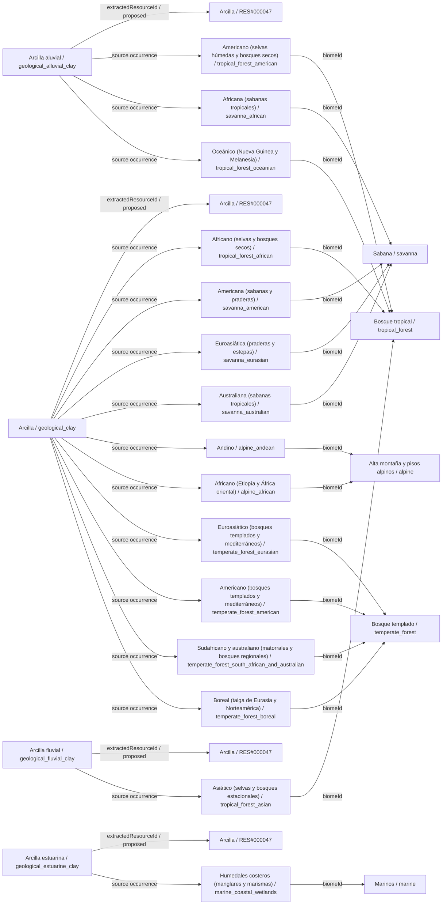

### Grupo 2

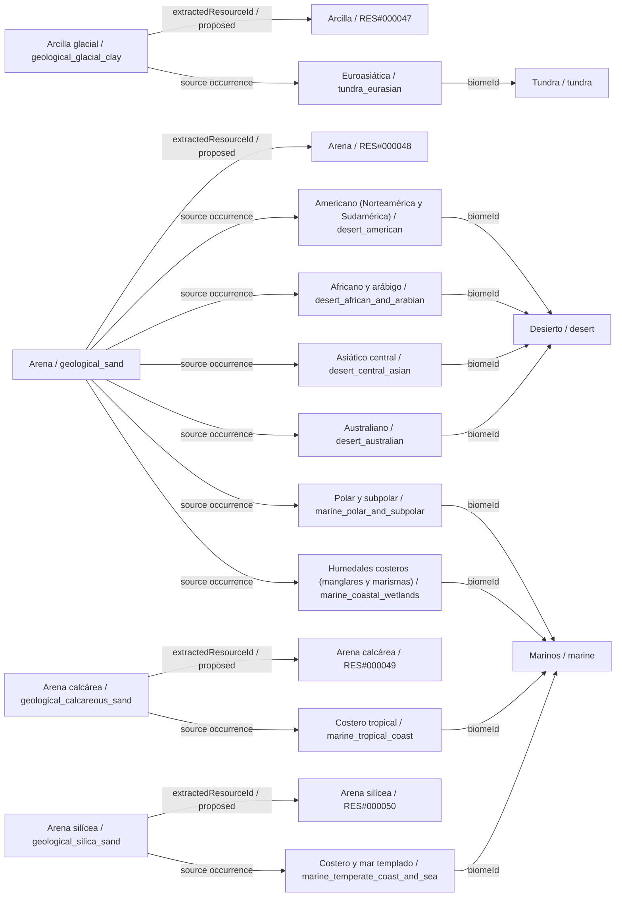

### Grupo 3

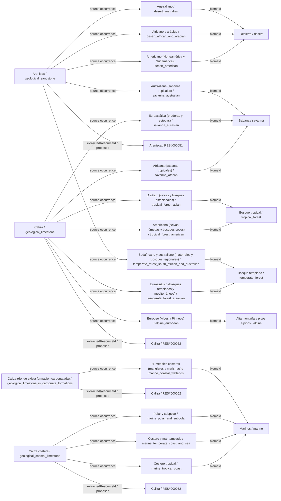

### Grupo 4

```mermaid
flowchart LR
    c0["Carbón mineral (hulla) / geological_bituminous_coal"]
    v4["Euroasiático (bosques templados y mediterráneos) / temperate_forest_eurasian"]
    b1["Bosque templado / temperate_forest"]
    v13["Euroasiática (praderas y estepas) / savanna_eurasian"]
    b3["Sabana / savanna"]
    r0["Carbón bituminoso / RES#000053"]
    c1["Cobre / geological_copper_bearing_deposit"]
    v0["Americano (selvas húmedas y bosques secos) / tropical_forest_american"]
    b0["Bosque tropical / tropical_forest"]
    v1["Africano (selvas y bosques secos) / tropical_forest_african"]
    v2["Asiático (selvas y bosques estacionales) / tropical_forest_asian"]
    v3["Oceánico (Nueva Guinea y Melanesia) / tropical_forest_oceanian"]
    v5["Americano (bosques templados y mediterráneos) / temperate_forest_american"]
    v6["Sudafricano y australiano (matorrales y bosques regionales) / temperate_forest_south_african_and_australian"]
    v7["Boreal (taiga de Eurasia y Norteamérica) / temperate_forest_boreal"]
    v8["Norteamérica y Groenlandia / tundra_north_american_and_greenland"]
    b2["Tundra / tundra"]
    v9["Euroasiática / tundra_eurasian"]
    v10["Subantártica / tundra_subantarctic"]
    v11["Africana (sabanas tropicales) / savanna_african"]
    v12["Americana (sabanas y praderas) / savanna_american"]
    v14["Australiana (sabanas tropicales) / savanna_australian"]
    v15["Americano (Norteamérica y Sudamérica) / desert_american"]
    b4["Desierto / desert"]
    v16["Africano y arábigo / desert_african_and_arabian"]
    v17["Asiático central / desert_central_asian"]
    v18["Australiano / desert_australian"]
    v23["Andino / alpine_andean"]
    b6["Alta montaña y pisos alpinos / alpine"]
    v24["Asiático (Himalaya y Tíbet) / alpine_asian"]
    v25["Europeo (Alpes y Pirineos) / alpine_european"]
    v26["Africano (Etiopía y África oriental) / alpine_african"]
    r1["Material con cobre / RES#000054"]
    c2["Cobre (calcopirita) / geological_chalcopyrite_copper_ore"]
    r2["Mena de cobre / RES#000055"]
    c3["Cobre (sulfuros) / geological_sulfide_copper_ore"]
    r3["Mena de cobre / RES#000055"]
    c0 -->|extractedResourceId / proposed| r0
    c0 -->|source occurrence| v13
    c0 -->|source occurrence| v4
    c1 -->|extractedResourceId / proposed| r1
    c1 -->|source occurrence| v0
    c1 -->|source occurrence| v1
    c1 -->|source occurrence| v10
    c1 -->|source occurrence| v11
    c1 -->|source occurrence| v12
    c1 -->|source occurrence| v13
    c1 -->|source occurrence| v14
    c1 -->|source occurrence| v15
    c1 -->|source occurrence| v16
    c1 -->|source occurrence| v17
    c1 -->|source occurrence| v18
    c1 -->|source occurrence| v2
    c1 -->|source occurrence| v23
    c1 -->|source occurrence| v24
    c1 -->|source occurrence| v25
    c1 -->|source occurrence| v26
    c1 -->|source occurrence| v3
    c1 -->|source occurrence| v4
    c1 -->|source occurrence| v5
    c1 -->|source occurrence| v6
    c1 -->|source occurrence| v7
    c1 -->|source occurrence| v8
    c1 -->|source occurrence| v9
    c2 -->|extractedResourceId / proposed| r2
    c2 -->|source occurrence| v10
    c2 -->|source occurrence| v12
    c2 -->|source occurrence| v15
    c2 -->|source occurrence| v17
    c2 -->|source occurrence| v2
    c2 -->|source occurrence| v23
    c2 -->|source occurrence| v24
    c2 -->|source occurrence| v3
    c2 -->|source occurrence| v5
    c2 -->|source occurrence| v6
    c2 -->|source occurrence| v9
    c3 -->|extractedResourceId / proposed| r3
    c3 -->|source occurrence| v0
    v0 -->|biomeId| b0
    v1 -->|biomeId| b0
    v10 -->|biomeId| b2
    v11 -->|biomeId| b3
    v12 -->|biomeId| b3
    v13 -->|biomeId| b3
    v14 -->|biomeId| b3
    v15 -->|biomeId| b4
    v16 -->|biomeId| b4
    v17 -->|biomeId| b4
    v18 -->|biomeId| b4
    v2 -->|biomeId| b0
    v23 -->|biomeId| b6
    v24 -->|biomeId| b6
    v25 -->|biomeId| b6
    v26 -->|biomeId| b6
    v3 -->|biomeId| b0
    v4 -->|biomeId| b1
    v5 -->|biomeId| b1
    v6 -->|biomeId| b1
    v7 -->|biomeId| b1
    v8 -->|biomeId| b2
    v9 -->|biomeId| b2
```

### Grupo 5

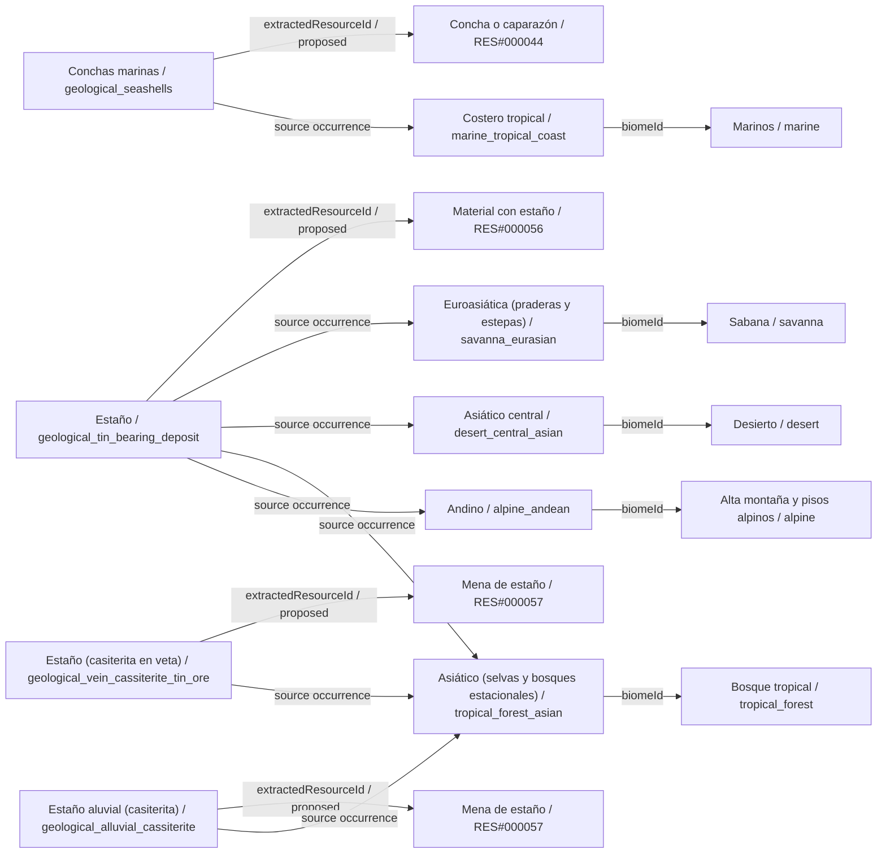

### Grupo 6

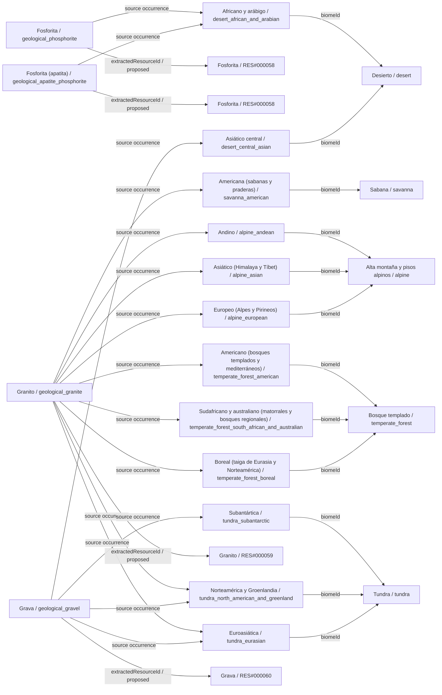

### Grupo 7

```mermaid
flowchart LR
    c0["Grava costera / geological_coastal_gravel"]
    v20["Costero y mar templado / marine_temperate_coast_and_sea"]
    b5["Marinos / marine"]
    v21["Polar y subpolar / marine_polar_and_subpolar"]
    r0["Grava / RES#000060"]
    c1["Hierro / geological_iron_bearing_deposit"]
    v0["Americano (selvas húmedas y bosques secos) / tropical_forest_american"]
    b0["Bosque tropical / tropical_forest"]
    v1["Africano (selvas y bosques secos) / tropical_forest_african"]
    v2["Asiático (selvas y bosques estacionales) / tropical_forest_asian"]
    v4["Euroasiático (bosques templados y mediterráneos) / temperate_forest_eurasian"]
    b1["Bosque templado / temperate_forest"]
    v5["Americano (bosques templados y mediterráneos) / temperate_forest_american"]
    v6["Sudafricano y australiano (matorrales y bosques regionales) / temperate_forest_south_african_and_australian"]
    v7["Boreal (taiga de Eurasia y Norteamérica) / temperate_forest_boreal"]
    v8["Norteamérica y Groenlandia / tundra_north_american_and_greenland"]
    b2["Tundra / tundra"]
    v9["Euroasiática / tundra_eurasian"]
    v10["Subantártica / tundra_subantarctic"]
    v11["Africana (sabanas tropicales) / savanna_african"]
    b3["Sabana / savanna"]
    v12["Americana (sabanas y praderas) / savanna_american"]
    v13["Euroasiática (praderas y estepas) / savanna_eurasian"]
    v14["Australiana (sabanas tropicales) / savanna_australian"]
    v15["Americano (Norteamérica y Sudamérica) / desert_american"]
    b4["Desierto / desert"]
    v16["Africano y arábigo / desert_african_and_arabian"]
    v17["Asiático central / desert_central_asian"]
    v18["Australiano / desert_australian"]
    v24["Asiático (Himalaya y Tíbet) / alpine_asian"]
    b6["Alta montaña y pisos alpinos / alpine"]
    v25["Europeo (Alpes y Pirineos) / alpine_european"]
    v26["Africano (Etiopía y África oriental) / alpine_african"]
    r1["Material con hierro / RES#000061"]
    c2["Hierro (hematita) / geological_hematite_iron_ore"]
    r2["Mena de hierro / RES#000062"]
    c3["Hierro (magnetita) / geological_magnetite_iron_ore"]
    r3["Mena de hierro / RES#000062"]
    c0 -->|extractedResourceId / proposed| r0
    c0 -->|source occurrence| v20
    c0 -->|source occurrence| v21
    c1 -->|extractedResourceId / proposed| r1
    c1 -->|source occurrence| v0
    c1 -->|source occurrence| v1
    c1 -->|source occurrence| v10
    c1 -->|source occurrence| v11
    c1 -->|source occurrence| v12
    c1 -->|source occurrence| v13
    c1 -->|source occurrence| v14
    c1 -->|source occurrence| v15
    c1 -->|source occurrence| v16
    c1 -->|source occurrence| v17
    c1 -->|source occurrence| v18
    c1 -->|source occurrence| v2
    c1 -->|source occurrence| v24
    c1 -->|source occurrence| v25
    c1 -->|source occurrence| v26
    c1 -->|source occurrence| v4
    c1 -->|source occurrence| v5
    c1 -->|source occurrence| v6
    c1 -->|source occurrence| v7
    c1 -->|source occurrence| v8
    c1 -->|source occurrence| v9
    c2 -->|extractedResourceId / proposed| r2
    c2 -->|source occurrence| v0
    c2 -->|source occurrence| v1
    c2 -->|source occurrence| v11
    c2 -->|source occurrence| v12
    c2 -->|source occurrence| v14
    c2 -->|source occurrence| v15
    c2 -->|source occurrence| v16
    c2 -->|source occurrence| v18
    c3 -->|extractedResourceId / proposed| r3
    c3 -->|source occurrence| v10
    c3 -->|source occurrence| v13
    c3 -->|source occurrence| v17
    c3 -->|source occurrence| v24
    c3 -->|source occurrence| v25
    c3 -->|source occurrence| v26
    c3 -->|source occurrence| v4
    c3 -->|source occurrence| v5
    c3 -->|source occurrence| v7
    c3 -->|source occurrence| v8
    c3 -->|source occurrence| v9
    v0 -->|biomeId| b0
    v1 -->|biomeId| b0
    v10 -->|biomeId| b2
    v11 -->|biomeId| b3
    v12 -->|biomeId| b3
    v13 -->|biomeId| b3
    v14 -->|biomeId| b3
    v15 -->|biomeId| b4
    v16 -->|biomeId| b4
    v17 -->|biomeId| b4
    v18 -->|biomeId| b4
    v2 -->|biomeId| b0
    v20 -->|biomeId| b5
    v21 -->|biomeId| b5
    v24 -->|biomeId| b6
    v25 -->|biomeId| b6
    v26 -->|biomeId| b6
    v4 -->|biomeId| b1
    v5 -->|biomeId| b1
    v6 -->|biomeId| b1
    v7 -->|biomeId| b1
    v8 -->|biomeId| b2
    v9 -->|biomeId| b2
```

### Grupo 8

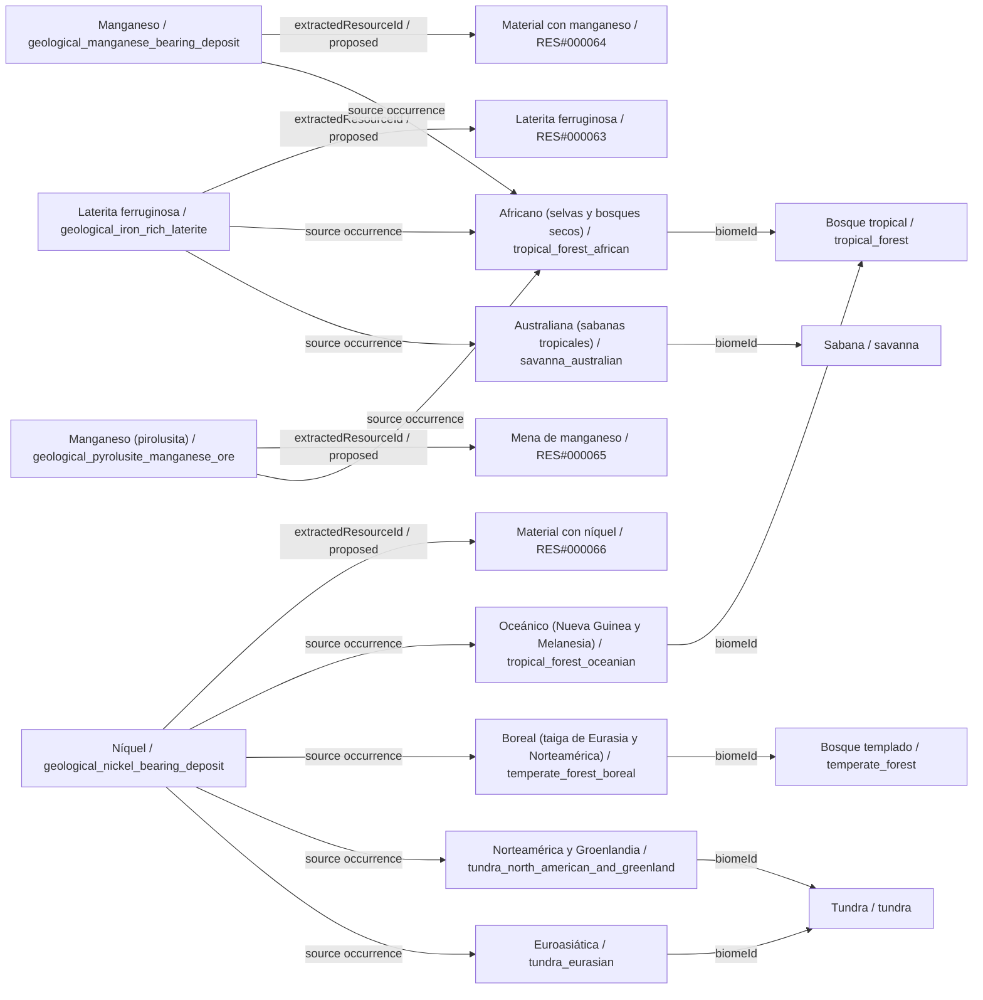

### Grupo 9

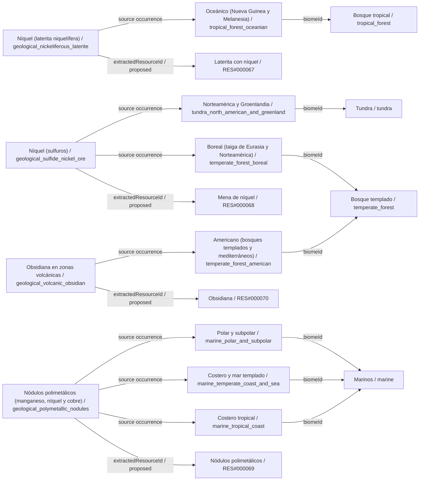

### Grupo 10

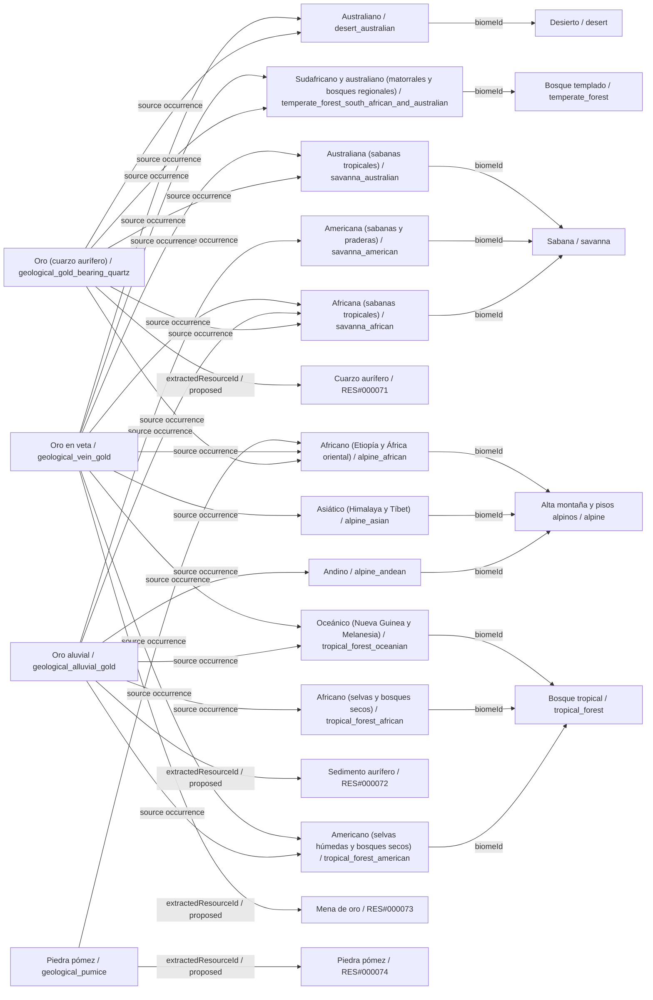

### Grupo 11

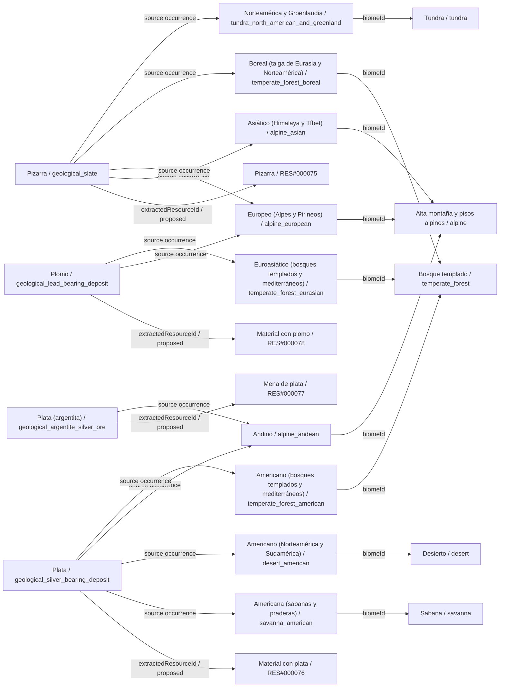

### Grupo 12

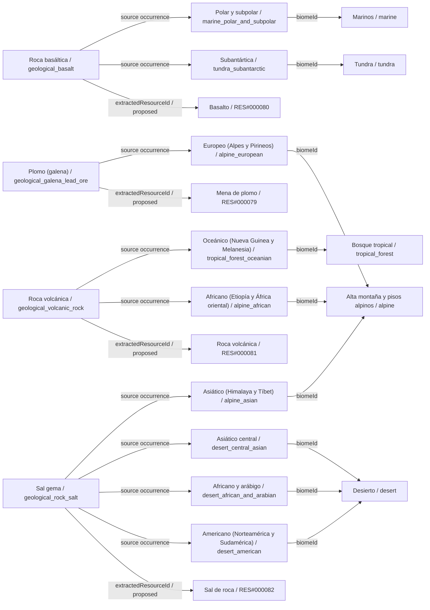

### Grupo 13

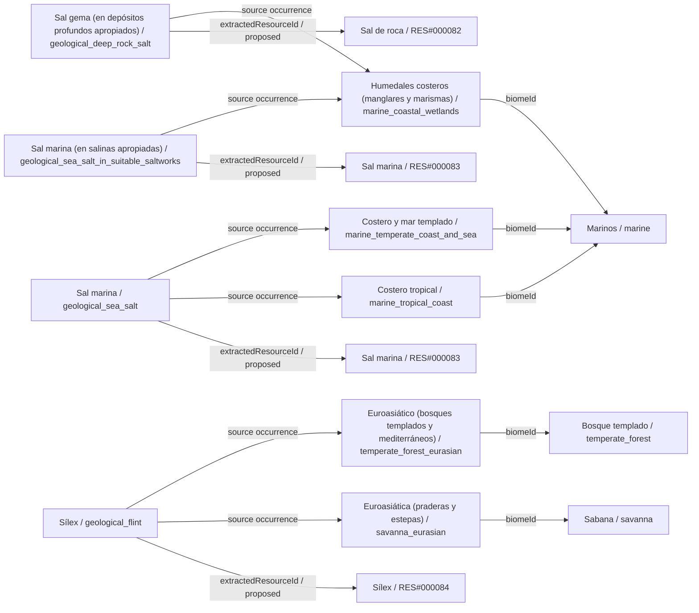

### Grupo 14

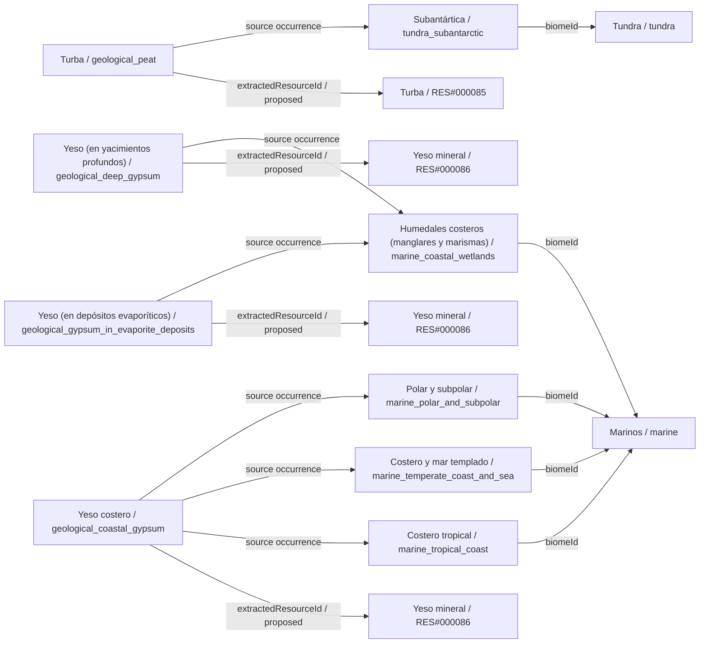

### Grupo 15

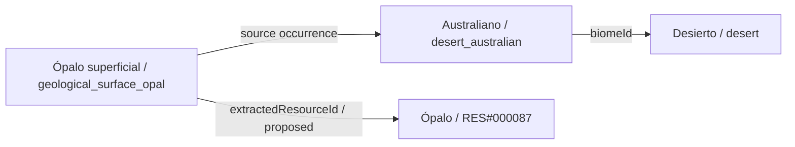

## Todas las apariciones de la fuente

Esta tabla conserva cada vínculo regional y método de extracción aunque el diagrama agrupe flechas repetidas. La presencia inicial sigue deshabilitada.

| id | definitionId | biomeId | variantId | extractionMethodId | sourceText |
| --- | --- | --- | --- | --- | --- |
| occurrence_0001 | geological_alluvial_clay | tropical_forest | tropical_forest_american | surface_collection | Arcilla aluvial |
| occurrence_0002 | geological_limestone | tropical_forest | tropical_forest_american | surface_collection | Caliza |
| occurrence_0003 | geological_alluvial_gold | tropical_forest | tropical_forest_american | surface_collection | Oro aluvial |
| occurrence_0004 | geological_copper_bearing_deposit | tropical_forest | tropical_forest_american | traditional_mining | Cobre |
| occurrence_0005 | geological_iron_bearing_deposit | tropical_forest | tropical_forest_american | traditional_mining | Hierro |
| occurrence_0006 | geological_vein_gold | tropical_forest | tropical_forest_american | traditional_mining | Oro en veta |
| occurrence_0007 | geological_sulfide_copper_ore | tropical_forest | tropical_forest_american | mechanized_mining | Cobre (sulfuros) |
| occurrence_0008 | geological_hematite_iron_ore | tropical_forest | tropical_forest_american | mechanized_mining | Hierro (hematita) |
| occurrence_0023 | geological_clay | tropical_forest | tropical_forest_african | surface_collection | Arcilla |
| occurrence_0024 | geological_iron_rich_laterite | tropical_forest | tropical_forest_african | surface_collection | Laterita ferruginosa |
| occurrence_0025 | geological_alluvial_gold | tropical_forest | tropical_forest_african | surface_collection | Oro aluvial |
| occurrence_0026 | geological_iron_bearing_deposit | tropical_forest | tropical_forest_african | traditional_mining | Hierro |
| occurrence_0027 | geological_copper_bearing_deposit | tropical_forest | tropical_forest_african | traditional_mining | Cobre |
| occurrence_0028 | geological_manganese_bearing_deposit | tropical_forest | tropical_forest_african | traditional_mining | Manganeso |
| occurrence_0029 | geological_hematite_iron_ore | tropical_forest | tropical_forest_african | mechanized_mining | Hierro (hematita) |
| occurrence_0030 | geological_pyrolusite_manganese_ore | tropical_forest | tropical_forest_african | mechanized_mining | Manganeso (pirolusita) |
| occurrence_0045 | geological_fluvial_clay | tropical_forest | tropical_forest_asian | surface_collection | Arcilla fluvial |
| occurrence_0046 | geological_limestone | tropical_forest | tropical_forest_asian | surface_collection | Caliza |
| occurrence_0047 | geological_alluvial_cassiterite | tropical_forest | tropical_forest_asian | surface_collection | Estaño aluvial (casiterita) |
| occurrence_0048 | geological_tin_bearing_deposit | tropical_forest | tropical_forest_asian | traditional_mining | Estaño |
| occurrence_0049 | geological_copper_bearing_deposit | tropical_forest | tropical_forest_asian | traditional_mining | Cobre |
| occurrence_0050 | geological_iron_bearing_deposit | tropical_forest | tropical_forest_asian | traditional_mining | Hierro |
| occurrence_0051 | geological_vein_cassiterite_tin_ore | tropical_forest | tropical_forest_asian | mechanized_mining | Estaño (casiterita en veta) |
| occurrence_0052 | geological_chalcopyrite_copper_ore | tropical_forest | tropical_forest_asian | mechanized_mining | Cobre (calcopirita) |
| occurrence_0067 | geological_alluvial_clay | tropical_forest | tropical_forest_oceanian | surface_collection | Arcilla aluvial |
| occurrence_0068 | geological_volcanic_rock | tropical_forest | tropical_forest_oceanian | surface_collection | Roca volcánica |
| occurrence_0069 | geological_alluvial_gold | tropical_forest | tropical_forest_oceanian | surface_collection | Oro aluvial |
| occurrence_0070 | geological_copper_bearing_deposit | tropical_forest | tropical_forest_oceanian | traditional_mining | Cobre |
| occurrence_0071 | geological_vein_gold | tropical_forest | tropical_forest_oceanian | traditional_mining | Oro en veta |
| occurrence_0072 | geological_nickel_bearing_deposit | tropical_forest | tropical_forest_oceanian | traditional_mining | Níquel |
| occurrence_0073 | geological_nickeliferous_laterite | tropical_forest | tropical_forest_oceanian | mechanized_mining | Níquel (laterita niquelífera) |
| occurrence_0074 | geological_chalcopyrite_copper_ore | tropical_forest | tropical_forest_oceanian | mechanized_mining | Cobre (calcopirita) |
| occurrence_0083 | geological_clay | temperate_forest | temperate_forest_eurasian | surface_collection | Arcilla |
| occurrence_0084 | geological_limestone | temperate_forest | temperate_forest_eurasian | surface_collection | Caliza |
| occurrence_0085 | geological_flint | temperate_forest | temperate_forest_eurasian | surface_collection | Sílex |
| occurrence_0086 | geological_iron_bearing_deposit | temperate_forest | temperate_forest_eurasian | traditional_mining | Hierro |
| occurrence_0087 | geological_copper_bearing_deposit | temperate_forest | temperate_forest_eurasian | traditional_mining | Cobre |
| occurrence_0088 | geological_lead_bearing_deposit | temperate_forest | temperate_forest_eurasian | traditional_mining | Plomo |
| occurrence_0089 | geological_magnetite_iron_ore | temperate_forest | temperate_forest_eurasian | mechanized_mining | Hierro (magnetita) |
| occurrence_0090 | geological_bituminous_coal | temperate_forest | temperate_forest_eurasian | mechanized_mining | Carbón mineral (hulla) |
| occurrence_0105 | geological_clay | temperate_forest | temperate_forest_american | surface_collection | Arcilla |
| occurrence_0106 | geological_granite | temperate_forest | temperate_forest_american | surface_collection | Granito |
| occurrence_0107 | geological_volcanic_obsidian | temperate_forest | temperate_forest_american | surface_collection | Obsidiana en zonas volcánicas |
| occurrence_0108 | geological_copper_bearing_deposit | temperate_forest | temperate_forest_american | traditional_mining | Cobre |
| occurrence_0109 | geological_iron_bearing_deposit | temperate_forest | temperate_forest_american | traditional_mining | Hierro |
| occurrence_0110 | geological_silver_bearing_deposit | temperate_forest | temperate_forest_american | traditional_mining | Plata |
| occurrence_0111 | geological_chalcopyrite_copper_ore | temperate_forest | temperate_forest_american | mechanized_mining | Cobre (calcopirita) |
| occurrence_0112 | geological_magnetite_iron_ore | temperate_forest | temperate_forest_american | mechanized_mining | Hierro (magnetita) |
| occurrence_0127 | geological_sandstone | temperate_forest | temperate_forest_south_african_and_australian | surface_collection | Arenisca |
| occurrence_0128 | geological_clay | temperate_forest | temperate_forest_south_african_and_australian | surface_collection | Arcilla |
| occurrence_0129 | geological_granite | temperate_forest | temperate_forest_south_african_and_australian | surface_collection | Granito |
| occurrence_0130 | geological_vein_gold | temperate_forest | temperate_forest_south_african_and_australian | traditional_mining | Oro en veta |
| occurrence_0131 | geological_copper_bearing_deposit | temperate_forest | temperate_forest_south_african_and_australian | traditional_mining | Cobre |
| occurrence_0132 | geological_iron_bearing_deposit | temperate_forest | temperate_forest_south_african_and_australian | traditional_mining | Hierro |
| occurrence_0133 | geological_gold_bearing_quartz | temperate_forest | temperate_forest_south_african_and_australian | mechanized_mining | Oro (cuarzo aurífero) |
| occurrence_0134 | geological_chalcopyrite_copper_ore | temperate_forest | temperate_forest_south_african_and_australian | mechanized_mining | Cobre (calcopirita) |
| occurrence_0149 | geological_granite | temperate_forest | temperate_forest_boreal | surface_collection | Granito |
| occurrence_0150 | geological_slate | temperate_forest | temperate_forest_boreal | surface_collection | Pizarra |
| occurrence_0151 | geological_clay | temperate_forest | temperate_forest_boreal | surface_collection | Arcilla |
| occurrence_0152 | geological_iron_bearing_deposit | temperate_forest | temperate_forest_boreal | traditional_mining | Hierro |
| occurrence_0153 | geological_copper_bearing_deposit | temperate_forest | temperate_forest_boreal | traditional_mining | Cobre |
| occurrence_0154 | geological_nickel_bearing_deposit | temperate_forest | temperate_forest_boreal | traditional_mining | Níquel |
| occurrence_0155 | geological_magnetite_iron_ore | temperate_forest | temperate_forest_boreal | mechanized_mining | Hierro (magnetita) |
| occurrence_0156 | geological_sulfide_nickel_ore | temperate_forest | temperate_forest_boreal | mechanized_mining | Níquel (sulfuros) |
| occurrence_0171 | geological_gravel | tundra | tundra_north_american_and_greenland | surface_collection | Grava |
| occurrence_0172 | geological_slate | tundra | tundra_north_american_and_greenland | surface_collection | Pizarra |
| occurrence_0173 | geological_granite | tundra | tundra_north_american_and_greenland | surface_collection | Granito |
| occurrence_0174 | geological_iron_bearing_deposit | tundra | tundra_north_american_and_greenland | traditional_mining | Hierro |
| occurrence_0175 | geological_copper_bearing_deposit | tundra | tundra_north_american_and_greenland | traditional_mining | Cobre |
| occurrence_0176 | geological_nickel_bearing_deposit | tundra | tundra_north_american_and_greenland | traditional_mining | Níquel |
| occurrence_0177 | geological_magnetite_iron_ore | tundra | tundra_north_american_and_greenland | mechanized_mining | Hierro (magnetita) |
| occurrence_0178 | geological_sulfide_nickel_ore | tundra | tundra_north_american_and_greenland | mechanized_mining | Níquel (sulfuros) |
| occurrence_0189 | geological_gravel | tundra | tundra_eurasian | surface_collection | Grava |
| occurrence_0190 | geological_granite | tundra | tundra_eurasian | surface_collection | Granito |
| occurrence_0191 | geological_glacial_clay | tundra | tundra_eurasian | surface_collection | Arcilla glacial |
| occurrence_0192 | geological_iron_bearing_deposit | tundra | tundra_eurasian | traditional_mining | Hierro |
| occurrence_0193 | geological_copper_bearing_deposit | tundra | tundra_eurasian | traditional_mining | Cobre |
| occurrence_0194 | geological_nickel_bearing_deposit | tundra | tundra_eurasian | traditional_mining | Níquel |
| occurrence_0195 | geological_magnetite_iron_ore | tundra | tundra_eurasian | mechanized_mining | Hierro (magnetita) |
| occurrence_0196 | geological_chalcopyrite_copper_ore | tundra | tundra_eurasian | mechanized_mining | Cobre (calcopirita) |
| occurrence_0207 | geological_basalt | tundra | tundra_subantarctic | surface_collection | Roca basáltica |
| occurrence_0208 | geological_gravel | tundra | tundra_subantarctic | surface_collection | Grava |
| occurrence_0209 | geological_peat | tundra | tundra_subantarctic | surface_collection | Turba |
| occurrence_0210 | geological_iron_bearing_deposit | tundra | tundra_subantarctic | traditional_mining | Hierro |
| occurrence_0211 | geological_copper_bearing_deposit | tundra | tundra_subantarctic | traditional_mining | Cobre |
| occurrence_0212 | geological_magnetite_iron_ore | tundra | tundra_subantarctic | mechanized_mining | Hierro (magnetita) |
| occurrence_0213 | geological_chalcopyrite_copper_ore | tundra | tundra_subantarctic | mechanized_mining | Cobre (calcopirita) |
| occurrence_0221 | geological_alluvial_clay | savanna | savanna_african | surface_collection | Arcilla aluvial |
| occurrence_0222 | geological_limestone | savanna | savanna_african | surface_collection | Caliza |
| occurrence_0223 | geological_alluvial_gold | savanna | savanna_african | surface_collection | Oro aluvial |
| occurrence_0224 | geological_iron_bearing_deposit | savanna | savanna_african | traditional_mining | Hierro |
| occurrence_0225 | geological_copper_bearing_deposit | savanna | savanna_african | traditional_mining | Cobre |
| occurrence_0226 | geological_vein_gold | savanna | savanna_african | traditional_mining | Oro en veta |
| occurrence_0227 | geological_hematite_iron_ore | savanna | savanna_african | mechanized_mining | Hierro (hematita) |
| occurrence_0228 | geological_gold_bearing_quartz | savanna | savanna_african | mechanized_mining | Oro (cuarzo aurífero) |
| occurrence_0240 | geological_clay | savanna | savanna_american | surface_collection | Arcilla |
| occurrence_0241 | geological_granite | savanna | savanna_american | surface_collection | Granito |
| occurrence_0242 | geological_alluvial_gold | savanna | savanna_american | surface_collection | Oro aluvial |
| occurrence_0243 | geological_copper_bearing_deposit | savanna | savanna_american | traditional_mining | Cobre |
| occurrence_0244 | geological_iron_bearing_deposit | savanna | savanna_american | traditional_mining | Hierro |
| occurrence_0245 | geological_silver_bearing_deposit | savanna | savanna_american | traditional_mining | Plata |
| occurrence_0246 | geological_chalcopyrite_copper_ore | savanna | savanna_american | mechanized_mining | Cobre (calcopirita) |
| occurrence_0247 | geological_hematite_iron_ore | savanna | savanna_american | mechanized_mining | Hierro (hematita) |
| occurrence_0262 | geological_clay | savanna | savanna_eurasian | surface_collection | Arcilla |
| occurrence_0263 | geological_limestone | savanna | savanna_eurasian | surface_collection | Caliza |
| occurrence_0264 | geological_flint | savanna | savanna_eurasian | surface_collection | Sílex |
| occurrence_0265 | geological_iron_bearing_deposit | savanna | savanna_eurasian | traditional_mining | Hierro |
| occurrence_0266 | geological_copper_bearing_deposit | savanna | savanna_eurasian | traditional_mining | Cobre |
| occurrence_0267 | geological_tin_bearing_deposit | savanna | savanna_eurasian | traditional_mining | Estaño |
| occurrence_0268 | geological_magnetite_iron_ore | savanna | savanna_eurasian | mechanized_mining | Hierro (magnetita) |
| occurrence_0269 | geological_bituminous_coal | savanna | savanna_eurasian | mechanized_mining | Carbón mineral (hulla) |
| occurrence_0278 | geological_clay | savanna | savanna_australian | surface_collection | Arcilla |
| occurrence_0279 | geological_sandstone | savanna | savanna_australian | surface_collection | Arenisca |
| occurrence_0280 | geological_iron_rich_laterite | savanna | savanna_australian | surface_collection | Laterita ferruginosa |
| occurrence_0281 | geological_iron_bearing_deposit | savanna | savanna_australian | traditional_mining | Hierro |
| occurrence_0282 | geological_copper_bearing_deposit | savanna | savanna_australian | traditional_mining | Cobre |
| occurrence_0283 | geological_vein_gold | savanna | savanna_australian | traditional_mining | Oro en veta |
| occurrence_0284 | geological_hematite_iron_ore | savanna | savanna_australian | mechanized_mining | Hierro (hematita) |
| occurrence_0285 | geological_gold_bearing_quartz | savanna | savanna_australian | mechanized_mining | Oro (cuarzo aurífero) |
| occurrence_0294 | geological_sand | desert | desert_american | surface_collection | Arena |
| occurrence_0295 | geological_sandstone | desert | desert_american | surface_collection | Arenisca |
| occurrence_0296 | geological_rock_salt | desert | desert_american | surface_collection | Sal gema |
| occurrence_0297 | geological_copper_bearing_deposit | desert | desert_american | traditional_mining | Cobre |
| occurrence_0298 | geological_silver_bearing_deposit | desert | desert_american | traditional_mining | Plata |
| occurrence_0299 | geological_iron_bearing_deposit | desert | desert_american | traditional_mining | Hierro |
| occurrence_0300 | geological_chalcopyrite_copper_ore | desert | desert_american | mechanized_mining | Cobre (calcopirita) |
| occurrence_0301 | geological_hematite_iron_ore | desert | desert_american | mechanized_mining | Hierro (hematita) |
| occurrence_0316 | geological_sand | desert | desert_african_and_arabian | surface_collection | Arena |
| occurrence_0317 | geological_sandstone | desert | desert_african_and_arabian | surface_collection | Arenisca |
| occurrence_0318 | geological_rock_salt | desert | desert_african_and_arabian | surface_collection | Sal gema |
| occurrence_0319 | geological_iron_bearing_deposit | desert | desert_african_and_arabian | traditional_mining | Hierro |
| occurrence_0320 | geological_copper_bearing_deposit | desert | desert_african_and_arabian | traditional_mining | Cobre |
| occurrence_0321 | geological_phosphorite | desert | desert_african_and_arabian | traditional_mining | Fosforita |
| occurrence_0322 | geological_hematite_iron_ore | desert | desert_african_and_arabian | mechanized_mining | Hierro (hematita) |
| occurrence_0323 | geological_apatite_phosphorite | desert | desert_african_and_arabian | mechanized_mining | Fosforita (apatita) |
| occurrence_0332 | geological_sand | desert | desert_central_asian | surface_collection | Arena |
| occurrence_0333 | geological_gravel | desert | desert_central_asian | surface_collection | Grava |
| occurrence_0334 | geological_rock_salt | desert | desert_central_asian | surface_collection | Sal gema |
| occurrence_0335 | geological_copper_bearing_deposit | desert | desert_central_asian | traditional_mining | Cobre |
| occurrence_0336 | geological_iron_bearing_deposit | desert | desert_central_asian | traditional_mining | Hierro |
| occurrence_0337 | geological_tin_bearing_deposit | desert | desert_central_asian | traditional_mining | Estaño |
| occurrence_0338 | geological_chalcopyrite_copper_ore | desert | desert_central_asian | mechanized_mining | Cobre (calcopirita) |
| occurrence_0339 | geological_magnetite_iron_ore | desert | desert_central_asian | mechanized_mining | Hierro (magnetita) |
| occurrence_0348 | geological_sand | desert | desert_australian | surface_collection | Arena |
| occurrence_0349 | geological_sandstone | desert | desert_australian | surface_collection | Arenisca |
| occurrence_0350 | geological_surface_opal | desert | desert_australian | surface_collection | Ópalo superficial |
| occurrence_0351 | geological_iron_bearing_deposit | desert | desert_australian | traditional_mining | Hierro |
| occurrence_0352 | geological_copper_bearing_deposit | desert | desert_australian | traditional_mining | Cobre |
| occurrence_0353 | geological_vein_gold | desert | desert_australian | traditional_mining | Oro en veta |
| occurrence_0354 | geological_hematite_iron_ore | desert | desert_australian | mechanized_mining | Hierro (hematita) |
| occurrence_0355 | geological_gold_bearing_quartz | desert | desert_australian | mechanized_mining | Oro (cuarzo aurífero) |
| occurrence_0364 | geological_sea_salt | marine | marine_tropical_coast | surface_collection | Sal marina |
| occurrence_0365 | geological_calcareous_sand | marine | marine_tropical_coast | surface_collection | Arena calcárea |
| occurrence_0366 | geological_seashells | marine | marine_tropical_coast | surface_collection | Conchas marinas |
| occurrence_0367 | geological_coastal_limestone | marine | marine_tropical_coast | traditional_mining | Caliza costera |
| occurrence_0368 | geological_coastal_gypsum | marine | marine_tropical_coast | traditional_mining | Yeso costero |
| occurrence_0369 | geological_polymetallic_nodules | marine | marine_tropical_coast | mechanized_mining | Nódulos polimetálicos (manganeso, níquel y cobre) |
| occurrence_0377 | geological_sea_salt | marine | marine_temperate_coast_and_sea | surface_collection | Sal marina |
| occurrence_0378 | geological_silica_sand | marine | marine_temperate_coast_and_sea | surface_collection | Arena silícea |
| occurrence_0379 | geological_coastal_gravel | marine | marine_temperate_coast_and_sea | surface_collection | Grava costera |
| occurrence_0380 | geological_coastal_limestone | marine | marine_temperate_coast_and_sea | traditional_mining | Caliza costera |
| occurrence_0381 | geological_coastal_gypsum | marine | marine_temperate_coast_and_sea | traditional_mining | Yeso costero |
| occurrence_0382 | geological_polymetallic_nodules | marine | marine_temperate_coast_and_sea | mechanized_mining | Nódulos polimetálicos (manganeso, níquel y cobre) |
| occurrence_0390 | geological_coastal_gravel | marine | marine_polar_and_subpolar | surface_collection | Grava costera |
| occurrence_0391 | geological_basalt | marine | marine_polar_and_subpolar | surface_collection | Roca basáltica |
| occurrence_0392 | geological_sand | marine | marine_polar_and_subpolar | surface_collection | Arena |
| occurrence_0393 | geological_coastal_limestone | marine | marine_polar_and_subpolar | traditional_mining | Caliza costera |
| occurrence_0394 | geological_coastal_gypsum | marine | marine_polar_and_subpolar | traditional_mining | Yeso costero |
| occurrence_0395 | geological_polymetallic_nodules | marine | marine_polar_and_subpolar | mechanized_mining | Nódulos polimetálicos (manganeso, níquel y cobre) |
| occurrence_0404 | geological_estuarine_clay | marine | marine_coastal_wetlands | surface_collection | Arcilla estuarina |
| occurrence_0405 | geological_sand | marine | marine_coastal_wetlands | surface_collection | Arena |
| occurrence_0406 | geological_sea_salt_in_suitable_saltworks | marine | marine_coastal_wetlands | surface_collection | Sal marina (en salinas apropiadas) |
| occurrence_0407 | geological_gypsum_in_evaporite_deposits | marine | marine_coastal_wetlands | traditional_mining | Yeso (en depósitos evaporíticos) |
| occurrence_0408 | geological_limestone_in_carbonate_formations | marine | marine_coastal_wetlands | traditional_mining | Caliza (donde exista formación carbonatada) |
| occurrence_0409 | geological_deep_rock_salt | marine | marine_coastal_wetlands | mechanized_mining | Sal gema (en depósitos profundos apropiados) |
| occurrence_0410 | geological_deep_gypsum | marine | marine_coastal_wetlands | mechanized_mining | Yeso (en yacimientos profundos) |
| occurrence_0418 | geological_granite | alpine | alpine_andean | surface_collection | Granito |
| occurrence_0419 | geological_clay | alpine | alpine_andean | surface_collection | Arcilla |
| occurrence_0420 | geological_alluvial_gold | alpine | alpine_andean | surface_collection | Oro aluvial |
| occurrence_0421 | geological_copper_bearing_deposit | alpine | alpine_andean | traditional_mining | Cobre |
| occurrence_0422 | geological_silver_bearing_deposit | alpine | alpine_andean | traditional_mining | Plata |
| occurrence_0423 | geological_tin_bearing_deposit | alpine | alpine_andean | traditional_mining | Estaño |
| occurrence_0424 | geological_chalcopyrite_copper_ore | alpine | alpine_andean | mechanized_mining | Cobre (calcopirita) |
| occurrence_0425 | geological_argentite_silver_ore | alpine | alpine_andean | mechanized_mining | Plata (argentita) |
| occurrence_0436 | geological_granite | alpine | alpine_asian | surface_collection | Granito |
| occurrence_0437 | geological_slate | alpine | alpine_asian | surface_collection | Pizarra |
| occurrence_0438 | geological_rock_salt | alpine | alpine_asian | surface_collection | Sal gema |
| occurrence_0439 | geological_copper_bearing_deposit | alpine | alpine_asian | traditional_mining | Cobre |
| occurrence_0440 | geological_iron_bearing_deposit | alpine | alpine_asian | traditional_mining | Hierro |
| occurrence_0441 | geological_vein_gold | alpine | alpine_asian | traditional_mining | Oro en veta |
| occurrence_0442 | geological_magnetite_iron_ore | alpine | alpine_asian | mechanized_mining | Hierro (magnetita) |
| occurrence_0443 | geological_chalcopyrite_copper_ore | alpine | alpine_asian | mechanized_mining | Cobre (calcopirita) |
| occurrence_0453 | geological_limestone | alpine | alpine_european | surface_collection | Caliza |
| occurrence_0454 | geological_granite | alpine | alpine_european | surface_collection | Granito |
| occurrence_0455 | geological_slate | alpine | alpine_european | surface_collection | Pizarra |
| occurrence_0456 | geological_iron_bearing_deposit | alpine | alpine_european | traditional_mining | Hierro |
| occurrence_0457 | geological_copper_bearing_deposit | alpine | alpine_european | traditional_mining | Cobre |
| occurrence_0458 | geological_lead_bearing_deposit | alpine | alpine_european | traditional_mining | Plomo |
| occurrence_0459 | geological_magnetite_iron_ore | alpine | alpine_european | mechanized_mining | Hierro (magnetita) |
| occurrence_0460 | geological_galena_lead_ore | alpine | alpine_european | mechanized_mining | Plomo (galena) |
| occurrence_0470 | geological_volcanic_rock | alpine | alpine_african | surface_collection | Roca volcánica |
| occurrence_0471 | geological_pumice | alpine | alpine_african | surface_collection | Piedra pómez |
| occurrence_0472 | geological_clay | alpine | alpine_african | surface_collection | Arcilla |
| occurrence_0473 | geological_iron_bearing_deposit | alpine | alpine_african | traditional_mining | Hierro |
| occurrence_0474 | geological_copper_bearing_deposit | alpine | alpine_african | traditional_mining | Cobre |
| occurrence_0475 | geological_vein_gold | alpine | alpine_african | traditional_mining | Oro en veta |
| occurrence_0476 | geological_magnetite_iron_ore | alpine | alpine_african | mechanized_mining | Hierro (magnetita) |
| occurrence_0477 | geological_gold_bearing_quartz | alpine | alpine_african | mechanized_mining | Oro (cuarzo aurífero) |
