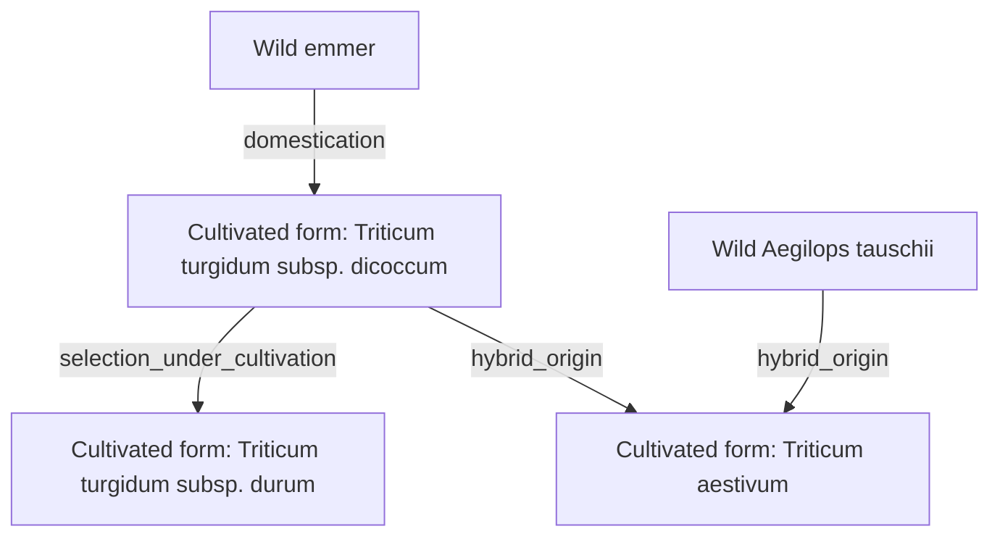
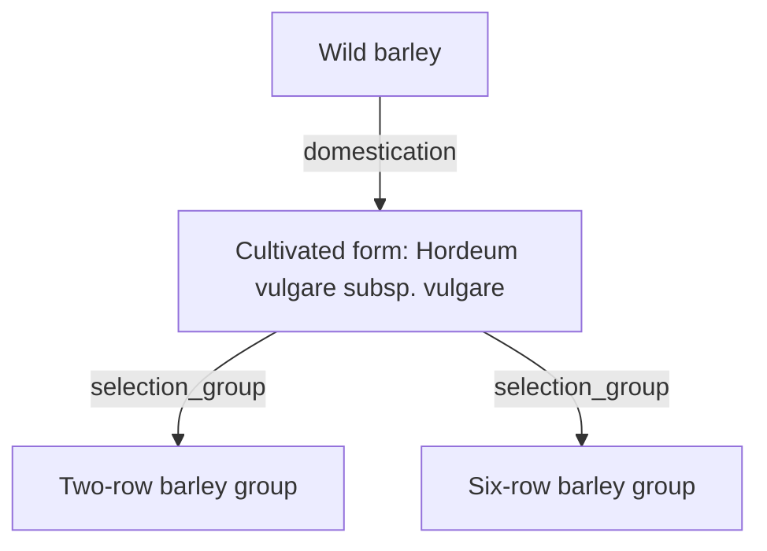
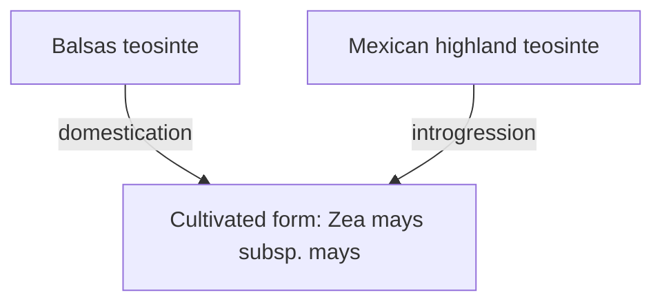
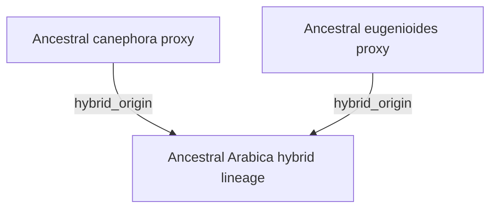

# Biological identities and relationships

[JSON](plants.biological.catalog.json) · [Model and boundaries](../../lang/en/biology.md)

Scientific names matched to the provider; representative choices, native ranges, habitats and outputs still need review. Legacy candidate IDs retain source provenance. No table authorizes initial spawning or gameplay transformations. Related reference forms are not a wild-spawn list.

## Coverage

| Metric | Count |
| --- | --- |
| `taxonCount` | 199 |
| `biologicalFormCount` | 49 |
| `lineageRelationCount` | 13 |
| `excludedLineageRelationCount` | 0 |
| `sourceCandidateCount` | 129 |
| `cropCandidateCount` | 21 |

## Original labels and concrete selection

| Candidate | Reference name | Selected taxa | Selection | Related forms |
| --- | --- | --- | --- | --- |
| `plant_dwarf_birch` | Dwarf Birch | `PLT#000025` Betula nana | `specific_name_interpretation` |  |
| `plant_birches` | Birches | `PLT#000026` Betula pendula; `PLT#000027` Betula pubescens | `representative_species_selection` |  |
| `plant_african_acacias` | African Acacias | `PLT#000181` Vachellia tortilis; `PLT#000180` Vachellia nilotica | `representative_species_selection` |  |
| `plant_australian_acacias` | Australian Acacias | `PLT#000002` Acacia aneura; `PLT#000001` Acacia acuminata | `representative_species_selection` |  |
| `plant_desert_acacias` | Desert Acacias | `PLT#000002` Acacia aneura | `representative_species_selection` |  |
| `plant_arid_land_acacias` | Arid-Land Acacias | `PLT#000181` Vachellia tortilis | `representative_species_selection` |  |
| `plant_wild_olive` | Wild Olive | `PLT#000104` Olea europaea europaea | `specific_name_interpretation` |  |
| `plant_agaves` | Agaves | `PLT#000010` Agave americana; `PLT#000011` Agave deserti | `representative_species_selection` |  |
| `plant_american_larch` | American Larch | `PLT#000087` Larix laricina | `specific_name_interpretation` |  |
| `plant_siberian_larches` | Siberian Larches | `PLT#000088` Larix sibirica; `PLT#000086` Larix gmelinii | `representative_species_selection` |  |
| `plant_polar_marine_algae` | Polar Marine Algae | `ALG#000005` Palmaria palmata | `representative_species_selection` |  |
| `plant_tropical_marine_algae` | Tropical Marine Algae | `ALG#000007` Ulva lactuca | `representative_species_selection` |  |
| `plant_regional_brown_and_red_algae` | Regional Brown and Red Algae | `ALG#000006` Saccharina latissima; `ALG#000005` Palmaria palmata | `representative_species_selection` |  |
| `plant_halophytic_shrubs` | Halophytic Shrubs | `PLT#000075` Halocnemum strobilaceum | `representative_species_selection` |  |
| `plant_australian_saltbushes` | Australian Saltbushes | `PLT#000018` Atriplex nummularia | `representative_species_selection` |  |
| `plant_xerophytic_shrubs` | Xerophytic Shrubs | `PLT#000166` Tetraena coccinea | `representative_species_selection` |  |
| `plant_shrubs_and_cushion_plants` | Shrubs and Cushion Plants | `PLT#000014` Androsace tapete | `representative_species_selection` |  |
| `plant_maples` | Maples | `PLT#000005` Acer saccharum; `PLT#000004` Acer rubrum | `representative_species_selection` |  |
| `plant_wormwoods` | Wormwoods | `PLT#000017` Artemisia terrae-albae | `specific_name_interpretation` |  |
| `plant_wormwoods_703907` | Wormwoods | `PLT#000016` Artemisia frigida | `representative_species_selection` |  |
| `plant_arctic_blueberries` | Arctic Blueberries | `PLT#000178` Vaccinium uliginosum | `specific_name_interpretation` |  |
| `plant_hazel` | Hazel | `PLT#000048` Corylus avellana | `specific_name_interpretation` |  |
| `plant_dry_forest_bamboos` | Dry-Forest Bamboos | `PLT#000054` Dendrocalamus strictus | `representative_species_selection` |  |
| `plant_asian_tropical_bamboos` | Asian Tropical Bamboos | `PLT#000022` Bambusa bambos | `representative_species_selection` |  |
| `plant_wild_bananas` | Wild Bananas | `PLT#000098` Musa acuminata | `representative_species_selection` |  |
| `plant_new_guinea_wild_bananas` | New Guinea Wild Bananas | `PLT#000099` Musa maclayi | `specific_name_interpretation` |  |
| `plant_banksias` | Banksias | `PLT#000023` Banksia attenuata | `specific_name_interpretation` |  |
| `plant_african_baobab` | African Baobab | `PLT#000007` Adansonia digitata | `specific_name_interpretation` |  |
| `plant_tundra_berries` | Tundra Berries | `PLT#000179` Vaccinium vitis-idaea; `PLT#000060` Empetrum nigrum | `representative_species_selection` |  |
| `plant_temperate_kelp_forests` | Temperate Kelp Forests | `ALG#000003` Laminaria hyperborea; `ALG#000004` Macrocystis pyrifera | `representative_species_selection` |  |
| `plant_cape_bulbs_and_geophytes` | Cape Bulbs and Geophytes | `PLT#000186` Watsonia borbonica | `specific_name_interpretation` |  |
| `plant_wild_cacao` | Wild Cacao | `PLT#000168` Theobroma cacao | `specific_name_interpretation` | `FRM#000028` |
| `plant_south_american_cacti` | South American Cacti | `PLT#000057` Leucostele atacamensis atacamensis | `representative_species_selection` |  |
| `plant_wild_squashes` | Wild Squashes | `PLT#000052` Cucurbita pepo; `PLT#000049` Cucurbita argyrosperma | `representative_species_selection` | `FRM#000020`, `FRM#000023` |
| `plant_brazil_nut` | Brazil Nut | `PLT#000024` Bertholletia excelsa | `specific_name_interpretation` |  |
| `plant_asian_chestnuts` | Asian Chestnuts | `PLT#000036` Castanea mollissima; `PLT#000035` Castanea crenata | `representative_species_selection` |  |
| `plant_wild_barley` | Wild Barley | `PLT#000078` Hordeum spontaneum | `specific_name_interpretation` | `FRM#000039` |
| `plant_coigue` | Coigue | `PLT#000101` Nothofagus dombeyi | `specific_name_interpretation` |  |
| `plant_patagonian_tussock_grasses` | Patagonian Tussock Grasses | `PLT#000068` Festuca gracillima | `representative_species_selection` |  |
| `plant_edelweiss` | Edelweiss | `PLT#000092` Leontopodium nivale alpinum | `specific_name_interpretation` |  |
| `plant_californian_oaks` | Californian Oaks | `PLT#000132` Quercus agrifolia; `PLT#000134` Quercus douglasii | `representative_species_selection` |  |
| `plant_mountain_junipers` | Mountain Junipers | `PLT#000082` Juniperus indica; `PLT#000083` Juniperus tibetica | `representative_species_selection` |  |
| `plant_ethiopian_highland_ensete` | Ethiopian Highland Ensete | `PLT#000061` Ensete ventricosum | `specific_name_interpretation` |  |
| `plant_heaths` | Heaths | `PLT#000062` Erica plukenetii | `representative_species_selection` |  |
| `plant_cordgrasses_and_saltmarsh_grasses` | Cordgrasses and Saltmarsh Grasses | `PLT#000160` Sporobolus alterniflorus; `PLT#000161` Sporobolus maritimus | `representative_species_selection` |  |
| `plant_mediterranean_eucalypts` | Mediterranean Eucalypts | `PLT#000064` Eucalyptus marginata | `specific_name_interpretation` |  |
| `plant_tropical_savanna_eucalypts` | Tropical Savanna Eucalypts | `PLT#000065` Eucalyptus tetrodonta | `specific_name_interpretation` |  |
| `plant_arid_land_eucalypts` | Arid-Land Eucalypts | `PLT#000063` Eucalyptus camaldulensis | `specific_name_interpretation` |  |
| `plant_marine_phytoplankton` | Marine Phytoplankton | `ALG#000002` Fragilariopsis cylindrus | `specific_name_interpretation` |  |
| `plant_wild_beans` | Wild Beans | `PLT#000116` Phaseolus vulgaris; `PLT#000115` Phaseolus lunatus | `representative_species_selection` | `FRM#000015`, `FRM#000016` |
| `plant_gentians` | Gentians | `PLT#000070` Gentiana acaulis | `specific_name_interpretation` |  |
| `plant_blue_grama` | Blue Grama | `PLT#000028` Bouteloua gracilis | `specific_name_interpretation` |  |
| `plant_cerrado_grasses` | Cerrado Grasses | `PLT#000094` Loudetiopsis chrysothrix | `representative_species_selection` |  |
| `plant_ephemeral_rainfall_grasses` | Ephemeral Rainfall Grasses | `PLT#000164` Stipagrostis plumosa | `representative_species_selection` |  |
| `plant_northern_australian_native_grasses` | Northern Australian Native Grasses | `PLT#000159` Sarga intrans | `representative_species_selection` |  |
| `plant_pampas_grasses` | Pampas Grasses | `PLT#000114` Paspalum quadrifarium | `representative_species_selection` |  |
| `plant_european_beech` | European Beech | `PLT#000066` Fagus sylvatica | `specific_name_interpretation` |  |
| `plant_ichu_grass` | Ichu Grass | `PLT#000080` Jarava ichu | `specific_name_interpretation` |  |
| `plant_creosote_bushes` | Creosote Bushes | `PLT#000089` Larrea tridentata | `representative_species_selection` |  |
| `plant_shea_tree` | Shea Tree | `PLT#000183` Vitellaria paradoxa | `specific_name_interpretation` |  |
| `plant_subantarctic_kelp` | Subantarctic Kelp | `ALG#000001` Durvillaea antarctica | `representative_species_selection` |  |
| `plant_lenga_beech` | Lenga Beech | `PLT#000102` Nothofagus pumilio | `specific_name_interpretation` |  |
| `plant_east_african_giant_lobelias` | East African Giant Lobelias | `PLT#000093` Lobelia deckenii | `specific_name_interpretation` |  |
| `plant_lichens` | Lichens | `FNG#000001` Cladonia rangiferina; `FNG#000002` Usnea antarctica | `representative_species_selection` |  |
| `plant_reindeer_lichens` | Reindeer Lichens | `FNG#000001` Cladonia rangiferina | `representative_species_selection` |  |
| `plant_tropical_mangroves` | Tropical Mangroves | `PLT#000142` Rhizophora mucronata; `PLT#000019` Avicennia marina | `representative_species_selection` |  |
| `plant_red_mangrove_and_other_native_mangroves` | Red Mangrove and Other Native Mangroves | `PLT#000141` Rhizophora mangle | `representative_species_selection` |  |
| `plant_manzanitas` | Manzanitas | `PLT#000015` Arctostaphylos manzanita | `representative_species_selection` |  |
| `plant_mesquites` | Mesquites | `PLT#000129` Prosopis glandulosa; `PLT#000130` Prosopis juliflora | `representative_species_selection` |  |
| `plant_cloudberry` | Cloudberry | `PLT#000144` Rubus chamaemorus | `specific_name_interpretation` |  |
| `plant_mosses` | Mosses | `PLT#000128` Polytrichum commune; `PLT#000150` Sanionia uncinata | `representative_species_selection` |  |
| `plant_prickly_pears` | Prickly Pears | `PLT#000106` Opuntia ficus-indica; `PLT#000105` Opuntia engelmannii | `representative_species_selection` |  |
| `plant_kola_trees` | Kola Trees | `PLT#000046` Cola nitida; `PLT#000045` Cola acuminata | `representative_species_selection` |  |
| `plant_african_oil_palm` | African Oil Palm | `PLT#000058` Elaeis guineensis | `specific_name_interpretation` |  |
| `plant_regional_savanna_palms` | Regional Savanna Palms | `PLT#000030` Butia yatay; `PLT#000006` Acrocomia aculeata | `representative_species_selection` |  |
| `plant_regional_palms_and_dipterocarps` | Regional Palms and Dipterocarps | `PLT#000153` Shorea leprosula; `PLT#000034` Caryota urens | `representative_species_selection` |  |
| `plant_palms_and_pandanus` | Palms and Pandanus | `PLT#000096` Metroxylon sagu; `PLT#000112` Pandanus tectorius | `representative_species_selection` |  |
| `plant_date_palm` | Date Palm | `PLT#000117` Phoenix dactylifera | `specific_name_interpretation` | `FRM#000027` |
| `plant_wetland_pandanus` | Wetland Pandanus | `PLT#000111` Pandanus spiralis | `specific_name_interpretation` |  |
| `plant_wild_sugarcane_relatives` | Wild Sugarcane Relatives | `PLT#000146` Saccharum robustum | `representative_species_selection` |  |
| `plant_wild_potato_relatives` | Wild Potato Relatives | `PLT#000155` Solanum candolleanum | `representative_species_selection` |  |
| `plant_wild_quinoa_relatives` | Wild Quinoa Relatives | `PLT#000039` Chenopodium quinoa | `representative_species_selection` |  |
| `plant_sahelian_wild_pearl_millet_relatives` | Sahelian Wild Pearl Millet Relatives | `PLT#000038` Cenchrus violaceus | `representative_species_selection` |  |
| `plant_afroalpine_grasses` | Afroalpine Grasses | `PLT#000067` Festuca abyssinica | `representative_species_selection` |  |
| `plant_alpine_grasses` | Alpine Grasses | `PLT#000031` Carex curvula; `PLT#000100` Nardus stricta | `representative_species_selection` |  |
| `plant_asian_alpine_grasses` | Asian Alpine Grasses | `PLT#000085` Carex parvula | `representative_species_selection` |  |
| `plant_big_bluestem` | Big Bluestem | `PLT#000013` Andropogon gerardi | `representative_species_selection` |  |
| `plant_regional_desert_grasses` | Regional Desert Grasses | `PLT#000163` Stipagrostis pennata | `representative_species_selection` |  |
| `plant_eurasian_steppe_grasses` | Eurasian Steppe Grasses | `PLT#000162` Stipa capillata | `representative_species_selection` |  |
| `plant_regional_seagrasses` | Regional Seagrasses | `PLT#000167` Thalassia testudinum; `PLT#000053` Cymodocea rotundata | `representative_species_selection` |  |
| `plant_subantarctic_grasses` | Subantarctic Grasses | `PLT#000125` Poa flabellata | `representative_species_selection` |  |
| `plant_pequi` | Pequi | `PLT#000033` Caryocar brasiliense | `specific_name_interpretation` |  |
| `plant_scots_pine` | Scots Pine | `PLT#000123` Pinus sylvestris | `specific_name_interpretation` |  |
| `plant_mountain_pines` | Mountain Pines | `PLT#000122` Pinus mugo | `specific_name_interpretation` |  |
| `plant_cushion_plants` | Cushion Plants | `PLT#000021` Azorella selago | `representative_species_selection` |  |
| `plant_andean_cushion_plants` | Andean Cushion Plants | `PLT#000020` Azorella compacta | `representative_species_selection` |  |
| `plant_atacama_coastal_fog_plants` | Atacama Coastal Fog Plants | `PLT#000169` Tillandsia landbeckii | `representative_species_selection` |  |
| `plant_estuarine_halophytes` | Estuarine Halophytes | `PLT#000147` Salicornia europaea | `representative_species_selection` |  |
| `plant_proteas` | Proteas | `PLT#000131` Protea repens | `specific_name_interpretation` |  |
| `plant_white_spruce` | White Spruce | `PLT#000119` Picea glauca | `specific_name_interpretation` |  |
| `plant_black_spruce` | Black Spruce | `PLT#000120` Picea mariana | `specific_name_interpretation` |  |
| `plant_eurasian_spruces` | Eurasian Spruces | `PLT#000118` Picea abies; `PLT#000121` Picea obovata | `representative_species_selection` |  |
| `plant_queuna_trees` | Queuna Trees | `PLT#000127` Polylepis tarapacana; `PLT#000126` Polylepis incana | `representative_species_selection` |  |
| `plant_soapbark_tree` | Soapbark Tree | `PLT#000139` Quillaja saponaria | `specific_name_interpretation` |  |
| `plant_african_raffia_palms` | African Raffia Palms | `PLT#000140` Raphia hookeri | `representative_species_selection` |  |
| `plant_restios` | Restios | `PLT#000059` Elegia tectorum | `specific_name_interpretation` |  |
| `plant_european_oaks` | European Oaks | `PLT#000137` Quercus robur; `PLT#000136` Quercus petraea | `representative_species_selection` |  |
| `plant_north_american_oaks` | North American Oaks | `PLT#000133` Quercus alba; `PLT#000138` Quercus rubra | `representative_species_selection` |  |
| `plant_asian_oaks_and_maples` | Asian Oaks and Maples | `PLT#000135` Quercus mongolica; `PLT#000003` Acer palmatum | `representative_species_selection` |  |
| `plant_high_altitude_rhododendrons` | High-Altitude Rhododendrons | `PLT#000143` Rhododendron campanulatum | `specific_name_interpretation` |  |
| `plant_sonoran_saguaro` | Sonoran Saguaro | `PLT#000032` Carnegiea gigantea | `specific_name_interpretation` |  |
| `plant_dwarf_willows` | Dwarf Willows | `PLT#000148` Salix arctica | `specific_name_interpretation` |  |
| `plant_arctic_willows` | Arctic Willows | `PLT#000149` Salix polaris | `specific_name_interpretation` |  |
| `plant_saxaul` | Saxaul | `PLT#000076` Haloxylon ammodendron | `representative_species_selection` |  |
| `plant_giant_groundsels` | Giant Groundsels | `PLT#000056` Dendrosenecio kilimanjari; `PLT#000055` Dendrosenecio keniodendron | `representative_species_selection` |  |
| `plant_african_wild_sorghums` | African Wild Sorghums | `PLT#000158` Sorghum arundinaceum | `specific_name_interpretation` |  |
| `plant_spinifex_grasses` | Spinifex Grasses | `PLT#000170` Triodia basedowii | `representative_species_selection` |  |
| `plant_wild_taro` | Wild Taro | `PLT#000047` Colocasia esculenta | `specific_name_interpretation` |  |
| `plant_taro_and_regional_aroids` | Taro and Regional Aroids | `PLT#000047` Colocasia esculenta; `PLT#000012` Alocasia macrorrhizos | `representative_species_selection` |  |
| `plant_native_teak` | Native Teak | `PLT#000165` Tectona grandis | `specific_name_interpretation` |  |
| `plant_mesoamerican_teosinte` | Mesoamerican Teosinte | `PLT#000189` Zea mays parviglumis; `PLT#000188` Zea mexicana | `representative_species_selection` | `FRM#000040`, `FRM#000041` |
| `plant_southwest_asian_wild_wheat` | Southwest Asian Wild Wheat | `PLT#000172` Triticum monococcum aegilopoides; `PLT#000174` Triticum turgidum dicoccoides | `representative_species_selection` | `FRM#000036`, `FRM#000037` |
| `plant_mesoamerican_vanilla` | Mesoamerican Vanilla | `PLT#000182` Vanilla planifolia | `specific_name_interpretation` |  |
| `plant_native_wild_grapevine` | Native Wild Grapevine | `PLT#000185` Vitis gmelinii | `specific_name_interpretation` |  |
| `plant_eelgrass_and_other_seagrasses` | Eelgrass and Other Seagrasses | `PLT#000190` Zostera marina | `representative_species_selection` |  |
| `plant_amazonian_rubber_tree` | Amazonian Rubber Tree | `PLT#000077` Hevea brasiliensis | `specific_name_interpretation` |  |
| `plant_regional_tropical_timber_trees` | Regional Tropical Timber Trees | `PLT#000097` Milicia excelsa; `PLT#000084` Khaya senegalensis | `representative_species_selection` |  |
| `plant_miombo_trees` | Miombo Trees | `PLT#000029` Brachystegia spiciformis; `PLT#000081` Julbernardia globiflora | `representative_species_selection` |  |
| `plant_sal_trees` | Sal Trees | `PLT#000154` Shorea robusta | `representative_species_selection` |  |
| `wheat` | Wheat | `PLT#000173` Triticum monococcum monococcum; `PLT#000175` Triticum turgidum dicoccum; `PLT#000176` Triticum turgidum durum; `PLT#000171` Triticum aestivum | `explicit_crop_taxa_selection` | `FRM#000001`, `FRM#000002`, `FRM#000003`, `FRM#000004` |
| `barley` | Barley | `PLT#000079` Hordeum vulgare vulgare | `explicit_crop_taxa_selection` | `FRM#000005` |
| `rice` | Rice | `PLT#000110` Oryza sativa; `PLT#000108` Oryza glaberrima | `explicit_crop_taxa_selection` | `FRM#000006`, `FRM#000007` |
| `maize` | Maize | `PLT#000187` Zea mays mays | `explicit_crop_taxa_selection` | `FRM#000008` |
| `sorghum` | Sorghum | `PLT#000157` Sorghum bicolor bicolor | `explicit_crop_taxa_selection` | `FRM#000009` |
| `millet` | Millet | `PLT#000037` Cenchrus americanus; `PLT#000113` Panicum miliaceum; `PLT#000151` Setaria italica | `explicit_crop_taxa_selection` | `FRM#000010`, `FRM#000011`, `FRM#000012` |
| `potato` | Potato | `PLT#000156` Solanum tuberosum | `explicit_crop_taxa_selection` | `FRM#000013` |
| `cassava` | Cassava | `PLT#000095` Manihot esculenta | `explicit_crop_taxa_selection` | `FRM#000014` |
| `beans` | Beans | `PLT#000116` Phaseolus vulgaris; `PLT#000115` Phaseolus lunatus | `explicit_crop_taxa_selection` | `FRM#000015`, `FRM#000016` |
| `lentils` | Lentils | `PLT#000090` Vicia lens | `explicit_crop_taxa_selection` | `FRM#000017` |
| `chickpeas` | Chickpeas | `PLT#000040` Cicer arietinum | `explicit_crop_taxa_selection` | `FRM#000018` |
| `peas` | Peas | `PLT#000124` Lathyrus oleraceus | `explicit_crop_taxa_selection` | `FRM#000019` |
| `squash` | Squash | `PLT#000052` Cucurbita pepo; `PLT#000050` Cucurbita maxima; `PLT#000051` Cucurbita moschata; `PLT#000049` Cucurbita argyrosperma | `explicit_crop_taxa_selection` | `FRM#000020`, `FRM#000021`, `FRM#000022`, `FRM#000023` |
| `grapevine` | Grapevine | `PLT#000184` Vitis vinifera | `explicit_crop_taxa_selection` | `FRM#000024` |
| `olive` | Olive | `PLT#000103` Olea europaea | `explicit_crop_taxa_selection` | `FRM#000025` |
| `fig` | Fig | `PLT#000069` Ficus carica | `explicit_crop_taxa_selection` | `FRM#000026` |
| `date_palm` | Date Palm | `PLT#000117` Phoenix dactylifera | `explicit_crop_taxa_selection` | `FRM#000027` |
| `cacao` | Cacao | `PLT#000168` Theobroma cacao | `explicit_crop_taxa_selection` | `FRM#000028` |
| `coffee` | Coffee | `PLT#000042` Coffea arabica; `PLT#000043` Coffea canephora | `explicit_crop_taxa_selection` | `FRM#000029`, `FRM#000030` |
| `sugarcane` | Sugarcane | `PLT#000145` Saccharum officinarum | `explicit_crop_taxa_selection` | `FRM#000031` |
| `cotton` | Cotton | `PLT#000074` Gossypium hirsutum; `PLT#000072` Gossypium barbadense; `PLT#000071` Gossypium arboreum; `PLT#000073` Gossypium herbaceum | `explicit_crop_taxa_selection` | `FRM#000032`, `FRM#000033`, `FRM#000034`, `FRM#000035` |

## Complete taxon registry

Latin names are identical across languages. A `SUBSPECIES` is not presented as a new species. Full names with authority and synonym evidence remain in JSON.

| ID | Tag | Scientific name | Rank | Group | Provider |
| --- | --- | --- | --- | --- | --- |
| `PLT#000001` | `acacia_acuminata` | Acacia acuminata Benth. | `SPECIES` | `plant` | [GBIF Backbone 2979180](https://www.gbif.org/species/2979180) |
| `PLT#000002` | `acacia_aneura` | Acacia aneura F.Muell. ex Benth. | `SPECIES` | `plant` | [GBIF Backbone 2979331](https://www.gbif.org/species/2979331) |
| `PLT#000003` | `acer_palmatum` | Acer palmatum Thunb. | `SPECIES` | `plant` | [GBIF Backbone 3189882](https://www.gbif.org/species/3189882) |
| `PLT#000004` | `acer_rubrum` | Acer rubrum L. | `SPECIES` | `plant` | [GBIF Backbone 3189883](https://www.gbif.org/species/3189883) |
| `PLT#000005` | `acer_saccharum` | Acer saccharum Marshall | `SPECIES` | `plant` | [GBIF Backbone 3189859](https://www.gbif.org/species/3189859) |
| `PLT#000006` | `acrocomia_aculeata` | Acrocomia aculeata (Jacq.) Lodd. ex R.Keith | `SPECIES` | `plant` | [GBIF Backbone 7413879](https://www.gbif.org/species/7413879) |
| `PLT#000007` | `adansonia_digitata` | Adansonia digitata L. | `SPECIES` | `plant` | [GBIF Backbone 5406695](https://www.gbif.org/species/5406695) |
| `PLT#000008` | `aegilops_speltoides` | Aegilops speltoides Tausch | `SPECIES` | `plant` | [GBIF Backbone 5289790](https://www.gbif.org/species/5289790) |
| `PLT#000009` | `aegilops_tauschii` | Aegilops tauschii Coss. | `SPECIES` | `plant` | [GBIF Backbone 5289779](https://www.gbif.org/species/5289779) |
| `PLT#000010` | `agave_americana` | Agave americana L. | `SPECIES` | `plant` | [GBIF Backbone 2767031](https://www.gbif.org/species/2767031) |
| `PLT#000011` | `agave_deserti` | Agave deserti Engelm. | `SPECIES` | `plant` | [GBIF Backbone 2767087](https://www.gbif.org/species/2767087) |
| `PLT#000012` | `alocasia_macrorrhizos` | Alocasia macrorrhizos (L.) G.Don | `SPECIES` | `plant` | [GBIF Backbone 5329904](https://www.gbif.org/species/5329904) |
| `PLT#000013` | `andropogon_gerardi` | Andropogon gerardi Vitman | `SPECIES` | `plant` | [GBIF Backbone 4932035](https://www.gbif.org/species/4932035) |
| `PLT#000014` | `androsace_tapete` | Androsace tapete Maxim. | `SPECIES` | `plant` | [GBIF Backbone 4008052](https://www.gbif.org/species/4008052) |
| `PLT#000015` | `arctostaphylos_manzanita` | Arctostaphylos manzanita Parry | `SPECIES` | `plant` | [GBIF Backbone 2882567](https://www.gbif.org/species/2882567) |
| `PLT#000016` | `artemisia_frigida` | Artemisia frigida Willd. | `SPECIES` | `plant` | [GBIF Backbone 3121436](https://www.gbif.org/species/3121436) |
| `PLT#000017` | `artemisia_terrae_albae` | Artemisia terrae-albae Krasch. | `SPECIES` | `plant` | [GBIF Backbone 3121435](https://www.gbif.org/species/3121435) |
| `PLT#000018` | `atriplex_nummularia` | Atriplex nummularia Lindl. | `SPECIES` | `plant` | [GBIF Backbone 3083652](https://www.gbif.org/species/3083652) |
| `PLT#000019` | `avicennia_marina` | Avicennia marina (Forssk.) Vierh. | `SPECIES` | `plant` | [GBIF Backbone 2925403](https://www.gbif.org/species/2925403) |
| `PLT#000020` | `azorella_compacta` | Azorella compacta Phil. | `SPECIES` | `plant` | [GBIF Backbone 3631998](https://www.gbif.org/species/3631998) |
| `PLT#000021` | `azorella_selago` | Azorella selago Hook.fil. | `SPECIES` | `plant` | [GBIF Backbone 6026455](https://www.gbif.org/species/6026455) |
| `PLT#000022` | `bambusa_bambos` | Bambusa bambos (L.) Voss | `SPECIES` | `plant` | [GBIF Backbone 2705752](https://www.gbif.org/species/2705752) |
| `PLT#000023` | `banksia_attenuata` | Banksia attenuata R.Br. | `SPECIES` | `plant` | [GBIF Backbone 5636437](https://www.gbif.org/species/5636437) |
| `PLT#000024` | `bertholletia_excelsa` | Bertholletia excelsa Bonpl. | `SPECIES` | `plant` | [GBIF Backbone 3083180](https://www.gbif.org/species/3083180) |
| `PLT#000025` | `betula_nana` | Betula nana L. | `SPECIES` | `plant` | [GBIF Backbone 5332004](https://www.gbif.org/species/5332004) |
| `PLT#000026` | `betula_pendula` | Betula pendula Roth | `SPECIES` | `plant` | [GBIF Backbone 5331916](https://www.gbif.org/species/5331916) |
| `PLT#000027` | `betula_pubescens` | Betula pubescens Ehrh. | `SPECIES` | `plant` | [GBIF Backbone 9118014](https://www.gbif.org/species/9118014) |
| `PLT#000028` | `bouteloua_gracilis` | Bouteloua gracilis (Kunth) Lag. ex Griffiths | `SPECIES` | `plant` | [GBIF Backbone 7861320](https://www.gbif.org/species/7861320) |
| `PLT#000029` | `brachystegia_spiciformis` | Brachystegia spiciformis Benth. | `SPECIES` | `plant` | [GBIF Backbone 2952670](https://www.gbif.org/species/2952670) |
| `PLT#000030` | `butia_yatay` | Butia yatay (Mart.) Becc. | `SPECIES` | `plant` | [GBIF Backbone 2736247](https://www.gbif.org/species/2736247) |
| `PLT#000031` | `carex_curvula` | Carex curvula All. | `SPECIES` | `plant` | [GBIF Backbone 2722112](https://www.gbif.org/species/2722112) |
| `PLT#000032` | `carnegiea_gigantea` | Carnegiea gigantea (Engelm.) Britton & Rose | `SPECIES` | `plant` | [GBIF Backbone 5384200](https://www.gbif.org/species/5384200) |
| `PLT#000033` | `caryocar_brasiliense` | Caryocar brasiliense A.St.-Hil. | `SPECIES` | `plant` | [GBIF Backbone 3189663](https://www.gbif.org/species/3189663) |
| `PLT#000034` | `caryota_urens` | Caryota urens L. | `SPECIES` | `plant` | [GBIF Backbone 2738914](https://www.gbif.org/species/2738914) |
| `PLT#000035` | `castanea_crenata` | Castanea crenata Siebold & Zucc. | `SPECIES` | `plant` | [GBIF Backbone 5333249](https://www.gbif.org/species/5333249) |
| `PLT#000036` | `castanea_mollissima` | Castanea mollissima Blume | `SPECIES` | `plant` | [GBIF Backbone 5333237](https://www.gbif.org/species/5333237) |
| `PLT#000037` | `cenchrus_americanus` | Cenchrus americanus (L.) Morrone | `SPECIES` | `plant` | [GBIF Backbone 5828197](https://www.gbif.org/species/5828197) |
| `PLT#000038` | `cenchrus_violaceus` | Cenchrus violaceus (Lam.) Morrone | `SPECIES` | `plant` | [GBIF Backbone 5828202](https://www.gbif.org/species/5828202) |
| `PLT#000039` | `chenopodium_quinoa` | Chenopodium quinoa Willd. | `SPECIES` | `plant` | [GBIF Backbone 3083935](https://www.gbif.org/species/3083935) |
| `PLT#000040` | `cicer_arietinum` | Cicer arietinum L. | `SPECIES` | `plant` | [GBIF Backbone 2947311](https://www.gbif.org/species/2947311) |
| `PLT#000041` | `cicer_reticulatum` | Cicer reticulatum Ladiz. | `SPECIES` | `plant` | [GBIF Backbone 2947370](https://www.gbif.org/species/2947370) |
| `FNG#000001` | `cladonia_rangiferina` | Cladonia rangiferina (L.) Weber | `SPECIES` | `lichenized_fungus` | [GBIF Backbone 8597577](https://www.gbif.org/species/8597577) |
| `PLT#000042` | `coffea_arabica` | Coffea arabica L. | `SPECIES` | `plant` | [GBIF Backbone 2895345](https://www.gbif.org/species/2895345) |
| `PLT#000043` | `coffea_canephora` | Coffea canephora Pierre ex A.Froehner | `SPECIES` | `plant` | [GBIF Backbone 2895528](https://www.gbif.org/species/2895528) |
| `PLT#000044` | `coffea_eugenioides` | Coffea eugenioides S.Moore | `SPECIES` | `plant` | [GBIF Backbone 2895439](https://www.gbif.org/species/2895439) |
| `PLT#000045` | `cola_acuminata` | Cola acuminata (P.Beauv.) Schott & Endl. | `SPECIES` | `plant` | [GBIF Backbone 5406685](https://www.gbif.org/species/5406685) |
| `PLT#000046` | `cola_nitida` | Cola nitida (Vent.) Schott & Endl. | `SPECIES` | `plant` | [GBIF Backbone 5406687](https://www.gbif.org/species/5406687) |
| `PLT#000047` | `colocasia_esculenta` | Colocasia esculenta (L.) Schott | `SPECIES` | `plant` | [GBIF Backbone 5330776](https://www.gbif.org/species/5330776) |
| `PLT#000048` | `corylus_avellana` | Corylus avellana L. | `SPECIES` | `plant` | [GBIF Backbone 2875979](https://www.gbif.org/species/2875979) |
| `PLT#000049` | `cucurbita_argyrosperma` | Cucurbita argyrosperma K.Koch | `SPECIES` | `plant` | [GBIF Backbone 7907172](https://www.gbif.org/species/7907172) |
| `PLT#000050` | `cucurbita_maxima` | Cucurbita maxima Duchesne | `SPECIES` | `plant` | [GBIF Backbone 2874515](https://www.gbif.org/species/2874515) |
| `PLT#000051` | `cucurbita_moschata` | Cucurbita moschata (Duchesne) Duchesne ex Poir. | `SPECIES` | `plant` | [GBIF Backbone 7393329](https://www.gbif.org/species/7393329) |
| `PLT#000052` | `cucurbita_pepo` | Cucurbita pepo L. | `SPECIES` | `plant` | [GBIF Backbone 2874508](https://www.gbif.org/species/2874508) |
| `PLT#000053` | `cymodocea_rotundata` | Cymodocea rotundata Asch. & Schweinf. | `SPECIES` | `plant` | [GBIF Backbone 5328491](https://www.gbif.org/species/5328491) |
| `PLT#000054` | `dendrocalamus_strictus` | Dendrocalamus strictus (Roxb.) Nees | `SPECIES` | `plant` | [GBIF Backbone 2703316](https://www.gbif.org/species/2703316) |
| `PLT#000055` | `dendrosenecio_keniodendron` | Dendrosenecio keniodendron (R.E.Fr. & T.C.E.Fr.) B.Nord. | `SPECIES` | `plant` | [GBIF Backbone 3118066](https://www.gbif.org/species/3118066) |
| `PLT#000056` | `dendrosenecio_kilimanjari` | Dendrosenecio kilimanjari (Mildbr.) E.B.Knox | `SPECIES` | `plant` | [GBIF Backbone 3118072](https://www.gbif.org/species/3118072) |
| `ALG#000001` | `durvillaea_antarctica` | Durvillaea antarctica (Cham.) Har. | `SPECIES` | `alga` | [GBIF Backbone 3197450](https://www.gbif.org/species/3197450) |
| `PLT#000057` | `leucostele_atacamensis_atacamensis` | Leucostele atacamensis subsp. atacamensis | `SUBSPECIES` | `plant` | [GBIF Backbone 12192460](https://www.gbif.org/species/12192460) |
| `PLT#000058` | `elaeis_guineensis` | Elaeis guineensis Jacq. | `SPECIES` | `plant` | [GBIF Backbone 2731882](https://www.gbif.org/species/2731882) |
| `PLT#000059` | `elegia_tectorum` | Elegia tectorum (L.f.) Moline & H.P.Linder | `SPECIES` | `plant` | [GBIF Backbone 6312125](https://www.gbif.org/species/6312125) |
| `PLT#000060` | `empetrum_nigrum` | Empetrum nigrum L. | `SPECIES` | `plant` | [GBIF Backbone 8925249](https://www.gbif.org/species/8925249) |
| `PLT#000061` | `ensete_ventricosum` | Ensete ventricosum (Welw.) Cheesman | `SPECIES` | `plant` | [GBIF Backbone 2763050](https://www.gbif.org/species/2763050) |
| `PLT#000062` | `erica_plukenetii` | Erica plukenetii L. | `SPECIES` | `plant` | [GBIF Backbone 7657369](https://www.gbif.org/species/7657369) |
| `PLT#000063` | `eucalyptus_camaldulensis` | Eucalyptus camaldulensis Denham | `SPECIES` | `plant` | [GBIF Backbone 11869920](https://www.gbif.org/species/11869920) |
| `PLT#000064` | `eucalyptus_marginata` | Eucalyptus marginata Sm. | `SPECIES` | `plant` | [GBIF Backbone 3177295](https://www.gbif.org/species/3177295) |
| `PLT#000065` | `eucalyptus_tetrodonta` | Eucalyptus tetrodonta F.Muell. | `SPECIES` | `plant` | [GBIF Backbone 3176575](https://www.gbif.org/species/3176575) |
| `PLT#000066` | `fagus_sylvatica` | Fagus sylvatica L. | `SPECIES` | `plant` | [GBIF Backbone 2882316](https://www.gbif.org/species/2882316) |
| `PLT#000067` | `festuca_abyssinica` | Festuca abyssinica A.Rich. | `SPECIES` | `plant` | [GBIF Backbone 4122231](https://www.gbif.org/species/4122231) |
| `PLT#000068` | `festuca_gracillima` | Festuca gracillima Hook.f. | `SPECIES` | `plant` | [GBIF Backbone 4932314](https://www.gbif.org/species/4932314) |
| `PLT#000069` | `ficus_carica` | Ficus carica L. | `SPECIES` | `plant` | [GBIF Backbone 5361909](https://www.gbif.org/species/5361909) |
| `ALG#000002` | `fragilariopsis_cylindrus` | Fragilariopsis cylindrus (Grunow) Krieger, 1954 | `SPECIES` | `alga` | [GBIF Backbone 7854049](https://www.gbif.org/species/7854049) |
| `PLT#000070` | `gentiana_acaulis` | Gentiana acaulis L. | `SPECIES` | `plant` | [GBIF Backbone 6366597](https://www.gbif.org/species/6366597) |
| `PLT#000071` | `gossypium_arboreum` | Gossypium arboreum L. | `SPECIES` | `plant` | [GBIF Backbone 3152663](https://www.gbif.org/species/3152663) |
| `PLT#000072` | `gossypium_barbadense` | Gossypium barbadense L. | `SPECIES` | `plant` | [GBIF Backbone 3152666](https://www.gbif.org/species/3152666) |
| `PLT#000073` | `gossypium_herbaceum` | Gossypium herbaceum L. | `SPECIES` | `plant` | [GBIF Backbone 3152658](https://www.gbif.org/species/3152658) |
| `PLT#000074` | `gossypium_hirsutum` | Gossypium hirsutum L. | `SPECIES` | `plant` | [GBIF Backbone 3152661](https://www.gbif.org/species/3152661) |
| `PLT#000075` | `halocnemum_strobilaceum` | Halocnemum strobilaceum (Pall.) M.Bieb. | `SPECIES` | `plant` | [GBIF Backbone 3760350](https://www.gbif.org/species/3760350) |
| `PLT#000076` | `haloxylon_ammodendron` | Haloxylon ammodendron (C.A.Mey.) Bunge ex Fenzl | `SPECIES` | `plant` | [GBIF Backbone 3759078](https://www.gbif.org/species/3759078) |
| `PLT#000077` | `hevea_brasiliensis` | Hevea brasiliensis (Willd. ex A.Juss.) Müll.Arg. | `SPECIES` | `plant` | [GBIF Backbone 3071171](https://www.gbif.org/species/3071171) |
| `PLT#000078` | `hordeum_spontaneum` | Hordeum spontaneum K.Koch | `SPECIES` | `plant` | [GBIF Backbone 2706075](https://www.gbif.org/species/2706075) |
| `PLT#000079` | `hordeum_vulgare_vulgare` | Hordeum vulgare subsp. vulgare | `SUBSPECIES` | `plant` | [GBIF Backbone 4932619](https://www.gbif.org/species/4932619) |
| `PLT#000080` | `jarava_ichu` | Jarava ichu Ruiz & Pav. | `SPECIES` | `plant` | [GBIF Backbone 5678417](https://www.gbif.org/species/5678417) |
| `PLT#000081` | `julbernardia_globiflora` | Julbernardia globiflora (Benth.) Troupin | `SPECIES` | `plant` | [GBIF Backbone 2981760](https://www.gbif.org/species/2981760) |
| `PLT#000082` | `juniperus_indica` | Juniperus indica Bertol. | `SPECIES` | `plant` | [GBIF Backbone 2684541](https://www.gbif.org/species/2684541) |
| `PLT#000083` | `juniperus_tibetica` | Juniperus tibetica Kom. | `SPECIES` | `plant` | [GBIF Backbone 2684578](https://www.gbif.org/species/2684578) |
| `PLT#000084` | `khaya_senegalensis` | Khaya senegalensis (Desv.) A.Juss. | `SPECIES` | `plant` | [GBIF Backbone 3190508](https://www.gbif.org/species/3190508) |
| `PLT#000085` | `carex_parvula` | Carex parvula O.Yano | `SPECIES` | `plant` | [GBIF Backbone 9571696](https://www.gbif.org/species/9571696) |
| `ALG#000003` | `laminaria_hyperborea` | Laminaria hyperborea (Gunnerus) Foslie | `SPECIES` | `alga` | [GBIF Backbone 5422383](https://www.gbif.org/species/5422383) |
| `PLT#000086` | `larix_gmelinii` | Larix gmelinii (Rupr.) Kuzen. | `SPECIES` | `plant` | [GBIF Backbone 2686170](https://www.gbif.org/species/2686170) |
| `PLT#000087` | `larix_laricina` | Larix laricina (Du Roi) K.Koch | `SPECIES` | `plant` | [GBIF Backbone 2686231](https://www.gbif.org/species/2686231) |
| `PLT#000088` | `larix_sibirica` | Larix sibirica Ledeb. | `SPECIES` | `plant` | [GBIF Backbone 2686276](https://www.gbif.org/species/2686276) |
| `PLT#000089` | `larrea_tridentata` | Larrea tridentata (DC.) Coult. | `SPECIES` | `plant` | [GBIF Backbone 7568403](https://www.gbif.org/species/7568403) |
| `PLT#000090` | `vicia_lens` | Vicia lens (L.) Coss. & Germ. | `SPECIES` | `plant` | [GBIF Backbone 3973001](https://www.gbif.org/species/3973001) |
| `PLT#000091` | `vicia_orientalis` | Vicia orientalis (Boiss.) Bég. & Diratz. | `SPECIES` | `plant` | [GBIF Backbone 3972444](https://www.gbif.org/species/3972444) |
| `PLT#000092` | `leontopodium_nivale_alpinum` | Leontopodium nivale subsp. alpinum (Cass.) Greuter | `SUBSPECIES` | `plant` | [GBIF Backbone 4252246](https://www.gbif.org/species/4252246) |
| `PLT#000093` | `lobelia_deckenii` | Lobelia deckenii (Asch.) Hemsl. | `SPECIES` | `plant` | [GBIF Backbone 5407982](https://www.gbif.org/species/5407982) |
| `PLT#000094` | `loudetiopsis_chrysothrix` | Loudetiopsis chrysothrix (Nees) Conert | `SPECIES` | `plant` | [GBIF Backbone 4128457](https://www.gbif.org/species/4128457) |
| `ALG#000004` | `macrocystis_pyrifera` | Macrocystis pyrifera (L.) C.Agardh | `SPECIES` | `alga` | [GBIF Backbone 5422328](https://www.gbif.org/species/5422328) |
| `PLT#000095` | `manihot_esculenta` | Manihot esculenta Crantz | `SPECIES` | `plant` | [GBIF Backbone 3060998](https://www.gbif.org/species/3060998) |
| `PLT#000096` | `metroxylon_sagu` | Metroxylon sagu Rottb. | `SPECIES` | `plant` | [GBIF Backbone 2733781](https://www.gbif.org/species/2733781) |
| `PLT#000097` | `milicia_excelsa` | Milicia excelsa (Welw.) C.C.Berg | `SPECIES` | `plant` | [GBIF Backbone 3763589](https://www.gbif.org/species/3763589) |
| `PLT#000098` | `musa_acuminata` | Musa acuminata Colla | `SPECIES` | `plant` | [GBIF Backbone 2762680](https://www.gbif.org/species/2762680) |
| `PLT#000099` | `musa_maclayi` | Musa maclayi F.Muell. ex Mikl.-Maclay | `SPECIES` | `plant` | [GBIF Backbone 2762976](https://www.gbif.org/species/2762976) |
| `PLT#000100` | `nardus_stricta` | Nardus stricta L. | `SPECIES` | `plant` | [GBIF Backbone 2702717](https://www.gbif.org/species/2702717) |
| `PLT#000101` | `nothofagus_dombeyi` | Nothofagus dombeyi (Mirb.) Oerst. | `SPECIES` | `plant` | [GBIF Backbone 2874895](https://www.gbif.org/species/2874895) |
| `PLT#000102` | `nothofagus_pumilio` | Nothofagus pumilio (Poepp. & Endl.) Krasser | `SPECIES` | `plant` | [GBIF Backbone 2874907](https://www.gbif.org/species/2874907) |
| `PLT#000103` | `olea_europaea` | Olea europaea L. | `SPECIES` | `plant` | [GBIF Backbone 5415040](https://www.gbif.org/species/5415040) |
| `PLT#000104` | `olea_europaea_europaea` | Olea europaea subsp. europaea L. | `SUBSPECIES` | `plant` | [GBIF Backbone 7164892](https://www.gbif.org/species/7164892) |
| `PLT#000105` | `opuntia_engelmannii` | Opuntia engelmannii Salm-Dyck ex Engelm. | `SPECIES` | `plant` | [GBIF Backbone 8014872](https://www.gbif.org/species/8014872) |
| `PLT#000106` | `opuntia_ficus_indica` | Opuntia ficus-indica (L.) Mill. | `SPECIES` | `plant` | [GBIF Backbone 5384064](https://www.gbif.org/species/5384064) |
| `PLT#000107` | `oryza_barthii` | Oryza barthii A.Chev. | `SPECIES` | `plant` | [GBIF Backbone 2703457](https://www.gbif.org/species/2703457) |
| `PLT#000108` | `oryza_glaberrima` | Oryza glaberrima Steud. | `SPECIES` | `plant` | [GBIF Backbone 2703464](https://www.gbif.org/species/2703464) |
| `PLT#000109` | `oryza_rufipogon` | Oryza rufipogon Griff. | `SPECIES` | `plant` | [GBIF Backbone 2703463](https://www.gbif.org/species/2703463) |
| `PLT#000110` | `oryza_sativa` | Oryza sativa L. | `SPECIES` | `plant` | [GBIF Backbone 2703459](https://www.gbif.org/species/2703459) |
| `ALG#000005` | `palmaria_palmata` | Palmaria palmata (L.) F.Weber & D.Mohr | `SPECIES` | `alga` | [GBIF Backbone 7843860](https://www.gbif.org/species/7843860) |
| `PLT#000111` | `pandanus_spiralis` | Pandanus spiralis R.Br. | `SPECIES` | `plant` | [GBIF Backbone 5327320](https://www.gbif.org/species/5327320) |
| `PLT#000112` | `pandanus_tectorius` | Pandanus tectorius Parkinson ex Du Roi | `SPECIES` | `plant` | [GBIF Backbone 8023236](https://www.gbif.org/species/8023236) |
| `PLT#000113` | `panicum_miliaceum` | Panicum miliaceum L. | `SPECIES` | `plant` | [GBIF Backbone 2705090](https://www.gbif.org/species/2705090) |
| `PLT#000114` | `paspalum_quadrifarium` | Paspalum quadrifarium Lam. | `SPECIES` | `plant` | [GBIF Backbone 4154990](https://www.gbif.org/species/4154990) |
| `PLT#000115` | `phaseolus_lunatus` | Phaseolus lunatus L. | `SPECIES` | `plant` | [GBIF Backbone 5350438](https://www.gbif.org/species/5350438) |
| `PLT#000116` | `phaseolus_vulgaris` | Phaseolus vulgaris L. | `SPECIES` | `plant` | [GBIF Backbone 5350452](https://www.gbif.org/species/5350452) |
| `PLT#000117` | `phoenix_dactylifera` | Phoenix dactylifera L. | `SPECIES` | `plant` | [GBIF Backbone 6109699](https://www.gbif.org/species/6109699) |
| `PLT#000118` | `picea_abies` | Picea abies (L.) H.Karst. | `SPECIES` | `plant` | [GBIF Backbone 5284884](https://www.gbif.org/species/5284884) |
| `PLT#000119` | `picea_glauca` | Picea glauca (Moench) Voss | `SPECIES` | `plant` | [GBIF Backbone 5284745](https://www.gbif.org/species/5284745) |
| `PLT#000120` | `picea_mariana` | Picea mariana (Mill.) Britton et al. | `SPECIES` | `plant` | [GBIF Backbone 5284802](https://www.gbif.org/species/5284802) |
| `PLT#000121` | `picea_obovata` | Picea obovata Ledeb. | `SPECIES` | `plant` | [GBIF Backbone 5284765](https://www.gbif.org/species/5284765) |
| `PLT#000122` | `pinus_mugo` | Pinus mugo Turra | `SPECIES` | `plant` | [GBIF Backbone 5285385](https://www.gbif.org/species/5285385) |
| `PLT#000123` | `pinus_sylvestris` | Pinus sylvestris L. | `SPECIES` | `plant` | [GBIF Backbone 5285637](https://www.gbif.org/species/5285637) |
| `PLT#000124` | `lathyrus_oleraceus` | Lathyrus oleraceus Lam. | `SPECIES` | `plant` | [GBIF Backbone 5347846](https://www.gbif.org/species/5347846) |
| `PLT#000125` | `poa_flabellata` | Poa flabellata (Lam.) Raspail | `SPECIES` | `plant` | [GBIF Backbone 2704228](https://www.gbif.org/species/2704228) |
| `PLT#000126` | `polylepis_incana` | Polylepis incana Kunth | `SPECIES` | `plant` | [GBIF Backbone 5370633](https://www.gbif.org/species/5370633) |
| `PLT#000127` | `polylepis_tarapacana` | Polylepis tarapacana Phil. | `SPECIES` | `plant` | [GBIF Backbone 5370572](https://www.gbif.org/species/5370572) |
| `PLT#000128` | `polytrichum_commune` | Polytrichum commune Hedw. | `SPECIES` | `plant` | [GBIF Backbone 2683084](https://www.gbif.org/species/2683084) |
| `PLT#000129` | `prosopis_glandulosa` | Prosopis glandulosa Torr. | `SPECIES` | `plant` | [GBIF Backbone 5358457](https://www.gbif.org/species/5358457) |
| `PLT#000130` | `prosopis_juliflora` | Prosopis juliflora (Sw.) DC. | `SPECIES` | `plant` | [GBIF Backbone 5358460](https://www.gbif.org/species/5358460) |
| `PLT#000131` | `protea_repens` | Protea repens (L.) L. | `SPECIES` | `plant` | [GBIF Backbone 5636761](https://www.gbif.org/species/5636761) |
| `PLT#000132` | `quercus_agrifolia` | Quercus agrifolia Née | `SPECIES` | `plant` | [GBIF Backbone 2880791](https://www.gbif.org/species/2880791) |
| `PLT#000133` | `quercus_alba` | Quercus alba L. | `SPECIES` | `plant` | [GBIF Backbone 2879737](https://www.gbif.org/species/2879737) |
| `PLT#000134` | `quercus_douglasii` | Quercus douglasii Hook. & Arn. | `SPECIES` | `plant` | [GBIF Backbone 2878266](https://www.gbif.org/species/2878266) |
| `PLT#000135` | `quercus_mongolica` | Quercus mongolica Fisch. ex Ledeb. | `SPECIES` | `plant` | [GBIF Backbone 2879685](https://www.gbif.org/species/2879685) |
| `PLT#000136` | `quercus_petraea` | Quercus petraea (Matt.) Liebl. | `SPECIES` | `plant` | [GBIF Backbone 2880130](https://www.gbif.org/species/2880130) |
| `PLT#000137` | `quercus_robur` | Quercus robur L. | `SPECIES` | `plant` | [GBIF Backbone 2878688](https://www.gbif.org/species/2878688) |
| `PLT#000138` | `quercus_rubra` | Quercus rubra L. | `SPECIES` | `plant` | [GBIF Backbone 2880539](https://www.gbif.org/species/2880539) |
| `PLT#000139` | `quillaja_saponaria` | Quillaja saponaria Molina | `SPECIES` | `plant` | [GBIF Backbone 3029379](https://www.gbif.org/species/3029379) |
| `PLT#000140` | `raphia_hookeri` | Raphia hookeri G.Mann & H.Wendl. | `SPECIES` | `plant` | [GBIF Backbone 5293235](https://www.gbif.org/species/5293235) |
| `PLT#000141` | `rhizophora_mangle` | Rhizophora mangle L. | `SPECIES` | `plant` | [GBIF Backbone 3086528](https://www.gbif.org/species/3086528) |
| `PLT#000142` | `rhizophora_mucronata` | Rhizophora mucronata Lam. | `SPECIES` | `plant` | [GBIF Backbone 3086527](https://www.gbif.org/species/3086527) |
| `PLT#000143` | `rhododendron_campanulatum` | Rhododendron campanulatum D.Don | `SPECIES` | `plant` | [GBIF Backbone 7327918](https://www.gbif.org/species/7327918) |
| `PLT#000144` | `rubus_chamaemorus` | Rubus chamaemorus L. | `SPECIES` | `plant` | [GBIF Backbone 2998290](https://www.gbif.org/species/2998290) |
| `ALG#000006` | `saccharina_latissima` | Saccharina latissima (L.) C.E.Lane, C.Mayes, Druehl & G.W.Saunders | `SPECIES` | `alga` | [GBIF Backbone 4377207](https://www.gbif.org/species/4377207) |
| `PLT#000145` | `saccharum_officinarum` | Saccharum officinarum L. | `SPECIES` | `plant` | [GBIF Backbone 2703912](https://www.gbif.org/species/2703912) |
| `PLT#000146` | `saccharum_robustum` | Saccharum robustum E.W.Brandes & Jeswiet ex Grassl | `SPECIES` | `plant` | [GBIF Backbone 2703923](https://www.gbif.org/species/2703923) |
| `PLT#000147` | `salicornia_europaea` | Salicornia europaea (Moss) Lambinon & Vanderp. | `SPECIES` | `plant` | [GBIF Backbone 12239479](https://www.gbif.org/species/12239479) |
| `PLT#000148` | `salix_arctica` | Salix arctica Pall. | `SPECIES` | `plant` | [GBIF Backbone 5372665](https://www.gbif.org/species/5372665) |
| `PLT#000149` | `salix_polaris` | Salix polaris Wahlenb. | `SPECIES` | `plant` | [GBIF Backbone 5372778](https://www.gbif.org/species/5372778) |
| `PLT#000150` | `sanionia_uncinata` | Sanionia uncinata (Hedw.) Loeske | `SPECIES` | `plant` | [GBIF Backbone 2681651](https://www.gbif.org/species/2681651) |
| `PLT#000151` | `setaria_italica` | Setaria italica (L.) P.Beauv. | `SPECIES` | `plant` | [GBIF Backbone 5289698](https://www.gbif.org/species/5289698) |
| `PLT#000152` | `setaria_viridis` | Setaria viridis (L.) P.Beauv. | `SPECIES` | `plant` | [GBIF Backbone 5289684](https://www.gbif.org/species/5289684) |
| `PLT#000153` | `shorea_leprosula` | Shorea leprosula Miq. | `SPECIES` | `plant` | [GBIF Backbone 4097193](https://www.gbif.org/species/4097193) |
| `PLT#000154` | `shorea_robusta` | Shorea robusta Gaertn. | `SPECIES` | `plant` | [GBIF Backbone 3189684](https://www.gbif.org/species/3189684) |
| `PLT#000155` | `solanum_candolleanum` | Solanum candolleanum Berthault | `SPECIES` | `plant` | [GBIF Backbone 3799175](https://www.gbif.org/species/3799175) |
| `PLT#000156` | `solanum_tuberosum` | Solanum tuberosum L. | `SPECIES` | `plant` | [GBIF Backbone 2930262](https://www.gbif.org/species/2930262) |
| `PLT#000157` | `sorghum_bicolor_bicolor` | Sorghum bicolor subsp. bicolor | `SUBSPECIES` | `plant` | [GBIF Backbone 6430935](https://www.gbif.org/species/6430935) |
| `PLT#000158` | `sorghum_arundinaceum` | Sorghum arundinaceum (Desv.) Stapf | `SPECIES` | `plant` | [GBIF Backbone 4108497](https://www.gbif.org/species/4108497) |
| `PLT#000159` | `sarga_intrans` | Sarga intrans (F.Muell. ex Benth.) Spangler | `SPECIES` | `plant` | [GBIF Backbone 4132407](https://www.gbif.org/species/4132407) |
| `PLT#000160` | `sporobolus_alterniflorus` | Sporobolus alterniflorus (Loisel.) P.M.Peterson & Saarela | `SPECIES` | `plant` | [GBIF Backbone 9394776](https://www.gbif.org/species/9394776) |
| `PLT#000161` | `sporobolus_maritimus` | Sporobolus maritimus (Curtis) P.M.Peterson & Saarela | `SPECIES` | `plant` | [GBIF Backbone 9396295](https://www.gbif.org/species/9396295) |
| `PLT#000162` | `stipa_capillata` | Stipa capillata L. | `SPECIES` | `plant` | [GBIF Backbone 4143519](https://www.gbif.org/species/4143519) |
| `PLT#000163` | `stipagrostis_pennata` | Stipagrostis pennata (Trin.) De Winter | `SPECIES` | `plant` | [GBIF Backbone 4130370](https://www.gbif.org/species/4130370) |
| `PLT#000164` | `stipagrostis_plumosa` | Stipagrostis plumosa (L.) Munro ex T.Anderson | `SPECIES` | `plant` | [GBIF Backbone 4130292](https://www.gbif.org/species/4130292) |
| `PLT#000165` | `tectona_grandis` | Tectona grandis L.f. | `SPECIES` | `plant` | [GBIF Backbone 2925649](https://www.gbif.org/species/2925649) |
| `PLT#000166` | `tetraena_coccinea` | Tetraena coccinea (L.) Beier & Thulin | `SPECIES` | `plant` | [GBIF Backbone 3987239](https://www.gbif.org/species/3987239) |
| `PLT#000167` | `thalassia_testudinum` | Thalassia testudinum Banks & Sol. ex K.D.Koenig | `SPECIES` | `plant` | [GBIF Backbone 5329591](https://www.gbif.org/species/5329591) |
| `PLT#000168` | `theobroma_cacao` | Theobroma cacao L. | `SPECIES` | `plant` | [GBIF Backbone 3152205](https://www.gbif.org/species/3152205) |
| `PLT#000169` | `tillandsia_landbeckii` | Tillandsia landbeckii Phil. | `SPECIES` | `plant` | [GBIF Backbone 2695666](https://www.gbif.org/species/2695666) |
| `PLT#000170` | `triodia_basedowii` | Triodia basedowii E.Pritz. | `SPECIES` | `plant` | [GBIF Backbone 5674439](https://www.gbif.org/species/5674439) |
| `PLT#000171` | `triticum_aestivum` | Triticum aestivum L. | `SPECIES` | `plant` | [GBIF Backbone 7795888](https://www.gbif.org/species/7795888) |
| `PLT#000172` | `triticum_monococcum_aegilopoides` | Triticum monococcum subsp. aegilopoides (Link) Thell. | `SUBSPECIES` | `plant` | [GBIF Backbone 4154355](https://www.gbif.org/species/4154355) |
| `PLT#000173` | `triticum_monococcum_monococcum` | Triticum monococcum subsp. monococcum | `SUBSPECIES` | `plant` | [GBIF Backbone 6430821](https://www.gbif.org/species/6430821) |
| `PLT#000174` | `triticum_turgidum_dicoccoides` | Triticum turgidum subsp. dicoccoides (Asch. & Graebn.) Thell. | `SUBSPECIES` | `plant` | [GBIF Backbone 4932502](https://www.gbif.org/species/4932502) |
| `PLT#000175` | `triticum_turgidum_dicoccum` | Triticum turgidum subsp. dicoccum (Schrank ex Schübl.) Thell. | `SUBSPECIES` | `plant` | [GBIF Backbone 8389446](https://www.gbif.org/species/8389446) |
| `PLT#000176` | `triticum_turgidum_durum` | Triticum turgidum subsp. durum (Desf.) Husn. | `SUBSPECIES` | `plant` | [GBIF Backbone 6313051](https://www.gbif.org/species/6313051) |
| `PLT#000177` | `triticum_urartu` | Triticum urartu Thumanjan ex Gandilyan | `SPECIES` | `plant` | [GBIF Backbone 2706411](https://www.gbif.org/species/2706411) |
| `ALG#000007` | `ulva_lactuca` | Ulva lactuca L. | `SPECIES` | `alga` | [GBIF Backbone 5273309](https://www.gbif.org/species/5273309) |
| `FNG#000002` | `usnea_antarctica` | Usnea antarctica Du Rietz | `SPECIES` | `lichenized_fungus` | [GBIF Backbone 3410352](https://www.gbif.org/species/3410352) |
| `PLT#000178` | `vaccinium_uliginosum` | Vaccinium uliginosum L. | `SPECIES` | `plant` | [GBIF Backbone 8073364](https://www.gbif.org/species/8073364) |
| `PLT#000179` | `vaccinium_vitis_idaea` | Vaccinium vitis-idaea L. | `SPECIES` | `plant` | [GBIF Backbone 2882835](https://www.gbif.org/species/2882835) |
| `PLT#000180` | `vachellia_nilotica` | Vachellia nilotica (L.) P.J.H.Hurter & Mabb. | `SPECIES` | `plant` | [GBIF Backbone 3974744](https://www.gbif.org/species/3974744) |
| `PLT#000181` | `vachellia_tortilis` | Vachellia tortilis (Forssk.) Galasso & Banfi | `SPECIES` | `plant` | [GBIF Backbone 3974700](https://www.gbif.org/species/3974700) |
| `PLT#000182` | `vanilla_planifolia` | Vanilla planifolia Andrews | `SPECIES` | `plant` | [GBIF Backbone 2803398](https://www.gbif.org/species/2803398) |
| `PLT#000183` | `vitellaria_paradoxa` | Vitellaria paradoxa C.F.Gaertn. | `SPECIES` | `plant` | [GBIF Backbone 2886750](https://www.gbif.org/species/2886750) |
| `PLT#000184` | `vitis_vinifera` | Vitis vinifera L. | `SPECIES` | `plant` | [GBIF Backbone 5372392](https://www.gbif.org/species/5372392) |
| `PLT#000185` | `vitis_gmelinii` | Vitis gmelinii Buttler | `SPECIES` | `plant` | [GBIF Backbone 9484186](https://www.gbif.org/species/9484186) |
| `PLT#000186` | `watsonia_borbonica` | Watsonia borbonica (Pourr.) Goldblatt | `SPECIES` | `plant` | [GBIF Backbone 5297820](https://www.gbif.org/species/5297820) |
| `PLT#000187` | `zea_mays_mays` | Zea mays subsp. mays | `SUBSPECIES` | `plant` | [GBIF Backbone 7546411](https://www.gbif.org/species/7546411) |
| `PLT#000188` | `zea_mexicana` | Zea mexicana (Schrad.) Kuntze | `SPECIES` | `plant` | [GBIF Backbone 5290049](https://www.gbif.org/species/5290049) |
| `PLT#000189` | `zea_mays_parviglumis` | Zea mays subsp. parviglumis Iltis & Doebley | `SUBSPECIES` | `plant` | [GBIF Backbone 5678457](https://www.gbif.org/species/5678457) |
| `PLT#000190` | `zostera_marina` | Zostera marina L. | `SPECIES` | `plant` | [GBIF Backbone 2863967](https://www.gbif.org/species/2863967) |

## Biological forms

A cultivated reference form does not by itself assert a proven historical domestication event or identify a named cultivar or breed.

| ID | Name | Taxon | Kind | Literature name | Evidence |
| --- | --- | --- | --- | --- | --- |
| `FRM#000001` | Cultivated form: Triticum monococcum subsp. monococcum | `PLT#000173` | `cultivated_population` | Triticum monococcum subsp. monococcum |  |
| `FRM#000002` | Cultivated form: Triticum turgidum subsp. dicoccum | `PLT#000175` | `cultivated_population` | Triticum turgidum subsp. dicoccum |  |
| `FRM#000003` | Cultivated form: Triticum turgidum subsp. durum | `PLT#000176` | `cultivated_population` | Triticum turgidum subsp. durum |  |
| `FRM#000004` | Cultivated form: Triticum aestivum | `PLT#000171` | `cultivated_population` | Triticum aestivum |  |
| `FRM#000005` | Cultivated form: Hordeum vulgare subsp. vulgare | `PLT#000079` | `cultivated_population` | Hordeum vulgare subsp. vulgare |  |
| `FRM#000006` | Cultivated form: Oryza sativa | `PLT#000110` | `cultivated_population` | Oryza sativa |  |
| `FRM#000007` | Cultivated form: Oryza glaberrima | `PLT#000108` | `cultivated_population` | Oryza glaberrima |  |
| `FRM#000008` | Cultivated form: Zea mays subsp. mays | `PLT#000187` | `cultivated_population` | Zea mays subsp. mays |  |
| `FRM#000009` | Cultivated form: Sorghum bicolor subsp. bicolor | `PLT#000157` | `cultivated_population` | Sorghum bicolor subsp. bicolor |  |
| `FRM#000010` | Cultivated form: Cenchrus americanus | `PLT#000037` | `cultivated_population` | Cenchrus americanus |  |
| `FRM#000011` | Cultivated form: Panicum miliaceum | `PLT#000113` | `cultivated_population` | Panicum miliaceum |  |
| `FRM#000012` | Cultivated form: Setaria italica | `PLT#000151` | `cultivated_population` | Setaria italica |  |
| `FRM#000013` | Cultivated form: Solanum tuberosum | `PLT#000156` | `cultivated_population` | Solanum tuberosum |  |
| `FRM#000014` | Cultivated form: Manihot esculenta | `PLT#000095` | `cultivated_population` | Manihot esculenta |  |
| `FRM#000015` | Cultivated form: Phaseolus vulgaris | `PLT#000116` | `cultivated_population` | Phaseolus vulgaris |  |
| `FRM#000016` | Cultivated form: Phaseolus lunatus | `PLT#000115` | `cultivated_population` | Phaseolus lunatus |  |
| `FRM#000017` | Cultivated form: Lens culinaris | `PLT#000090` | `cultivated_population` | Lens culinaris |  |
| `FRM#000018` | Cultivated form: Cicer arietinum | `PLT#000040` | `cultivated_population` | Cicer arietinum |  |
| `FRM#000019` | Cultivated form: Pisum sativum | `PLT#000124` | `cultivated_population` | Pisum sativum |  |
| `FRM#000020` | Cultivated form: Cucurbita pepo | `PLT#000052` | `cultivated_population` | Cucurbita pepo |  |
| `FRM#000021` | Cultivated form: Cucurbita maxima | `PLT#000050` | `cultivated_population` | Cucurbita maxima |  |
| `FRM#000022` | Cultivated form: Cucurbita moschata | `PLT#000051` | `cultivated_population` | Cucurbita moschata |  |
| `FRM#000023` | Cultivated form: Cucurbita argyrosperma | `PLT#000049` | `cultivated_population` | Cucurbita argyrosperma |  |
| `FRM#000024` | Cultivated form: Vitis vinifera | `PLT#000184` | `cultivated_population` | Vitis vinifera |  |
| `FRM#000025` | Cultivated form: Olea europaea | `PLT#000103` | `cultivated_population` | Olea europaea |  |
| `FRM#000026` | Cultivated form: Ficus carica | `PLT#000069` | `cultivated_population` | Ficus carica |  |
| `FRM#000027` | Cultivated form: Phoenix dactylifera | `PLT#000117` | `cultivated_population` | Phoenix dactylifera |  |
| `FRM#000028` | Cultivated form: Theobroma cacao | `PLT#000168` | `cultivated_population` | Theobroma cacao |  |
| `FRM#000029` | Cultivated form: Coffea arabica | `PLT#000042` | `cultivated_population` | Coffea arabica |  |
| `FRM#000030` | Cultivated form: Coffea canephora | `PLT#000043` | `cultivated_population` | Coffea canephora |  |
| `FRM#000031` | Cultivated form: Saccharum officinarum | `PLT#000145` | `cultivated_population` | Saccharum officinarum |  |
| `FRM#000032` | Cultivated form: Gossypium hirsutum | `PLT#000074` | `cultivated_population` | Gossypium hirsutum |  |
| `FRM#000033` | Cultivated form: Gossypium barbadense | `PLT#000072` | `cultivated_population` | Gossypium barbadense |  |
| `FRM#000034` | Cultivated form: Gossypium arboreum | `PLT#000071` | `cultivated_population` | Gossypium arboreum |  |
| `FRM#000035` | Cultivated form: Gossypium herbaceum | `PLT#000073` | `cultivated_population` | Gossypium herbaceum |  |
| `FRM#000036` | Wild einkorn | `PLT#000172` | `wild_ancestral_proxy` | Triticum monococcum subsp. aegilopoides | einkorn_2023 |
| `FRM#000037` | Wild emmer | `PLT#000174` | `wild_ancestral_proxy` | Triticum turgidum subsp. dicoccoides | emmer_durum_2019 |
| `FRM#000038` | Wild Aegilops tauschii | `PLT#000009` | `wild_ancestral_proxy` | Aegilops tauschii | bread_wheat_2013 |
| `FRM#000039` | Wild barley | `PLT#000078` | `wild_ancestral_proxy` | Hordeum vulgare subsp. spontaneum | barley_2025 |
| `FRM#000040` | Balsas teosinte | `PLT#000189` | `wild_ancestral_proxy` | Zea mays subsp. parviglumis | maize_2002 |
| `FRM#000041` | Mexican highland teosinte | `PLT#000188` | `wild_ancestral_proxy` | Zea mays subsp. mexicana | maize_introgression_2017 |
| `FRM#000042` | Asian wild rice ancestral complex | `PLT#000109` | `wild_ancestral_proxy` | Oryza rufipogon | asian_rice_2011 |
| `FRM#000043` | Wild African rice | `PLT#000107` | `wild_ancestral_proxy` | Oryza barthii | african_rice_2014 |
| `FRM#000044` | Wild cassava relative | `PLT#000095` | `wild_ancestral_proxy` | Manihot esculenta subsp. flabellifolia | cassava_1999 |
| `FRM#000045` | Two-row barley group | `PLT#000079` | `cultivar_group` | Hordeum vulgare subsp. vulgare | barley_rows_2007 |
| `FRM#000046` | Six-row barley group | `PLT#000079` | `cultivar_group` | Hordeum vulgare subsp. vulgare | barley_rows_2007 |
| `FRM#000047` | Ancestral canephora proxy | `PLT#000043` | `wild_ancestral_proxy` | Coffea canephora | coffee_2024 |
| `FRM#000048` | Ancestral eugenioides proxy | `PLT#000044` | `wild_ancestral_proxy` | Coffea eugenioides | coffee_2024 |
| `FRM#000049` | Ancestral Arabica hybrid lineage | `PLT#000042` | `historical_lineage` | Coffea arabica | coffee_2024 |

## Documented relationships

Relations describe biological history, not mandatory levels or recipes. In `hybrid_origin`, all listed parents jointly contribute. Introgression is gene flow, distinct from domestication. Exact founding populations are not resolved.

| Type | Parent forms | Child forms | Interpretation | Evidence |
| --- | --- | --- | --- | --- |
| `domestication` | `FRM#000036` Wild einkorn | `FRM#000001` Cultivated form: Triticum monococcum subsp. monococcum | Einkorn branch; not the only wild wheat lineage. | einkorn_2023 |
| `domestication` | `FRM#000037` Wild emmer | `FRM#000002` Cultivated form: Triticum turgidum subsp. dicoccum | Emmer domestication branch; exact founding populations are not encoded. | emmer_durum_2019 |
| `selection_under_cultivation` | `FRM#000002` Cultivated form: Triticum turgidum subsp. dicoccum | `FRM#000003` Cultivated form: Triticum turgidum subsp. durum | Durum arose through selection within the cultivated tetraploid lineage. | emmer_durum_2019 |
| `hybrid_origin` | `FRM#000002` Cultivated form: Triticum turgidum subsp. dicoccum; `FRM#000038` Wild Aegilops tauschii | `FRM#000004` Cultivated form: Triticum aestivum | Two ancestral genome contributions; this is history, not a guaranteed breeding recipe. | bread_wheat_2013 |
| `domestication` | `FRM#000039` Wild barley | `FRM#000005` Cultivated form: Hordeum vulgare subsp. vulgare | Summary of a documented ancestral branch; no duration or automatic transformation is specified. | barley_2025 |
| `domestication` | `FRM#000040` Balsas teosinte | `FRM#000008` Cultivated form: Zea mays subsp. mays | Summary of a documented ancestral branch; no duration or automatic transformation is specified. | maize_2002 |
| `domestication` | `FRM#000043` Wild African rice | `FRM#000007` Cultivated form: Oryza glaberrima | Summary of a documented ancestral branch; no duration or automatic transformation is specified. | african_rice_2014 |
| `domestication` | `FRM#000044` Wild cassava relative | `FRM#000014` Cultivated form: Manihot esculenta | Summary of a documented ancestral branch; no duration or automatic transformation is specified. | cassava_1999 |
| `ancestral_contribution` | `FRM#000042` Asian wild rice ancestral complex | `FRM#000006` Cultivated form: Oryza sativa | Wild-rice ancestry is represented without fixing a single geographic origin or a complete admixture model. | asian_rice_2011 |
| `introgression` | `FRM#000041` Mexican highland teosinte | `FRM#000008` Cultivated form: Zea mays subsp. mays | Later gene flow is distinct from the initial parviglumis domestication branch. | maize_introgression_2017 |
| `selection_group` | `FRM#000005` Cultivated form: Hordeum vulgare subsp. vulgare | `FRM#000045` Two-row barley group | Morphological cultivar group; not a new species or named modern cultivar. | barley_rows_2007 |
| `selection_group` | `FRM#000005` Cultivated form: Hordeum vulgare subsp. vulgare | `FRM#000046` Six-row barley group | Morphological cultivar group; not a new species or named modern cultivar. | barley_rows_2007 |
| `hybrid_origin` | `FRM#000047` Ancestral canephora proxy; `FRM#000048` Ancestral eugenioides proxy | `FRM#000049` Ancestral Arabica hybrid lineage | Natural hybrid ancestry is distinct from later human cultivation. | coffee_2024 |

### Related branch 1

### Related branch 2

### Related branch 3

### Related branch 4

## Ancestry without a recorded founding relation

These forms have concrete identities; their founding relation has not been incorporated. This does not mean they lack ancestors. Exclusions above prevent substituting an extant relative without evidence.

- `FRM#000009` — Cultivated form: Sorghum bicolor subsp. bicolor.
- `FRM#000010` — Cultivated form: Cenchrus americanus.
- `FRM#000011` — Cultivated form: Panicum miliaceum.
- `FRM#000012` — Cultivated form: Setaria italica.
- `FRM#000013` — Cultivated form: Solanum tuberosum.
- `FRM#000015` — Cultivated form: Phaseolus vulgaris.
- `FRM#000016` — Cultivated form: Phaseolus lunatus.
- `FRM#000017` — Cultivated form: Lens culinaris.
- `FRM#000018` — Cultivated form: Cicer arietinum.
- `FRM#000019` — Cultivated form: Pisum sativum.
- `FRM#000020` — Cultivated form: Cucurbita pepo.
- `FRM#000021` — Cultivated form: Cucurbita maxima.
- `FRM#000022` — Cultivated form: Cucurbita moschata.
- `FRM#000023` — Cultivated form: Cucurbita argyrosperma.
- `FRM#000024` — Cultivated form: Vitis vinifera.
- `FRM#000025` — Cultivated form: Olea europaea.
- `FRM#000026` — Cultivated form: Ficus carica.
- `FRM#000027` — Cultivated form: Phoenix dactylifera.
- `FRM#000028` — Cultivated form: Theobroma cacao.
- `FRM#000029` — Cultivated form: Coffea arabica.
- `FRM#000030` — Cultivated form: Coffea canephora.
- `FRM#000031` — Cultivated form: Saccharum officinarum.
- `FRM#000032` — Cultivated form: Gossypium hirsutum.
- `FRM#000033` — Cultivated form: Gossypium barbadense.
- `FRM#000034` — Cultivated form: Gossypium arboreum.
- `FRM#000035` — Cultivated form: Gossypium herbaceum.

## Relationship sources

- `einkorn_2023` — [Einkorn genomics sheds light on history of the oldest domesticated wheat](https://www.nature.com/articles/s41586-023-06389-7).
- `emmer_durum_2019` — [Durum wheat genome highlights past domestication signatures and future improvement targets](https://www.nature.com/articles/s41588-019-0381-3).
- `bread_wheat_2013` — [Aegilops tauschii draft genome sequence reveals a gene repertoire for wheat adaptation](https://www.nature.com/articles/nature12028).
- `maize_2002` — [A single domestication for maize shown by multilocus microsatellite genotyping](https://pmc.ncbi.nlm.nih.gov/articles/PMC122905/).
- `maize_introgression_2017` — [Contributions of Zea mays subspecies mexicana haplotypes to modern maize](https://www.nature.com/articles/s41467-017-02063-5).
- `barley_2025` — [A haplotype-based evolutionary history of barley domestication](https://www.nature.com/articles/s41586-025-09533-7).
- `barley_rows_2007` — [Six-rowed barley originated from a mutation in a homeodomain-leucine zipper I-class homeobox gene](https://pmc.ncbi.nlm.nih.gov/articles/PMC1783110/).
- `asian_rice_2011` — [Molecular evidence for a single evolutionary origin of domesticated rice](https://pmc.ncbi.nlm.nih.gov/articles/PMC3101000/).
- `african_rice_2014` — [The genome sequence of African rice and evidence for independent domestication](https://www.nature.com/articles/ng.3044).
- `cassava_1999` — [Evidence on the origin of cassava: Phylogeography of Manihot esculenta](https://pmc.ncbi.nlm.nih.gov/articles/PMC21904/).
- `coffee_2024` — [A chromosome-scale assembly reveals chromosomal aberrations and exchanges generating genetic diversity in Coffea arabica germplasm](https://www.nature.com/articles/s41467-023-44449-8).

Update with `python tools/generate_biology_reference.py`.
