# Plants — Complete reference diagrams

[Diagram index](../../lang/en/catalog-diagrams.md) · [English](DIAGRAMS.md) · [Español](DIAGRAMS.es.md)

[JSON](plants.catalog.guide.json) · [Complete JSON structure](../../lang/en/json-structures.md)

Every catalog record is included. Several small diagrams in this file keep the reference readable. Arrows represent documented links, not yield, guaranteed presence or inferred evolution. Existing IDs are preserved.

Candidates do not have finalized taxonomy, ecology, products or processes. Only existing relationships are drawn. Potential product tags are not resource IDs or confirmed production quantities.

## Complete inventory

| id | Name |
| --- | --- |
| plant_dwarf_birch | Dwarf Birch |
| plant_birches | Birches |
| plant_african_acacias | African Acacias |
| plant_australian_acacias | Australian Acacias |
| plant_desert_acacias | Desert Acacias |
| plant_arid_land_acacias | Arid-Land Acacias |
| plant_wild_olive | Wild Olive |
| plant_agaves | Agaves |
| plant_american_larch | American Larch |
| plant_siberian_larches | Siberian Larches |
| plant_polar_marine_algae | Polar Marine Algae |
| plant_tropical_marine_algae | Tropical Marine Algae |
| plant_regional_brown_and_red_algae | Regional Brown and Red Algae |
| plant_halophytic_shrubs | Halophytic Shrubs |
| plant_australian_saltbushes | Australian Saltbushes |
| plant_xerophytic_shrubs | Xerophytic Shrubs |
| plant_shrubs_and_cushion_plants | Shrubs and Cushion Plants |
| plant_maples | Maples |
| plant_wormwoods | Wormwoods |
| plant_wormwoods_703907 | Wormwoods |
| plant_arctic_blueberries | Arctic Blueberries |
| plant_hazel | Hazel |
| plant_dry_forest_bamboos | Dry-Forest Bamboos |
| plant_asian_tropical_bamboos | Asian Tropical Bamboos |
| plant_wild_bananas | Wild Bananas |
| plant_new_guinea_wild_bananas | New Guinea Wild Bananas |
| plant_banksias | Banksias |
| plant_african_baobab | African Baobab |
| plant_tundra_berries | Tundra Berries |
| plant_temperate_kelp_forests | Temperate Kelp Forests |
| plant_cape_bulbs_and_geophytes | Cape Bulbs and Geophytes |
| plant_wild_cacao | Wild Cacao |
| plant_south_american_cacti | South American Cacti |
| plant_wild_squashes | Wild Squashes |
| plant_brazil_nut | Brazil Nut |
| plant_asian_chestnuts | Asian Chestnuts |
| plant_wild_barley | Wild Barley |
| plant_coigue | Coigue |
| plant_patagonian_tussock_grasses | Patagonian Tussock Grasses |
| plant_edelweiss | Edelweiss |
| plant_californian_oaks | Californian Oaks |
| plant_mountain_junipers | Mountain Junipers |
| plant_ethiopian_highland_ensete | Ethiopian Highland Ensete |
| plant_heaths | Heaths |
| plant_cordgrasses_and_saltmarsh_grasses | Cordgrasses and Saltmarsh Grasses |
| plant_mediterranean_eucalypts | Mediterranean Eucalypts |
| plant_tropical_savanna_eucalypts | Tropical Savanna Eucalypts |
| plant_arid_land_eucalypts | Arid-Land Eucalypts |
| plant_marine_phytoplankton | Marine Phytoplankton |
| plant_wild_beans | Wild Beans |
| plant_gentians | Gentians |
| plant_blue_grama | Blue Grama |
| plant_cerrado_grasses | Cerrado Grasses |
| plant_ephemeral_rainfall_grasses | Ephemeral Rainfall Grasses |
| plant_northern_australian_native_grasses | Northern Australian Native Grasses |
| plant_pampas_grasses | Pampas Grasses |
| plant_european_beech | European Beech |
| plant_ichu_grass | Ichu Grass |
| plant_creosote_bushes | Creosote Bushes |
| plant_shea_tree | Shea Tree |
| plant_subantarctic_kelp | Subantarctic Kelp |
| plant_lenga_beech | Lenga Beech |
| plant_east_african_giant_lobelias | East African Giant Lobelias |
| plant_lichens | Lichens |
| plant_reindeer_lichens | Reindeer Lichens |
| plant_tropical_mangroves | Tropical Mangroves |
| plant_red_mangrove_and_other_native_mangroves | Red Mangrove and Other Native Mangroves |
| plant_manzanitas | Manzanitas |
| plant_mesquites | Mesquites |
| plant_cloudberry | Cloudberry |
| plant_mosses | Mosses |
| plant_prickly_pears | Prickly Pears |
| plant_kola_trees | Kola Trees |
| plant_african_oil_palm | African Oil Palm |
| plant_regional_savanna_palms | Regional Savanna Palms |
| plant_regional_palms_and_dipterocarps | Regional Palms and Dipterocarps |
| plant_palms_and_pandanus | Palms and Pandanus |
| plant_date_palm | Date Palm |
| plant_wetland_pandanus | Wetland Pandanus |
| plant_wild_sugarcane_relatives | Wild Sugarcane Relatives |
| plant_wild_potato_relatives | Wild Potato Relatives |
| plant_wild_quinoa_relatives | Wild Quinoa Relatives |
| plant_sahelian_wild_pearl_millet_relatives | Sahelian Wild Pearl Millet Relatives |
| plant_afroalpine_grasses | Afroalpine Grasses |
| plant_alpine_grasses | Alpine Grasses |
| plant_asian_alpine_grasses | Asian Alpine Grasses |
| plant_big_bluestem | Big Bluestem |
| plant_regional_desert_grasses | Regional Desert Grasses |
| plant_eurasian_steppe_grasses | Eurasian Steppe Grasses |
| plant_regional_seagrasses | Regional Seagrasses |
| plant_subantarctic_grasses | Subantarctic Grasses |
| plant_pequi | Pequi |
| plant_scots_pine | Scots Pine |
| plant_mountain_pines | Mountain Pines |
| plant_cushion_plants | Cushion Plants |
| plant_andean_cushion_plants | Andean Cushion Plants |
| plant_atacama_coastal_fog_plants | Atacama Coastal Fog Plants |
| plant_estuarine_halophytes | Estuarine Halophytes |
| plant_proteas | Proteas |
| plant_white_spruce | White Spruce |
| plant_black_spruce | Black Spruce |
| plant_eurasian_spruces | Eurasian Spruces |
| plant_queuna_trees | Queuna Trees |
| plant_soapbark_tree | Soapbark Tree |
| plant_african_raffia_palms | African Raffia Palms |
| plant_restios | Restios |
| plant_european_oaks | European Oaks |
| plant_north_american_oaks | North American Oaks |
| plant_asian_oaks_and_maples | Asian Oaks and Maples |
| plant_high_altitude_rhododendrons | High-Altitude Rhododendrons |
| plant_sonoran_saguaro | Sonoran Saguaro |
| plant_dwarf_willows | Dwarf Willows |
| plant_arctic_willows | Arctic Willows |
| plant_saxaul | Saxaul |
| plant_giant_groundsels | Giant Groundsels |
| plant_african_wild_sorghums | African Wild Sorghums |
| plant_spinifex_grasses | Spinifex Grasses |
| plant_wild_taro | Wild Taro |
| plant_taro_and_regional_aroids | Taro and Regional Aroids |
| plant_native_teak | Native Teak |
| plant_mesoamerican_teosinte | Mesoamerican Teosinte |
| plant_southwest_asian_wild_wheat | Southwest Asian Wild Wheat |
| plant_mesoamerican_vanilla | Mesoamerican Vanilla |
| plant_native_wild_grapevine | Native Wild Grapevine |
| plant_eelgrass_and_other_seagrasses | Eelgrass and Other Seagrasses |
| plant_amazonian_rubber_tree | Amazonian Rubber Tree |
| plant_regional_tropical_timber_trees | Regional Tropical Timber Trees |
| plant_miombo_trees | Miombo Trees |
| plant_sal_trees | Sal Trees |

## Relationships for every candidate

### Group 1

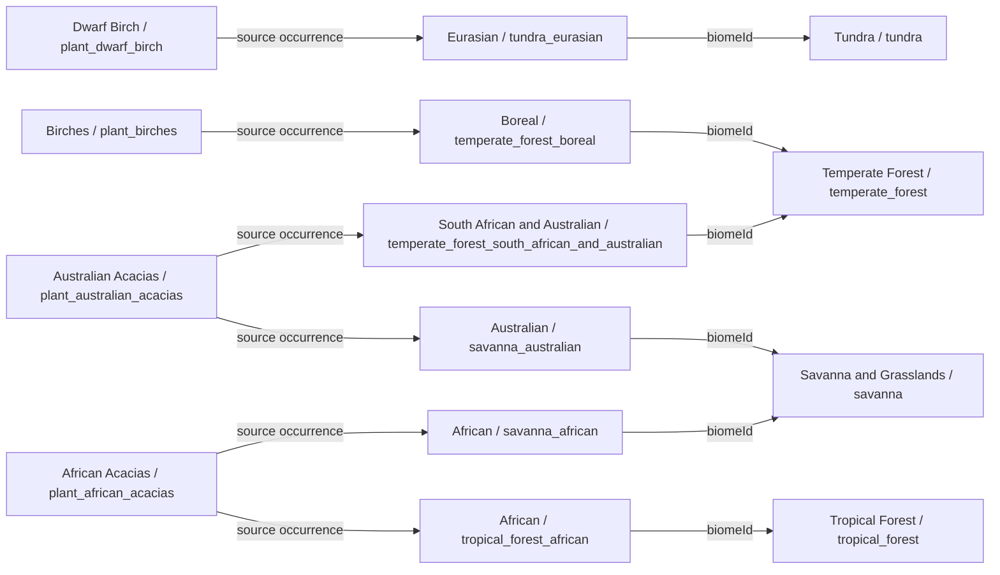

### Group 2

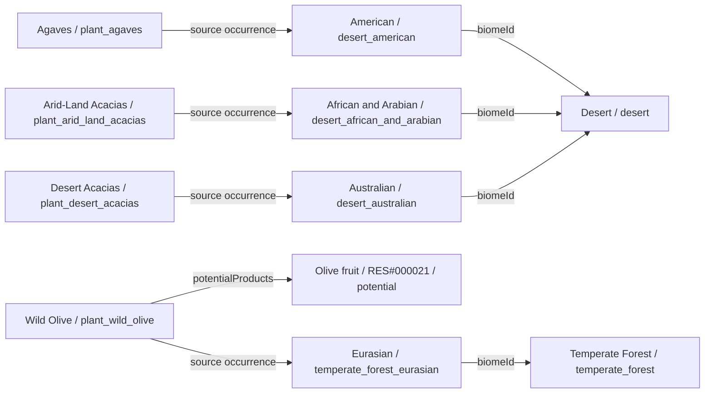

### Group 3

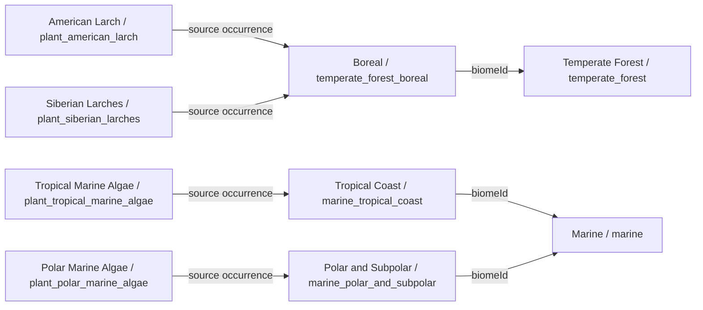

### Group 4

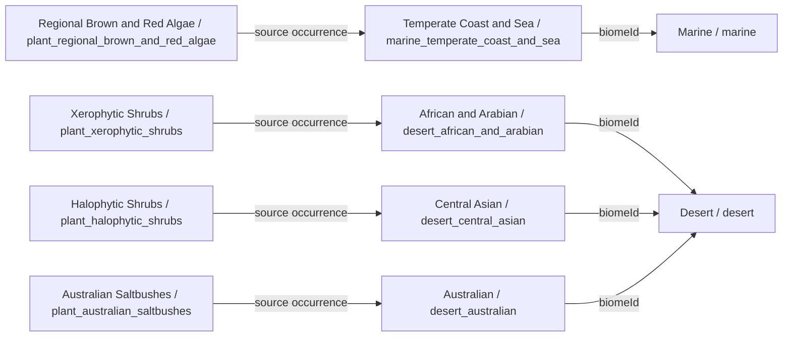

### Group 5

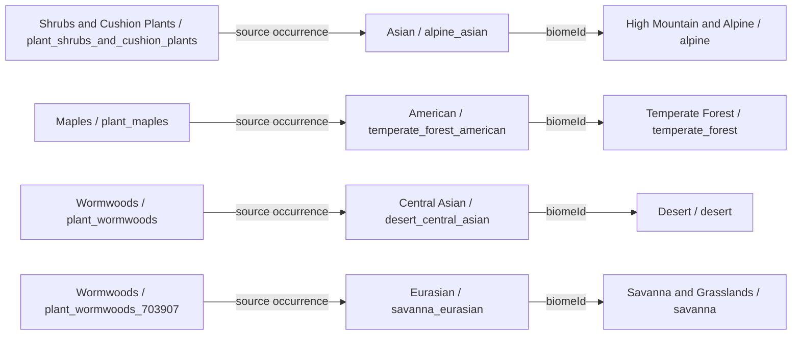

### Group 6

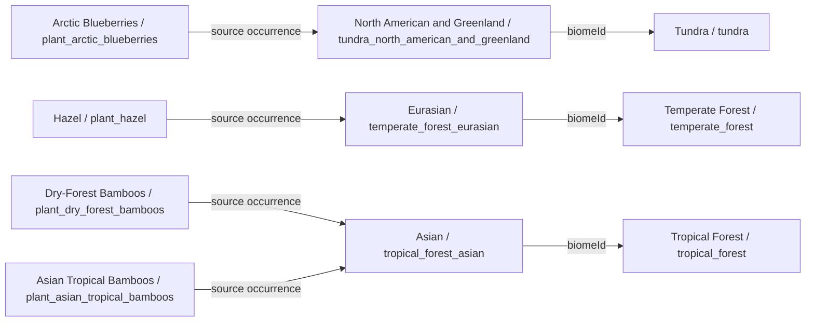

### Group 7

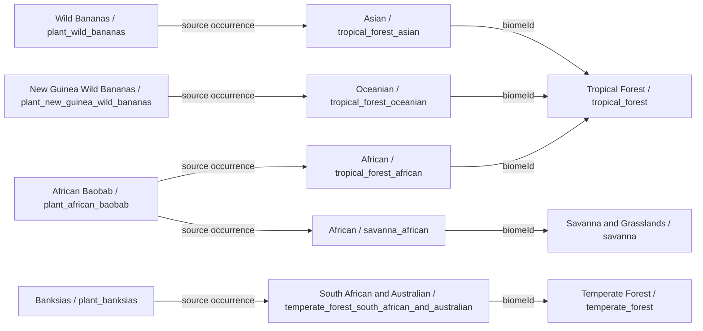

### Group 8

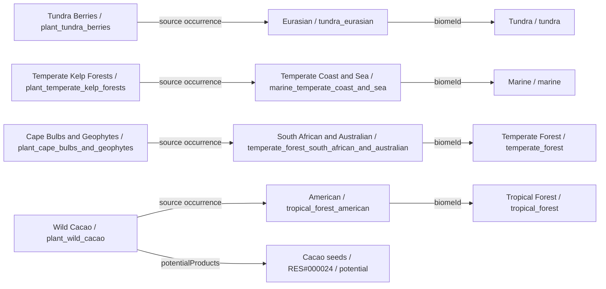

### Group 9

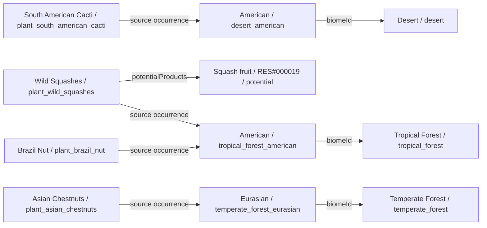

### Group 10

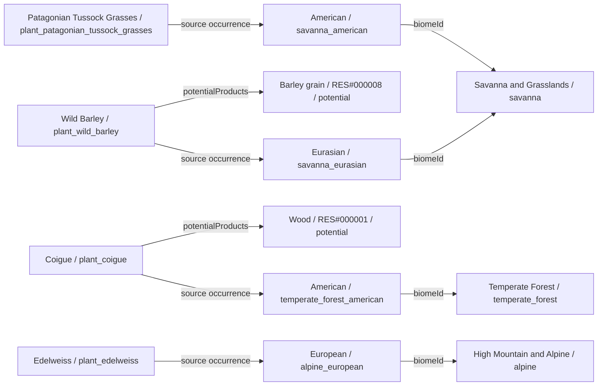

### Group 11

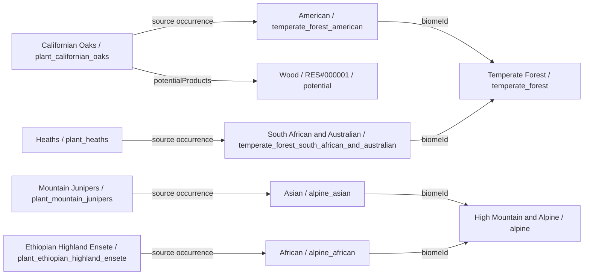

### Group 12

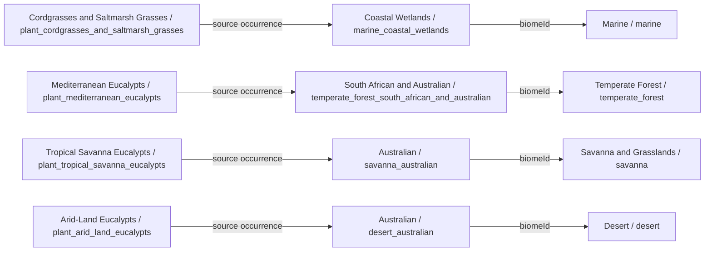

### Group 13

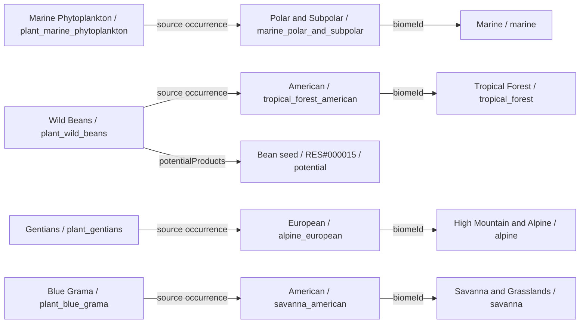

### Group 14

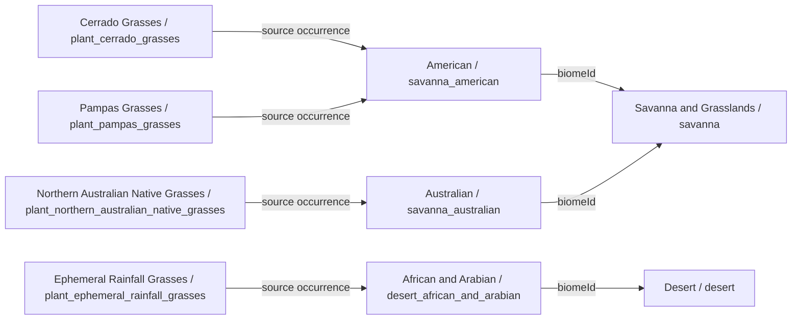

### Group 15

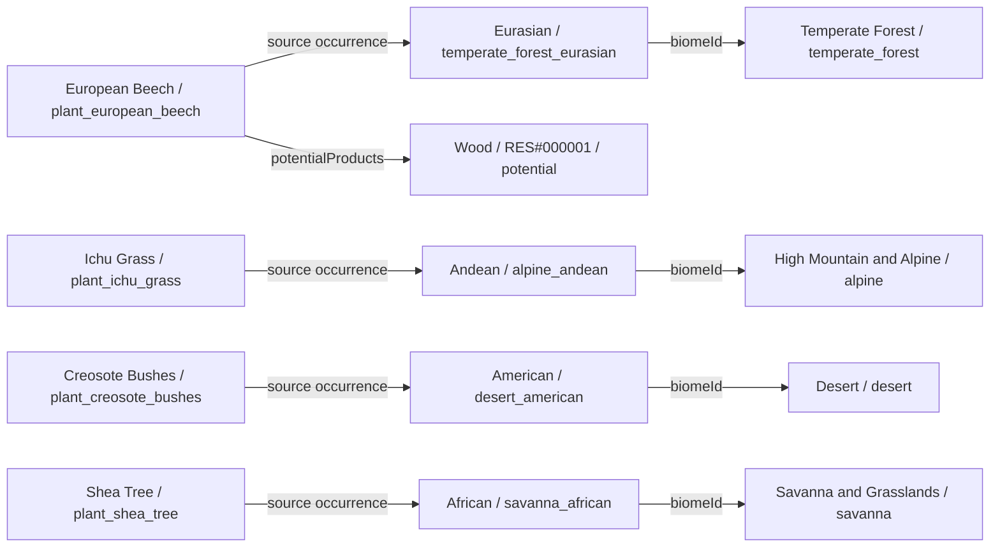

### Group 16

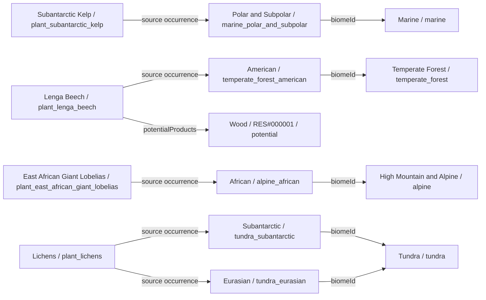

### Group 17

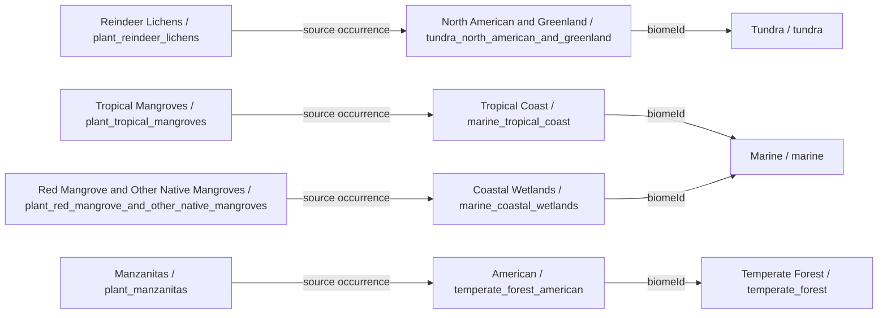

### Group 18

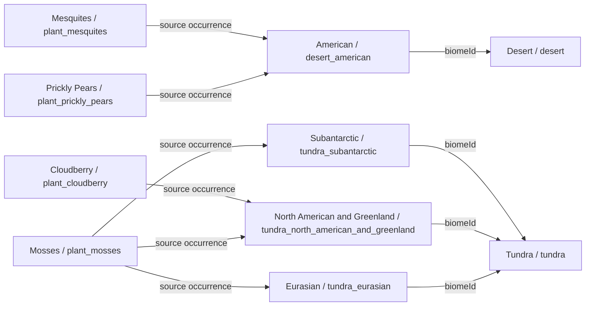

### Group 19

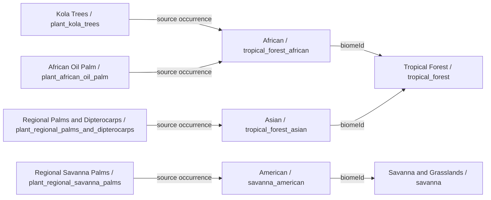

### Group 20

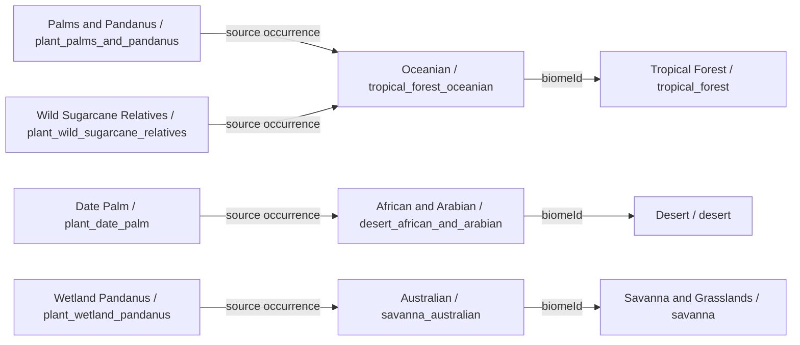

### Group 21

```mermaid
flowchart LR
    c0["Wild Potato Relatives / plant_wild_potato_relatives"]
    v23["Andean / alpine_andean"]
    b6["High Mountain and Alpine / alpine"]
    c1["Wild Quinoa Relatives / plant_wild_quinoa_relatives"]
    c2["Sahelian Wild Pearl Millet Relatives / plant_sahelian_wild_pearl_millet_relatives"]
    v11["African / savanna_african"]
    b3["Savanna and Grasslands / savanna"]
    c3["Afroalpine Grasses / plant_afroalpine_grasses"]
    v26["African / alpine_african"]
    c0 -->|source occurrence| v23
    c1 -->|source occurrence| v23
    c2 -->|source occurrence| v11
    c3 -->|source occurrence| v26
    v11 -->|biomeId| b3
    v23 -->|biomeId| b6
    v26 -->|biomeId| b6
```

### Group 22

```mermaid
flowchart LR
    c0["Alpine Grasses / plant_alpine_grasses"]
    v25["European / alpine_european"]
    b6["High Mountain and Alpine / alpine"]
    c1["Asian Alpine Grasses / plant_asian_alpine_grasses"]
    v24["Asian / alpine_asian"]
    c2["Big Bluestem / plant_big_bluestem"]
    v12["American / savanna_american"]
    b3["Savanna and Grasslands / savanna"]
    c3["Regional Desert Grasses / plant_regional_desert_grasses"]
    v17["Central Asian / desert_central_asian"]
    b4["Desert / desert"]
    c0 -->|source occurrence| v25
    c1 -->|source occurrence| v24
    c2 -->|source occurrence| v12
    c3 -->|source occurrence| v17
    v12 -->|biomeId| b3
    v17 -->|biomeId| b4
    v24 -->|biomeId| b6
    v25 -->|biomeId| b6
```

### Group 23

```mermaid
flowchart LR
    c0["Eurasian Steppe Grasses / plant_eurasian_steppe_grasses"]
    v13["Eurasian / savanna_eurasian"]
    b3["Savanna and Grasslands / savanna"]
    c1["Regional Seagrasses / plant_regional_seagrasses"]
    v19["Tropical Coast / marine_tropical_coast"]
    b5["Marine / marine"]
    c2["Subantarctic Grasses / plant_subantarctic_grasses"]
    v10["Subantarctic / tundra_subantarctic"]
    b2["Tundra / tundra"]
    c3["Pequi / plant_pequi"]
    v12["American / savanna_american"]
    c0 -->|source occurrence| v13
    c1 -->|source occurrence| v19
    c2 -->|source occurrence| v10
    c3 -->|source occurrence| v12
    v10 -->|biomeId| b2
    v12 -->|biomeId| b3
    v13 -->|biomeId| b3
    v19 -->|biomeId| b5
```

### Group 24

```mermaid
flowchart LR
    c0["Scots Pine / plant_scots_pine"]
    v7["Boreal / temperate_forest_boreal"]
    b1["Temperate Forest / temperate_forest"]
    o0_0["Wood / RES#000001 / potential"]
    c1["Mountain Pines / plant_mountain_pines"]
    v25["European / alpine_european"]
    b6["High Mountain and Alpine / alpine"]
    o1_0["Wood / RES#000001 / potential"]
    c2["Cushion Plants / plant_cushion_plants"]
    v10["Subantarctic / tundra_subantarctic"]
    b2["Tundra / tundra"]
    c3["Andean Cushion Plants / plant_andean_cushion_plants"]
    v23["Andean / alpine_andean"]
    c0 -->|potentialProducts| o0_0
    c0 -->|source occurrence| v7
    c1 -->|potentialProducts| o1_0
    c1 -->|source occurrence| v25
    c2 -->|source occurrence| v10
    c3 -->|source occurrence| v23
    v10 -->|biomeId| b2
    v23 -->|biomeId| b6
    v25 -->|biomeId| b6
    v7 -->|biomeId| b1
```

### Group 25

```mermaid
flowchart LR
    c0["Atacama Coastal Fog Plants / plant_atacama_coastal_fog_plants"]
    v15["American / desert_american"]
    b4["Desert / desert"]
    c1["Estuarine Halophytes / plant_estuarine_halophytes"]
    v22["Coastal Wetlands / marine_coastal_wetlands"]
    b5["Marine / marine"]
    c2["Proteas / plant_proteas"]
    v6["South African and Australian / temperate_forest_south_african_and_australian"]
    b1["Temperate Forest / temperate_forest"]
    c3["White Spruce / plant_white_spruce"]
    v7["Boreal / temperate_forest_boreal"]
    o3_0["Wood / RES#000001 / potential"]
    c0 -->|source occurrence| v15
    c1 -->|source occurrence| v22
    c2 -->|source occurrence| v6
    c3 -->|potentialProducts| o3_0
    c3 -->|source occurrence| v7
    v15 -->|biomeId| b4
    v22 -->|biomeId| b5
    v6 -->|biomeId| b1
    v7 -->|biomeId| b1
```

### Group 26

```mermaid
flowchart LR
    c0["Black Spruce / plant_black_spruce"]
    v7["Boreal / temperate_forest_boreal"]
    b1["Temperate Forest / temperate_forest"]
    o0_0["Wood / RES#000001 / potential"]
    c1["Eurasian Spruces / plant_eurasian_spruces"]
    o1_0["Wood / RES#000001 / potential"]
    c2["Queuna Trees / plant_queuna_trees"]
    v23["Andean / alpine_andean"]
    b6["High Mountain and Alpine / alpine"]
    c3["Soapbark Tree / plant_soapbark_tree"]
    v5["American / temperate_forest_american"]
    c0 -->|potentialProducts| o0_0
    c0 -->|source occurrence| v7
    c1 -->|potentialProducts| o1_0
    c1 -->|source occurrence| v7
    c2 -->|source occurrence| v23
    c3 -->|source occurrence| v5
    v23 -->|biomeId| b6
    v5 -->|biomeId| b1
    v7 -->|biomeId| b1
```

### Group 27

```mermaid
flowchart LR
    c0["African Raffia Palms / plant_african_raffia_palms"]
    v1["African / tropical_forest_african"]
    b0["Tropical Forest / tropical_forest"]
    c1["Restios / plant_restios"]
    v6["South African and Australian / temperate_forest_south_african_and_australian"]
    b1["Temperate Forest / temperate_forest"]
    c2["European Oaks / plant_european_oaks"]
    v4["Eurasian / temperate_forest_eurasian"]
    o2_0["Wood / RES#000001 / potential"]
    c3["North American Oaks / plant_north_american_oaks"]
    v5["American / temperate_forest_american"]
    o3_0["Wood / RES#000001 / potential"]
    c0 -->|source occurrence| v1
    c1 -->|source occurrence| v6
    c2 -->|potentialProducts| o2_0
    c2 -->|source occurrence| v4
    c3 -->|potentialProducts| o3_0
    c3 -->|source occurrence| v5
    v1 -->|biomeId| b0
    v4 -->|biomeId| b1
    v5 -->|biomeId| b1
    v6 -->|biomeId| b1
```

### Group 28

```mermaid
flowchart LR
    c0["Asian Oaks and Maples / plant_asian_oaks_and_maples"]
    v4["Eurasian / temperate_forest_eurasian"]
    b1["Temperate Forest / temperate_forest"]
    c1["High-Altitude Rhododendrons / plant_high_altitude_rhododendrons"]
    v24["Asian / alpine_asian"]
    b6["High Mountain and Alpine / alpine"]
    c2["Sonoran Saguaro / plant_sonoran_saguaro"]
    v15["American / desert_american"]
    b4["Desert / desert"]
    c3["Dwarf Willows / plant_dwarf_willows"]
    v8["North American and Greenland / tundra_north_american_and_greenland"]
    b2["Tundra / tundra"]
    c0 -->|source occurrence| v4
    c1 -->|source occurrence| v24
    c2 -->|source occurrence| v15
    c3 -->|source occurrence| v8
    v15 -->|biomeId| b4
    v24 -->|biomeId| b6
    v4 -->|biomeId| b1
    v8 -->|biomeId| b2
```

### Group 29

```mermaid
flowchart LR
    c0["Arctic Willows / plant_arctic_willows"]
    v9["Eurasian / tundra_eurasian"]
    b2["Tundra / tundra"]
    c1["Saxaul / plant_saxaul"]
    v17["Central Asian / desert_central_asian"]
    b4["Desert / desert"]
    c2["Giant Groundsels / plant_giant_groundsels"]
    v26["African / alpine_african"]
    b6["High Mountain and Alpine / alpine"]
    c3["African Wild Sorghums / plant_african_wild_sorghums"]
    v11["African / savanna_african"]
    b3["Savanna and Grasslands / savanna"]
    c0 -->|source occurrence| v9
    c1 -->|source occurrence| v17
    c2 -->|source occurrence| v26
    c3 -->|source occurrence| v11
    v11 -->|biomeId| b3
    v17 -->|biomeId| b4
    v26 -->|biomeId| b6
    v9 -->|biomeId| b2
```

### Group 30

```mermaid
flowchart LR
    c0["Spinifex Grasses / plant_spinifex_grasses"]
    v18["Australian / desert_australian"]
    b4["Desert / desert"]
    c1["Wild Taro / plant_wild_taro"]
    v2["Asian / tropical_forest_asian"]
    b0["Tropical Forest / tropical_forest"]
    c2["Taro and Regional Aroids / plant_taro_and_regional_aroids"]
    v3["Oceanian / tropical_forest_oceanian"]
    c3["Native Teak / plant_native_teak"]
    o3_0["Wood / RES#000001 / potential"]
    c0 -->|source occurrence| v18
    c1 -->|source occurrence| v2
    c2 -->|source occurrence| v3
    c3 -->|potentialProducts| o3_0
    c3 -->|source occurrence| v2
    v18 -->|biomeId| b4
    v2 -->|biomeId| b0
    v3 -->|biomeId| b0
```

### Group 31

```mermaid
flowchart LR
    c0["Mesoamerican Teosinte / plant_mesoamerican_teosinte"]
    v0["American / tropical_forest_american"]
    b0["Tropical Forest / tropical_forest"]
    c1["Southwest Asian Wild Wheat / plant_southwest_asian_wild_wheat"]
    v13["Eurasian / savanna_eurasian"]
    b3["Savanna and Grasslands / savanna"]
    o1_0["Wheat grain / RES#000007 / potential"]
    c2["Mesoamerican Vanilla / plant_mesoamerican_vanilla"]
    c3["Native Wild Grapevine / plant_native_wild_grapevine"]
    v4["Eurasian / temperate_forest_eurasian"]
    b1["Temperate Forest / temperate_forest"]
    o3_0["Grape / RES#000020 / potential"]
    c0 -->|source occurrence| v0
    c1 -->|potentialProducts| o1_0
    c1 -->|source occurrence| v13
    c2 -->|source occurrence| v0
    c3 -->|potentialProducts| o3_0
    c3 -->|source occurrence| v4
    v0 -->|biomeId| b0
    v13 -->|biomeId| b3
    v4 -->|biomeId| b1
```

### Group 32

```mermaid
flowchart LR
    c0["Eelgrass and Other Seagrasses / plant_eelgrass_and_other_seagrasses"]
    v20["Temperate Coast and Sea / marine_temperate_coast_and_sea"]
    b5["Marine / marine"]
    c1["Amazonian Rubber Tree / plant_amazonian_rubber_tree"]
    v0["American / tropical_forest_american"]
    b0["Tropical Forest / tropical_forest"]
    c2["Regional Tropical Timber Trees / plant_regional_tropical_timber_trees"]
    v1["African / tropical_forest_african"]
    o2_0["Wood / RES#000001 / potential"]
    c3["Miombo Trees / plant_miombo_trees"]
    c0 -->|source occurrence| v20
    c1 -->|source occurrence| v0
    c2 -->|potentialProducts| o2_0
    c2 -->|source occurrence| v1
    c3 -->|source occurrence| v1
    v0 -->|biomeId| b0
    v1 -->|biomeId| b0
    v20 -->|biomeId| b5
```

### Group 33

```mermaid
flowchart LR
    c0["Sal Trees / plant_sal_trees"]
    v2["Asian / tropical_forest_asian"]
    b0["Tropical Forest / tropical_forest"]
    c0 -->|source occurrence| v2
    v2 -->|biomeId| b0
```

## All agricultural candidates

These are crop groups awaiting exact species and ancestors; they are not automatically merged with regional candidates.

### Crops 1

```mermaid
flowchart LR
    tech["species_cultivation"]
    c0["Wheat / wheat"]
    c0 -->|cultivationResearch.technologyId| tech
    g0["cereal"]
    c0 -->|cropUseTag| g0
    r0_0["Wheat grain / RES#000007"]
    c0 -->|products / proposed| r0_0
    r0_1["Cereal straw / RES#000028"]
    c0 -->|products / proposed| r0_1
    c1["Barley / barley"]
    c1 -->|cultivationResearch.technologyId| tech
    c1 -->|cropUseTag| g0
    r1_0["Barley grain / RES#000008"]
    c1 -->|products / proposed| r1_0
    r1_1["Cereal straw / RES#000028"]
    c1 -->|products / proposed| r1_1
    c2["Rice / rice"]
    c2 -->|cultivationResearch.technologyId| tech
    c2 -->|cropUseTag| g0
    r2_0["Rice grain / RES#000009"]
    c2 -->|products / proposed| r2_0
    r2_1["Cereal straw / RES#000028"]
    c2 -->|products / proposed| r2_1
    c3["Maize / maize"]
    c3 -->|cultivationResearch.technologyId| tech
    c3 -->|cropUseTag| g0
    r3_0["Maize grain / RES#000010"]
    c3 -->|products / proposed| r3_0
```

### Crops 2

```mermaid
flowchart LR
    tech["species_cultivation"]
    c0["Sorghum / sorghum"]
    c0 -->|cultivationResearch.technologyId| tech
    g0["cereal"]
    c0 -->|cropUseTag| g0
    r0_0["Sorghum grain / RES#000011"]
    c0 -->|products / proposed| r0_0
    c1["Millet / millet"]
    c1 -->|cultivationResearch.technologyId| tech
    c1 -->|cropUseTag| g0
    r1_0["Millet grain / RES#000012"]
    c1 -->|products / proposed| r1_0
    c2["Potato / potato"]
    c2 -->|cultivationResearch.technologyId| tech
    g1["root_or_tuber"]
    c2 -->|cropUseTag| g1
    r2_0["Potato tuber / RES#000013"]
    c2 -->|products / proposed| r2_0
    c3["Cassava / cassava"]
    c3 -->|cultivationResearch.technologyId| tech
    c3 -->|cropUseTag| g1
    r3_0["Cassava root / RES#000014"]
    c3 -->|products / proposed| r3_0
```

### Crops 3

```mermaid
flowchart LR
    tech["species_cultivation"]
    c0["Beans / beans"]
    c0 -->|cultivationResearch.technologyId| tech
    g0["pulse"]
    c0 -->|cropUseTag| g0
    r0_0["Bean seed / RES#000015"]
    c0 -->|products / proposed| r0_0
    c1["Lentils / lentils"]
    c1 -->|cultivationResearch.technologyId| tech
    c1 -->|cropUseTag| g0
    r1_0["Lentil seed / RES#000016"]
    c1 -->|products / proposed| r1_0
    c2["Chickpeas / chickpeas"]
    c2 -->|cultivationResearch.technologyId| tech
    c2 -->|cropUseTag| g0
    r2_0["Chickpea seed / RES#000017"]
    c2 -->|products / proposed| r2_0
    c3["Peas / peas"]
    c3 -->|cultivationResearch.technologyId| tech
    c3 -->|cropUseTag| g0
    r3_0["Pea seed / RES#000018"]
    c3 -->|products / proposed| r3_0
```

### Crops 4

```mermaid
flowchart LR
    tech["species_cultivation"]
    c0["Squash / squash"]
    c0 -->|cultivationResearch.technologyId| tech
    g0["vegetable"]
    c0 -->|cropUseTag| g0
    r0_0["Squash fruit / RES#000019"]
    c0 -->|products / proposed| r0_0
    c1["Grapevine / grapevine"]
    c1 -->|cultivationResearch.technologyId| tech
    g1["fruit_crop"]
    c1 -->|cropUseTag| g1
    r1_0["Grape / RES#000020"]
    c1 -->|products / proposed| r1_0
    c2["Olive / olive"]
    c2 -->|cultivationResearch.technologyId| tech
    g2["oil_crop"]
    c2 -->|cropUseTag| g2
    r2_0["Olive fruit / RES#000021"]
    c2 -->|products / proposed| r2_0
    c3["Fig / fig"]
    c3 -->|cultivationResearch.technologyId| tech
    c3 -->|cropUseTag| g1
    r3_0["Fig fruit / RES#000022"]
    c3 -->|products / proposed| r3_0
```

### Crops 5

```mermaid
flowchart LR
    tech["species_cultivation"]
    c0["Date Palm / date_palm"]
    c0 -->|cultivationResearch.technologyId| tech
    g0["fruit_crop"]
    c0 -->|cropUseTag| g0
    r0_0["Date fruit / RES#000023"]
    c0 -->|products / proposed| r0_0
    c1["Cacao / cacao"]
    c1 -->|cultivationResearch.technologyId| tech
    g1["special_crop"]
    c1 -->|cropUseTag| g1
    r1_0["Cacao seeds / RES#000024"]
    c1 -->|products / proposed| r1_0
    c2["Coffee / coffee"]
    c2 -->|cultivationResearch.technologyId| tech
    c2 -->|cropUseTag| g1
    r2_0["Coffee cherries / RES#000025"]
    c2 -->|products / proposed| r2_0
    c3["Sugarcane / sugarcane"]
    c3 -->|cultivationResearch.technologyId| tech
    c3 -->|cropUseTag| g1
    r3_0["Sugarcane stalk / RES#000026"]
    c3 -->|products / proposed| r3_0
```

### Crops 6

```mermaid
flowchart LR
    tech["species_cultivation"]
    c0["Cotton / cotton"]
    c0 -->|cultivationResearch.technologyId| tech
    g0["fiber_crop"]
    c0 -->|cropUseTag| g0
    r0_0["Cotton fiber / RES#000027"]
    c0 -->|products / proposed| r0_0
```

| id | Name | cropUseTag | sourceOriginHint |
| --- | --- | --- | --- |
| wheat | Wheat | cereal | Southwest Asia |
| barley | Barley | cereal | Southwest Asia |
| rice | Rice | cereal | None |
| maize | Maize | cereal | Mesoamerica |
| sorghum | Sorghum | cereal | None |
| millet | Millet | cereal | None |
| potato | Potato | root_or_tuber | Andes |
| cassava | Cassava | root_or_tuber | South America |
| beans | Beans | pulse | None |
| lentils | Lentils | pulse | None |
| chickpeas | Chickpeas | pulse | None |
| peas | Peas | pulse | None |
| squash | Squash | vegetable | None |
| grapevine | Grapevine | fruit_crop | None |
| olive | Olive | oil_crop | None |
| fig | Fig | fruit_crop | None |
| date_palm | Date Palm | fruit_crop | None |
| cacao | Cacao | special_crop | Tropical America |
| coffee | Coffee | special_crop | None |
| sugarcane | Sugarcane | special_crop | None |
| cotton | Cotton | fiber_crop | None |

## Every source occurrence

This table retains every regional link and extraction method even when diagrams combine repeated arrows. Initial spawning remains disabled.

| id | definitionId | biomeId | variantId | extractionMethodId | sourceText |
| --- | --- | --- | --- | --- | --- |
| occurrence_0016 | plant_wild_cacao | tropical_forest | tropical_forest_american | None | Cacao silvestre, en su distribución nativa |
| occurrence_0017 | plant_mesoamerican_teosinte | tropical_forest | tropical_forest_american | None | Teosinte, en su distribución mesoamericana |
| occurrence_0018 | plant_mesoamerican_vanilla | tropical_forest | tropical_forest_american | None | Vainilla (Vanilla planifolia), Mesoamérica |
| occurrence_0019 | plant_wild_beans | tropical_forest | tropical_forest_american | None | Frijoles silvestres (Phaseolus spp.) |
| occurrence_0020 | plant_brazil_nut | tropical_forest | tropical_forest_american | None | Castaña de Brasil, Amazonía |
| occurrence_0021 | plant_wild_squashes | tropical_forest | tropical_forest_american | None | Calabazas silvestres (Cucurbita spp.) |
| occurrence_0022 | plant_amazonian_rubber_tree | tropical_forest | tropical_forest_american | None | Árbol del caucho (Hevea brasiliensis), Amazonía |
| occurrence_0038 | plant_african_oil_palm | tropical_forest | tropical_forest_african | None | Palma aceitera africana |
| occurrence_0039 | plant_african_baobab | tropical_forest | tropical_forest_african | None | Baobab africano |
| occurrence_0040 | plant_kola_trees | tropical_forest | tropical_forest_african | None | Nuez de cola (Cola spp.) |
| occurrence_0041 | plant_african_acacias | tropical_forest | tropical_forest_african | None | Acacias africanas |
| occurrence_0042 | plant_african_raffia_palms | tropical_forest | tropical_forest_african | None | Rafia africana (Raphia spp.) |
| occurrence_0043 | plant_miombo_trees | tropical_forest | tropical_forest_african | None | Árboles de miombo (Brachystegia spp.), donde corresponda |
| occurrence_0044 | plant_regional_tropical_timber_trees | tropical_forest | tropical_forest_african | None | Árboles de maderas tropicales regionales |
| occurrence_0060 | plant_wild_bananas | tropical_forest | tropical_forest_asian | None | Bananos silvestres (Musa spp.) |
| occurrence_0061 | plant_native_teak | tropical_forest | tropical_forest_asian | None | Teca en su distribución nativa |
| occurrence_0062 | plant_wild_taro | tropical_forest | tropical_forest_asian | None | Taro silvestre en su área nativa |
| occurrence_0063 | plant_dry_forest_bamboos | tropical_forest | tropical_forest_asian | None | Bambúes de bosque seco |
| occurrence_0064 | plant_asian_tropical_bamboos | tropical_forest | tropical_forest_asian | None | Bambúes tropicales asiáticos |
| occurrence_0065 | plant_sal_trees | tropical_forest | tropical_forest_asian | None | Árboles de sal (Shorea robusta), regiones adecuadas |
| occurrence_0066 | plant_regional_palms_and_dipterocarps | tropical_forest | tropical_forest_asian | None | Palmas y dipterocarpáceas regionales |
| occurrence_0079 | plant_wild_sugarcane_relatives | tropical_forest | tropical_forest_oceanian | None | Parientes silvestres de caña de azúcar (Saccharum spp.) |
| occurrence_0080 | plant_new_guinea_wild_bananas | tropical_forest | tropical_forest_oceanian | None | Bananos silvestres de Nueva Guinea |
| occurrence_0081 | plant_taro_and_regional_aroids | tropical_forest | tropical_forest_oceanian | None | Taro y otras aráceas regionales |
| occurrence_0082 | plant_palms_and_pandanus | tropical_forest | tropical_forest_oceanian | None | Palmas y pandanus |
| occurrence_0098 | plant_european_oaks | temperate_forest | temperate_forest_eurasian | None | Robles europeos |
| occurrence_0099 | plant_asian_oaks_and_maples | temperate_forest | temperate_forest_eurasian | None | Robles y arces asiáticos |
| occurrence_0100 | plant_wild_olive | temperate_forest | temperate_forest_eurasian | None | Acebuche |
| occurrence_0101 | plant_european_beech | temperate_forest | temperate_forest_eurasian | None | Haya europea |
| occurrence_0102 | plant_asian_chestnuts | temperate_forest | temperate_forest_eurasian | None | Castaños asiáticos |
| occurrence_0103 | plant_native_wild_grapevine | temperate_forest | temperate_forest_eurasian | None | Vid silvestre en hábitats nativos |
| occurrence_0104 | plant_hazel | temperate_forest | temperate_forest_eurasian | None | Avellano |
| occurrence_0120 | plant_north_american_oaks | temperate_forest | temperate_forest_american | None | Robles norteamericanos |
| occurrence_0121 | plant_coigue | temperate_forest | temperate_forest_american | None | Coigüe (Nothofagus dombeyi) |
| occurrence_0122 | plant_manzanitas | temperate_forest | temperate_forest_american | None | Manzanitas (Arctostaphylos spp.) |
| occurrence_0123 | plant_soapbark_tree | temperate_forest | temperate_forest_american | None | Quillay |
| occurrence_0124 | plant_maples | temperate_forest | temperate_forest_american | None | Arces |
| occurrence_0125 | plant_lenga_beech | temperate_forest | temperate_forest_american | None | Lenga (Nothofagus pumilio) |
| occurrence_0126 | plant_californian_oaks | temperate_forest | temperate_forest_american | None | Encinas y robles californianos |
| occurrence_0142 | plant_proteas | temperate_forest | temperate_forest_south_african_and_australian | None | Proteas |
| occurrence_0143 | plant_banksias | temperate_forest | temperate_forest_south_african_and_australian | None | Banksias |
| occurrence_0144 | plant_heaths | temperate_forest | temperate_forest_south_african_and_australian | None | Erica spp. |
| occurrence_0145 | plant_mediterranean_eucalypts | temperate_forest | temperate_forest_south_african_and_australian | None | Eucaliptos de clima mediterráneo |
| occurrence_0146 | plant_restios | temperate_forest | temperate_forest_south_african_and_australian | None | Restios |
| occurrence_0147 | plant_australian_acacias | temperate_forest | temperate_forest_south_african_and_australian | None | Acacias australianas |
| occurrence_0148 | plant_cape_bulbs_and_geophytes | temperate_forest | temperate_forest_south_african_and_australian | None | Bulbos y geófitas del Cabo |
| occurrence_0164 | plant_scots_pine | temperate_forest | temperate_forest_boreal | None | Pino silvestre |
| occurrence_0165 | plant_black_spruce | temperate_forest | temperate_forest_boreal | None | Pícea negra |
| occurrence_0166 | plant_eurasian_spruces | temperate_forest | temperate_forest_boreal | None | Píceas euroasiáticas |
| occurrence_0167 | plant_white_spruce | temperate_forest | temperate_forest_boreal | None | Pícea blanca |
| occurrence_0168 | plant_siberian_larches | temperate_forest | temperate_forest_boreal | None | Alerces siberianos |
| occurrence_0169 | plant_american_larch | temperate_forest | temperate_forest_boreal | None | Alerce americano |
| occurrence_0170 | plant_birches | temperate_forest | temperate_forest_boreal | None | Abedules |
| occurrence_0184 | plant_dwarf_willows | tundra | tundra_north_american_and_greenland | None | Sauces enanos |
| occurrence_0185 | plant_reindeer_lichens | tundra | tundra_north_american_and_greenland | None | Líquenes de reno |
| occurrence_0186 | plant_cloudberry | tundra | tundra_north_american_and_greenland | None | Mora de los pantanos |
| occurrence_0187 | plant_mosses | tundra | tundra_north_american_and_greenland | None | Musgos |
| occurrence_0188 | plant_arctic_blueberries | tundra | tundra_north_american_and_greenland | None | Arándanos árticos |
| occurrence_0202 | plant_dwarf_birch | tundra | tundra_eurasian | None | Abedul enano |
| occurrence_0203 | plant_arctic_willows | tundra | tundra_eurasian | None | Sauces árticos |
| occurrence_0204 | plant_lichens | tundra | tundra_eurasian | None | Líquenes |
| occurrence_0205 | plant_mosses | tundra | tundra_eurasian | None | Musgos |
| occurrence_0206 | plant_tundra_berries | tundra | tundra_eurasian | None | Bayas de tundra |
| occurrence_0217 | plant_subantarctic_grasses | tundra | tundra_subantarctic | None | Pastos subantárticos |
| occurrence_0218 | plant_mosses | tundra | tundra_subantarctic | None | Musgos |
| occurrence_0219 | plant_lichens | tundra | tundra_subantarctic | None | Líquenes |
| occurrence_0220 | plant_cushion_plants | tundra | tundra_subantarctic | None | Plantas almohadilladas |
| occurrence_0235 | plant_african_wild_sorghums | savanna | savanna_african | None | Sorgos silvestres africanos |
| occurrence_0236 | plant_sahelian_wild_pearl_millet_relatives | savanna | savanna_african | None | Parientes silvestres del mijo perla, Sahel |
| occurrence_0237 | plant_african_baobab | savanna | savanna_african | None | Baobab africano |
| occurrence_0238 | plant_shea_tree | savanna | savanna_african | None | Karité, sabanas de África occidental |
| occurrence_0239 | plant_african_acacias | savanna | savanna_african | None | Acacias africanas |
| occurrence_0255 | plant_cerrado_grasses | savanna | savanna_american | None | Gramíneas del Cerrado |
| occurrence_0256 | plant_big_bluestem | savanna | savanna_american | None | Pastos altos (Andropogon gerardii) |
| occurrence_0257 | plant_pampas_grasses | savanna | savanna_american | None | Gramíneas pampeanas |
| occurrence_0258 | plant_regional_savanna_palms | savanna | savanna_american | None | Palmas de sabana regionales |
| occurrence_0259 | plant_blue_grama | savanna | savanna_american | None | Grama azul (Bouteloua gracilis) |
| occurrence_0260 | plant_patagonian_tussock_grasses | savanna | savanna_american | None | Coirones patagónicos (Festuca y afines) |
| occurrence_0261 | plant_pequi | savanna | savanna_american | None | Pequi (Caryocar brasiliense), Cerrado |
| occurrence_0274 | plant_wormwoods_703907 | savanna | savanna_eurasian | None | Artemisas (Artemisia spp.) |
| occurrence_0275 | plant_eurasian_steppe_grasses | savanna | savanna_eurasian | None | Pastos esteparios euroasiáticos |
| occurrence_0276 | plant_southwest_asian_wild_wheat | savanna | savanna_eurasian | None | Trigo silvestre, solo en sus regiones nativas del sudoeste asiático |
| occurrence_0277 | plant_wild_barley | savanna | savanna_eurasian | None | Cebada silvestre, en sus regiones nativas |
| occurrence_0290 | plant_tropical_savanna_eucalypts | savanna | savanna_australian | None | Eucaliptos de sabana tropical |
| occurrence_0291 | plant_australian_acacias | savanna | savanna_australian | None | Acacias australianas |
| occurrence_0292 | plant_northern_australian_native_grasses | savanna | savanna_australian | None | Gramíneas nativas del norte |
| occurrence_0293 | plant_wetland_pandanus | savanna | savanna_australian | None | Pandanus en zonas húmedas |
| occurrence_0309 | plant_sonoran_saguaro | desert | desert_american | None | Saguaro, Sonora |
| occurrence_0310 | plant_south_american_cacti | desert | desert_american | None | Cactáceas sudamericanas regionales |
| occurrence_0311 | plant_prickly_pears | desert | desert_american | None | Nopales (Opuntia spp.) |
| occurrence_0312 | plant_creosote_bushes | desert | desert_american | None | Jarillas (Larrea spp.), Monte |
| occurrence_0313 | plant_agaves | desert | desert_american | None | Agaves |
| occurrence_0314 | plant_atacama_coastal_fog_plants | desert | desert_american | None | Plantas de niebla costera, sectores de Atacama |
| occurrence_0315 | plant_mesquites | desert | desert_american | None | Mezquites |
| occurrence_0328 | plant_arid_land_acacias | desert | desert_african_and_arabian | None | Acacias desérticas |
| occurrence_0329 | plant_xerophytic_shrubs | desert | desert_african_and_arabian | None | Arbustos xerófitos |
| occurrence_0330 | plant_date_palm | desert | desert_african_and_arabian | None | Palmera datilera en oasis y áreas de cultivo |
| occurrence_0331 | plant_ephemeral_rainfall_grasses | desert | desert_african_and_arabian | None | Gramíneas efímeras tras lluvias |
| occurrence_0344 | plant_saxaul | desert | desert_central_asian | None | Saxaúl (Haloxylon spp.) |
| occurrence_0345 | plant_wormwoods | desert | desert_central_asian | None | Artemisas |
| occurrence_0346 | plant_halophytic_shrubs | desert | desert_central_asian | None | Arbustos halófitos |
| occurrence_0347 | plant_regional_desert_grasses | desert | desert_central_asian | None | Pastos desérticos regionales |
| occurrence_0360 | plant_spinifex_grasses | desert | desert_australian | None | Spinifex (Triodia spp.) |
| occurrence_0361 | plant_desert_acacias | desert | desert_australian | None | Acacias del desierto |
| occurrence_0362 | plant_arid_land_eucalypts | desert | desert_australian | None | Eucaliptos de zonas áridas |
| occurrence_0363 | plant_australian_saltbushes | desert | desert_australian | None | Arbustos salinos australianos |
| occurrence_0374 | plant_tropical_mangroves | marine | marine_tropical_coast | None | Manglares en litorales tropicales compatibles |
| occurrence_0375 | plant_regional_seagrasses | marine | marine_tropical_coast | None | Pastos marinos (Thalassia y otros géneros regionales) |
| occurrence_0376 | plant_tropical_marine_algae | marine | marine_tropical_coast | None | Algas marinas tropicales |
| occurrence_0387 | plant_temperate_kelp_forests | marine | marine_temperate_coast_and_sea | None | Bosques de kelp en costas templadas apropiadas |
| occurrence_0388 | plant_eelgrass_and_other_seagrasses | marine | marine_temperate_coast_and_sea | None | Zostera y otros pastos marinos |
| occurrence_0389 | plant_regional_brown_and_red_algae | marine | marine_temperate_coast_and_sea | None | Algas pardas y rojas regionales |
| occurrence_0401 | plant_marine_phytoplankton | marine | marine_polar_and_subpolar | None | Fitoplancton marino |
| occurrence_0402 | plant_polar_marine_algae | marine | marine_polar_and_subpolar | None | Algas marinas polares |
| occurrence_0403 | plant_subantarctic_kelp | marine | marine_polar_and_subpolar | None | Kelp subantártico en costas apropiadas |
| occurrence_0415 | plant_red_mangrove_and_other_native_mangroves | marine | marine_coastal_wetlands | None | Mangle rojo y otros mangles nativos (costas tropicales y subtropicales) |
| occurrence_0416 | plant_cordgrasses_and_saltmarsh_grasses | marine | marine_coastal_wetlands | None | Espartina y otros pastos de marisma (regiones compatibles) |
| occurrence_0417 | plant_estuarine_halophytes | marine | marine_coastal_wetlands | None | Plantas halófitas de estuario |
| occurrence_0431 | plant_ichu_grass | alpine | alpine_andean | None | Ichu |
| occurrence_0432 | plant_queuna_trees | alpine | alpine_andean | None | Queñua (Polylepis spp.) |
| occurrence_0433 | plant_wild_potato_relatives | alpine | alpine_andean | None | Parientes silvestres de la papa |
| occurrence_0434 | plant_wild_quinoa_relatives | alpine | alpine_andean | None | Parientes silvestres de la quinua |
| occurrence_0435 | plant_andean_cushion_plants | alpine | alpine_andean | None | Plantas almohadilladas andinas |
| occurrence_0449 | plant_mountain_junipers | alpine | alpine_asian | None | Enebros de montaña |
| occurrence_0450 | plant_high_altitude_rhododendrons | alpine | alpine_asian | None | Rododendros de altura |
| occurrence_0451 | plant_asian_alpine_grasses | alpine | alpine_asian | None | Pastos alpinos asiáticos |
| occurrence_0452 | plant_shrubs_and_cushion_plants | alpine | alpine_asian | None | Arbustos y plantas almohadilladas |
| occurrence_0466 | plant_edelweiss | alpine | alpine_european | None | Edelweiss |
| occurrence_0467 | plant_mountain_pines | alpine | alpine_european | None | Pinos de montaña |
| occurrence_0468 | plant_alpine_grasses | alpine | alpine_european | None | Pastos alpinos |
| occurrence_0469 | plant_gentians | alpine | alpine_european | None | Gencianas |
| occurrence_0482 | plant_east_african_giant_lobelias | alpine | alpine_african | None | Lobelias gigantes, montañas de África oriental |
| occurrence_0483 | plant_giant_groundsels | alpine | alpine_african | None | Senecios gigantes (Dendrosenecio spp.) |
| occurrence_0484 | plant_afroalpine_grasses | alpine | alpine_african | None | Pastos afroalpinos |
| occurrence_0485 | plant_ethiopian_highland_ensete | alpine | alpine_african | None | Ensete en tierras altas etíopes apropiadas |


[Biological identities and relationships / Identidades y relaciones biológicas](BIOLOGY.md)
