# Recursos — Diagramas completos de referencia

[Índice gráfico](../../lang/es/catalog-diagrams.md) · [English](DIAGRAMS.md) · [Español](DIAGRAMS.es.md)

[JSON](resources.catalog.guide.json) · [Estructura completa del JSON](../../lang/es/json-structures.md)

Todos los registros del catálogo están incluidos. Se usan varios diagramas pequeños en este mismo archivo para facilitar la consulta. Las flechas representan vínculos documentados, no rendimiento, presencia garantizada ni evolución deducida. Los IDs actuales se conservan.

Los recursos son materiales de inventario; árboles, animales y yacimientos son sus posibles orígenes. Las relaciones están deshabilitadas hasta revisar acciones, especies y cantidades. Las transformaciones son guías de extremos, no recetas completas.

| id | tag | Nombre | category | stage |
| --- | --- | --- | --- | --- |
| RES#000001 | wood | Madera | plant_material | raw |
| RES#000002 | stone | Piedra | geological_material | raw |
| RES#000003 | water | Agua | environmental_material | raw |
| RES#000004 | plant_fiber | Fibra vegetal | plant_material | raw |
| RES#000005 | flexible_plant_fiber | Fibra vegetal flexible preparada | plant_material | processed |
| RES#000006 | livestock_manure | Estiércol de ganado | animal_material | raw |
| RES#000007 | wheat_grain | Grano de trigo | crop_material | raw |
| RES#000008 | barley_grain | Grano de cebada | crop_material | raw |
| RES#000009 | rice_grain | Grano de arroz | crop_material | raw |
| RES#000010 | maize_grain | Grano de maíz | crop_material | raw |
| RES#000011 | sorghum_grain | Grano de sorgo | crop_material | raw |
| RES#000012 | millet_grain | Grano de mijo | crop_material | raw |
| RES#000013 | potato_tuber | Tubérculo de papa | crop_material | raw |
| RES#000014 | cassava_root | Raíz de yuca | crop_material | raw |
| RES#000015 | bean_seed | Semilla de frijol | crop_material | raw |
| RES#000016 | lentil_seed | Semilla de lenteja | crop_material | raw |
| RES#000017 | chickpea_seed | Semilla de garbanzo | crop_material | raw |
| RES#000018 | pea_seed | Semilla de arveja | crop_material | raw |
| RES#000019 | squash_fruit | Fruto de calabaza | crop_material | raw |
| RES#000020 | grape | Uva | crop_material | raw |
| RES#000021 | olive_fruit | Aceituna | crop_material | raw |
| RES#000022 | fig | Higo | crop_material | raw |
| RES#000023 | date | Dátil | crop_material | raw |
| RES#000024 | cacao_beans | Semillas de cacao | crop_material | raw |
| RES#000025 | coffee_cherries | Frutos de café | crop_material | raw |
| RES#000026 | sugarcane_stalk | Tallo de caña de azúcar | crop_material | raw |
| RES#000027 | cotton_fiber | Fibra de algodón | plant_material | raw |
| RES#000028 | straw | Paja de cereal | plant_material | raw |
| RES#000029 | meat | Carne | animal_material | raw |
| RES#000030 | fish_meat | Carne de pescado | animal_material | raw |
| RES#000031 | hide | Piel sin curtir | animal_material | raw |
| RES#000032 | animal_fat | Grasa animal | animal_material | raw |
| RES#000033 | animal_oil | Aceite animal | animal_material | processed |
| RES#000034 | fish_oil | Aceite de pescado | animal_material | processed |
| RES#000035 | whale_oil | Aceite de ballena | animal_material | processed |
| RES#000036 | antlers | Astas | animal_material | raw |
| RES#000037 | horns | Cuernos | animal_material | raw |
| RES#000038 | baleen | Barbas de ballena | animal_material | raw |
| RES#000039 | eggs | Huevos | animal_material | raw |
| RES#000040 | feathers | Plumas | animal_material | raw |
| RES#000041 | animal_fiber | Fibra animal | animal_material | raw |
| RES#000042 | milk | Leche | animal_material | raw |
| RES#000043 | pearls | Perlas | animal_material | raw |
| RES#000044 | animal_shell | Concha de animal | animal_material | raw |
| RES#000045 | tusks | Colmillos | animal_material | raw |
| RES#000046 | ivory | Marfil | animal_material | processed |
| RES#000047 | clay | Arcilla | geological_material | raw |
| RES#000048 | sand | Arena | geological_material | raw |
| RES#000049 | calcareous_sand | Arena calcárea | geological_material | raw |
| RES#000050 | silica_sand | Arena silícea | geological_material | raw |
| RES#000051 | sandstone | Arenisca | geological_material | raw |
| RES#000052 | limestone | Caliza | geological_material | raw |
| RES#000053 | bituminous_coal | Carbón bituminoso | geological_material | raw |
| RES#000054 | copper_bearing_material | Material con cobre | geological_material | raw |
| RES#000055 | copper_ore | Mena de cobre | geological_material | raw |
| RES#000056 | tin_bearing_material | Material con estaño | geological_material | raw |
| RES#000057 | tin_ore | Mena de estaño | geological_material | raw |
| RES#000058 | phosphorite | Fosforita | geological_material | raw |
| RES#000059 | granite | Granito | geological_material | raw |
| RES#000060 | gravel | Grava | geological_material | raw |
| RES#000061 | iron_bearing_material | Material con hierro | geological_material | raw |
| RES#000062 | iron_ore | Mena de hierro | geological_material | raw |
| RES#000063 | iron_rich_laterite | Laterita ferruginosa | geological_material | raw |
| RES#000064 | manganese_bearing_material | Material con manganeso | geological_material | raw |
| RES#000065 | manganese_ore | Mena de manganeso | geological_material | raw |
| RES#000066 | nickel_bearing_material | Material con níquel | geological_material | raw |
| RES#000067 | nickel_laterite | Laterita con níquel | geological_material | raw |
| RES#000068 | nickel_ore | Mena de níquel | geological_material | raw |
| RES#000069 | polymetallic_nodules | Nódulos polimetálicos | geological_material | raw |
| RES#000070 | obsidian | Obsidiana | geological_material | raw |
| RES#000071 | gold_bearing_quartz | Cuarzo aurífero | geological_material | raw |
| RES#000072 | gold_bearing_sediment | Sedimento aurífero | geological_material | raw |
| RES#000073 | gold_ore | Mena de oro | geological_material | raw |
| RES#000074 | pumice | Piedra pómez | geological_material | raw |
| RES#000075 | slate | Pizarra | geological_material | raw |
| RES#000076 | silver_bearing_material | Material con plata | geological_material | raw |
| RES#000077 | silver_ore | Mena de plata | geological_material | raw |
| RES#000078 | lead_bearing_material | Material con plomo | geological_material | raw |
| RES#000079 | lead_ore | Mena de plomo | geological_material | raw |
| RES#000080 | basalt | Basalto | geological_material | raw |
| RES#000081 | volcanic_rock | Roca volcánica | geological_material | raw |
| RES#000082 | rock_salt | Sal de roca | geological_material | raw |
| RES#000083 | sea_salt | Sal marina | geological_material | raw |
| RES#000084 | flint | Sílex | geological_material | raw |
| RES#000085 | peat | Turba | geological_material | raw |
| RES#000086 | gypsum | Yeso mineral | geological_material | raw |
| RES#000087 | opal | Ópalo | geological_material | raw |
| RES#000088 | wood_plank | Tabla de madera | construction_material | processed |
| RES#000089 | stone_block | Bloque de piedra | construction_material | processed |
| RES#000090 | charcoal | Carbón vegetal | fuel | processed |
| RES#000091 | wheat_flour | Harina de trigo | food_ingredient | processed |
| RES#000092 | bread | Pan | food_product | processed |
| RES#000093 | copper_metal | Cobre metálico | metal | refined |
| RES#000094 | tin_metal | Estaño metálico | metal | refined |
| RES#000095 | bronze | Bronce de estaño | metal | processed |
| RES#000096 | iron_bloom | Masa de hierro de reducción | metal | intermediate |
| RES#000097 | iron_metal | Hierro trabajado | metal | refined |
| RES#000098 | lead_metal | Plomo metálico | metal | refined |
| RES#000099 | silver_metal | Plata metálica | metal | refined |
| RES#000100 | gold_metal | Oro metálico | metal | refined |
| RES#000101 | cotton_yarn | Hilo de algodón | textile_material | processed |
| RES#000102 | cotton_cloth | Tela de algodón | textile_material | processed |
| RES#000103 | olive_oil | Aceite de oliva | food_ingredient | processed |
| RES#000104 | leather | Cuero curtido | animal_material | processed |
| RES#000105 | bones | Huesos | animal_material | raw |

## Todos los recursos

### Grupo 1

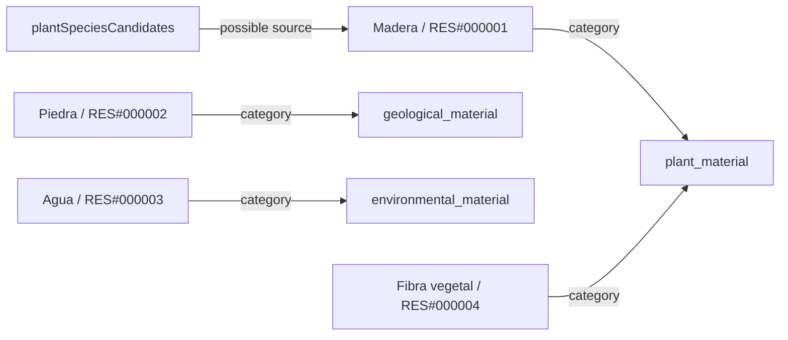

### Grupo 2

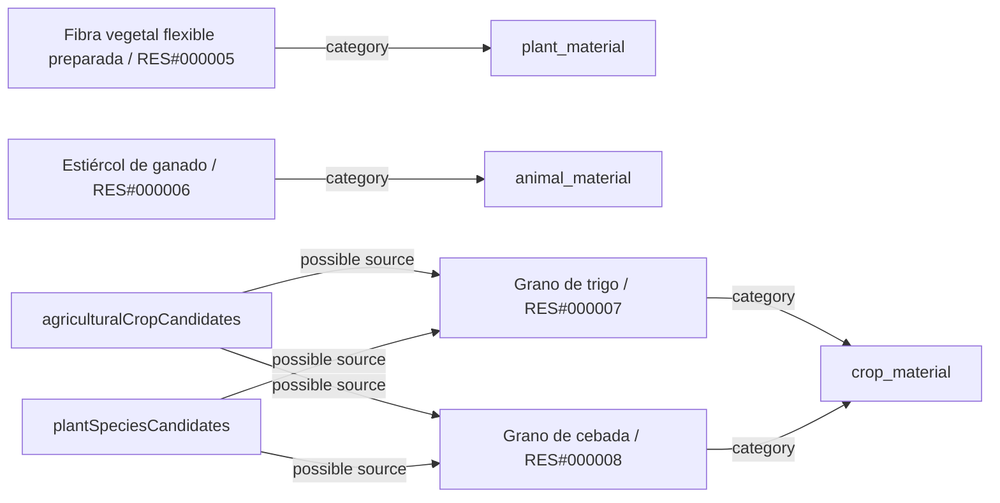

### Grupo 3

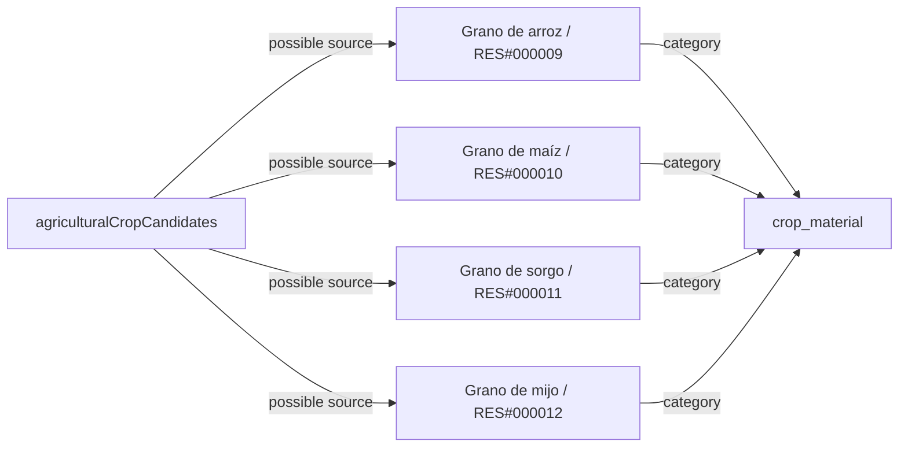

### Grupo 4

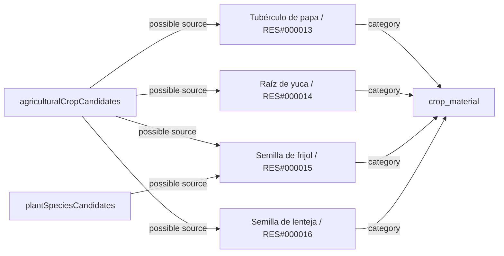

### Grupo 5

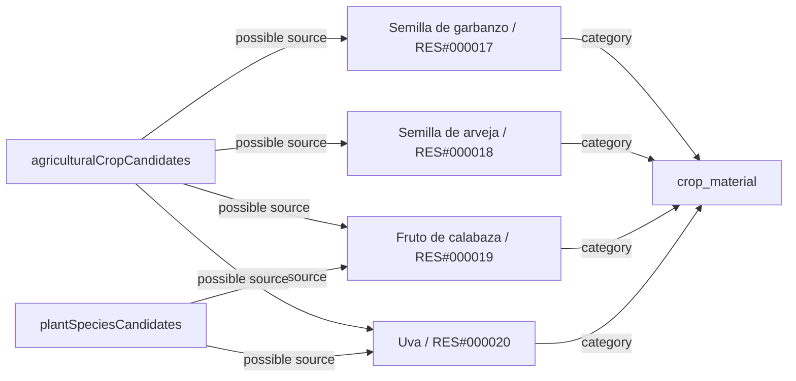

### Grupo 6

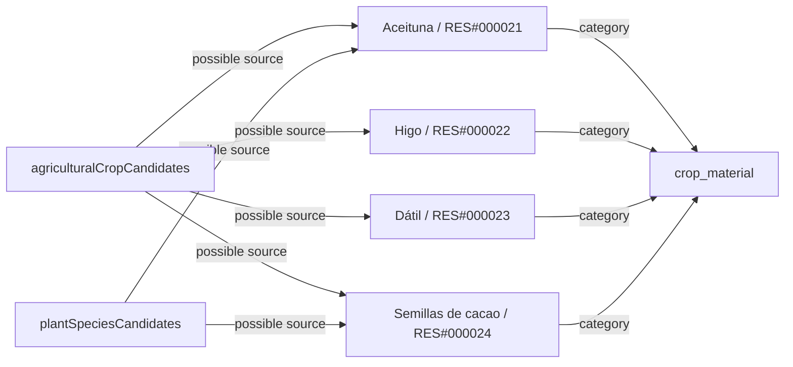

### Grupo 7

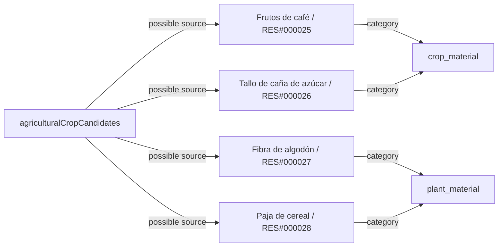

### Grupo 8

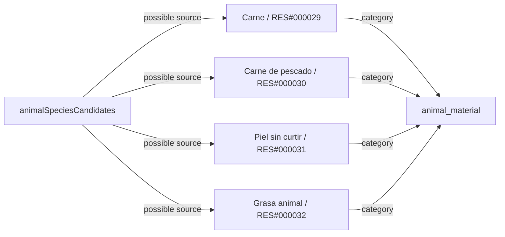

### Grupo 9

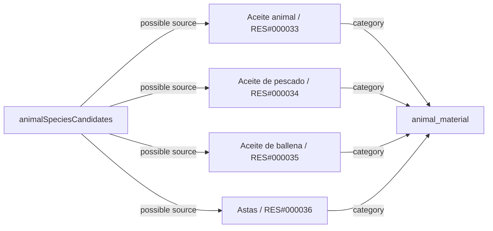

### Grupo 10

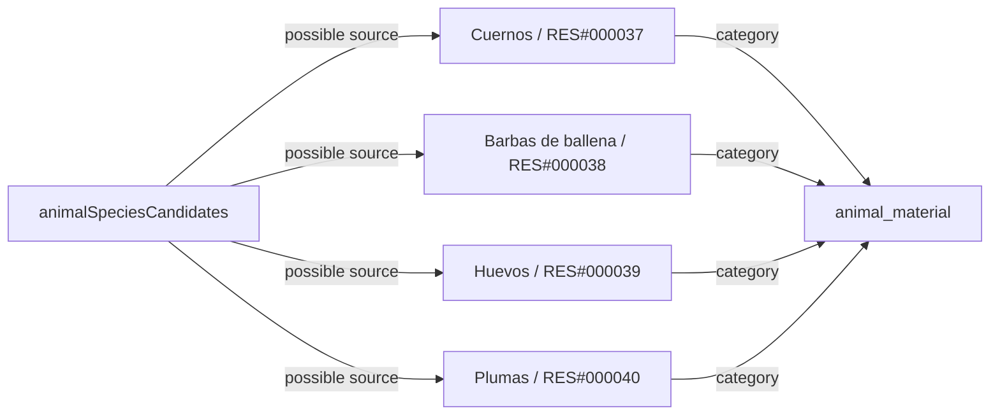

### Grupo 11

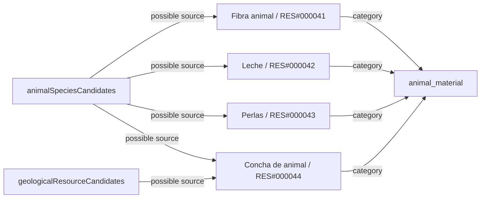

### Grupo 12

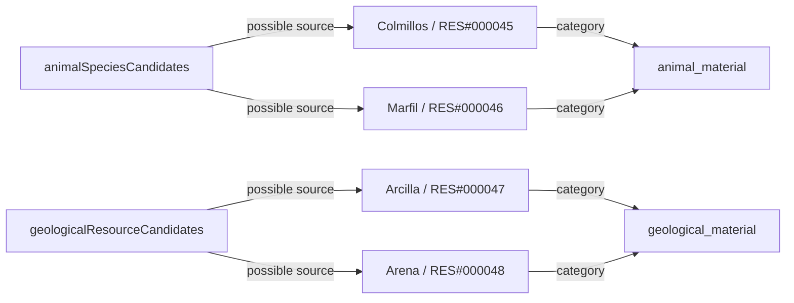

### Grupo 13

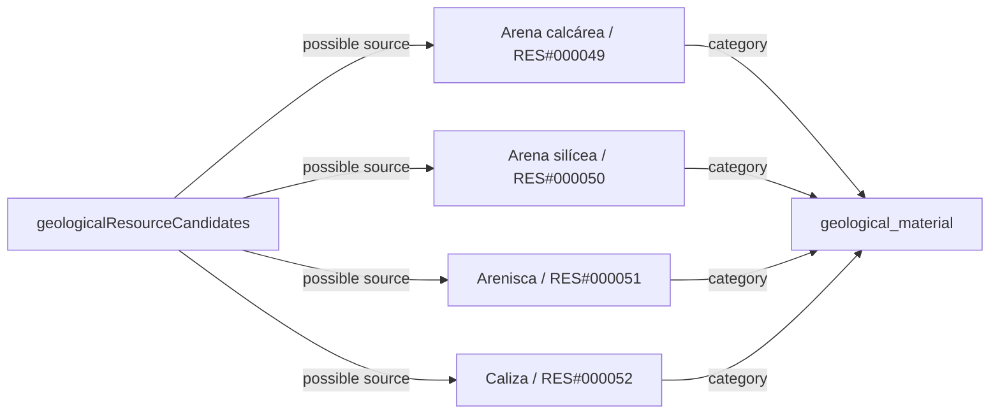

### Grupo 14

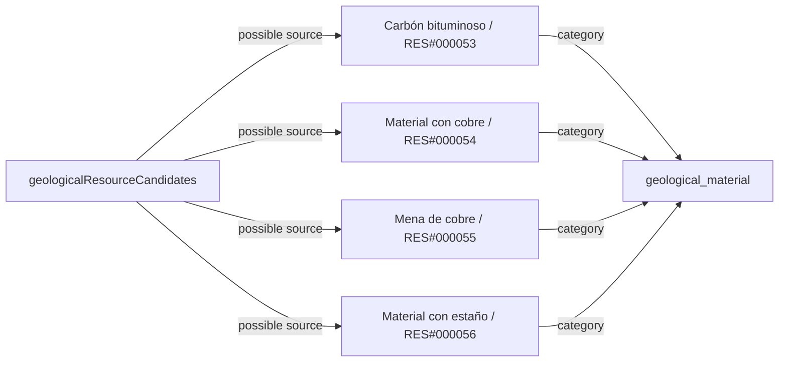

### Grupo 15

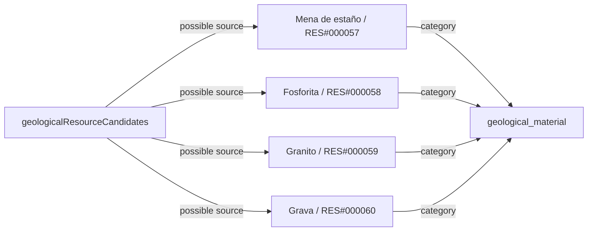

### Grupo 16

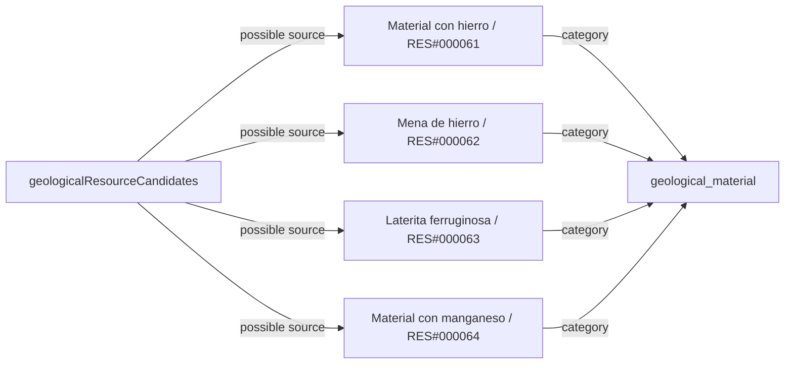

### Grupo 17

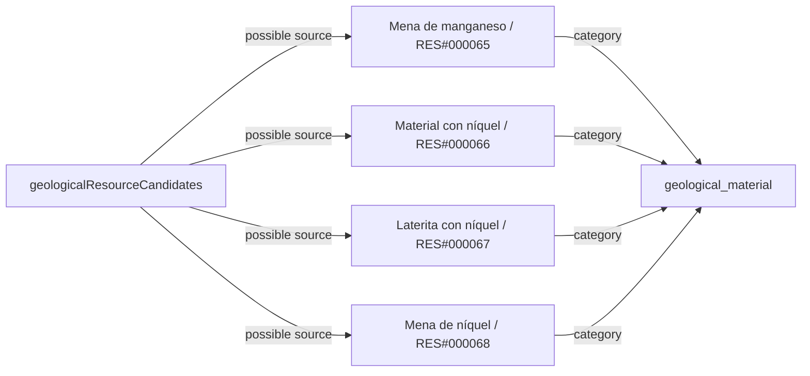

### Grupo 18

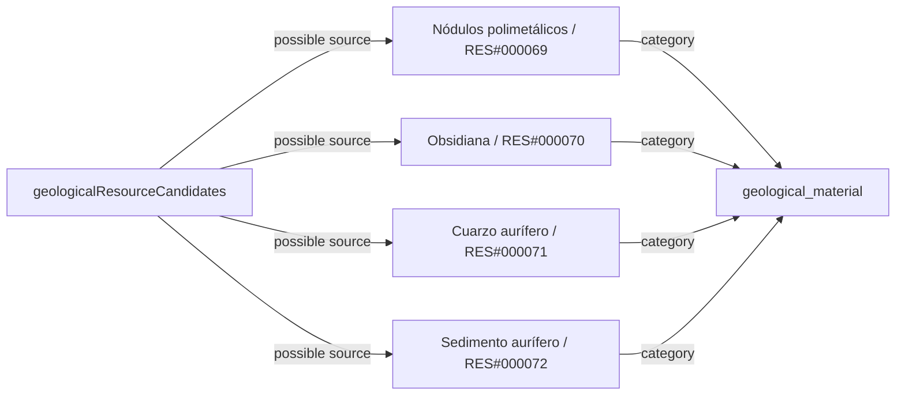

### Grupo 19

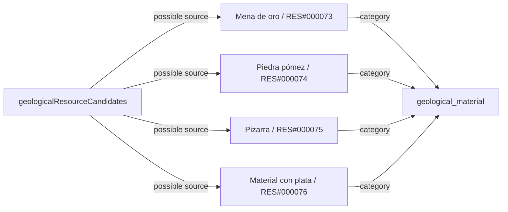

### Grupo 20

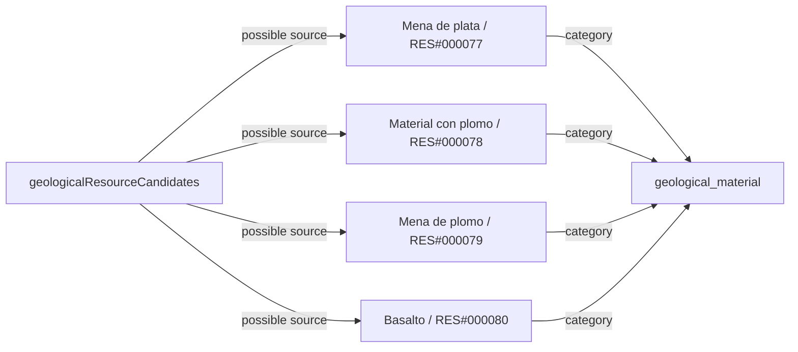

### Grupo 21

```mermaid
flowchart LR
    r0["Roca volcánica / RES#000081"]
    k0["geological_material"]
    r0 -->|category| k0
    s0["geologicalResourceCandidates"]
    s0 -->|possible source| r0
    r1["Sal de roca / RES#000082"]
    r1 -->|category| k0
    s0 -->|possible source| r1
    r2["Sal marina / RES#000083"]
    r2 -->|category| k0
    s0 -->|possible source| r2
    r3["Sílex / RES#000084"]
    r3 -->|category| k0
    s0 -->|possible source| r3
```

### Grupo 22

```mermaid
flowchart LR
    r0["Turba / RES#000085"]
    k0["geological_material"]
    r0 -->|category| k0
    s0["geologicalResourceCandidates"]
    s0 -->|possible source| r0
    r1["Yeso mineral / RES#000086"]
    r1 -->|category| k0
    s0 -->|possible source| r1
    r2["Ópalo / RES#000087"]
    r2 -->|category| k0
    s0 -->|possible source| r2
    r3["Tabla de madera / RES#000088"]
    k1["construction_material"]
    r3 -->|category| k1
```

### Grupo 23

```mermaid
flowchart LR
    r0["Bloque de piedra / RES#000089"]
    k0["construction_material"]
    r0 -->|category| k0
    r1["Carbón vegetal / RES#000090"]
    k1["fuel"]
    r1 -->|category| k1
    r2["Harina de trigo / RES#000091"]
    k2["food_ingredient"]
    r2 -->|category| k2
    r3["Pan / RES#000092"]
    k3["food_product"]
    r3 -->|category| k3
```

### Grupo 24

```mermaid
flowchart LR
    r0["Cobre metálico / RES#000093"]
    k0["metal"]
    r0 -->|category| k0
    r1["Estaño metálico / RES#000094"]
    r1 -->|category| k0
    r2["Bronce de estaño / RES#000095"]
    r2 -->|category| k0
    r3["Masa de hierro de reducción / RES#000096"]
    r3 -->|category| k0
```

### Grupo 25

```mermaid
flowchart LR
    r0["Hierro trabajado / RES#000097"]
    k0["metal"]
    r0 -->|category| k0
    r1["Plomo metálico / RES#000098"]
    r1 -->|category| k0
    r2["Plata metálica / RES#000099"]
    r2 -->|category| k0
    r3["Oro metálico / RES#000100"]
    r3 -->|category| k0
```

### Grupo 26

```mermaid
flowchart LR
    r0["Hilo de algodón / RES#000101"]
    k0["textile_material"]
    r0 -->|category| k0
    r1["Tela de algodón / RES#000102"]
    r1 -->|category| k0
    r2["Aceite de oliva / RES#000103"]
    k1["food_ingredient"]
    r2 -->|category| k1
    r3["Cuero curtido / RES#000104"]
    k2["animal_material"]
    r3 -->|category| k2
```

### Grupo 27

```mermaid
flowchart LR
    r0["Huesos / RES#000105"]
    k0["animal_material"]
    r0 -->|category| k0
    s0["animalSpeciesCandidates"]
    s0 -->|possible source| r0
```

## Transformaciones propuestas

Cada caja processTag agrupa sus entradas conocidas; pueden faltar combustible, agua, instalaciones y otras entradas. No es una receta operativa.

### Procesos 1

```mermaid
flowchart LR
    p0["wood_sawing / guide"]
    r0["Madera / RES#000001"]
    r0 -->|input endpoint| p0
    r1["Tabla de madera / RES#000088"]
    p0 -->|output endpoint| r1
    p1["stone_preparation / guide"]
    r2["Piedra / RES#000002"]
    r2 -->|input endpoint| p1
    r3["Bloque de piedra / RES#000089"]
    p1 -->|output endpoint| r3
    p2["granite_building_material_selection / guide"]
    r4["Granito / RES#000059"]
    r4 -->|input endpoint| p2
    p2 -->|output endpoint| r2
```

### Procesos 2

```mermaid
flowchart LR
    p0["limestone_building_material_selection / guide"]
    r0["Caliza / RES#000052"]
    r0 -->|input endpoint| p0
    r1["Piedra / RES#000002"]
    p0 -->|output endpoint| r1
    p1["sandstone_building_material_selection / guide"]
    r2["Arenisca / RES#000051"]
    r2 -->|input endpoint| p1
    p1 -->|output endpoint| r1
    p2["basalt_building_material_selection / guide"]
    r3["Basalto / RES#000080"]
    r3 -->|input endpoint| p2
    p2 -->|output endpoint| r1
```

### Procesos 3

```mermaid
flowchart LR
    p0["slate_building_material_selection / guide"]
    r0["Pizarra / RES#000075"]
    r0 -->|input endpoint| p0
    r1["Piedra / RES#000002"]
    p0 -->|output endpoint| r1
    p1["charcoal_production / guide"]
    r2["Madera / RES#000001"]
    r2 -->|input endpoint| p1
    r3["Carbón vegetal / RES#000090"]
    p1 -->|output endpoint| r3
    p2["fiber_preparation / guide"]
    r4["Fibra vegetal / RES#000004"]
    r4 -->|input endpoint| p2
    r5["Fibra vegetal flexible preparada / RES#000005"]
    p2 -->|output endpoint| r5
```

### Procesos 4

```mermaid
flowchart LR
    p0["wheat_milling / guide"]
    r0["Grano de trigo / RES#000007"]
    r0 -->|input endpoint| p0
    r1["Harina de trigo / RES#000091"]
    p0 -->|output endpoint| r1
    p1["breadmaking / guide"]
    r1 -->|input endpoint| p1
    r2["Agua / RES#000003"]
    r2 -->|input endpoint| p1
    r3["Pan / RES#000092"]
    p1 -->|output endpoint| r3
    p2["copper_metallurgy / guide"]
    r4["Mena de cobre / RES#000055"]
    r4 -->|input endpoint| p2
    r5["Cobre metálico / RES#000093"]
    p2 -->|output endpoint| r5
```

### Procesos 5

```mermaid
flowchart LR
    p0["tin_metallurgy / guide"]
    r0["Mena de estaño / RES#000057"]
    r0 -->|input endpoint| p0
    r1["Estaño metálico / RES#000094"]
    p0 -->|output endpoint| r1
    p1["tin_bronze_alloying / guide"]
    r2["Cobre metálico / RES#000093"]
    r2 -->|input endpoint| p1
    r1 -->|input endpoint| p1
    r3["Bronce de estaño / RES#000095"]
    p1 -->|output endpoint| r3
    p2["bloomery_ironmaking / guide"]
    r4["Mena de hierro / RES#000062"]
    r4 -->|input endpoint| p2
    r5["Masa de hierro de reducción / RES#000096"]
    p2 -->|output endpoint| r5
```

### Procesos 6

```mermaid
flowchart LR
    p0["iron_bloom_consolidation / guide"]
    r0["Masa de hierro de reducción / RES#000096"]
    r0 -->|input endpoint| p0
    r1["Hierro trabajado / RES#000097"]
    p0 -->|output endpoint| r1
    p1["lead_metal_processing / guide"]
    r2["Mena de plomo / RES#000079"]
    r2 -->|input endpoint| p1
    r3["Plomo metálico / RES#000098"]
    p1 -->|output endpoint| r3
    p2["silver_metal_processing / guide"]
    r4["Mena de plata / RES#000077"]
    r4 -->|input endpoint| p2
    r5["Plata metálica / RES#000099"]
    p2 -->|output endpoint| r5
```

### Procesos 7

```mermaid
flowchart LR
    p0["gold_metal_processing / guide"]
    r0["Mena de oro / RES#000073"]
    r0 -->|input endpoint| p0
    r1["Oro metálico / RES#000100"]
    p0 -->|output endpoint| r1
    p1["alluvial_gold_recovery / guide"]
    r2["Sedimento aurífero / RES#000072"]
    r2 -->|input endpoint| p1
    p1 -->|output endpoint| r1
    p2["cotton_spinning / guide"]
    r3["Fibra de algodón / RES#000027"]
    r3 -->|input endpoint| p2
    r4["Hilo de algodón / RES#000101"]
    p2 -->|output endpoint| r4
```

### Procesos 8

```mermaid
flowchart LR
    p0["cotton_weaving / guide"]
    r0["Hilo de algodón / RES#000101"]
    r0 -->|input endpoint| p0
    r1["Tela de algodón / RES#000102"]
    p0 -->|output endpoint| r1
    p1["olive_oil_extraction / guide"]
    r2["Aceituna / RES#000021"]
    r2 -->|input endpoint| p1
    r3["Aceite de oliva / RES#000103"]
    p1 -->|output endpoint| r3
    p2["hide_tanning / guide"]
    r4["Piel sin curtir / RES#000031"]
    r4 -->|input endpoint| p2
    r5["Cuero curtido / RES#000104"]
    p2 -->|output endpoint| r5
```

### Procesos 9

```mermaid
flowchart LR
    p0["ivory_preparation / guide"]
    r0["Colmillos / RES#000045"]
    r0 -->|input endpoint| p0
    r1["Marfil / RES#000046"]
    p0 -->|output endpoint| r1
```

## Todos los vínculos de origen

| sourceCollection | sourceId | resourceId | requiresProcessing | reviewStatus |
| --- | --- | --- | --- | --- |
| agriculturalCropCandidates | wheat | RES#000007 | false | proposed_requires_species_and_action_review |
| agriculturalCropCandidates | barley | RES#000008 | false | proposed_requires_species_and_action_review |
| agriculturalCropCandidates | rice | RES#000009 | false | proposed_requires_species_and_action_review |
| agriculturalCropCandidates | maize | RES#000010 | false | proposed_requires_species_and_action_review |
| agriculturalCropCandidates | sorghum | RES#000011 | false | proposed_requires_species_and_action_review |
| agriculturalCropCandidates | millet | RES#000012 | false | proposed_requires_species_and_action_review |
| agriculturalCropCandidates | potato | RES#000013 | false | proposed_requires_species_and_action_review |
| agriculturalCropCandidates | cassava | RES#000014 | false | proposed_requires_species_and_action_review |
| agriculturalCropCandidates | beans | RES#000015 | false | proposed_requires_species_and_action_review |
| agriculturalCropCandidates | lentils | RES#000016 | false | proposed_requires_species_and_action_review |
| agriculturalCropCandidates | chickpeas | RES#000017 | false | proposed_requires_species_and_action_review |
| agriculturalCropCandidates | peas | RES#000018 | false | proposed_requires_species_and_action_review |
| agriculturalCropCandidates | squash | RES#000019 | false | proposed_requires_species_and_action_review |
| agriculturalCropCandidates | grapevine | RES#000020 | false | proposed_requires_species_and_action_review |
| agriculturalCropCandidates | olive | RES#000021 | false | proposed_requires_species_and_action_review |
| agriculturalCropCandidates | fig | RES#000022 | false | proposed_requires_species_and_action_review |
| agriculturalCropCandidates | date_palm | RES#000023 | false | proposed_requires_species_and_action_review |
| agriculturalCropCandidates | cacao | RES#000024 | false | proposed_requires_species_and_action_review |
| agriculturalCropCandidates | coffee | RES#000025 | false | proposed_requires_species_and_action_review |
| agriculturalCropCandidates | sugarcane | RES#000026 | false | proposed_requires_species_and_action_review |
| agriculturalCropCandidates | cotton | RES#000027 | false | proposed_requires_species_and_action_review |
| plantSpeciesCandidates | PLT#000204 | RES#000001 | false | proposed_requires_species_and_action_review |
| plantSpeciesCandidates | PLT#000201 | RES#000001 | false | proposed_requires_species_and_action_review |
| plantSpeciesCandidates | PLT#000203 | RES#000001 | false | proposed_requires_species_and_action_review |
| plantSpeciesCandidates | plant_european_beech | RES#000001 | false | proposed_requires_species_and_action_review |
| plantSpeciesCandidates | plant_native_teak | RES#000001 | false | proposed_requires_species_and_action_review |
| plantSpeciesCandidates | plant_regional_tropical_timber_trees | RES#000001 | false | proposed_requires_species_and_action_review |
| plantSpeciesCandidates | plant_coigue | RES#000001 | false | proposed_requires_species_and_action_review |
| plantSpeciesCandidates | plant_lenga_beech | RES#000001 | false | proposed_requires_species_and_action_review |
| plantSpeciesCandidates | plant_southwest_asian_wild_wheat | RES#000007 | false | proposed_requires_species_and_action_review |
| plantSpeciesCandidates | plant_wild_barley | RES#000008 | false | proposed_requires_species_and_action_review |
| plantSpeciesCandidates | plant_wild_beans | RES#000015 | false | proposed_requires_species_and_action_review |
| plantSpeciesCandidates | plant_wild_squashes | RES#000019 | false | proposed_requires_species_and_action_review |
| plantSpeciesCandidates | plant_native_wild_grapevine | RES#000020 | false | proposed_requires_species_and_action_review |
| plantSpeciesCandidates | plant_wild_olive | RES#000021 | false | proposed_requires_species_and_action_review |
| plantSpeciesCandidates | plant_wild_cacao | RES#000024 | false | proposed_requires_species_and_action_review |
| agriculturalCropCandidates | wheat | RES#000028 | false | proposed_requires_species_and_action_review |
| agriculturalCropCandidates | barley | RES#000028 | false | proposed_requires_species_and_action_review |
| agriculturalCropCandidates | rice | RES#000028 | false | proposed_requires_species_and_action_review |
| animalSpeciesCandidates | animal_regional_seals | RES#000032 | false | source_potential_use_requires_species_and_action_review |
| animalSpeciesCandidates | animal_coastal_seals_and_sea_lions | RES#000032 | false | source_potential_use_requires_species_and_action_review |
| animalSpeciesCandidates | animal_giant_anteater | RES#000032 | false | source_potential_use_requires_species_and_action_review |
| animalSpeciesCandidates | ANM#000182 | RES#000032 | false | source_potential_use_requires_species_and_action_review |
| animalSpeciesCandidates | ANM#000183 | RES#000032 | false | source_potential_use_requires_species_and_action_review |
| animalSpeciesCandidates | animal_coastal_elephant_seals | RES#000033 | true | source_potential_use_requires_species_and_action_review |
| animalSpeciesCandidates | animal_woodland_caribou | RES#000036 | false | source_potential_use_requires_species_and_action_review |
| animalSpeciesCandidates | animal_tundra_caribou | RES#000036 | false | source_potential_use_requires_species_and_action_review |
| animalSpeciesCandidates | animal_reindeer | RES#000036 | false | source_potential_use_requires_species_and_action_review |
| animalSpeciesCandidates | animal_regional_migratory_whales | RES#000038 | false | source_potential_use_requires_species_and_action_review |
| animalSpeciesCandidates | animal_australian_scrub_birds | RES#000039 | false | source_potential_use_requires_species_and_action_review |
| animalSpeciesCandidates | animal_shorebirds_and_waterbirds | RES#000039 | false | source_potential_use_requires_species_and_action_review |
| animalSpeciesCandidates | animal_southern_cassowary | RES#000039 | false | source_potential_use_requires_species_and_action_review |
| animalSpeciesCandidates | animal_roadrunner | RES#000039 | false | source_potential_use_requires_species_and_action_review |
| animalSpeciesCandidates | animal_emu | RES#000039 | false | source_potential_use_requires_species_and_action_review |
| animalSpeciesCandidates | animal_red_junglefowl | RES#000039 | false | source_potential_use_requires_species_and_action_review |
| animalSpeciesCandidates | animal_ocellated_turkey | RES#000039 | false | source_potential_use_requires_species_and_action_review |
| animalSpeciesCandidates | animal_indian_peafowl | RES#000039 | false | source_potential_use_requires_species_and_action_review |
| animalSpeciesCandidates | animal_island_petrels_and_albatrosses | RES#000039 | false | source_potential_use_requires_species_and_action_review |
| animalSpeciesCandidates | ANM#000183 | RES#000039 | false | source_potential_use_requires_species_and_action_review |
| animalSpeciesCandidates | animal_desert_tortoise | RES#000039 | false | source_potential_use_requires_species_and_action_review |
| animalSpeciesCandidates | animal_sea_turtles | RES#000039 | false | source_potential_use_requires_species_and_action_review |
| animalSpeciesCandidates | animal_regional_land_tortoises | RES#000039 | false | source_potential_use_requires_species_and_action_review |
| animalSpeciesCandidates | animal_greater_rhea | RES#000039 | false | source_potential_use_requires_species_and_action_review |
| animalSpeciesCandidates | animal_australian_scrub_birds | RES#000040 | false | source_potential_use_requires_species_and_action_review |
| animalSpeciesCandidates | animal_birds_of_paradise | RES#000040 | false | source_potential_use_requires_species_and_action_review |
| animalSpeciesCandidates | animal_shorebirds_and_waterbirds | RES#000040 | false | source_potential_use_requires_species_and_action_review |
| animalSpeciesCandidates | animal_snowy_owl | RES#000040 | false | source_potential_use_requires_species_and_action_review |
| animalSpeciesCandidates | animal_cockatoos_and_savanna_birds | RES#000040 | false | source_potential_use_requires_species_and_action_review |
| animalSpeciesCandidates | animal_southern_cassowary | RES#000040 | false | source_potential_use_requires_species_and_action_review |
| animalSpeciesCandidates | animal_roadrunner | RES#000040 | false | source_potential_use_requires_species_and_action_review |
| animalSpeciesCandidates | animal_andean_condor | RES#000040 | false | source_potential_use_requires_species_and_action_review |
| animalSpeciesCandidates | animal_emu | RES#000040 | false | source_potential_use_requires_species_and_action_review |
| animalSpeciesCandidates | animal_red_junglefowl | RES#000040 | false | source_potential_use_requires_species_and_action_review |
| animalSpeciesCandidates | animal_macaws | RES#000040 | false | source_potential_use_requires_species_and_action_review |
| animalSpeciesCandidates | animal_ocellated_turkey | RES#000040 | false | source_potential_use_requires_species_and_action_review |
| animalSpeciesCandidates | animal_indian_peafowl | RES#000040 | false | source_potential_use_requires_species_and_action_review |
| animalSpeciesCandidates | animal_island_petrels_and_albatrosses | RES#000040 | false | source_potential_use_requires_species_and_action_review |
| animalSpeciesCandidates | ANM#000184 | RES#000040 | false | source_potential_use_requires_species_and_action_review |
| animalSpeciesCandidates | animal_golden_eagle | RES#000040 | false | source_potential_use_requires_species_and_action_review |
| animalSpeciesCandidates | animal_greater_rhea | RES#000040 | false | source_potential_use_requires_species_and_action_review |
| animalSpeciesCandidates | animal_muskox | RES#000041 | false | source_potential_use_requires_species_and_action_review |
| animalSpeciesCandidates | animal_wild_bactrian_camel | RES#000041 | false | source_potential_use_requires_species_and_action_review |
| animalSpeciesCandidates | ANM#000179 | RES#000041 | false | source_potential_use_requires_species_and_action_review |
| animalSpeciesCandidates | animal_vicuna | RES#000041 | false | source_potential_use_requires_species_and_action_review |
| animalSpeciesCandidates | animal_wild_yak | RES#000041 | false | source_potential_use_requires_species_and_action_review |
| animalSpeciesCandidates | animal_atlantic_cod | RES#000030 | false | source_potential_use_requires_species_and_action_review |
| animalSpeciesCandidates | animal_regional_reef_fish | RES#000030 | false | source_potential_use_requires_species_and_action_review |
| animalSpeciesCandidates | animal_juvenile_estuarine_fish | RES#000030 | false | source_potential_use_requires_species_and_action_review |
| animalSpeciesCandidates | animal_regional_polar_fish | RES#000030 | false | source_potential_use_requires_species_and_action_review |
| animalSpeciesCandidates | animal_regional_sardines | RES#000030 | false | source_potential_use_requires_species_and_action_review |
| animalSpeciesCandidates | animal_atlantic_cod | RES#000034 | true | source_potential_use_requires_species_and_action_review |
| animalSpeciesCandidates | animal_regional_reef_fish | RES#000034 | true | source_potential_use_requires_species_and_action_review |
| animalSpeciesCandidates | animal_juvenile_estuarine_fish | RES#000034 | true | source_potential_use_requires_species_and_action_review |
| animalSpeciesCandidates | animal_regional_polar_fish | RES#000034 | true | source_potential_use_requires_species_and_action_review |
| animalSpeciesCandidates | animal_regional_sardines | RES#000034 | true | source_potential_use_requires_species_and_action_review |
| animalSpeciesCandidates | ANM#000170 | RES#000031 | false | source_potential_use_requires_species_and_action_review |
| animalSpeciesCandidates | ANM#000171 | RES#000031 | false | source_potential_use_requires_species_and_action_review |
| animalSpeciesCandidates | animal_american_bison | RES#000031 | false | source_potential_use_requires_species_and_action_review |
| animalSpeciesCandidates | animal_muskox | RES#000031 | false | source_potential_use_requires_species_and_action_review |
| animalSpeciesCandidates | animal_african_buffalo | RES#000031 | false | source_potential_use_requires_species_and_action_review |
| animalSpeciesCandidates | animal_przewalski_horse | RES#000031 | false | source_potential_use_requires_species_and_action_review |
| animalSpeciesCandidates | animal_wild_bactrian_camel | RES#000031 | false | source_potential_use_requires_species_and_action_review |
| animalSpeciesCandidates | ANM#000174 | RES#000031 | false | source_potential_use_requires_species_and_action_review |
| animalSpeciesCandidates | animal_capybara | RES#000031 | false | source_potential_use_requires_species_and_action_review |
| animalSpeciesCandidates | animal_woodland_caribou | RES#000031 | false | source_potential_use_requires_species_and_action_review |
| animalSpeciesCandidates | animal_tundra_caribou | RES#000031 | false | source_potential_use_requires_species_and_action_review |
| animalSpeciesCandidates | animal_southern_cassowary | RES#000031 | false | source_potential_use_requires_species_and_action_review |
| animalSpeciesCandidates | animal_plains_zebra | RES#000031 | false | source_potential_use_requires_species_and_action_review |
| animalSpeciesCandidates | ANM#000175 | RES#000031 | false | source_potential_use_requires_species_and_action_review |
| animalSpeciesCandidates | animal_european_rabbit | RES#000031 | false | source_potential_use_requires_species_and_action_review |
| animalSpeciesCandidates | animal_coyote | RES#000031 | false | source_potential_use_requires_species_and_action_review |
| animalSpeciesCandidates | animal_cuscuses_and_other_arboreal_marsupials | RES#000031 | false | source_potential_use_requires_species_and_action_review |
| animalSpeciesCandidates | animal_rock_hyraxes | RES#000031 | false | source_potential_use_requires_species_and_action_review |
| animalSpeciesCandidates | animal_dingo | RES#000031 | false | source_potential_use_requires_species_and_action_review |
| animalSpeciesCandidates | animal_introduced_domestic_or_feral_dromedary | RES#000031 | false | source_potential_use_requires_species_and_action_review |
| animalSpeciesCandidates | ANM#000176 | RES#000031 | false | source_potential_use_requires_species_and_action_review |
| animalSpeciesCandidates | animal_coastal_elephant_seals | RES#000031 | false | source_potential_use_requires_species_and_action_review |
| animalSpeciesCandidates | animal_emu | RES#000031 | false | source_potential_use_requires_species_and_action_review |
| animalSpeciesCandidates | animal_short_beaked_echidna | RES#000031 | false | source_potential_use_requires_species_and_action_review |
| animalSpeciesCandidates | animal_regional_seals | RES#000031 | false | source_potential_use_requires_species_and_action_review |
| animalSpeciesCandidates | animal_coastal_seals_and_sea_lions | RES#000031 | false | source_potential_use_requires_species_and_action_review |
| animalSpeciesCandidates | ANM#000178 | RES#000031 | false | source_potential_use_requires_species_and_action_review |
| animalSpeciesCandidates | animal_subarctic_wolverine | RES#000031 | false | source_potential_use_requires_species_and_action_review |
| animalSpeciesCandidates | ANM#000179 | RES#000031 | false | source_potential_use_requires_species_and_action_review |
| animalSpeciesCandidates | ANM#000180 | RES#000031 | false | source_potential_use_requires_species_and_action_review |
| animalSpeciesCandidates | animal_jaguar | RES#000031 | false | source_potential_use_requires_species_and_action_review |
| animalSpeciesCandidates | animal_regional_jerboas_and_gerbils | RES#000031 | false | source_potential_use_requires_species_and_action_review |
| animalSpeciesCandidates | animal_giraffe | RES#000031 | false | source_potential_use_requires_species_and_action_review |
| animalSpeciesCandidates | animal_lemming | RES#000031 | false | source_potential_use_requires_species_and_action_review |
| animalSpeciesCandidates | animal_snow_leopard | RES#000031 | false | source_potential_use_requires_species_and_action_review |
| animalSpeciesCandidates | animal_lion | RES#000031 | false | source_potential_use_requires_species_and_action_review |
| animalSpeciesCandidates | animal_arctic_hare | RES#000031 | false | source_potential_use_requires_species_and_action_review |
| animalSpeciesCandidates | animal_eurasian_lynx | RES#000031 | false | source_potential_use_requires_species_and_action_review |
| animalSpeciesCandidates | animal_maned_wolf | RES#000031 | false | source_potential_use_requires_species_and_action_review |
| animalSpeciesCandidates | animal_ethiopian_wolf | RES#000031 | false | source_potential_use_requires_species_and_action_review |
| animalSpeciesCandidates | animal_grey_wolf | RES#000031 | false | source_potential_use_requires_species_and_action_review |
| animalSpeciesCandidates | ANM#000181 | RES#000031 | false | source_potential_use_requires_species_and_action_review |
| animalSpeciesCandidates | animal_okapi | RES#000031 | false | source_potential_use_requires_species_and_action_review |
| animalSpeciesCandidates | animal_giant_anteater | RES#000031 | false | source_potential_use_requires_species_and_action_review |
| animalSpeciesCandidates | ANM#000182 | RES#000031 | false | source_potential_use_requires_species_and_action_review |
| animalSpeciesCandidates | animal_collared_peccary | RES#000031 | false | source_potential_use_requires_species_and_action_review |
| animalSpeciesCandidates | animal_perentie | RES#000031 | false | source_potential_use_requires_species_and_action_review |
| animalSpeciesCandidates | animal_prairie_dog | RES#000031 | false | source_potential_use_requires_species_and_action_review |
| animalSpeciesCandidates | animal_puma | RES#000031 | false | source_potential_use_requires_species_and_action_review |
| animalSpeciesCandidates | animal_chamois | RES#000031 | false | source_potential_use_requires_species_and_action_review |
| animalSpeciesCandidates | animal_reindeer | RES#000031 | false | source_potential_use_requires_species_and_action_review |
| animalSpeciesCandidates | animal_eurasian_saiga | RES#000031 | false | source_potential_use_requires_species_and_action_review |
| animalSpeciesCandidates | animal_regional_rattlesnakes | RES#000031 | false | source_potential_use_requires_species_and_action_review |
| animalSpeciesCandidates | animal_himalayan_tahr | RES#000031 | false | source_potential_use_requires_species_and_action_review |
| animalSpeciesCandidates | ANM#000185 | RES#000031 | false | source_potential_use_requires_species_and_action_review |
| animalSpeciesCandidates | animal_tiger | RES#000031 | false | source_potential_use_requires_species_and_action_review |
| animalSpeciesCandidates | animal_regional_wallabies | RES#000031 | false | source_potential_use_requires_species_and_action_review |
| animalSpeciesCandidates | animal_vicuna | RES#000031 | false | source_potential_use_requires_species_and_action_review |
| animalSpeciesCandidates | animal_andean_viscacha | RES#000031 | false | source_potential_use_requires_species_and_action_review |
| animalSpeciesCandidates | animal_rock_dwelling_viscachas | RES#000031 | false | source_potential_use_requires_species_and_action_review |
| animalSpeciesCandidates | animal_wild_yak | RES#000031 | false | source_potential_use_requires_species_and_action_review |
| animalSpeciesCandidates | ANM#000186 | RES#000031 | false | source_potential_use_requires_species_and_action_review |
| animalSpeciesCandidates | animal_greater_rhea | RES#000031 | false | source_potential_use_requires_species_and_action_review |
| animalSpeciesCandidates | animal_wildebeest | RES#000031 | false | source_potential_use_requires_species_and_action_review |
| animalSpeciesCandidates | animal_arabian_oryx | RES#000031 | false | source_potential_use_requires_species_and_action_review |
| animalSpeciesCandidates | animal_american_bison | RES#000037 | false | source_potential_use_requires_species_and_action_review |
| animalSpeciesCandidates | animal_african_buffalo | RES#000037 | false | source_potential_use_requires_species_and_action_review |
| animalSpeciesCandidates | ANM#000176 | RES#000046 | true | source_potential_use_requires_species_and_action_review |
| animalSpeciesCandidates | ANM#000177 | RES#000046 | true | source_potential_use_requires_species_and_action_review |
| animalSpeciesCandidates | ANM#000170 | RES#000029 | false | source_potential_use_requires_species_and_action_review |
| animalSpeciesCandidates | ANM#000171 | RES#000029 | false | source_potential_use_requires_species_and_action_review |
| animalSpeciesCandidates | animal_shorebirds_and_waterbirds | RES#000029 | false | source_potential_use_requires_species_and_action_review |
| animalSpeciesCandidates | animal_regional_migratory_whales | RES#000029 | false | source_potential_use_requires_species_and_action_review |
| animalSpeciesCandidates | animal_american_bison | RES#000029 | false | source_potential_use_requires_species_and_action_review |
| animalSpeciesCandidates | animal_muskox | RES#000029 | false | source_potential_use_requires_species_and_action_review |
| animalSpeciesCandidates | animal_african_buffalo | RES#000029 | false | source_potential_use_requires_species_and_action_review |
| animalSpeciesCandidates | animal_przewalski_horse | RES#000029 | false | source_potential_use_requires_species_and_action_review |
| animalSpeciesCandidates | animal_wild_bactrian_camel | RES#000029 | false | source_potential_use_requires_species_and_action_review |
| animalSpeciesCandidates | ANM#000173 | RES#000029 | false | source_potential_use_requires_species_and_action_review |
| animalSpeciesCandidates | ANM#000174 | RES#000029 | false | source_potential_use_requires_species_and_action_review |
| animalSpeciesCandidates | animal_capybara | RES#000029 | false | source_potential_use_requires_species_and_action_review |
| animalSpeciesCandidates | animal_woodland_caribou | RES#000029 | false | source_potential_use_requires_species_and_action_review |
| animalSpeciesCandidates | animal_tundra_caribou | RES#000029 | false | source_potential_use_requires_species_and_action_review |
| animalSpeciesCandidates | animal_southern_cassowary | RES#000029 | false | source_potential_use_requires_species_and_action_review |
| animalSpeciesCandidates | animal_plains_zebra | RES#000029 | false | source_potential_use_requires_species_and_action_review |
| animalSpeciesCandidates | ANM#000175 | RES#000029 | false | source_potential_use_requires_species_and_action_review |
| animalSpeciesCandidates | animal_european_rabbit | RES#000029 | false | source_potential_use_requires_species_and_action_review |
| animalSpeciesCandidates | animal_cuscuses_and_other_arboreal_marsupials | RES#000029 | false | source_potential_use_requires_species_and_action_review |
| animalSpeciesCandidates | animal_rock_hyraxes | RES#000029 | false | source_potential_use_requires_species_and_action_review |
| animalSpeciesCandidates | animal_introduced_domestic_or_feral_dromedary | RES#000029 | false | source_potential_use_requires_species_and_action_review |
| animalSpeciesCandidates | animal_emu | RES#000029 | false | source_potential_use_requires_species_and_action_review |
| animalSpeciesCandidates | animal_short_beaked_echidna | RES#000029 | false | source_potential_use_requires_species_and_action_review |
| animalSpeciesCandidates | animal_regional_seals | RES#000029 | false | source_potential_use_requires_species_and_action_review |
| animalSpeciesCandidates | animal_coastal_seals_and_sea_lions | RES#000029 | false | source_potential_use_requires_species_and_action_review |
| animalSpeciesCandidates | ANM#000178 | RES#000029 | false | source_potential_use_requires_species_and_action_review |
| animalSpeciesCandidates | animal_red_junglefowl | RES#000029 | false | source_potential_use_requires_species_and_action_review |
| animalSpeciesCandidates | ANM#000179 | RES#000029 | false | source_potential_use_requires_species_and_action_review |
| animalSpeciesCandidates | ANM#000180 | RES#000029 | false | source_potential_use_requires_species_and_action_review |
| animalSpeciesCandidates | animal_regional_jerboas_and_gerbils | RES#000029 | false | source_potential_use_requires_species_and_action_review |
| animalSpeciesCandidates | animal_giraffe | RES#000029 | false | source_potential_use_requires_species_and_action_review |
| animalSpeciesCandidates | animal_lemming | RES#000029 | false | source_potential_use_requires_species_and_action_review |
| animalSpeciesCandidates | animal_arctic_hare | RES#000029 | false | source_potential_use_requires_species_and_action_review |
| animalSpeciesCandidates | ANM#000181 | RES#000029 | false | source_potential_use_requires_species_and_action_review |
| animalSpeciesCandidates | animal_okapi | RES#000029 | false | source_potential_use_requires_species_and_action_review |
| animalSpeciesCandidates | animal_giant_anteater | RES#000029 | false | source_potential_use_requires_species_and_action_review |
| animalSpeciesCandidates | ANM#000182 | RES#000029 | false | source_potential_use_requires_species_and_action_review |
| animalSpeciesCandidates | animal_ocellated_turkey | RES#000029 | false | source_potential_use_requires_species_and_action_review |
| animalSpeciesCandidates | animal_indian_peafowl | RES#000029 | false | source_potential_use_requires_species_and_action_review |
| animalSpeciesCandidates | animal_collared_peccary | RES#000029 | false | source_potential_use_requires_species_and_action_review |
| animalSpeciesCandidates | animal_perentie | RES#000029 | false | source_potential_use_requires_species_and_action_review |
| animalSpeciesCandidates | animal_prairie_dog | RES#000029 | false | source_potential_use_requires_species_and_action_review |
| animalSpeciesCandidates | animal_chamois | RES#000029 | false | source_potential_use_requires_species_and_action_review |
| animalSpeciesCandidates | animal_reindeer | RES#000029 | false | source_potential_use_requires_species_and_action_review |
| animalSpeciesCandidates | animal_eurasian_saiga | RES#000029 | false | source_potential_use_requires_species_and_action_review |
| animalSpeciesCandidates | animal_regional_rattlesnakes | RES#000029 | false | source_potential_use_requires_species_and_action_review |
| animalSpeciesCandidates | animal_himalayan_tahr | RES#000029 | false | source_potential_use_requires_species_and_action_review |
| animalSpeciesCandidates | ANM#000185 | RES#000029 | false | source_potential_use_requires_species_and_action_review |
| animalSpeciesCandidates | animal_desert_tortoise | RES#000029 | false | source_potential_use_requires_species_and_action_review |
| animalSpeciesCandidates | animal_sea_turtles | RES#000029 | false | source_potential_use_requires_species_and_action_review |
| animalSpeciesCandidates | animal_regional_land_tortoises | RES#000029 | false | source_potential_use_requires_species_and_action_review |
| animalSpeciesCandidates | animal_regional_wallabies | RES#000029 | false | source_potential_use_requires_species_and_action_review |
| animalSpeciesCandidates | animal_vicuna | RES#000029 | false | source_potential_use_requires_species_and_action_review |
| animalSpeciesCandidates | animal_andean_viscacha | RES#000029 | false | source_potential_use_requires_species_and_action_review |
| animalSpeciesCandidates | animal_rock_dwelling_viscachas | RES#000029 | false | source_potential_use_requires_species_and_action_review |
| animalSpeciesCandidates | animal_wild_yak | RES#000029 | false | source_potential_use_requires_species_and_action_review |
| animalSpeciesCandidates | ANM#000186 | RES#000029 | false | source_potential_use_requires_species_and_action_review |
| animalSpeciesCandidates | animal_greater_rhea | RES#000029 | false | source_potential_use_requires_species_and_action_review |
| animalSpeciesCandidates | animal_wildebeest | RES#000029 | false | source_potential_use_requires_species_and_action_review |
| animalSpeciesCandidates | animal_arabian_oryx | RES#000029 | false | source_potential_use_requires_species_and_action_review |
| animalSpeciesCandidates | animal_woodland_caribou | RES#000042 | false | source_potential_use_requires_species_and_action_review |
| animalSpeciesCandidates | animal_tundra_caribou | RES#000042 | false | source_potential_use_requires_species_and_action_review |
| animalSpeciesCandidates | animal_introduced_domestic_or_feral_dromedary | RES#000042 | false | source_potential_use_requires_species_and_action_review |
| animalSpeciesCandidates | animal_reindeer | RES#000042 | false | source_potential_use_requires_species_and_action_review |
| animalSpeciesCandidates | animal_regional_mussels_and_oysters | RES#000043 | false | source_potential_use_requires_species_and_action_review |
| animalSpeciesCandidates | animal_tropical_mollusks_and_bivalves | RES#000043 | false | source_potential_use_requires_species_and_action_review |
| animalSpeciesCandidates | animal_estuarine_oysters_and_other_bivalves | RES#000043 | false | source_potential_use_requires_species_and_action_review |
| animalSpeciesCandidates | animal_desert_tortoise | RES#000044 | false | source_potential_use_requires_species_and_action_review |
| animalSpeciesCandidates | animal_sea_turtles | RES#000044 | false | source_potential_use_requires_species_and_action_review |
| animalSpeciesCandidates | animal_regional_land_tortoises | RES#000044 | false | source_potential_use_requires_species_and_action_review |
| animalSpeciesCandidates | animal_regional_mussels_and_oysters | RES#000044 | false | source_potential_use_requires_species_and_action_review |
| animalSpeciesCandidates | animal_tropical_mollusks_and_bivalves | RES#000044 | false | source_potential_use_requires_species_and_action_review |
| animalSpeciesCandidates | animal_estuarine_oysters_and_other_bivalves | RES#000044 | false | source_potential_use_requires_species_and_action_review |
| animalSpeciesCandidates | ANM#000180 | RES#000045 | false | source_potential_use_requires_species_and_action_review |
| animalSpeciesCandidates | animal_collared_peccary | RES#000045 | false | source_potential_use_requires_species_and_action_review |
| animalSpeciesCandidates | animal_regional_migratory_whales | RES#000035 | true | source_potential_use_requires_species_and_action_review |
| geologicalResourceCandidates | geological_clay | RES#000047 | false | source_material_mapping_requires_extraction_and_processing_review |
| geologicalResourceCandidates | geological_alluvial_clay | RES#000047 | false | source_material_mapping_requires_extraction_and_processing_review |
| geologicalResourceCandidates | geological_estuarine_clay | RES#000047 | false | source_material_mapping_requires_extraction_and_processing_review |
| geologicalResourceCandidates | geological_fluvial_clay | RES#000047 | false | source_material_mapping_requires_extraction_and_processing_review |
| geologicalResourceCandidates | geological_glacial_clay | RES#000047 | false | source_material_mapping_requires_extraction_and_processing_review |
| geologicalResourceCandidates | geological_sand | RES#000048 | false | source_material_mapping_requires_extraction_and_processing_review |
| geologicalResourceCandidates | geological_calcareous_sand | RES#000049 | false | source_material_mapping_requires_extraction_and_processing_review |
| geologicalResourceCandidates | geological_silica_sand | RES#000050 | false | source_material_mapping_requires_extraction_and_processing_review |
| geologicalResourceCandidates | geological_sandstone | RES#000051 | false | source_material_mapping_requires_extraction_and_processing_review |
| geologicalResourceCandidates | geological_limestone | RES#000052 | false | source_material_mapping_requires_extraction_and_processing_review |
| geologicalResourceCandidates | geological_limestone_in_carbonate_formations | RES#000052 | false | source_material_mapping_requires_extraction_and_processing_review |
| geologicalResourceCandidates | geological_coastal_limestone | RES#000052 | false | source_material_mapping_requires_extraction_and_processing_review |
| geologicalResourceCandidates | geological_bituminous_coal | RES#000053 | false | source_material_mapping_requires_extraction_and_processing_review |
| geologicalResourceCandidates | geological_copper_bearing_deposit | RES#000054 | false | source_material_mapping_requires_extraction_and_processing_review |
| geologicalResourceCandidates | geological_chalcopyrite_copper_ore | RES#000055 | false | source_material_mapping_requires_extraction_and_processing_review |
| geologicalResourceCandidates | geological_sulfide_copper_ore | RES#000055 | false | source_material_mapping_requires_extraction_and_processing_review |
| geologicalResourceCandidates | geological_seashells | RES#000044 | false | source_material_mapping_requires_extraction_and_processing_review |
| geologicalResourceCandidates | geological_tin_bearing_deposit | RES#000056 | false | source_material_mapping_requires_extraction_and_processing_review |
| geologicalResourceCandidates | geological_vein_cassiterite_tin_ore | RES#000057 | false | source_material_mapping_requires_extraction_and_processing_review |
| geologicalResourceCandidates | geological_alluvial_cassiterite | RES#000057 | false | source_material_mapping_requires_extraction_and_processing_review |
| geologicalResourceCandidates | geological_phosphorite | RES#000058 | false | source_material_mapping_requires_extraction_and_processing_review |
| geologicalResourceCandidates | geological_apatite_phosphorite | RES#000058 | false | source_material_mapping_requires_extraction_and_processing_review |
| geologicalResourceCandidates | geological_granite | RES#000059 | false | source_material_mapping_requires_extraction_and_processing_review |
| geologicalResourceCandidates | geological_gravel | RES#000060 | false | source_material_mapping_requires_extraction_and_processing_review |
| geologicalResourceCandidates | geological_coastal_gravel | RES#000060 | false | source_material_mapping_requires_extraction_and_processing_review |
| geologicalResourceCandidates | geological_iron_bearing_deposit | RES#000061 | false | source_material_mapping_requires_extraction_and_processing_review |
| geologicalResourceCandidates | geological_hematite_iron_ore | RES#000062 | false | source_material_mapping_requires_extraction_and_processing_review |
| geologicalResourceCandidates | geological_magnetite_iron_ore | RES#000062 | false | source_material_mapping_requires_extraction_and_processing_review |
| geologicalResourceCandidates | geological_iron_rich_laterite | RES#000063 | false | source_material_mapping_requires_extraction_and_processing_review |
| geologicalResourceCandidates | geological_manganese_bearing_deposit | RES#000064 | false | source_material_mapping_requires_extraction_and_processing_review |
| geologicalResourceCandidates | geological_pyrolusite_manganese_ore | RES#000065 | false | source_material_mapping_requires_extraction_and_processing_review |
| geologicalResourceCandidates | geological_nickel_bearing_deposit | RES#000066 | false | source_material_mapping_requires_extraction_and_processing_review |
| geologicalResourceCandidates | geological_nickeliferous_laterite | RES#000067 | false | source_material_mapping_requires_extraction_and_processing_review |
| geologicalResourceCandidates | geological_sulfide_nickel_ore | RES#000068 | false | source_material_mapping_requires_extraction_and_processing_review |
| geologicalResourceCandidates | geological_polymetallic_nodules | RES#000069 | false | source_material_mapping_requires_extraction_and_processing_review |
| geologicalResourceCandidates | geological_volcanic_obsidian | RES#000070 | false | source_material_mapping_requires_extraction_and_processing_review |
| geologicalResourceCandidates | geological_gold_bearing_quartz | RES#000071 | false | source_material_mapping_requires_extraction_and_processing_review |
| geologicalResourceCandidates | geological_alluvial_gold | RES#000072 | false | source_material_mapping_requires_extraction_and_processing_review |
| geologicalResourceCandidates | geological_vein_gold | RES#000073 | false | source_material_mapping_requires_extraction_and_processing_review |
| geologicalResourceCandidates | geological_pumice | RES#000074 | false | source_material_mapping_requires_extraction_and_processing_review |
| geologicalResourceCandidates | geological_slate | RES#000075 | false | source_material_mapping_requires_extraction_and_processing_review |
| geologicalResourceCandidates | geological_silver_bearing_deposit | RES#000076 | false | source_material_mapping_requires_extraction_and_processing_review |
| geologicalResourceCandidates | geological_argentite_silver_ore | RES#000077 | false | source_material_mapping_requires_extraction_and_processing_review |
| geologicalResourceCandidates | geological_lead_bearing_deposit | RES#000078 | false | source_material_mapping_requires_extraction_and_processing_review |
| geologicalResourceCandidates | geological_galena_lead_ore | RES#000079 | false | source_material_mapping_requires_extraction_and_processing_review |
| geologicalResourceCandidates | geological_basalt | RES#000080 | false | source_material_mapping_requires_extraction_and_processing_review |
| geologicalResourceCandidates | geological_volcanic_rock | RES#000081 | false | source_material_mapping_requires_extraction_and_processing_review |
| geologicalResourceCandidates | geological_rock_salt | RES#000082 | false | source_material_mapping_requires_extraction_and_processing_review |
| geologicalResourceCandidates | geological_deep_rock_salt | RES#000082 | false | source_material_mapping_requires_extraction_and_processing_review |
| geologicalResourceCandidates | geological_sea_salt | RES#000083 | false | source_material_mapping_requires_extraction_and_processing_review |
| geologicalResourceCandidates | geological_sea_salt_in_suitable_saltworks | RES#000083 | false | source_material_mapping_requires_extraction_and_processing_review |
| geologicalResourceCandidates | geological_flint | RES#000084 | false | source_material_mapping_requires_extraction_and_processing_review |
| geologicalResourceCandidates | geological_peat | RES#000085 | false | source_material_mapping_requires_extraction_and_processing_review |
| geologicalResourceCandidates | geological_gypsum_in_evaporite_deposits | RES#000086 | false | source_material_mapping_requires_extraction_and_processing_review |
| geologicalResourceCandidates | geological_deep_gypsum | RES#000086 | false | source_material_mapping_requires_extraction_and_processing_review |
| geologicalResourceCandidates | geological_coastal_gypsum | RES#000086 | false | source_material_mapping_requires_extraction_and_processing_review |
| geologicalResourceCandidates | geological_surface_opal | RES#000087 | false | source_material_mapping_requires_extraction_and_processing_review |
| animalSpeciesCandidates | ANM#000169 | RES#000031 | false | gameplay_output_selected_acquisition_method_pending |
| animalSpeciesCandidates | ANM#000169 | RES#000029 | false | gameplay_output_selected_acquisition_method_pending |
| animalSpeciesCandidates | ANM#000169 | RES#000105 | false | gameplay_output_selected_acquisition_method_pending |
| animalSpeciesCandidates | ANM#000169 | RES#000032 | false | gameplay_output_selected_acquisition_method_pending |

## Tags de la fuente animal

| sourceTag | targetKind | resourceIds | resolutionStatus |
| --- | --- | --- | --- |
| animal_fat | resource | RES#000032 | tag_linked_species_and_use_review_pending |
| animal_oil | resource | RES#000033 | tag_linked_species_and_use_review_pending |
| antlers | resource | RES#000036 | tag_linked_species_and_use_review_pending |
| antlers_or_horns | unresolved_anatomical_alternative | none | choose_by_exact_species |
| baleen | resource | RES#000038 | tag_linked_species_and_use_review_pending |
| draft_service | service | none | not_an_inventory_resource |
| eggs | resource | RES#000039 | tag_linked_species_and_use_review_pending |
| feathers | resource | RES#000040 | tag_linked_species_and_use_review_pending |
| fiber | resource | RES#000041 | tag_linked_species_and_use_review_pending |
| fish_meat | resource | RES#000030 | tag_linked_species_and_use_review_pending |
| fish_oil | resource | RES#000034 | tag_linked_species_and_use_review_pending |
| hide | resource | RES#000031 | tag_linked_species_and_use_review_pending |
| horns | resource | RES#000037 | tag_linked_species_and_use_review_pending |
| ivory | resource | RES#000046 | tag_linked_species_and_use_review_pending |
| meat | resource | RES#000029 | tag_linked_species_and_use_review_pending |
| milk | resource | RES#000042 | tag_linked_species_and_use_review_pending |
| pearls | resource | RES#000043 | tag_linked_species_and_use_review_pending |
| shell | resource | RES#000044 | tag_linked_species_and_use_review_pending |
| shells | resource | RES#000044 | tag_linked_species_and_use_review_pending |
| transport_service | service | none | not_an_inventory_resource |
| tusks | resource | RES#000045 | tag_linked_species_and_use_review_pending |
| whale_oil | resource | RES#000035 | tag_linked_species_and_use_review_pending |
| work_service | service | none | not_an_inventory_resource |
| bones | resource | RES#000105 | gameplay_output_selected_acquisition_method_pending |

## Orígenes pendientes

| resourceId | reason |
| --- | --- |
| RES#000003 | World water access and collection actions are not yet defined as source entities. |
| RES#000006 | Livestock husbandry and collection conditions are pending; animal presence does not grant manure. |
| RES#000004 | Exact fiber-bearing species, harvesting and separation methods remain unresolved. |
