# Resources — Complete reference diagrams

[Diagram index](../../lang/en/catalog-diagrams.md) · [English](DIAGRAMS.md) · [Español](DIAGRAMS.es.md)

[JSON](resources.catalog.guide.json) · [Complete JSON structure](../../lang/en/json-structures.md)

Every catalog record is included. Several small diagrams in this file keep the reference readable. Arrows represent documented links, not yield, guaranteed presence or inferred evolution. Existing IDs are preserved.

Resources are inventory materials; trees, animals and deposits are possible sources. Relations remain disabled pending action, species and quantity review. Transformations are endpoint guides, not complete recipes.

| id | tag | Name | category | stage |
| --- | --- | --- | --- | --- |
| RES#000001 | wood | Wood | plant_material | raw |
| RES#000002 | stone | Stone | geological_material | raw |
| RES#000003 | water | Water | environmental_material | raw |
| RES#000004 | plant_fiber | Plant fiber | plant_material | raw |
| RES#000005 | flexible_plant_fiber | Prepared flexible plant fiber | plant_material | processed |
| RES#000006 | livestock_manure | Livestock manure | animal_material | raw |
| RES#000007 | wheat_grain | Wheat grain | crop_material | raw |
| RES#000008 | barley_grain | Barley grain | crop_material | raw |
| RES#000009 | rice_grain | Rice grain | crop_material | raw |
| RES#000010 | maize_grain | Maize grain | crop_material | raw |
| RES#000011 | sorghum_grain | Sorghum grain | crop_material | raw |
| RES#000012 | millet_grain | Millet grain | crop_material | raw |
| RES#000013 | potato_tuber | Potato tuber | crop_material | raw |
| RES#000014 | cassava_root | Cassava root | crop_material | raw |
| RES#000015 | bean_seed | Bean seed | crop_material | raw |
| RES#000016 | lentil_seed | Lentil seed | crop_material | raw |
| RES#000017 | chickpea_seed | Chickpea seed | crop_material | raw |
| RES#000018 | pea_seed | Pea seed | crop_material | raw |
| RES#000019 | squash_fruit | Squash fruit | crop_material | raw |
| RES#000020 | grape | Grape | crop_material | raw |
| RES#000021 | olive_fruit | Olive fruit | crop_material | raw |
| RES#000022 | fig | Fig fruit | crop_material | raw |
| RES#000023 | date | Date fruit | crop_material | raw |
| RES#000024 | cacao_beans | Cacao seeds | crop_material | raw |
| RES#000025 | coffee_cherries | Coffee cherries | crop_material | raw |
| RES#000026 | sugarcane_stalk | Sugarcane stalk | crop_material | raw |
| RES#000027 | cotton_fiber | Cotton fiber | plant_material | raw |
| RES#000028 | straw | Cereal straw | plant_material | raw |
| RES#000029 | meat | Meat | animal_material | raw |
| RES#000030 | fish_meat | Fish meat | animal_material | raw |
| RES#000031 | hide | Hide | animal_material | raw |
| RES#000032 | animal_fat | Animal fat | animal_material | raw |
| RES#000033 | animal_oil | Animal oil | animal_material | processed |
| RES#000034 | fish_oil | Fish oil | animal_material | processed |
| RES#000035 | whale_oil | Whale oil | animal_material | processed |
| RES#000036 | antlers | Antlers | animal_material | raw |
| RES#000037 | horns | Horns | animal_material | raw |
| RES#000038 | baleen | Baleen | animal_material | raw |
| RES#000039 | eggs | Eggs | animal_material | raw |
| RES#000040 | feathers | Feathers | animal_material | raw |
| RES#000041 | animal_fiber | Animal fiber | animal_material | raw |
| RES#000042 | milk | Milk | animal_material | raw |
| RES#000043 | pearls | Pearls | animal_material | raw |
| RES#000044 | animal_shell | Animal shell | animal_material | raw |
| RES#000045 | tusks | Tusks | animal_material | raw |
| RES#000046 | ivory | Ivory material | animal_material | processed |
| RES#000047 | clay | Clay | geological_material | raw |
| RES#000048 | sand | Sand | geological_material | raw |
| RES#000049 | calcareous_sand | Calcareous sand | geological_material | raw |
| RES#000050 | silica_sand | Silica sand | geological_material | raw |
| RES#000051 | sandstone | Sandstone | geological_material | raw |
| RES#000052 | limestone | Limestone | geological_material | raw |
| RES#000053 | bituminous_coal | Bituminous coal | geological_material | raw |
| RES#000054 | copper_bearing_material | Copper-bearing material | geological_material | raw |
| RES#000055 | copper_ore | Copper ore | geological_material | raw |
| RES#000056 | tin_bearing_material | Tin-bearing material | geological_material | raw |
| RES#000057 | tin_ore | Tin ore | geological_material | raw |
| RES#000058 | phosphorite | Phosphorite | geological_material | raw |
| RES#000059 | granite | Granite | geological_material | raw |
| RES#000060 | gravel | Gravel | geological_material | raw |
| RES#000061 | iron_bearing_material | Iron-bearing material | geological_material | raw |
| RES#000062 | iron_ore | Iron ore | geological_material | raw |
| RES#000063 | iron_rich_laterite | Iron-rich laterite | geological_material | raw |
| RES#000064 | manganese_bearing_material | Manganese-bearing material | geological_material | raw |
| RES#000065 | manganese_ore | Manganese ore | geological_material | raw |
| RES#000066 | nickel_bearing_material | Nickel-bearing material | geological_material | raw |
| RES#000067 | nickel_laterite | Nickel-bearing laterite | geological_material | raw |
| RES#000068 | nickel_ore | Nickel ore | geological_material | raw |
| RES#000069 | polymetallic_nodules | Polymetallic nodules | geological_material | raw |
| RES#000070 | obsidian | Obsidian | geological_material | raw |
| RES#000071 | gold_bearing_quartz | Gold-bearing quartz | geological_material | raw |
| RES#000072 | gold_bearing_sediment | Gold-bearing sediment | geological_material | raw |
| RES#000073 | gold_ore | Gold ore | geological_material | raw |
| RES#000074 | pumice | Pumice | geological_material | raw |
| RES#000075 | slate | Slate | geological_material | raw |
| RES#000076 | silver_bearing_material | Silver-bearing material | geological_material | raw |
| RES#000077 | silver_ore | Silver ore | geological_material | raw |
| RES#000078 | lead_bearing_material | Lead-bearing material | geological_material | raw |
| RES#000079 | lead_ore | Lead ore | geological_material | raw |
| RES#000080 | basalt | Basalt | geological_material | raw |
| RES#000081 | volcanic_rock | Volcanic rock | geological_material | raw |
| RES#000082 | rock_salt | Rock salt | geological_material | raw |
| RES#000083 | sea_salt | Sea salt | geological_material | raw |
| RES#000084 | flint | Flint | geological_material | raw |
| RES#000085 | peat | Peat | geological_material | raw |
| RES#000086 | gypsum | Gypsum | geological_material | raw |
| RES#000087 | opal | Opal | geological_material | raw |
| RES#000088 | wood_plank | Wood plank | construction_material | processed |
| RES#000089 | stone_block | Stone block | construction_material | processed |
| RES#000090 | charcoal | Charcoal | fuel | processed |
| RES#000091 | wheat_flour | Wheat flour | food_ingredient | processed |
| RES#000092 | bread | Bread | food_product | processed |
| RES#000093 | copper_metal | Copper metal | metal | refined |
| RES#000094 | tin_metal | Tin metal | metal | refined |
| RES#000095 | bronze | Tin bronze | metal | processed |
| RES#000096 | iron_bloom | Iron bloom | metal | intermediate |
| RES#000097 | iron_metal | Worked iron | metal | refined |
| RES#000098 | lead_metal | Lead metal | metal | refined |
| RES#000099 | silver_metal | Silver metal | metal | refined |
| RES#000100 | gold_metal | Gold metal | metal | refined |
| RES#000101 | cotton_yarn | Cotton yarn | textile_material | processed |
| RES#000102 | cotton_cloth | Cotton cloth | textile_material | processed |
| RES#000103 | olive_oil | Olive oil | food_ingredient | processed |
| RES#000104 | leather | Leather | animal_material | processed |

## Every resource

### Group 1

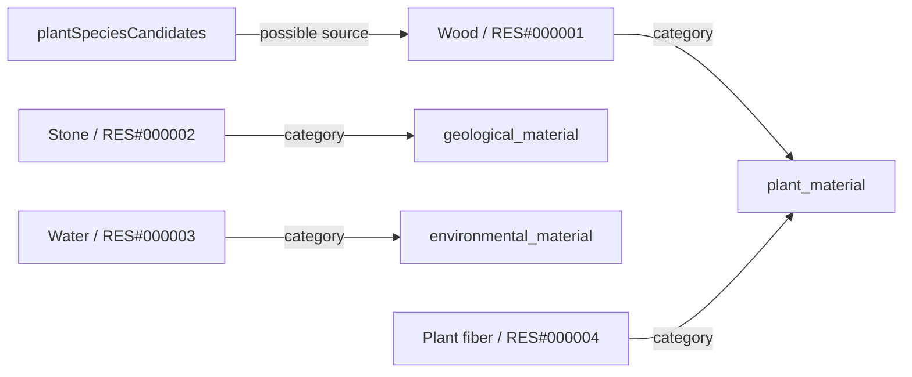

### Group 2

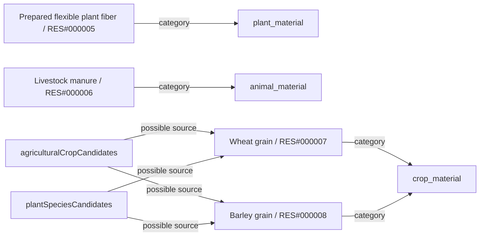

### Group 3

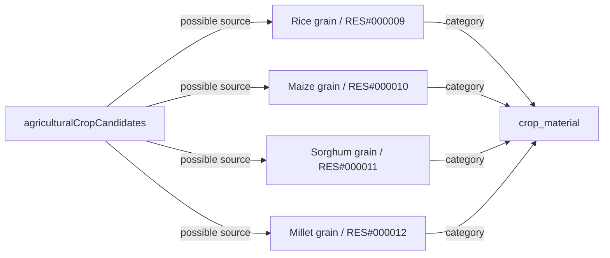

### Group 4

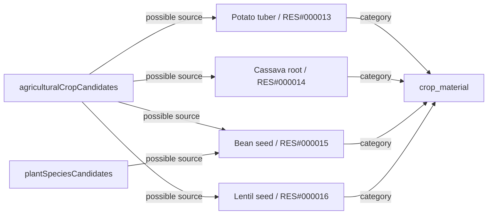

### Group 5

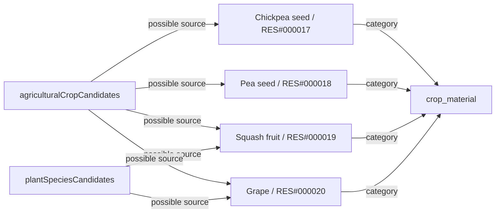

### Group 6

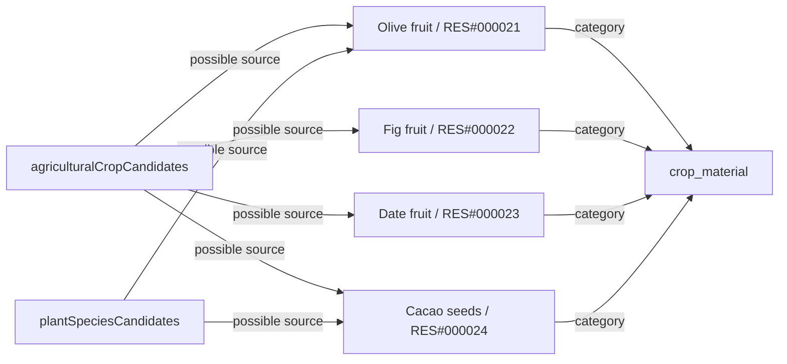

### Group 7

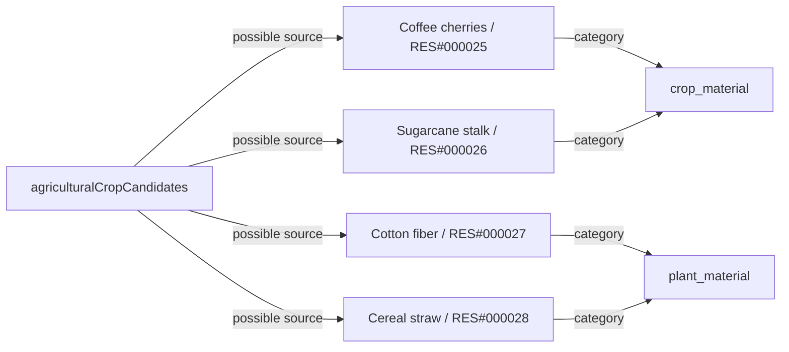

### Group 8

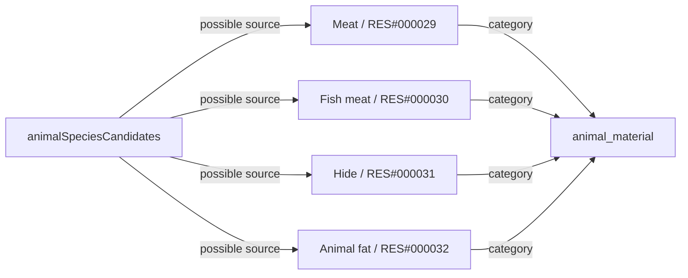

### Group 9

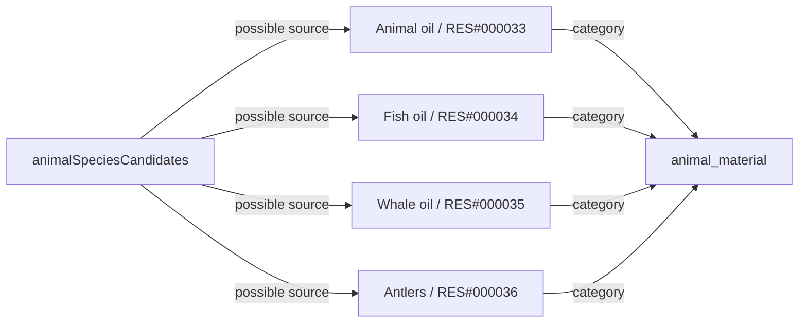

### Group 10

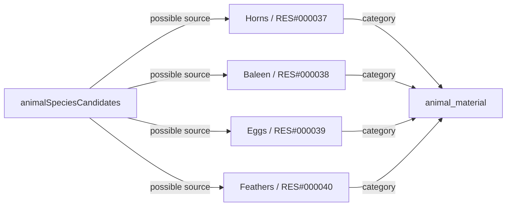

### Group 11

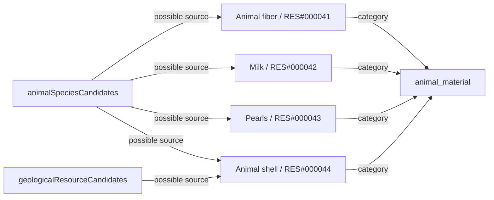

### Group 12

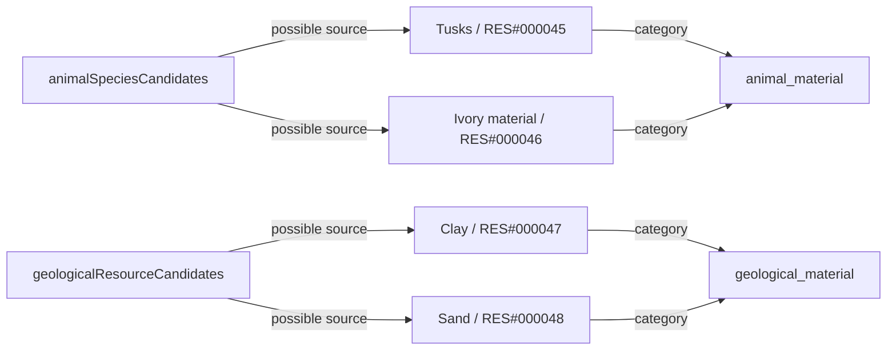

### Group 13

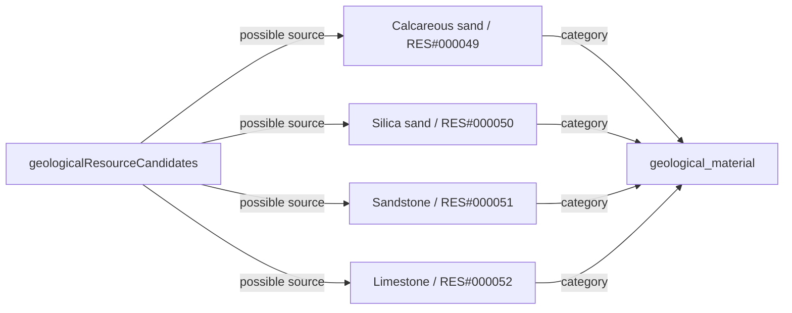

### Group 14

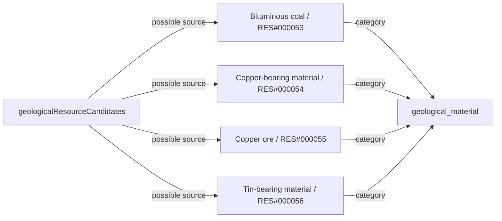

### Group 15

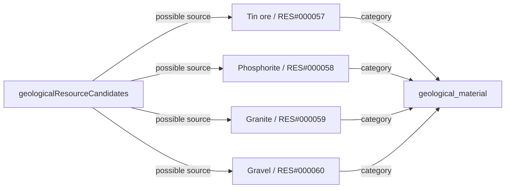

### Group 16

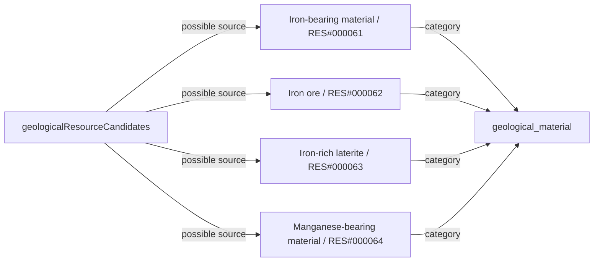

### Group 17

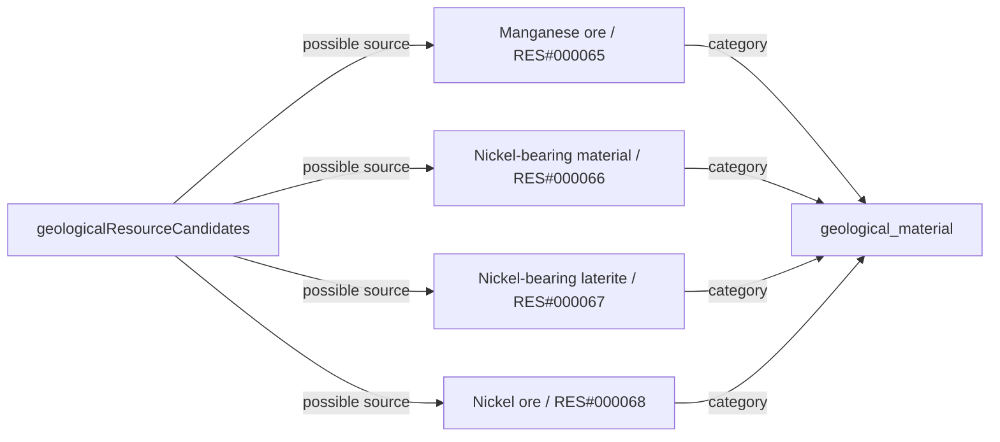

### Group 18

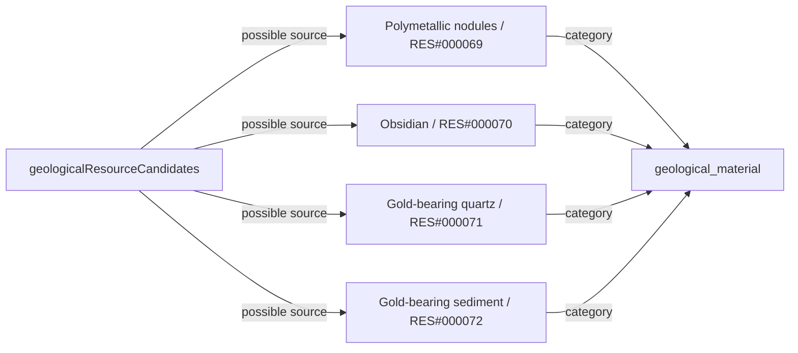

### Group 19

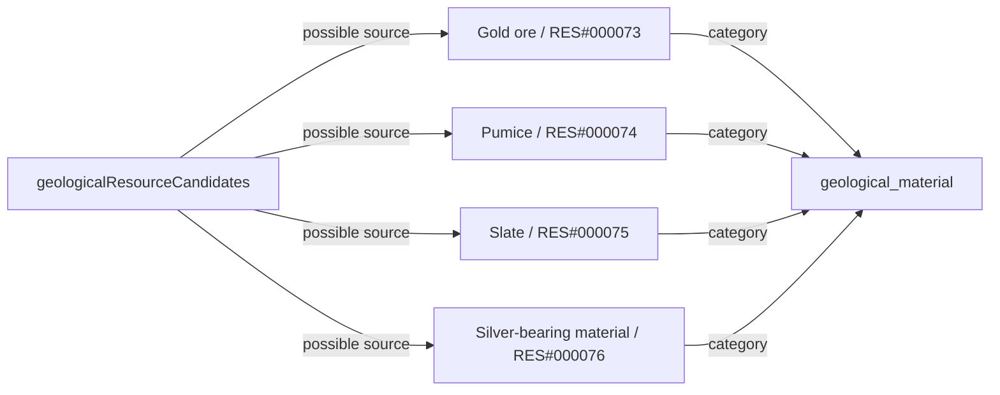

### Group 20

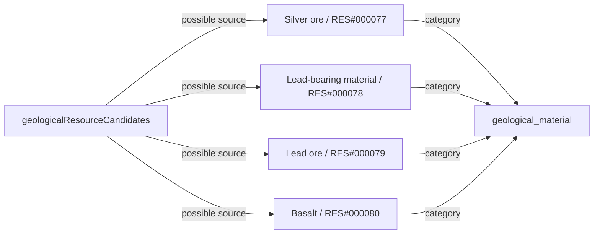

### Group 21

```mermaid
flowchart LR
    r0["Volcanic rock / RES#000081"]
    k0["geological_material"]
    r0 -->|category| k0
    s0["geologicalResourceCandidates"]
    s0 -->|possible source| r0
    r1["Rock salt / RES#000082"]
    r1 -->|category| k0
    s0 -->|possible source| r1
    r2["Sea salt / RES#000083"]
    r2 -->|category| k0
    s0 -->|possible source| r2
    r3["Flint / RES#000084"]
    r3 -->|category| k0
    s0 -->|possible source| r3
```

### Group 22

```mermaid
flowchart LR
    r0["Peat / RES#000085"]
    k0["geological_material"]
    r0 -->|category| k0
    s0["geologicalResourceCandidates"]
    s0 -->|possible source| r0
    r1["Gypsum / RES#000086"]
    r1 -->|category| k0
    s0 -->|possible source| r1
    r2["Opal / RES#000087"]
    r2 -->|category| k0
    s0 -->|possible source| r2
    r3["Wood plank / RES#000088"]
    k1["construction_material"]
    r3 -->|category| k1
```

### Group 23

```mermaid
flowchart LR
    r0["Stone block / RES#000089"]
    k0["construction_material"]
    r0 -->|category| k0
    r1["Charcoal / RES#000090"]
    k1["fuel"]
    r1 -->|category| k1
    r2["Wheat flour / RES#000091"]
    k2["food_ingredient"]
    r2 -->|category| k2
    r3["Bread / RES#000092"]
    k3["food_product"]
    r3 -->|category| k3
```

### Group 24

```mermaid
flowchart LR
    r0["Copper metal / RES#000093"]
    k0["metal"]
    r0 -->|category| k0
    r1["Tin metal / RES#000094"]
    r1 -->|category| k0
    r2["Tin bronze / RES#000095"]
    r2 -->|category| k0
    r3["Iron bloom / RES#000096"]
    r3 -->|category| k0
```

### Group 25

```mermaid
flowchart LR
    r0["Worked iron / RES#000097"]
    k0["metal"]
    r0 -->|category| k0
    r1["Lead metal / RES#000098"]
    r1 -->|category| k0
    r2["Silver metal / RES#000099"]
    r2 -->|category| k0
    r3["Gold metal / RES#000100"]
    r3 -->|category| k0
```

### Group 26

```mermaid
flowchart LR
    r0["Cotton yarn / RES#000101"]
    k0["textile_material"]
    r0 -->|category| k0
    r1["Cotton cloth / RES#000102"]
    r1 -->|category| k0
    r2["Olive oil / RES#000103"]
    k1["food_ingredient"]
    r2 -->|category| k1
    r3["Leather / RES#000104"]
    k2["animal_material"]
    r3 -->|category| k2
```

## Proposed transformations

Each processTag groups its known input endpoints; fuel, water, facilities and other inputs may still be missing. This is not an operational recipe.

### Processes 1

```mermaid
flowchart LR
    p0["wood_sawing / guide"]
    r0["Wood / RES#000001"]
    r0 -->|input endpoint| p0
    r1["Wood plank / RES#000088"]
    p0 -->|output endpoint| r1
    p1["stone_preparation / guide"]
    r2["Stone / RES#000002"]
    r2 -->|input endpoint| p1
    r3["Stone block / RES#000089"]
    p1 -->|output endpoint| r3
    p2["granite_building_material_selection / guide"]
    r4["Granite / RES#000059"]
    r4 -->|input endpoint| p2
    p2 -->|output endpoint| r2
```

### Processes 2

```mermaid
flowchart LR
    p0["limestone_building_material_selection / guide"]
    r0["Limestone / RES#000052"]
    r0 -->|input endpoint| p0
    r1["Stone / RES#000002"]
    p0 -->|output endpoint| r1
    p1["sandstone_building_material_selection / guide"]
    r2["Sandstone / RES#000051"]
    r2 -->|input endpoint| p1
    p1 -->|output endpoint| r1
    p2["basalt_building_material_selection / guide"]
    r3["Basalt / RES#000080"]
    r3 -->|input endpoint| p2
    p2 -->|output endpoint| r1
```

### Processes 3

```mermaid
flowchart LR
    p0["slate_building_material_selection / guide"]
    r0["Slate / RES#000075"]
    r0 -->|input endpoint| p0
    r1["Stone / RES#000002"]
    p0 -->|output endpoint| r1
    p1["charcoal_production / guide"]
    r2["Wood / RES#000001"]
    r2 -->|input endpoint| p1
    r3["Charcoal / RES#000090"]
    p1 -->|output endpoint| r3
    p2["fiber_preparation / guide"]
    r4["Plant fiber / RES#000004"]
    r4 -->|input endpoint| p2
    r5["Prepared flexible plant fiber / RES#000005"]
    p2 -->|output endpoint| r5
```

### Processes 4

```mermaid
flowchart LR
    p0["wheat_milling / guide"]
    r0["Wheat grain / RES#000007"]
    r0 -->|input endpoint| p0
    r1["Wheat flour / RES#000091"]
    p0 -->|output endpoint| r1
    p1["breadmaking / guide"]
    r1 -->|input endpoint| p1
    r2["Water / RES#000003"]
    r2 -->|input endpoint| p1
    r3["Bread / RES#000092"]
    p1 -->|output endpoint| r3
    p2["copper_metallurgy / guide"]
    r4["Copper ore / RES#000055"]
    r4 -->|input endpoint| p2
    r5["Copper metal / RES#000093"]
    p2 -->|output endpoint| r5
```

### Processes 5

```mermaid
flowchart LR
    p0["tin_metallurgy / guide"]
    r0["Tin ore / RES#000057"]
    r0 -->|input endpoint| p0
    r1["Tin metal / RES#000094"]
    p0 -->|output endpoint| r1
    p1["tin_bronze_alloying / guide"]
    r2["Copper metal / RES#000093"]
    r2 -->|input endpoint| p1
    r1 -->|input endpoint| p1
    r3["Tin bronze / RES#000095"]
    p1 -->|output endpoint| r3
    p2["bloomery_ironmaking / guide"]
    r4["Iron ore / RES#000062"]
    r4 -->|input endpoint| p2
    r5["Iron bloom / RES#000096"]
    p2 -->|output endpoint| r5
```

### Processes 6

```mermaid
flowchart LR
    p0["iron_bloom_consolidation / guide"]
    r0["Iron bloom / RES#000096"]
    r0 -->|input endpoint| p0
    r1["Worked iron / RES#000097"]
    p0 -->|output endpoint| r1
    p1["lead_metal_processing / guide"]
    r2["Lead ore / RES#000079"]
    r2 -->|input endpoint| p1
    r3["Lead metal / RES#000098"]
    p1 -->|output endpoint| r3
    p2["silver_metal_processing / guide"]
    r4["Silver ore / RES#000077"]
    r4 -->|input endpoint| p2
    r5["Silver metal / RES#000099"]
    p2 -->|output endpoint| r5
```

### Processes 7

```mermaid
flowchart LR
    p0["gold_metal_processing / guide"]
    r0["Gold ore / RES#000073"]
    r0 -->|input endpoint| p0
    r1["Gold metal / RES#000100"]
    p0 -->|output endpoint| r1
    p1["alluvial_gold_recovery / guide"]
    r2["Gold-bearing sediment / RES#000072"]
    r2 -->|input endpoint| p1
    p1 -->|output endpoint| r1
    p2["cotton_spinning / guide"]
    r3["Cotton fiber / RES#000027"]
    r3 -->|input endpoint| p2
    r4["Cotton yarn / RES#000101"]
    p2 -->|output endpoint| r4
```

### Processes 8

```mermaid
flowchart LR
    p0["cotton_weaving / guide"]
    r0["Cotton yarn / RES#000101"]
    r0 -->|input endpoint| p0
    r1["Cotton cloth / RES#000102"]
    p0 -->|output endpoint| r1
    p1["olive_oil_extraction / guide"]
    r2["Olive fruit / RES#000021"]
    r2 -->|input endpoint| p1
    r3["Olive oil / RES#000103"]
    p1 -->|output endpoint| r3
    p2["hide_tanning / guide"]
    r4["Hide / RES#000031"]
    r4 -->|input endpoint| p2
    r5["Leather / RES#000104"]
    p2 -->|output endpoint| r5
```

### Processes 9

```mermaid
flowchart LR
    p0["ivory_preparation / guide"]
    r0["Tusks / RES#000045"]
    r0 -->|input endpoint| p0
    r1["Ivory material / RES#000046"]
    p0 -->|output endpoint| r1
```

## All source bindings

| sourceCollection | sourceId | resourceId | requiresProcessing | reviewStatus |
| --- | --- | --- | --- | --- |
| agriculturalCropCandidates | wheat | RES#000007 | false | proposed_requires_species_and_action_review |
| agriculturalCropCandidates | barley | RES#000008 | false | proposed_requires_species_and_action_review |
| agriculturalCropCandidates | rice | RES#000009 | false | proposed_requires_species_and_action_review |
| agriculturalCropCandidates | maize | RES#000010 | false | proposed_requires_species_and_action_review |
| agriculturalCropCandidates | sorghum | RES#000011 | false | proposed_requires_species_and_action_review |
| agriculturalCropCandidates | millet | RES#000012 | false | proposed_requires_species_and_action_review |
| agriculturalCropCandidates | potato | RES#000013 | false | proposed_requires_species_and_action_review |
| agriculturalCropCandidates | cassava | RES#000014 | false | proposed_requires_species_and_action_review |
| agriculturalCropCandidates | beans | RES#000015 | false | proposed_requires_species_and_action_review |
| agriculturalCropCandidates | lentils | RES#000016 | false | proposed_requires_species_and_action_review |
| agriculturalCropCandidates | chickpeas | RES#000017 | false | proposed_requires_species_and_action_review |
| agriculturalCropCandidates | peas | RES#000018 | false | proposed_requires_species_and_action_review |
| agriculturalCropCandidates | squash | RES#000019 | false | proposed_requires_species_and_action_review |
| agriculturalCropCandidates | grapevine | RES#000020 | false | proposed_requires_species_and_action_review |
| agriculturalCropCandidates | olive | RES#000021 | false | proposed_requires_species_and_action_review |
| agriculturalCropCandidates | fig | RES#000022 | false | proposed_requires_species_and_action_review |
| agriculturalCropCandidates | date_palm | RES#000023 | false | proposed_requires_species_and_action_review |
| agriculturalCropCandidates | cacao | RES#000024 | false | proposed_requires_species_and_action_review |
| agriculturalCropCandidates | coffee | RES#000025 | false | proposed_requires_species_and_action_review |
| agriculturalCropCandidates | sugarcane | RES#000026 | false | proposed_requires_species_and_action_review |
| agriculturalCropCandidates | cotton | RES#000027 | false | proposed_requires_species_and_action_review |
| plantSpeciesCandidates | plant_european_oaks | RES#000001 | false | proposed_requires_species_and_action_review |
| plantSpeciesCandidates | plant_north_american_oaks | RES#000001 | false | proposed_requires_species_and_action_review |
| plantSpeciesCandidates | plant_californian_oaks | RES#000001 | false | proposed_requires_species_and_action_review |
| plantSpeciesCandidates | plant_scots_pine | RES#000001 | false | proposed_requires_species_and_action_review |
| plantSpeciesCandidates | plant_mountain_pines | RES#000001 | false | proposed_requires_species_and_action_review |
| plantSpeciesCandidates | plant_white_spruce | RES#000001 | false | proposed_requires_species_and_action_review |
| plantSpeciesCandidates | plant_black_spruce | RES#000001 | false | proposed_requires_species_and_action_review |
| plantSpeciesCandidates | plant_eurasian_spruces | RES#000001 | false | proposed_requires_species_and_action_review |
| plantSpeciesCandidates | plant_european_beech | RES#000001 | false | proposed_requires_species_and_action_review |
| plantSpeciesCandidates | plant_native_teak | RES#000001 | false | proposed_requires_species_and_action_review |
| plantSpeciesCandidates | plant_regional_tropical_timber_trees | RES#000001 | false | proposed_requires_species_and_action_review |
| plantSpeciesCandidates | plant_coigue | RES#000001 | false | proposed_requires_species_and_action_review |
| plantSpeciesCandidates | plant_lenga_beech | RES#000001 | false | proposed_requires_species_and_action_review |
| plantSpeciesCandidates | plant_southwest_asian_wild_wheat | RES#000007 | false | proposed_requires_species_and_action_review |
| plantSpeciesCandidates | plant_wild_barley | RES#000008 | false | proposed_requires_species_and_action_review |
| plantSpeciesCandidates | plant_wild_beans | RES#000015 | false | proposed_requires_species_and_action_review |
| plantSpeciesCandidates | plant_wild_squashes | RES#000019 | false | proposed_requires_species_and_action_review |
| plantSpeciesCandidates | plant_native_wild_grapevine | RES#000020 | false | proposed_requires_species_and_action_review |
| plantSpeciesCandidates | plant_wild_olive | RES#000021 | false | proposed_requires_species_and_action_review |
| plantSpeciesCandidates | plant_wild_cacao | RES#000024 | false | proposed_requires_species_and_action_review |
| agriculturalCropCandidates | wheat | RES#000028 | false | proposed_requires_species_and_action_review |
| agriculturalCropCandidates | barley | RES#000028 | false | proposed_requires_species_and_action_review |
| agriculturalCropCandidates | rice | RES#000028 | false | proposed_requires_species_and_action_review |
| animalSpeciesCandidates | animal_regional_seals | RES#000032 | false | source_potential_use_requires_species_and_action_review |
| animalSpeciesCandidates | animal_coastal_seals_and_sea_lions | RES#000032 | false | source_potential_use_requires_species_and_action_review |
| animalSpeciesCandidates | animal_giant_anteater | RES#000032 | false | source_potential_use_requires_species_and_action_review |
| animalSpeciesCandidates | animal_american_black_bear | RES#000032 | false | source_potential_use_requires_species_and_action_review |
| animalSpeciesCandidates | animal_asian_black_bear | RES#000032 | false | source_potential_use_requires_species_and_action_review |
| animalSpeciesCandidates | animal_brown_bear | RES#000032 | false | source_potential_use_requires_species_and_action_review |
| animalSpeciesCandidates | animal_coastal_and_sea_ice_polar_bear | RES#000032 | false | source_potential_use_requires_species_and_action_review |
| animalSpeciesCandidates | animal_island_coastal_penguins | RES#000032 | false | source_potential_use_requires_species_and_action_review |
| animalSpeciesCandidates | animal_southern_regional_penguins | RES#000032 | false | source_potential_use_requires_species_and_action_review |
| animalSpeciesCandidates | animal_coastal_elephant_seals | RES#000033 | true | source_potential_use_requires_species_and_action_review |
| animalSpeciesCandidates | animal_woodland_caribou | RES#000036 | false | source_potential_use_requires_species_and_action_review |
| animalSpeciesCandidates | animal_tundra_caribou | RES#000036 | false | source_potential_use_requires_species_and_action_review |
| animalSpeciesCandidates | animal_reindeer | RES#000036 | false | source_potential_use_requires_species_and_action_review |
| animalSpeciesCandidates | animal_regional_migratory_whales | RES#000038 | false | source_potential_use_requires_species_and_action_review |
| animalSpeciesCandidates | animal_australian_scrub_birds | RES#000039 | false | source_potential_use_requires_species_and_action_review |
| animalSpeciesCandidates | animal_shorebirds_and_waterbirds | RES#000039 | false | source_potential_use_requires_species_and_action_review |
| animalSpeciesCandidates | animal_southern_cassowary | RES#000039 | false | source_potential_use_requires_species_and_action_review |
| animalSpeciesCandidates | animal_roadrunner | RES#000039 | false | source_potential_use_requires_species_and_action_review |
| animalSpeciesCandidates | animal_emu | RES#000039 | false | source_potential_use_requires_species_and_action_review |
| animalSpeciesCandidates | animal_red_junglefowl | RES#000039 | false | source_potential_use_requires_species_and_action_review |
| animalSpeciesCandidates | animal_ocellated_turkey | RES#000039 | false | source_potential_use_requires_species_and_action_review |
| animalSpeciesCandidates | animal_indian_peafowl | RES#000039 | false | source_potential_use_requires_species_and_action_review |
| animalSpeciesCandidates | animal_island_petrels_and_albatrosses | RES#000039 | false | source_potential_use_requires_species_and_action_review |
| animalSpeciesCandidates | animal_island_coastal_penguins | RES#000039 | false | source_potential_use_requires_species_and_action_review |
| animalSpeciesCandidates | animal_southern_regional_penguins | RES#000039 | false | source_potential_use_requires_species_and_action_review |
| animalSpeciesCandidates | animal_desert_tortoise | RES#000039 | false | source_potential_use_requires_species_and_action_review |
| animalSpeciesCandidates | animal_sea_turtles | RES#000039 | false | source_potential_use_requires_species_and_action_review |
| animalSpeciesCandidates | animal_regional_land_tortoises | RES#000039 | false | source_potential_use_requires_species_and_action_review |
| animalSpeciesCandidates | animal_greater_rhea | RES#000039 | false | source_potential_use_requires_species_and_action_review |
| animalSpeciesCandidates | animal_australian_scrub_birds | RES#000040 | false | source_potential_use_requires_species_and_action_review |
| animalSpeciesCandidates | animal_birds_of_paradise | RES#000040 | false | source_potential_use_requires_species_and_action_review |
| animalSpeciesCandidates | animal_shorebirds_and_waterbirds | RES#000040 | false | source_potential_use_requires_species_and_action_review |
| animalSpeciesCandidates | animal_snowy_owl | RES#000040 | false | source_potential_use_requires_species_and_action_review |
| animalSpeciesCandidates | animal_cockatoos_and_savanna_birds | RES#000040 | false | source_potential_use_requires_species_and_action_review |
| animalSpeciesCandidates | animal_southern_cassowary | RES#000040 | false | source_potential_use_requires_species_and_action_review |
| animalSpeciesCandidates | animal_roadrunner | RES#000040 | false | source_potential_use_requires_species_and_action_review |
| animalSpeciesCandidates | animal_andean_condor | RES#000040 | false | source_potential_use_requires_species_and_action_review |
| animalSpeciesCandidates | animal_emu | RES#000040 | false | source_potential_use_requires_species_and_action_review |
| animalSpeciesCandidates | animal_red_junglefowl | RES#000040 | false | source_potential_use_requires_species_and_action_review |
| animalSpeciesCandidates | animal_macaws | RES#000040 | false | source_potential_use_requires_species_and_action_review |
| animalSpeciesCandidates | animal_ocellated_turkey | RES#000040 | false | source_potential_use_requires_species_and_action_review |
| animalSpeciesCandidates | animal_indian_peafowl | RES#000040 | false | source_potential_use_requires_species_and_action_review |
| animalSpeciesCandidates | animal_island_petrels_and_albatrosses | RES#000040 | false | source_potential_use_requires_species_and_action_review |
| animalSpeciesCandidates | animal_bearded_vulture | RES#000040 | false | source_potential_use_requires_species_and_action_review |
| animalSpeciesCandidates | animal_bearded_vulture_in_suitable_mountains | RES#000040 | false | source_potential_use_requires_species_and_action_review |
| animalSpeciesCandidates | animal_golden_eagle | RES#000040 | false | source_potential_use_requires_species_and_action_review |
| animalSpeciesCandidates | animal_greater_rhea | RES#000040 | false | source_potential_use_requires_species_and_action_review |
| animalSpeciesCandidates | animal_muskox | RES#000041 | false | source_potential_use_requires_species_and_action_review |
| animalSpeciesCandidates | animal_wild_bactrian_camel | RES#000041 | false | source_potential_use_requires_species_and_action_review |
| animalSpeciesCandidates | animal_guanaco_in_coastal_deserts_and_foothills | RES#000041 | false | source_potential_use_requires_species_and_action_review |
| animalSpeciesCandidates | animal_guanaco_at_suitable_elevations | RES#000041 | false | source_potential_use_requires_species_and_action_review |
| animalSpeciesCandidates | animal_vicuna | RES#000041 | false | source_potential_use_requires_species_and_action_review |
| animalSpeciesCandidates | animal_wild_yak | RES#000041 | false | source_potential_use_requires_species_and_action_review |
| animalSpeciesCandidates | animal_atlantic_cod | RES#000030 | false | source_potential_use_requires_species_and_action_review |
| animalSpeciesCandidates | animal_regional_reef_fish | RES#000030 | false | source_potential_use_requires_species_and_action_review |
| animalSpeciesCandidates | animal_juvenile_estuarine_fish | RES#000030 | false | source_potential_use_requires_species_and_action_review |
| animalSpeciesCandidates | animal_regional_polar_fish | RES#000030 | false | source_potential_use_requires_species_and_action_review |
| animalSpeciesCandidates | animal_regional_sardines | RES#000030 | false | source_potential_use_requires_species_and_action_review |
| animalSpeciesCandidates | animal_atlantic_cod | RES#000034 | true | source_potential_use_requires_species_and_action_review |
| animalSpeciesCandidates | animal_regional_reef_fish | RES#000034 | true | source_potential_use_requires_species_and_action_review |
| animalSpeciesCandidates | animal_juvenile_estuarine_fish | RES#000034 | true | source_potential_use_requires_species_and_action_review |
| animalSpeciesCandidates | animal_regional_polar_fish | RES#000034 | true | source_potential_use_requires_species_and_action_review |
| animalSpeciesCandidates | animal_regional_sardines | RES#000034 | true | source_potential_use_requires_species_and_action_review |
| animalSpeciesCandidates | animal_eurasian_moose | RES#000031 | false | source_potential_use_requires_species_and_action_review |
| animalSpeciesCandidates | animal_north_american_moose | RES#000031 | false | source_potential_use_requires_species_and_action_review |
| animalSpeciesCandidates | animal_regional_small_antelopes | RES#000031 | false | source_potential_use_requires_species_and_action_review |
| animalSpeciesCandidates | animal_regional_antelopes | RES#000031 | false | source_potential_use_requires_species_and_action_review |
| animalSpeciesCandidates | animal_american_bison | RES#000031 | false | source_potential_use_requires_species_and_action_review |
| animalSpeciesCandidates | animal_muskox | RES#000031 | false | source_potential_use_requires_species_and_action_review |
| animalSpeciesCandidates | animal_african_buffalo | RES#000031 | false | source_potential_use_requires_species_and_action_review |
| animalSpeciesCandidates | animal_przewalski_horse | RES#000031 | false | source_potential_use_requires_species_and_action_review |
| animalSpeciesCandidates | animal_wild_bactrian_camel | RES#000031 | false | source_potential_use_requires_species_and_action_review |
| animalSpeciesCandidates | animal_antilopine_kangaroo | RES#000031 | false | source_potential_use_requires_species_and_action_review |
| animalSpeciesCandidates | animal_western_grey_kangaroo | RES#000031 | false | source_potential_use_requires_species_and_action_review |
| animalSpeciesCandidates | animal_red_kangaroo | RES#000031 | false | source_potential_use_requires_species_and_action_review |
| animalSpeciesCandidates | animal_new_guinea_tree_kangaroos | RES#000031 | false | source_potential_use_requires_species_and_action_review |
| animalSpeciesCandidates | animal_capybara | RES#000031 | false | source_potential_use_requires_species_and_action_review |
| animalSpeciesCandidates | animal_woodland_caribou | RES#000031 | false | source_potential_use_requires_species_and_action_review |
| animalSpeciesCandidates | animal_tundra_caribou | RES#000031 | false | source_potential_use_requires_species_and_action_review |
| animalSpeciesCandidates | animal_southern_cassowary | RES#000031 | false | source_potential_use_requires_species_and_action_review |
| animalSpeciesCandidates | animal_plains_zebra | RES#000031 | false | source_potential_use_requires_species_and_action_review |
| animalSpeciesCandidates | animal_chital | RES#000031 | false | source_potential_use_requires_species_and_action_review |
| animalSpeciesCandidates | animal_red_deer | RES#000031 | false | source_potential_use_requires_species_and_action_review |
| animalSpeciesCandidates | animal_sika_deer | RES#000031 | false | source_potential_use_requires_species_and_action_review |
| animalSpeciesCandidates | animal_european_rabbit | RES#000031 | false | source_potential_use_requires_species_and_action_review |
| animalSpeciesCandidates | animal_coyote | RES#000031 | false | source_potential_use_requires_species_and_action_review |
| animalSpeciesCandidates | animal_cuscuses_and_other_arboreal_marsupials | RES#000031 | false | source_potential_use_requires_species_and_action_review |
| animalSpeciesCandidates | animal_rock_hyraxes | RES#000031 | false | source_potential_use_requires_species_and_action_review |
| animalSpeciesCandidates | animal_dingo | RES#000031 | false | source_potential_use_requires_species_and_action_review |
| animalSpeciesCandidates | animal_introduced_domestic_or_feral_dromedary | RES#000031 | false | source_potential_use_requires_species_and_action_review |
| animalSpeciesCandidates | animal_african_forest_elephant | RES#000031 | false | source_potential_use_requires_species_and_action_review |
| animalSpeciesCandidates | animal_african_savanna_elephant | RES#000031 | false | source_potential_use_requires_species_and_action_review |
| animalSpeciesCandidates | animal_african_savanna_elephant_in_dry_forest_mosaics | RES#000031 | false | source_potential_use_requires_species_and_action_review |
| animalSpeciesCandidates | animal_coastal_elephant_seals | RES#000031 | false | source_potential_use_requires_species_and_action_review |
| animalSpeciesCandidates | animal_emu | RES#000031 | false | source_potential_use_requires_species_and_action_review |
| animalSpeciesCandidates | animal_short_beaked_echidna | RES#000031 | false | source_potential_use_requires_species_and_action_review |
| animalSpeciesCandidates | animal_regional_seals | RES#000031 | false | source_potential_use_requires_species_and_action_review |
| animalSpeciesCandidates | animal_coastal_seals_and_sea_lions | RES#000031 | false | source_potential_use_requires_species_and_action_review |
| animalSpeciesCandidates | animal_mongolian_gazelle | RES#000031 | false | source_potential_use_requires_species_and_action_review |
| animalSpeciesCandidates | animal_desert_gazelles | RES#000031 | false | source_potential_use_requires_species_and_action_review |
| animalSpeciesCandidates | animal_subarctic_wolverine | RES#000031 | false | source_potential_use_requires_species_and_action_review |
| animalSpeciesCandidates | animal_guanaco_in_coastal_deserts_and_foothills | RES#000031 | false | source_potential_use_requires_species_and_action_review |
| animalSpeciesCandidates | animal_guanaco_at_suitable_elevations | RES#000031 | false | source_potential_use_requires_species_and_action_review |
| animalSpeciesCandidates | animal_huemul | RES#000031 | false | source_potential_use_requires_species_and_action_review |
| animalSpeciesCandidates | animal_wild_boar | RES#000031 | false | source_potential_use_requires_species_and_action_review |
| animalSpeciesCandidates | animal_eurasian_wild_boar | RES#000031 | false | source_potential_use_requires_species_and_action_review |
| animalSpeciesCandidates | animal_jaguar | RES#000031 | false | source_potential_use_requires_species_and_action_review |
| animalSpeciesCandidates | animal_regional_jerboas_and_gerbils | RES#000031 | false | source_potential_use_requires_species_and_action_review |
| animalSpeciesCandidates | animal_giraffe | RES#000031 | false | source_potential_use_requires_species_and_action_review |
| animalSpeciesCandidates | animal_lemming | RES#000031 | false | source_potential_use_requires_species_and_action_review |
| animalSpeciesCandidates | animal_snow_leopard | RES#000031 | false | source_potential_use_requires_species_and_action_review |
| animalSpeciesCandidates | animal_lion | RES#000031 | false | source_potential_use_requires_species_and_action_review |
| animalSpeciesCandidates | animal_arctic_hare | RES#000031 | false | source_potential_use_requires_species_and_action_review |
| animalSpeciesCandidates | animal_eurasian_lynx | RES#000031 | false | source_potential_use_requires_species_and_action_review |
| animalSpeciesCandidates | animal_maned_wolf | RES#000031 | false | source_potential_use_requires_species_and_action_review |
| animalSpeciesCandidates | animal_ethiopian_wolf | RES#000031 | false | source_potential_use_requires_species_and_action_review |
| animalSpeciesCandidates | animal_grey_wolf | RES#000031 | false | source_potential_use_requires_species_and_action_review |
| animalSpeciesCandidates | animal_alpine_marmot | RES#000031 | false | source_potential_use_requires_species_and_action_review |
| animalSpeciesCandidates | animal_steppe_marmots | RES#000031 | false | source_potential_use_requires_species_and_action_review |
| animalSpeciesCandidates | animal_okapi | RES#000031 | false | source_potential_use_requires_species_and_action_review |
| animalSpeciesCandidates | animal_giant_anteater | RES#000031 | false | source_potential_use_requires_species_and_action_review |
| animalSpeciesCandidates | animal_american_black_bear | RES#000031 | false | source_potential_use_requires_species_and_action_review |
| animalSpeciesCandidates | animal_asian_black_bear | RES#000031 | false | source_potential_use_requires_species_and_action_review |
| animalSpeciesCandidates | animal_brown_bear | RES#000031 | false | source_potential_use_requires_species_and_action_review |
| animalSpeciesCandidates | animal_coastal_and_sea_ice_polar_bear | RES#000031 | false | source_potential_use_requires_species_and_action_review |
| animalSpeciesCandidates | animal_collared_peccary | RES#000031 | false | source_potential_use_requires_species_and_action_review |
| animalSpeciesCandidates | animal_perentie | RES#000031 | false | source_potential_use_requires_species_and_action_review |
| animalSpeciesCandidates | animal_prairie_dog | RES#000031 | false | source_potential_use_requires_species_and_action_review |
| animalSpeciesCandidates | animal_pudu | RES#000031 | false | source_potential_use_requires_species_and_action_review |
| animalSpeciesCandidates | animal_puma | RES#000031 | false | source_potential_use_requires_species_and_action_review |
| animalSpeciesCandidates | animal_chamois | RES#000031 | false | source_potential_use_requires_species_and_action_review |
| animalSpeciesCandidates | animal_reindeer | RES#000031 | false | source_potential_use_requires_species_and_action_review |
| animalSpeciesCandidates | animal_eurasian_saiga | RES#000031 | false | source_potential_use_requires_species_and_action_review |
| animalSpeciesCandidates | animal_regional_rattlesnakes | RES#000031 | false | source_potential_use_requires_species_and_action_review |
| animalSpeciesCandidates | animal_himalayan_tahr | RES#000031 | false | source_potential_use_requires_species_and_action_review |
| animalSpeciesCandidates | animal_regional_amazonian_or_central_american_tapir | RES#000031 | false | source_potential_use_requires_species_and_action_review |
| animalSpeciesCandidates | animal_malayan_tapir | RES#000031 | false | source_potential_use_requires_species_and_action_review |
| animalSpeciesCandidates | animal_tiger | RES#000031 | false | source_potential_use_requires_species_and_action_review |
| animalSpeciesCandidates | animal_regional_wallabies | RES#000031 | false | source_potential_use_requires_species_and_action_review |
| animalSpeciesCandidates | animal_white_tailed_deer | RES#000031 | false | source_potential_use_requires_species_and_action_review |
| animalSpeciesCandidates | animal_mesoamerican_white_tailed_deer | RES#000031 | false | source_potential_use_requires_species_and_action_review |
| animalSpeciesCandidates | animal_pampas_deer | RES#000031 | false | source_potential_use_requires_species_and_action_review |
| animalSpeciesCandidates | animal_vicuna | RES#000031 | false | source_potential_use_requires_species_and_action_review |
| animalSpeciesCandidates | animal_andean_viscacha | RES#000031 | false | source_potential_use_requires_species_and_action_review |
| animalSpeciesCandidates | animal_rock_dwelling_viscachas | RES#000031 | false | source_potential_use_requires_species_and_action_review |
| animalSpeciesCandidates | animal_wild_yak | RES#000031 | false | source_potential_use_requires_species_and_action_review |
| animalSpeciesCandidates | animal_corsac_fox | RES#000031 | false | source_potential_use_requires_species_and_action_review |
| animalSpeciesCandidates | animal_culpeo_fox | RES#000031 | false | source_potential_use_requires_species_and_action_review |
| animalSpeciesCandidates | animal_culpeo_fox_in_arid_habitats | RES#000031 | false | source_potential_use_requires_species_and_action_review |
| animalSpeciesCandidates | animal_fennec_fox | RES#000031 | false | source_potential_use_requires_species_and_action_review |
| animalSpeciesCandidates | animal_arctic_fox | RES#000031 | false | source_potential_use_requires_species_and_action_review |
| animalSpeciesCandidates | animal_alpine_ibex | RES#000031 | false | source_potential_use_requires_species_and_action_review |
| animalSpeciesCandidates | animal_walia_ibex | RES#000031 | false | source_potential_use_requires_species_and_action_review |
| animalSpeciesCandidates | animal_siberian_ibex | RES#000031 | false | source_potential_use_requires_species_and_action_review |
| animalSpeciesCandidates | animal_greater_rhea | RES#000031 | false | source_potential_use_requires_species_and_action_review |
| animalSpeciesCandidates | animal_wildebeest | RES#000031 | false | source_potential_use_requires_species_and_action_review |
| animalSpeciesCandidates | animal_arabian_oryx | RES#000031 | false | source_potential_use_requires_species_and_action_review |
| animalSpeciesCandidates | animal_american_bison | RES#000037 | false | source_potential_use_requires_species_and_action_review |
| animalSpeciesCandidates | animal_african_buffalo | RES#000037 | false | source_potential_use_requires_species_and_action_review |
| animalSpeciesCandidates | animal_african_forest_elephant | RES#000046 | true | source_potential_use_requires_species_and_action_review |
| animalSpeciesCandidates | animal_african_savanna_elephant | RES#000046 | true | source_potential_use_requires_species_and_action_review |
| animalSpeciesCandidates | animal_african_savanna_elephant_in_dry_forest_mosaics | RES#000046 | true | source_potential_use_requires_species_and_action_review |
| animalSpeciesCandidates | animal_asian_elephant | RES#000046 | true | source_potential_use_requires_species_and_action_review |
| animalSpeciesCandidates | animal_asian_elephant_in_suitable_forests | RES#000046 | true | source_potential_use_requires_species_and_action_review |
| animalSpeciesCandidates | animal_eurasian_moose | RES#000029 | false | source_potential_use_requires_species_and_action_review |
| animalSpeciesCandidates | animal_north_american_moose | RES#000029 | false | source_potential_use_requires_species_and_action_review |
| animalSpeciesCandidates | animal_regional_small_antelopes | RES#000029 | false | source_potential_use_requires_species_and_action_review |
| animalSpeciesCandidates | animal_regional_antelopes | RES#000029 | false | source_potential_use_requires_species_and_action_review |
| animalSpeciesCandidates | animal_shorebirds_and_waterbirds | RES#000029 | false | source_potential_use_requires_species_and_action_review |
| animalSpeciesCandidates | animal_regional_migratory_whales | RES#000029 | false | source_potential_use_requires_species_and_action_review |
| animalSpeciesCandidates | animal_american_bison | RES#000029 | false | source_potential_use_requires_species_and_action_review |
| animalSpeciesCandidates | animal_muskox | RES#000029 | false | source_potential_use_requires_species_and_action_review |
| animalSpeciesCandidates | animal_african_buffalo | RES#000029 | false | source_potential_use_requires_species_and_action_review |
| animalSpeciesCandidates | animal_przewalski_horse | RES#000029 | false | source_potential_use_requires_species_and_action_review |
| animalSpeciesCandidates | animal_wild_bactrian_camel | RES#000029 | false | source_potential_use_requires_species_and_action_review |
| animalSpeciesCandidates | animal_coastal_crabs | RES#000029 | false | source_potential_use_requires_species_and_action_review |
| animalSpeciesCandidates | animal_mangrove_crabs | RES#000029 | false | source_potential_use_requires_species_and_action_review |
| animalSpeciesCandidates | animal_antilopine_kangaroo | RES#000029 | false | source_potential_use_requires_species_and_action_review |
| animalSpeciesCandidates | animal_western_grey_kangaroo | RES#000029 | false | source_potential_use_requires_species_and_action_review |
| animalSpeciesCandidates | animal_red_kangaroo | RES#000029 | false | source_potential_use_requires_species_and_action_review |
| animalSpeciesCandidates | animal_new_guinea_tree_kangaroos | RES#000029 | false | source_potential_use_requires_species_and_action_review |
| animalSpeciesCandidates | animal_capybara | RES#000029 | false | source_potential_use_requires_species_and_action_review |
| animalSpeciesCandidates | animal_woodland_caribou | RES#000029 | false | source_potential_use_requires_species_and_action_review |
| animalSpeciesCandidates | animal_tundra_caribou | RES#000029 | false | source_potential_use_requires_species_and_action_review |
| animalSpeciesCandidates | animal_southern_cassowary | RES#000029 | false | source_potential_use_requires_species_and_action_review |
| animalSpeciesCandidates | animal_plains_zebra | RES#000029 | false | source_potential_use_requires_species_and_action_review |
| animalSpeciesCandidates | animal_chital | RES#000029 | false | source_potential_use_requires_species_and_action_review |
| animalSpeciesCandidates | animal_red_deer | RES#000029 | false | source_potential_use_requires_species_and_action_review |
| animalSpeciesCandidates | animal_sika_deer | RES#000029 | false | source_potential_use_requires_species_and_action_review |
| animalSpeciesCandidates | animal_european_rabbit | RES#000029 | false | source_potential_use_requires_species_and_action_review |
| animalSpeciesCandidates | animal_cuscuses_and_other_arboreal_marsupials | RES#000029 | false | source_potential_use_requires_species_and_action_review |
| animalSpeciesCandidates | animal_rock_hyraxes | RES#000029 | false | source_potential_use_requires_species_and_action_review |
| animalSpeciesCandidates | animal_introduced_domestic_or_feral_dromedary | RES#000029 | false | source_potential_use_requires_species_and_action_review |
| animalSpeciesCandidates | animal_emu | RES#000029 | false | source_potential_use_requires_species_and_action_review |
| animalSpeciesCandidates | animal_short_beaked_echidna | RES#000029 | false | source_potential_use_requires_species_and_action_review |
| animalSpeciesCandidates | animal_regional_seals | RES#000029 | false | source_potential_use_requires_species_and_action_review |
| animalSpeciesCandidates | animal_coastal_seals_and_sea_lions | RES#000029 | false | source_potential_use_requires_species_and_action_review |
| animalSpeciesCandidates | animal_mongolian_gazelle | RES#000029 | false | source_potential_use_requires_species_and_action_review |
| animalSpeciesCandidates | animal_desert_gazelles | RES#000029 | false | source_potential_use_requires_species_and_action_review |
| animalSpeciesCandidates | animal_red_junglefowl | RES#000029 | false | source_potential_use_requires_species_and_action_review |
| animalSpeciesCandidates | animal_guanaco_in_coastal_deserts_and_foothills | RES#000029 | false | source_potential_use_requires_species_and_action_review |
| animalSpeciesCandidates | animal_guanaco_at_suitable_elevations | RES#000029 | false | source_potential_use_requires_species_and_action_review |
| animalSpeciesCandidates | animal_huemul | RES#000029 | false | source_potential_use_requires_species_and_action_review |
| animalSpeciesCandidates | animal_wild_boar | RES#000029 | false | source_potential_use_requires_species_and_action_review |
| animalSpeciesCandidates | animal_eurasian_wild_boar | RES#000029 | false | source_potential_use_requires_species_and_action_review |
| animalSpeciesCandidates | animal_regional_jerboas_and_gerbils | RES#000029 | false | source_potential_use_requires_species_and_action_review |
| animalSpeciesCandidates | animal_giraffe | RES#000029 | false | source_potential_use_requires_species_and_action_review |
| animalSpeciesCandidates | animal_lemming | RES#000029 | false | source_potential_use_requires_species_and_action_review |
| animalSpeciesCandidates | animal_arctic_hare | RES#000029 | false | source_potential_use_requires_species_and_action_review |
| animalSpeciesCandidates | animal_alpine_marmot | RES#000029 | false | source_potential_use_requires_species_and_action_review |
| animalSpeciesCandidates | animal_steppe_marmots | RES#000029 | false | source_potential_use_requires_species_and_action_review |
| animalSpeciesCandidates | animal_okapi | RES#000029 | false | source_potential_use_requires_species_and_action_review |
| animalSpeciesCandidates | animal_giant_anteater | RES#000029 | false | source_potential_use_requires_species_and_action_review |
| animalSpeciesCandidates | animal_american_black_bear | RES#000029 | false | source_potential_use_requires_species_and_action_review |
| animalSpeciesCandidates | animal_asian_black_bear | RES#000029 | false | source_potential_use_requires_species_and_action_review |
| animalSpeciesCandidates | animal_brown_bear | RES#000029 | false | source_potential_use_requires_species_and_action_review |
| animalSpeciesCandidates | animal_coastal_and_sea_ice_polar_bear | RES#000029 | false | source_potential_use_requires_species_and_action_review |
| animalSpeciesCandidates | animal_ocellated_turkey | RES#000029 | false | source_potential_use_requires_species_and_action_review |
| animalSpeciesCandidates | animal_indian_peafowl | RES#000029 | false | source_potential_use_requires_species_and_action_review |
| animalSpeciesCandidates | animal_collared_peccary | RES#000029 | false | source_potential_use_requires_species_and_action_review |
| animalSpeciesCandidates | animal_perentie | RES#000029 | false | source_potential_use_requires_species_and_action_review |
| animalSpeciesCandidates | animal_prairie_dog | RES#000029 | false | source_potential_use_requires_species_and_action_review |
| animalSpeciesCandidates | animal_pudu | RES#000029 | false | source_potential_use_requires_species_and_action_review |
| animalSpeciesCandidates | animal_chamois | RES#000029 | false | source_potential_use_requires_species_and_action_review |
| animalSpeciesCandidates | animal_reindeer | RES#000029 | false | source_potential_use_requires_species_and_action_review |
| animalSpeciesCandidates | animal_eurasian_saiga | RES#000029 | false | source_potential_use_requires_species_and_action_review |
| animalSpeciesCandidates | animal_regional_rattlesnakes | RES#000029 | false | source_potential_use_requires_species_and_action_review |
| animalSpeciesCandidates | animal_himalayan_tahr | RES#000029 | false | source_potential_use_requires_species_and_action_review |
| animalSpeciesCandidates | animal_regional_amazonian_or_central_american_tapir | RES#000029 | false | source_potential_use_requires_species_and_action_review |
| animalSpeciesCandidates | animal_malayan_tapir | RES#000029 | false | source_potential_use_requires_species_and_action_review |
| animalSpeciesCandidates | animal_desert_tortoise | RES#000029 | false | source_potential_use_requires_species_and_action_review |
| animalSpeciesCandidates | animal_sea_turtles | RES#000029 | false | source_potential_use_requires_species_and_action_review |
| animalSpeciesCandidates | animal_regional_land_tortoises | RES#000029 | false | source_potential_use_requires_species_and_action_review |
| animalSpeciesCandidates | animal_regional_wallabies | RES#000029 | false | source_potential_use_requires_species_and_action_review |
| animalSpeciesCandidates | animal_white_tailed_deer | RES#000029 | false | source_potential_use_requires_species_and_action_review |
| animalSpeciesCandidates | animal_mesoamerican_white_tailed_deer | RES#000029 | false | source_potential_use_requires_species_and_action_review |
| animalSpeciesCandidates | animal_pampas_deer | RES#000029 | false | source_potential_use_requires_species_and_action_review |
| animalSpeciesCandidates | animal_vicuna | RES#000029 | false | source_potential_use_requires_species_and_action_review |
| animalSpeciesCandidates | animal_andean_viscacha | RES#000029 | false | source_potential_use_requires_species_and_action_review |
| animalSpeciesCandidates | animal_rock_dwelling_viscachas | RES#000029 | false | source_potential_use_requires_species_and_action_review |
| animalSpeciesCandidates | animal_wild_yak | RES#000029 | false | source_potential_use_requires_species_and_action_review |
| animalSpeciesCandidates | animal_alpine_ibex | RES#000029 | false | source_potential_use_requires_species_and_action_review |
| animalSpeciesCandidates | animal_walia_ibex | RES#000029 | false | source_potential_use_requires_species_and_action_review |
| animalSpeciesCandidates | animal_siberian_ibex | RES#000029 | false | source_potential_use_requires_species_and_action_review |
| animalSpeciesCandidates | animal_greater_rhea | RES#000029 | false | source_potential_use_requires_species_and_action_review |
| animalSpeciesCandidates | animal_wildebeest | RES#000029 | false | source_potential_use_requires_species_and_action_review |
| animalSpeciesCandidates | animal_arabian_oryx | RES#000029 | false | source_potential_use_requires_species_and_action_review |
| animalSpeciesCandidates | animal_woodland_caribou | RES#000042 | false | source_potential_use_requires_species_and_action_review |
| animalSpeciesCandidates | animal_tundra_caribou | RES#000042 | false | source_potential_use_requires_species_and_action_review |
| animalSpeciesCandidates | animal_introduced_domestic_or_feral_dromedary | RES#000042 | false | source_potential_use_requires_species_and_action_review |
| animalSpeciesCandidates | animal_reindeer | RES#000042 | false | source_potential_use_requires_species_and_action_review |
| animalSpeciesCandidates | animal_regional_mussels_and_oysters | RES#000043 | false | source_potential_use_requires_species_and_action_review |
| animalSpeciesCandidates | animal_tropical_mollusks_and_bivalves | RES#000043 | false | source_potential_use_requires_species_and_action_review |
| animalSpeciesCandidates | animal_estuarine_oysters_and_other_bivalves | RES#000043 | false | source_potential_use_requires_species_and_action_review |
| animalSpeciesCandidates | animal_desert_tortoise | RES#000044 | false | source_potential_use_requires_species_and_action_review |
| animalSpeciesCandidates | animal_sea_turtles | RES#000044 | false | source_potential_use_requires_species_and_action_review |
| animalSpeciesCandidates | animal_regional_land_tortoises | RES#000044 | false | source_potential_use_requires_species_and_action_review |
| animalSpeciesCandidates | animal_regional_mussels_and_oysters | RES#000044 | false | source_potential_use_requires_species_and_action_review |
| animalSpeciesCandidates | animal_tropical_mollusks_and_bivalves | RES#000044 | false | source_potential_use_requires_species_and_action_review |
| animalSpeciesCandidates | animal_estuarine_oysters_and_other_bivalves | RES#000044 | false | source_potential_use_requires_species_and_action_review |
| animalSpeciesCandidates | animal_wild_boar | RES#000045 | false | source_potential_use_requires_species_and_action_review |
| animalSpeciesCandidates | animal_eurasian_wild_boar | RES#000045 | false | source_potential_use_requires_species_and_action_review |
| animalSpeciesCandidates | animal_collared_peccary | RES#000045 | false | source_potential_use_requires_species_and_action_review |
| animalSpeciesCandidates | animal_regional_migratory_whales | RES#000035 | true | source_potential_use_requires_species_and_action_review |
| geologicalResourceCandidates | geological_clay | RES#000047 | false | source_material_mapping_requires_extraction_and_processing_review |
| geologicalResourceCandidates | geological_alluvial_clay | RES#000047 | false | source_material_mapping_requires_extraction_and_processing_review |
| geologicalResourceCandidates | geological_estuarine_clay | RES#000047 | false | source_material_mapping_requires_extraction_and_processing_review |
| geologicalResourceCandidates | geological_fluvial_clay | RES#000047 | false | source_material_mapping_requires_extraction_and_processing_review |
| geologicalResourceCandidates | geological_glacial_clay | RES#000047 | false | source_material_mapping_requires_extraction_and_processing_review |
| geologicalResourceCandidates | geological_sand | RES#000048 | false | source_material_mapping_requires_extraction_and_processing_review |
| geologicalResourceCandidates | geological_calcareous_sand | RES#000049 | false | source_material_mapping_requires_extraction_and_processing_review |
| geologicalResourceCandidates | geological_silica_sand | RES#000050 | false | source_material_mapping_requires_extraction_and_processing_review |
| geologicalResourceCandidates | geological_sandstone | RES#000051 | false | source_material_mapping_requires_extraction_and_processing_review |
| geologicalResourceCandidates | geological_limestone | RES#000052 | false | source_material_mapping_requires_extraction_and_processing_review |
| geologicalResourceCandidates | geological_limestone_in_carbonate_formations | RES#000052 | false | source_material_mapping_requires_extraction_and_processing_review |
| geologicalResourceCandidates | geological_coastal_limestone | RES#000052 | false | source_material_mapping_requires_extraction_and_processing_review |
| geologicalResourceCandidates | geological_bituminous_coal | RES#000053 | false | source_material_mapping_requires_extraction_and_processing_review |
| geologicalResourceCandidates | geological_copper_bearing_deposit | RES#000054 | false | source_material_mapping_requires_extraction_and_processing_review |
| geologicalResourceCandidates | geological_chalcopyrite_copper_ore | RES#000055 | false | source_material_mapping_requires_extraction_and_processing_review |
| geologicalResourceCandidates | geological_sulfide_copper_ore | RES#000055 | false | source_material_mapping_requires_extraction_and_processing_review |
| geologicalResourceCandidates | geological_seashells | RES#000044 | false | source_material_mapping_requires_extraction_and_processing_review |
| geologicalResourceCandidates | geological_tin_bearing_deposit | RES#000056 | false | source_material_mapping_requires_extraction_and_processing_review |
| geologicalResourceCandidates | geological_vein_cassiterite_tin_ore | RES#000057 | false | source_material_mapping_requires_extraction_and_processing_review |
| geologicalResourceCandidates | geological_alluvial_cassiterite | RES#000057 | false | source_material_mapping_requires_extraction_and_processing_review |
| geologicalResourceCandidates | geological_phosphorite | RES#000058 | false | source_material_mapping_requires_extraction_and_processing_review |
| geologicalResourceCandidates | geological_apatite_phosphorite | RES#000058 | false | source_material_mapping_requires_extraction_and_processing_review |
| geologicalResourceCandidates | geological_granite | RES#000059 | false | source_material_mapping_requires_extraction_and_processing_review |
| geologicalResourceCandidates | geological_gravel | RES#000060 | false | source_material_mapping_requires_extraction_and_processing_review |
| geologicalResourceCandidates | geological_coastal_gravel | RES#000060 | false | source_material_mapping_requires_extraction_and_processing_review |
| geologicalResourceCandidates | geological_iron_bearing_deposit | RES#000061 | false | source_material_mapping_requires_extraction_and_processing_review |
| geologicalResourceCandidates | geological_hematite_iron_ore | RES#000062 | false | source_material_mapping_requires_extraction_and_processing_review |
| geologicalResourceCandidates | geological_magnetite_iron_ore | RES#000062 | false | source_material_mapping_requires_extraction_and_processing_review |
| geologicalResourceCandidates | geological_iron_rich_laterite | RES#000063 | false | source_material_mapping_requires_extraction_and_processing_review |
| geologicalResourceCandidates | geological_manganese_bearing_deposit | RES#000064 | false | source_material_mapping_requires_extraction_and_processing_review |
| geologicalResourceCandidates | geological_pyrolusite_manganese_ore | RES#000065 | false | source_material_mapping_requires_extraction_and_processing_review |
| geologicalResourceCandidates | geological_nickel_bearing_deposit | RES#000066 | false | source_material_mapping_requires_extraction_and_processing_review |
| geologicalResourceCandidates | geological_nickeliferous_laterite | RES#000067 | false | source_material_mapping_requires_extraction_and_processing_review |
| geologicalResourceCandidates | geological_sulfide_nickel_ore | RES#000068 | false | source_material_mapping_requires_extraction_and_processing_review |
| geologicalResourceCandidates | geological_polymetallic_nodules | RES#000069 | false | source_material_mapping_requires_extraction_and_processing_review |
| geologicalResourceCandidates | geological_volcanic_obsidian | RES#000070 | false | source_material_mapping_requires_extraction_and_processing_review |
| geologicalResourceCandidates | geological_gold_bearing_quartz | RES#000071 | false | source_material_mapping_requires_extraction_and_processing_review |
| geologicalResourceCandidates | geological_alluvial_gold | RES#000072 | false | source_material_mapping_requires_extraction_and_processing_review |
| geologicalResourceCandidates | geological_vein_gold | RES#000073 | false | source_material_mapping_requires_extraction_and_processing_review |
| geologicalResourceCandidates | geological_pumice | RES#000074 | false | source_material_mapping_requires_extraction_and_processing_review |
| geologicalResourceCandidates | geological_slate | RES#000075 | false | source_material_mapping_requires_extraction_and_processing_review |
| geologicalResourceCandidates | geological_silver_bearing_deposit | RES#000076 | false | source_material_mapping_requires_extraction_and_processing_review |
| geologicalResourceCandidates | geological_argentite_silver_ore | RES#000077 | false | source_material_mapping_requires_extraction_and_processing_review |
| geologicalResourceCandidates | geological_lead_bearing_deposit | RES#000078 | false | source_material_mapping_requires_extraction_and_processing_review |
| geologicalResourceCandidates | geological_galena_lead_ore | RES#000079 | false | source_material_mapping_requires_extraction_and_processing_review |
| geologicalResourceCandidates | geological_basalt | RES#000080 | false | source_material_mapping_requires_extraction_and_processing_review |
| geologicalResourceCandidates | geological_volcanic_rock | RES#000081 | false | source_material_mapping_requires_extraction_and_processing_review |
| geologicalResourceCandidates | geological_rock_salt | RES#000082 | false | source_material_mapping_requires_extraction_and_processing_review |
| geologicalResourceCandidates | geological_deep_rock_salt | RES#000082 | false | source_material_mapping_requires_extraction_and_processing_review |
| geologicalResourceCandidates | geological_sea_salt | RES#000083 | false | source_material_mapping_requires_extraction_and_processing_review |
| geologicalResourceCandidates | geological_sea_salt_in_suitable_saltworks | RES#000083 | false | source_material_mapping_requires_extraction_and_processing_review |
| geologicalResourceCandidates | geological_flint | RES#000084 | false | source_material_mapping_requires_extraction_and_processing_review |
| geologicalResourceCandidates | geological_peat | RES#000085 | false | source_material_mapping_requires_extraction_and_processing_review |
| geologicalResourceCandidates | geological_gypsum_in_evaporite_deposits | RES#000086 | false | source_material_mapping_requires_extraction_and_processing_review |
| geologicalResourceCandidates | geological_deep_gypsum | RES#000086 | false | source_material_mapping_requires_extraction_and_processing_review |
| geologicalResourceCandidates | geological_coastal_gypsum | RES#000086 | false | source_material_mapping_requires_extraction_and_processing_review |
| geologicalResourceCandidates | geological_surface_opal | RES#000087 | false | source_material_mapping_requires_extraction_and_processing_review |

## Animal source tags

| sourceTag | targetKind | resourceIds | resolutionStatus |
| --- | --- | --- | --- |
| animal_fat | resource | RES#000032 | tag_linked_species_and_use_review_pending |
| animal_oil | resource | RES#000033 | tag_linked_species_and_use_review_pending |
| antlers | resource | RES#000036 | tag_linked_species_and_use_review_pending |
| antlers_or_horns | unresolved_anatomical_alternative | none | choose_by_exact_species |
| baleen | resource | RES#000038 | tag_linked_species_and_use_review_pending |
| draft_service | service | none | not_an_inventory_resource |
| eggs | resource | RES#000039 | tag_linked_species_and_use_review_pending |
| feathers | resource | RES#000040 | tag_linked_species_and_use_review_pending |
| fiber | resource | RES#000041 | tag_linked_species_and_use_review_pending |
| fish_meat | resource | RES#000030 | tag_linked_species_and_use_review_pending |
| fish_oil | resource | RES#000034 | tag_linked_species_and_use_review_pending |
| hide | resource | RES#000031 | tag_linked_species_and_use_review_pending |
| horns | resource | RES#000037 | tag_linked_species_and_use_review_pending |
| ivory | resource | RES#000046 | tag_linked_species_and_use_review_pending |
| meat | resource | RES#000029 | tag_linked_species_and_use_review_pending |
| milk | resource | RES#000042 | tag_linked_species_and_use_review_pending |
| pearls | resource | RES#000043 | tag_linked_species_and_use_review_pending |
| shell | resource | RES#000044 | tag_linked_species_and_use_review_pending |
| shells | resource | RES#000044 | tag_linked_species_and_use_review_pending |
| transport_service | service | none | not_an_inventory_resource |
| tusks | resource | RES#000045 | tag_linked_species_and_use_review_pending |
| whale_oil | resource | RES#000035 | tag_linked_species_and_use_review_pending |
| work_service | service | none | not_an_inventory_resource |

## Unresolved sources

| resourceId | reason |
| --- | --- |
| RES#000003 | World water access and collection actions are not yet defined as source entities. |
| RES#000006 | Livestock husbandry and collection conditions are pending; animal presence does not grant manure. |
| RES#000004 | Exact fiber-bearing species, harvesting and separation methods remain unresolved. |
