# Tecnologías — Diagramas completos de referencia

[Índice gráfico](../../lang/es/catalog-diagrams.md) · [English](DIAGRAMS.md) · [Español](DIAGRAMS.es.md)

[JSON](agriculture.technologies.json) · [Estructura completa del JSON](../../lang/es/json-structures.md)

Todos los registros del catálogo están incluidos. Se usan varios diagramas pequeños en este mismo archivo para facilitar la consulta. Las flechas representan vínculos documentados, no rendimiento, presencia garantizada ni evolución deducida. Los IDs actuales se conservan.

## Índice de las 23 tecnologías

| order | id | Nombre | scope |
| --- | --- | --- | --- |
| 1 | [basic_foraging](#technology-basic_foraging) | Recolección básica | civilization |
| 2 | [plant_knowledge](#technology-plant_knowledge) | Conocimiento de plantas | species |
| 3 | [gathering_tools](#technology-gathering_tools) | Herramientas de recolección | civilization |
| 4 | [gathering_containers](#technology-gathering_containers) | Recipientes de recolección | civilization |
| 5 | [seed_handling](#technology-seed_handling) | Manejo de semillas | species |
| 6 | [wild_plant_management](#technology-wild_plant_management) | Manejo de plantas silvestres | species |
| 7 | [initial_sowing](#technology-initial_sowing) | Siembra inicial | civilization |
| 8 | [species_cultivation](#technology-species_cultivation) | Cultivo por especie | species |
| 9 | [soil_preparation](#technology-soil_preparation) | Preparación del suelo | civilization |
| 10 | [channel_irrigation](#technology-channel_irrigation) | Riego por canales | civilization |
| 11 | [agricultural_drainage](#technology-agricultural_drainage) | Drenaje agrícola | civilization |
| 12 | [organic_manuring](#technology-organic_manuring) | Abonado orgánico | civilization |
| 13 | [animal_drawn_plough](#technology-animal_drawn_plough) | Arado de tracción animal | civilization |
| 14 | [improved_ploughs](#technology-improved_ploughs) | Arados mejorados | civilization |
| 15 | [fallow_management](#technology-fallow_management) | Descanso del suelo | civilization |
| 16 | [crop_alternation](#technology-crop_alternation) | Alternancia de cultivos | civilization |
| 17 | [reproductive_reserve](#technology-reproductive_reserve) | Reserva para reproducción | species |
| 18 | [initial_selection](#technology-initial_selection) | Selección inicial | species |
| 19 | [progressive_domestication](#technology-progressive_domestication) | Domesticación progresiva | species |
| 20 | [line_comparison](#technology-line_comparison) | Comparación de líneas | species |
| 21 | [specialized_varieties](#technology-specialized_varieties) | Variedades especializadas | species |
| 22 | [vegetative_propagation](#technology-vegetative_propagation) | Propagación vegetativa | species |
| 23 | [grafting](#technology-grafting) | Injerto | species |

`order` solo ordena la presentación. `ALL` exige todos los requisitos; `ANY` acepta cualquiera. `current_species` se refiere a la misma especie y `any_species` a alguna especie de esa civilización. Los requisitos externos están declarados, todavía no implementados aquí.

## Technology basic_foraging

**Recolección básica** — Recoge alimentos de plantas silvestres comestibles accesibles.

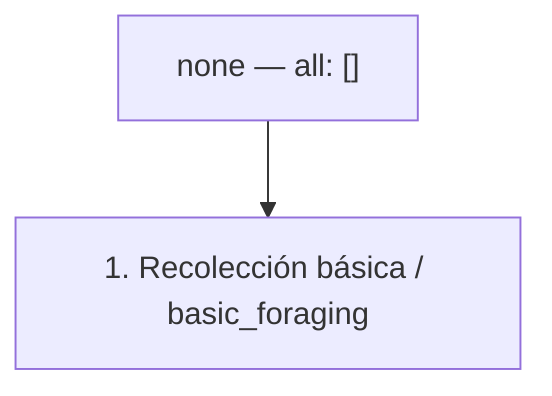

| Campo | Valor |
| --- | --- |
| scope | civilization |
| research.mode | initial_grant |
| research.cost | 0 research_point |
| research.onConditionFailure | pause_keep_progress |
| effects | unlock_capability: basic_foraging (civilization; while_usage_conditions_met) |

| Condición | Expresión exacta |
| --- | --- |
| research.startConditions.all | [] |
| research.ongoingConditions.all | [] |
| usageConditions.all[0] | `{"type":"workers_assigned","minimumCount":1}` |
| usageConditions.all[1] | `{"type":"accessible_edible_plants"}` |

**Eurekas:** none.

## Technology plant_knowledge

**Conocimiento de plantas** — Identifica las partes útiles y reproductivas de una especie vegetal.

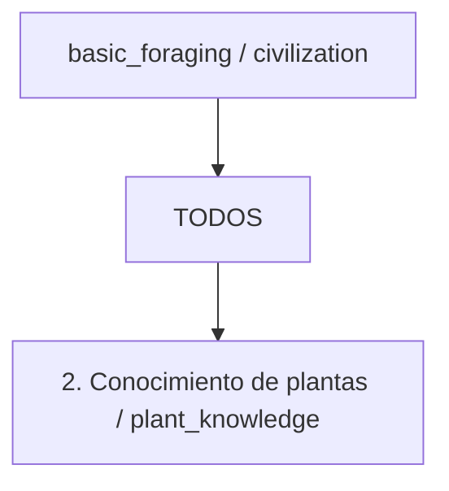

| Campo | Valor |
| --- | --- |
| scope | species |
| research.mode | points |
| research.cost | 100 research_point |
| research.onConditionFailure | pause_keep_progress |
| effects | unlock_capability: plant_knowledge (species; while_usage_conditions_met) |

| Condición | Expresión exacta |
| --- | --- |
| research.startConditions.all[0] | `{"type":"species_discovered","speciesId":"$speciesId"}` |
| research.startConditions.all[1] | `{"type":"species_material_accessible","speciesId":"$speciesId"}` |
| research.ongoingConditions.all | [] |
| usageConditions.all[0] | `{"type":"species_discovered","speciesId":"$speciesId"}` |
| usageConditions.all[1] | `{"type":"workers_assigned","minimumCount":1}` |
| usageConditions.all[2] | `{"type":"species_plants_accessible","speciesId":"$speciesId"}` |

### Eurekas

| id | eventType | filters | counter | reward | repeatable |
| --- | --- | --- | --- | --- | --- |
| plant_gathered | plant_gathered | `{"speciesId": "$speciesId"}` | `{"mode": "sum_amount", "target": 20}` | `{"type": "add_research_points", "fractionOfBaseCost": 0.25}` | false |

## Technology gathering_tools

**Herramientas de recolección** — Permite que los trabajadores equipados cosechen plantas con mayor eficiencia.

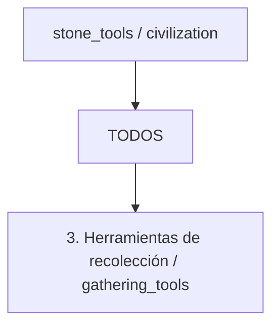

| Campo | Valor |
| --- | --- |
| scope | civilization |
| research.mode | points |
| research.cost | 100 research_point |
| research.onConditionFailure | pause_keep_progress |
| effects | unlock_capability: gathering_tools (civilization; while_usage_conditions_met) |

| Condición | Expresión exacta |
| --- | --- |
| research.startConditions.all | [] |
| research.ongoingConditions.all | [] |
| usageConditions.all[0] | `{"type":"workers_assigned","minimumCount":1}` |
| usageConditions.all[1] | `{"type":"accessible_edible_plants"}` |
| usageConditions.all[2] | `{"type":"resource_tag_available","tag":"gathering_tool","location":"site_equipment","minimumAmount":1}` |

### Eurekas

| id | eventType | filters | counter | reward | repeatable |
| --- | --- | --- | --- | --- | --- |
| item_crafted | item_crafted | `{"itemTag": "stone_gathering_tool"}` | `{"mode": "sum_amount", "target": 1}` | `{"type": "add_research_points", "fractionOfBaseCost": 0.25}` | false |

> Efficiency values belong to balance and production rules. Stone tools are the minimum technological prerequisite.

## Technology gathering_containers

**Recipientes de recolección** — Permite que los trabajadores equipados transporten más alimentos recolectados.

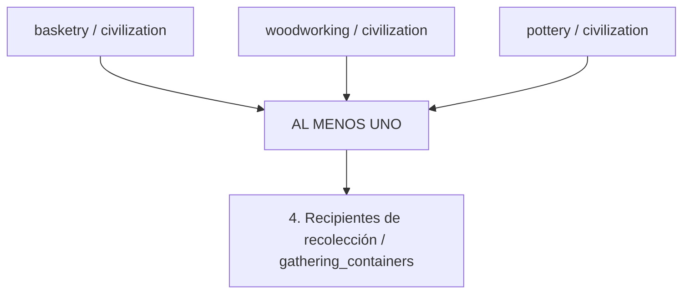

| Campo | Valor |
| --- | --- |
| scope | civilization |
| research.mode | points |
| research.cost | 100 research_point |
| research.onConditionFailure | pause_keep_progress |
| effects | unlock_capability: gathering_containers (civilization; while_usage_conditions_met) |

| Condición | Expresión exacta |
| --- | --- |
| research.startConditions.all | [] |
| research.ongoingConditions.all | [] |
| usageConditions.all[0] | `{"type":"workers_assigned","minimumCount":1}` |
| usageConditions.all[1] | `{"type":"accessible_edible_plants"}` |
| usageConditions.all[2] | `{"type":"resource_tag_available","tag":"gathering_container","location":"site_equipment","minimumAmount":1}` |

### Eurekas

| id | eventType | filters | counter | reward | repeatable |
| --- | --- | --- | --- | --- | --- |
| item_crafted | item_crafted | `{"itemTag": "gathering_container"}` | `{"mode": "sum_amount", "target": 1}` | `{"type": "add_research_points", "fractionOfBaseCost": 0.25}` | false |

> Any one container technology is sufficient. Raw materials are consumed by manufacturing recipes, not by researching or using this technology.

## Technology seed_handling

**Manejo de semillas** — Separa y conserva semillas viables u otro material de reproducción.

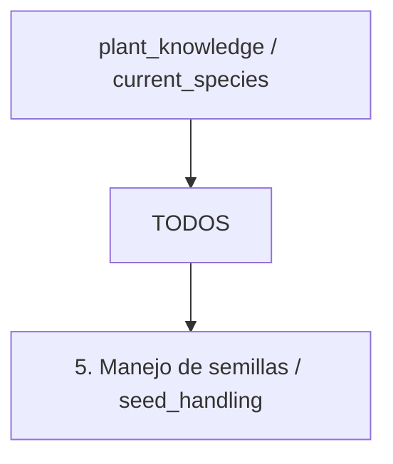

| Campo | Valor |
| --- | --- |
| scope | species |
| research.mode | points |
| research.cost | 100 research_point |
| research.onConditionFailure | pause_keep_progress |
| effects | unlock_capability: seed_handling (species; while_usage_conditions_met) |

| Condición | Expresión exacta |
| --- | --- |
| research.startConditions.all[0] | `{"type":"species_discovered","speciesId":"$speciesId"}` |
| research.startConditions.all[1] | `{"type":"species_material_accessible","speciesId":"$speciesId"}` |
| research.ongoingConditions.all | [] |
| usageConditions.all[0] | `{"type":"species_discovered","speciesId":"$speciesId"}` |
| usageConditions.all[1] | `{"type":"workers_assigned","minimumCount":1}` |
| usageConditions.all[2] | `{"type":"species_propagation_material_available","speciesId":"$speciesId","minimumAmount":1}` |
| usageConditions.all[3] | `{"type":"propagation_storage_available","speciesId":"$speciesId"}` |

### Eurekas

| id | eventType | filters | counter | reward | repeatable |
| --- | --- | --- | --- | --- | --- |
| propagation_material_collected | propagation_material_collected | `{"speciesId": "$speciesId"}` | `{"mode": "sum_amount", "target": 5}` | `{"type": "add_research_points", "fractionOfBaseCost": 0.25}` | false |

## Technology wild_plant_management

**Manejo de plantas silvestres** — Protege plantas útiles y retira la vegetación que compite con ellas.

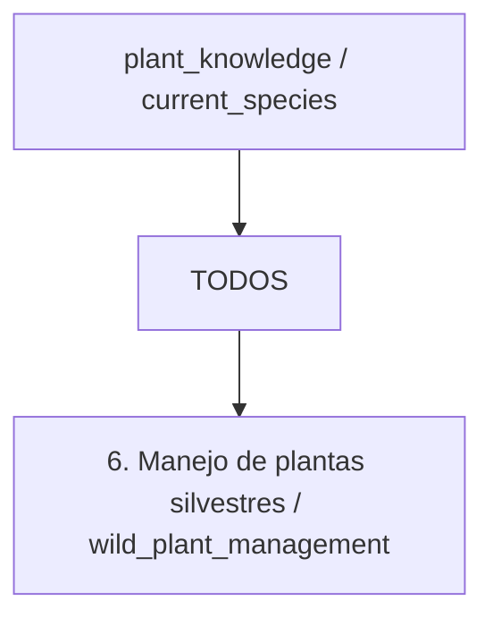

| Campo | Valor |
| --- | --- |
| scope | species |
| research.mode | points |
| research.cost | 100 research_point |
| research.onConditionFailure | pause_keep_progress |
| effects | unlock_capability: wild_plant_management (species; while_usage_conditions_met) |

| Condición | Expresión exacta |
| --- | --- |
| research.startConditions.all[0] | `{"type":"species_discovered","speciesId":"$speciesId"}` |
| research.startConditions.all[1] | `{"type":"species_material_accessible","speciesId":"$speciesId"}` |
| research.ongoingConditions.all | [] |
| usageConditions.all[0] | `{"type":"species_discovered","speciesId":"$speciesId"}` |
| usageConditions.all[1] | `{"type":"workers_assigned","minimumCount":1}` |
| usageConditions.all[2] | `{"type":"species_plants_accessible","speciesId":"$speciesId"}` |
| usageConditions.all[3] | `{"type":"accessible_land_available"}` |

### Eurekas

| id | eventType | filters | counter | reward | repeatable |
| --- | --- | --- | --- | --- | --- |
| plant_gathered | plant_gathered | `{"speciesId": "$speciesId"}` | `{"mode": "sum_amount", "target": 30}` | `{"type": "add_research_points", "fractionOfBaseCost": 0.25}` | false |

## Technology initial_sowing

**Siembra inicial** — Aprende la técnica general de plantar material de reproducción viable.

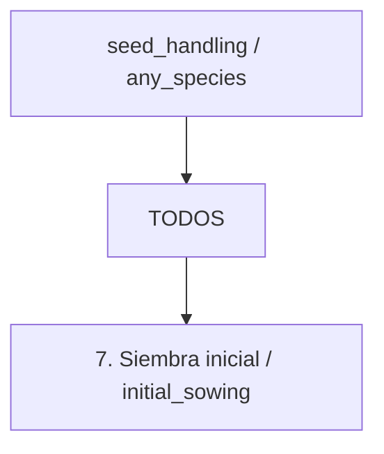

| Campo | Valor |
| --- | --- |
| scope | civilization |
| research.mode | points |
| research.cost | 100 research_point |
| research.onConditionFailure | pause_keep_progress |
| effects | unlock_capability: initial_sowing (civilization; while_usage_conditions_met) |

| Condición | Expresión exacta |
| --- | --- |
| research.startConditions.all | [] |
| research.ongoingConditions.all | [] |
| usageConditions.all[0] | `{"type":"workers_assigned","minimumCount":1}` |
| usageConditions.all[1] | `{"type":"any_viable_propagation_material_available"}` |
| usageConditions.all[2] | `{"type":"cultivable_land_available"}` |

### Eurekas

| id | eventType | filters | counter | reward | repeatable |
| --- | --- | --- | --- | --- | --- |
| propagation_material_reserved | propagation_material_reserved | `{}` | `{"mode": "sum_amount", "target": 10}` | `{"type": "add_research_points", "fractionOfBaseCost": 0.25}` | false |

> This general technique does not automatically unlock cultivation of every species.

## Technology species_cultivation

**Cultivo por especie** — Aplica la siembra y el cuidado de cultivos a una especie descubierta.

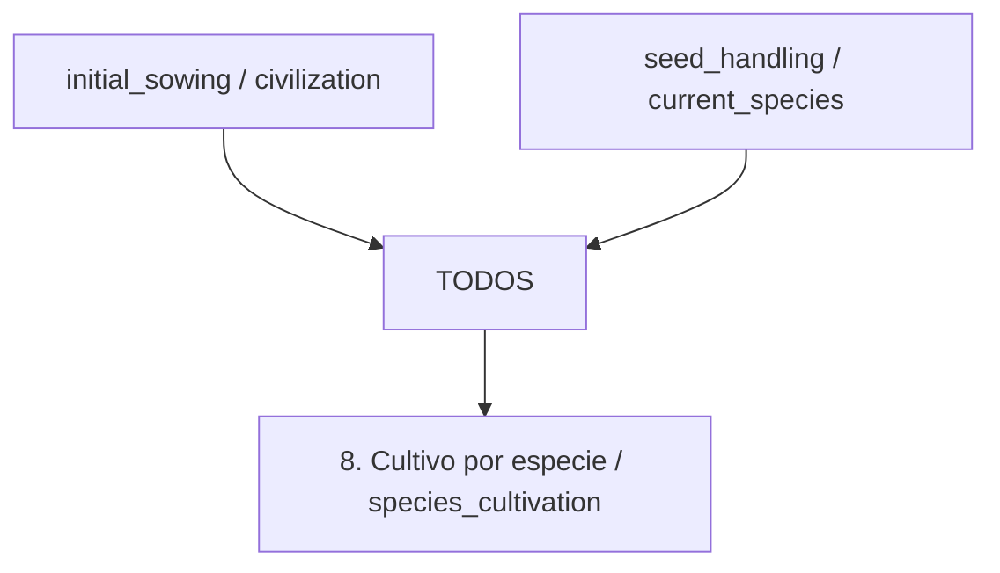

| Campo | Valor |
| --- | --- |
| scope | species |
| research.mode | points |
| research.cost | 100 research_point |
| research.onConditionFailure | pause_keep_progress |
| effects | unlock_capability: species_cultivation (species; while_usage_conditions_met) |

| Condición | Expresión exacta |
| --- | --- |
| research.startConditions.all[0] | `{"type":"species_discovered","speciesId":"$speciesId"}` |
| research.startConditions.all[1] | `{"type":"species_material_accessible","speciesId":"$speciesId"}` |
| research.ongoingConditions.all | [] |
| usageConditions.all[0] | `{"type":"species_discovered","speciesId":"$speciesId"}` |
| usageConditions.all[1] | `{"type":"workers_assigned","minimumCount":1}` |
| usageConditions.all[2] | `{"type":"species_propagation_material_available","speciesId":"$speciesId","minimumAmount":1}` |
| usageConditions.all[3] | `{"type":"compatible_plot_available","speciesId":"$speciesId"}` |

### Eurekas

| id | eventType | filters | counter | reward | repeatable |
| --- | --- | --- | --- | --- | --- |
| propagation_material_reserved | propagation_material_reserved | `{"speciesId": "$speciesId"}` | `{"mode": "sum_amount", "target": 10}` | `{"type": "add_research_points", "fractionOfBaseCost": 0.25}` | false |

> Wheat and maize use separate research instances identified by technologyId and speciesId. Wild ancestors and domesticated crops must be distinguished in the species catalog.

## Technology soil_preparation

**Preparación del suelo** — Prepara parcelas más grandes con herramientas agrícolas manuales apropiadas.

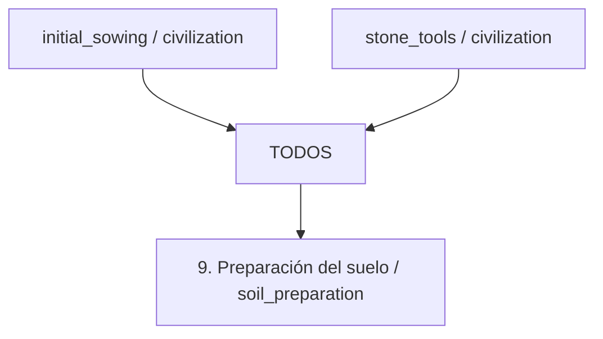

| Campo | Valor |
| --- | --- |
| scope | civilization |
| research.mode | points |
| research.cost | 100 research_point |
| research.onConditionFailure | pause_keep_progress |
| effects | unlock_capability: soil_preparation (civilization; while_usage_conditions_met) |

| Condición | Expresión exacta |
| --- | --- |
| research.startConditions.all | [] |
| research.ongoingConditions.all | [] |
| usageConditions.all[0] | `{"type":"workers_assigned","minimumCount":1}` |
| usageConditions.all[1] | `{"type":"cultivable_land_available"}` |
| usageConditions.all[2] | `{"type":"resource_tag_available","tag":"soil_working_tool","location":"site_equipment","minimumAmount":1}` |

### Eurekas

| id | eventType | filters | counter | reward | repeatable |
| --- | --- | --- | --- | --- | --- |
| item_crafted | item_crafted | `{"itemTag": "soil_working_tool"}` | `{"mode": "sum_amount", "target": 1}` | `{"type": "add_research_points", "fractionOfBaseCost": 0.25}` | false |

## Technology channel_irrigation

**Riego por canales** — Abastece campos adecuados mediante canales de riego construidos.


| Campo | Valor |
| --- | --- |
| scope | civilization |
| research.mode | points |
| research.cost | 100 research_point |
| research.onConditionFailure | pause_keep_progress |
| effects | unlock_capability: channel_irrigation (civilization; while_usage_conditions_met) |

| Condición | Expresión exacta |
| --- | --- |
| research.startConditions.all | [] |
| research.ongoingConditions.all | [] |
| usageConditions.all[0] | `{"type":"workers_assigned","minimumCount":1}` |
| usageConditions.all[1] | `{"type":"site_feature_available","feature":"accessible_water_source"}` |
| usageConditions.all[2] | `{"type":"site_feature_available","feature":"operational_irrigation_channels"}` |

### Eurekas

| id | eventType | filters | counter | reward | repeatable |
| --- | --- | --- | --- | --- | --- |
| plot_established | plot_established | `{"siteFeature": "accessible_water_source"}` | `{"mode": "sum_amount", "target": 1}` | `{"type": "add_research_points", "fractionOfBaseCost": 0.25}` | false |

## Technology agricultural_drainage

**Drenaje agrícola** — Retira el exceso de agua donde el terreno y los drenajes construidos lo permiten.

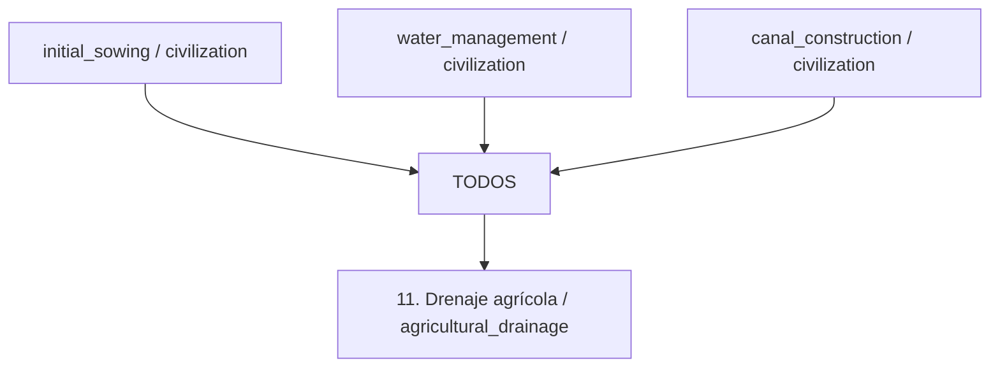

| Campo | Valor |
| --- | --- |
| scope | civilization |
| research.mode | points |
| research.cost | 100 research_point |
| research.onConditionFailure | pause_keep_progress |
| effects | unlock_capability: agricultural_drainage (civilization; while_usage_conditions_met) |

| Condición | Expresión exacta |
| --- | --- |
| research.startConditions.all | [] |
| research.ongoingConditions.all | [] |
| usageConditions.all[0] | `{"type":"workers_assigned","minimumCount":1}` |
| usageConditions.all[1] | `{"type":"site_feature_available","feature":"viable_drainage_outlet"}` |
| usageConditions.all[2] | `{"type":"site_feature_available","feature":"operational_drainage_channels"}` |

### Eurekas

| id | eventType | filters | counter | reward | repeatable |
| --- | --- | --- | --- | --- | --- |
| land_surveyed | land_surveyed | `{"siteFeature": "excess_soil_water"}` | `{"mode": "sum_amount", "target": 1}` | `{"type": "add_research_points", "fractionOfBaseCost": 0.25}` | false |

## Technology organic_manuring

**Abonado orgánico** — Aplica materiales orgánicos apropiados al suelo cultivado.

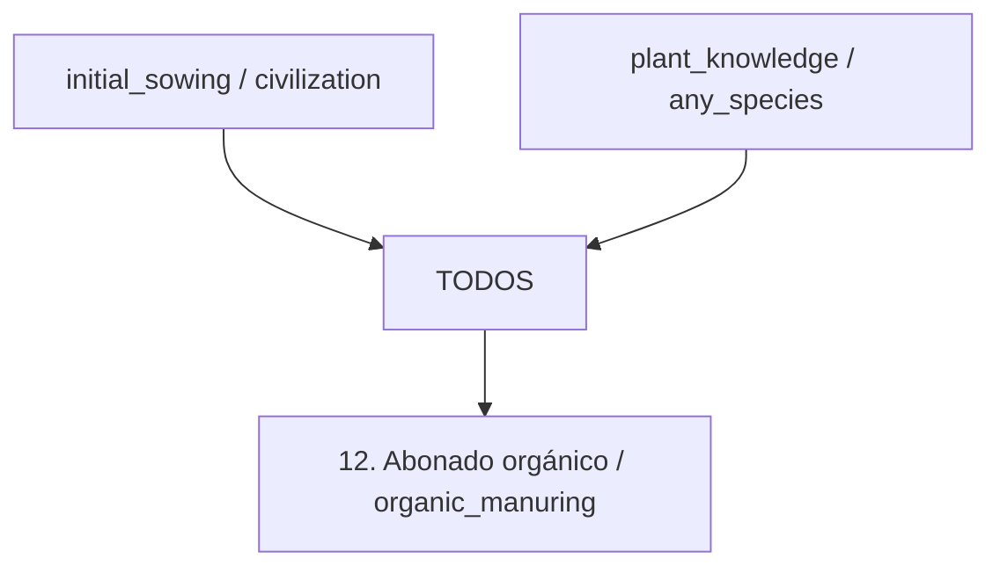

| Campo | Valor |
| --- | --- |
| scope | civilization |
| research.mode | points |
| research.cost | 100 research_point |
| research.onConditionFailure | pause_keep_progress |
| effects | unlock_capability: organic_manuring (civilization; while_usage_conditions_met) |

| Condición | Expresión exacta |
| --- | --- |
| research.startConditions.all | [] |
| research.ongoingConditions.all | [] |
| usageConditions.all[0] | `{"type":"workers_assigned","minimumCount":1}` |
| usageConditions.all[1] | `{"type":"cultivated_plot_available"}` |
| usageConditions.all[2] | `{"type":"resource_tag_available","tag":"suitable_organic_fertilizer","location":"inventory","minimumAmount":1}` |

### Eurekas

| id | eventType | filters | counter | reward | repeatable |
| --- | --- | --- | --- | --- | --- |
| resource_produced | resource_produced | `{"resourceTag": "livestock_manure"}` | `{"mode": "sum_amount", "target": 10}` | `{"type": "add_research_points", "fractionOfBaseCost": 0.25}` | false |

> Fertilizer quantities and soil responses are defined by production and soil rules.

## Technology animal_drawn_plough

**Arado de tracción animal** — Prepara más terreno con animales de tiro entrenados y un arado adecuado.

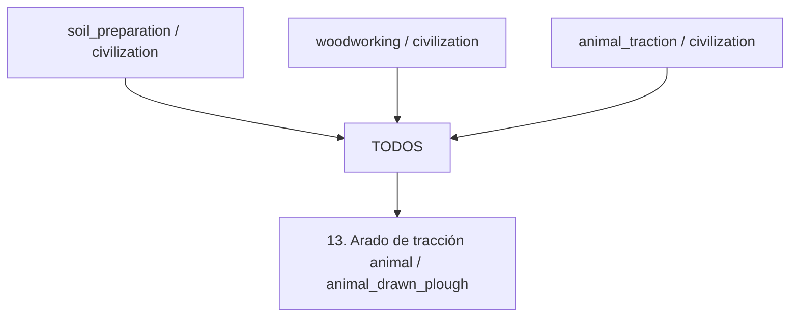

| Campo | Valor |
| --- | --- |
| scope | civilization |
| research.mode | points |
| research.cost | 100 research_point |
| research.onConditionFailure | pause_keep_progress |
| effects | unlock_capability: animal_drawn_plough (civilization; while_usage_conditions_met) |

| Condición | Expresión exacta |
| --- | --- |
| research.startConditions.all | [] |
| research.ongoingConditions.all | [] |
| usageConditions.all[0] | `{"type":"workers_assigned","minimumCount":1}` |
| usageConditions.all[1] | `{"type":"resource_tag_available","tag":"wooden_plough","location":"site_equipment","minimumAmount":1}` |
| usageConditions.all[2] | `{"type":"resource_tag_available","tag":"compatible_draft_harness","location":"site_equipment","minimumAmount":1}` |
| usageConditions.all[3] | `{"type":"trained_draft_animals_available"}` |
| usageConditions.all[4] | `{"type":"draft_animals_supported"}` |

### Eurekas

| id | eventType | filters | counter | reward | repeatable |
| --- | --- | --- | --- | --- | --- |
| draft_plough_team_assembled | draft_plough_team_assembled | `{}` | `{"mode": "sum_amount", "target": 1}` | `{"type": "add_research_points", "fractionOfBaseCost": 0.25}` | false |

> Wooden ploughs do not require metallurgy. Assembled teams require both suitable equipment and trained animals.

## Technology improved_ploughs

**Arados mejorados** — Utiliza diseños de arado más duraderos o adaptados al suelo.

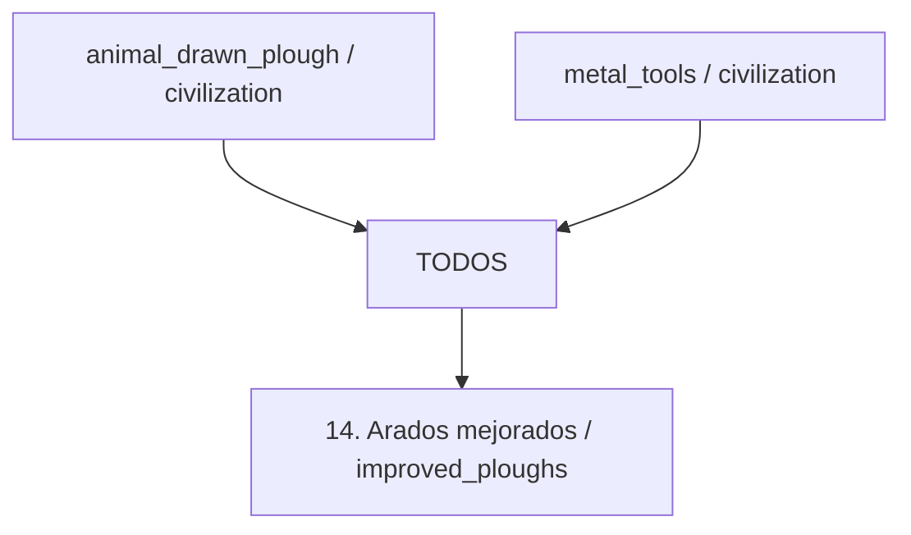

| Campo | Valor |
| --- | --- |
| scope | civilization |
| research.mode | points |
| research.cost | 100 research_point |
| research.onConditionFailure | pause_keep_progress |
| effects | unlock_capability: improved_ploughs (civilization; while_usage_conditions_met) |

| Condición | Expresión exacta |
| --- | --- |
| research.startConditions.all | [] |
| research.ongoingConditions.all | [] |
| usageConditions.all[0] | `{"type":"workers_assigned","minimumCount":1}` |
| usageConditions.all[1] | `{"type":"resource_tag_available","tag":"improved_plough","location":"site_equipment","minimumAmount":1}` |
| usageConditions.all[2] | `{"type":"site_feature_available","feature":"compatible_plough_soil"}` |
| usageConditions.all[3] | `{"type":"trained_draft_animals_available"}` |
| usageConditions.all[4] | `{"type":"draft_animals_supported"}` |

### Eurekas

| id | eventType | filters | counter | reward | repeatable |
| --- | --- | --- | --- | --- | --- |
| item_crafted | item_crafted | `{"itemTag": "metal_plough_component"}` | `{"mode": "sum_amount", "target": 1}` | `{"type": "add_research_points", "fractionOfBaseCost": 0.25}` | false |

## Technology fallow_management

**Descanso del suelo** — Programa periodos sin cultivo para gestionar la recuperación del suelo.

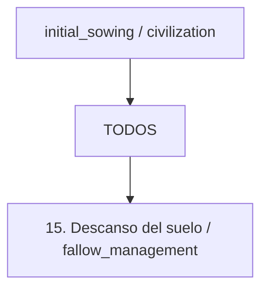

| Campo | Valor |
| --- | --- |
| scope | civilization |
| research.mode | points |
| research.cost | 100 research_point |
| research.onConditionFailure | pause_keep_progress |
| effects | unlock_capability: fallow_management (civilization; while_usage_conditions_met) |

| Condición | Expresión exacta |
| --- | --- |
| research.startConditions.all | [] |
| research.ongoingConditions.all | [] |
| usageConditions.all[0] | `{"type":"workers_assigned","minimumCount":1}` |
| usageConditions.all[1] | `{"type":"cultivated_plot_available"}` |
| usageConditions.all[2] | `{"type":"alternative_food_supply_available"}` |

### Eurekas

| id | eventType | filters | counter | reward | repeatable |
| --- | --- | --- | --- | --- | --- |
| plot_harvest_completed | plot_harvest_completed | `{"counterGroup": "plotId"}` | `{"mode": "sum_amount", "target": 3}` | `{"type": "add_research_points", "fractionOfBaseCost": 0.25}` | false |

> Actual recovery is controlled by soil simulation; it is not an instant fertility reset.

## Technology crop_alternation

**Alternancia de cultivos** — Organiza sucesiones de cultivos compatibles en terrenos cultivados.

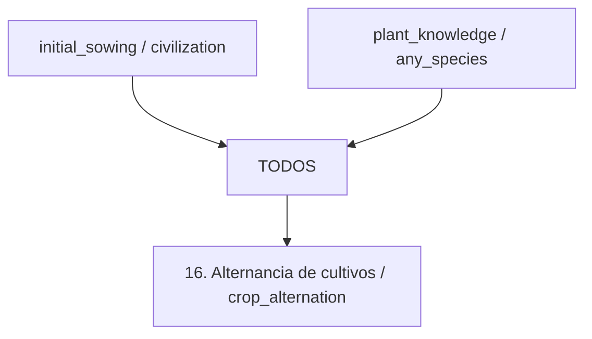

| Campo | Valor |
| --- | --- |
| scope | civilization |
| research.mode | points |
| research.cost | 100 research_point |
| research.onConditionFailure | pause_keep_progress |
| effects | unlock_capability: crop_alternation (civilization; while_usage_conditions_met) |

| Condición | Expresión exacta |
| --- | --- |
| research.startConditions.all | [] |
| research.ongoingConditions.all | [] |
| usageConditions.all[0] | `{"type":"workers_assigned","minimumCount":1}` |
| usageConditions.all[1] | `{"type":"compatible_crop_sequence_available","minimumSpeciesCount":2}` |

### Eurekas

| id | eventType | filters | counter | reward | repeatable |
| --- | --- | --- | --- | --- | --- |
| compatible_crop_species_harvested | compatible_crop_species_harvested | `{}` | `{"mode": "sum_amount", "target": 2}` | `{"type": "add_research_points", "fractionOfBaseCost": 0.25}` | false |

> The runtime must count distinct species in a compatible sequence for this event. No universal benefit is granted for arbitrary crop combinations.

## Technology reproductive_reserve

**Reserva para reproducción** — Reserva material viable de una cosecha para futuras plantaciones.

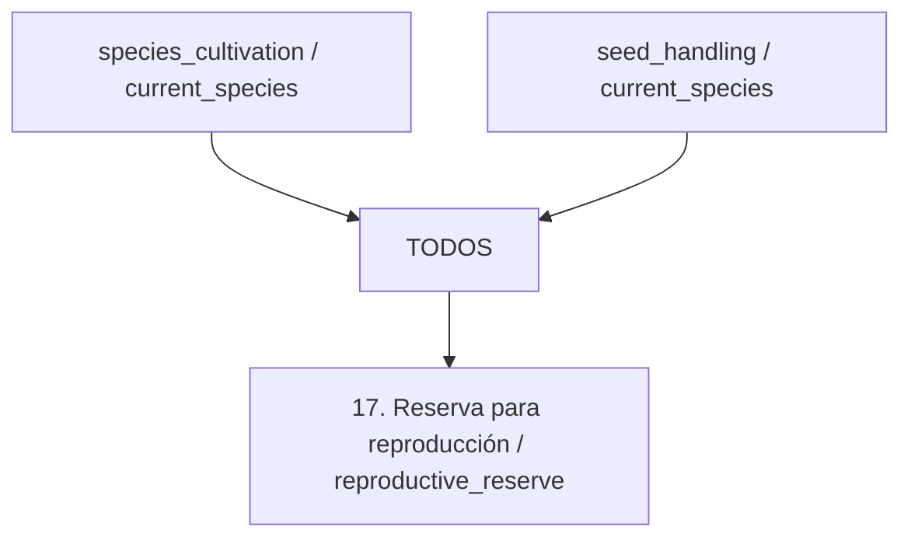

| Campo | Valor |
| --- | --- |
| scope | species |
| research.mode | points |
| research.cost | 100 research_point |
| research.onConditionFailure | pause_keep_progress |
| effects | unlock_capability: reproductive_reserve (species; while_usage_conditions_met) |

| Condición | Expresión exacta |
| --- | --- |
| research.startConditions.all[0] | `{"type":"species_discovered","speciesId":"$speciesId"}` |
| research.startConditions.all[1] | `{"type":"species_material_accessible","speciesId":"$speciesId"}` |
| research.ongoingConditions.all | [] |
| usageConditions.all[0] | `{"type":"species_discovered","speciesId":"$speciesId"}` |
| usageConditions.all[1] | `{"type":"workers_assigned","minimumCount":1}` |
| usageConditions.all[2] | `{"type":"species_propagation_material_available","speciesId":"$speciesId","minimumAmount":1}` |
| usageConditions.all[3] | `{"type":"propagation_storage_available","speciesId":"$speciesId"}` |

### Eurekas

| id | eventType | filters | counter | reward | repeatable |
| --- | --- | --- | --- | --- | --- |
| crop_harvest_completed | crop_harvest_completed | `{"speciesId": "$speciesId"}` | `{"mode": "sum_amount", "target": 1}` | `{"type": "add_research_points", "fractionOfBaseCost": 0.25}` | false |

## Technology initial_selection

**Selección inicial** — Selecciona plantas con características útiles observables para reproducirlas.

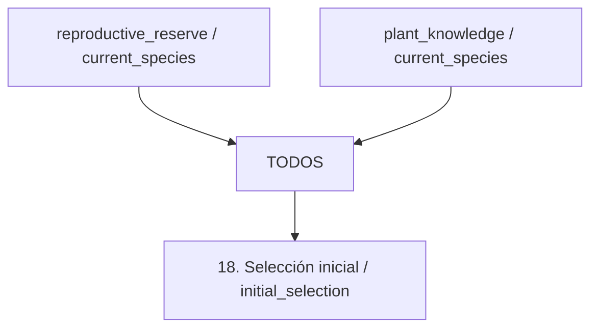

| Campo | Valor |
| --- | --- |
| scope | species |
| research.mode | points |
| research.cost | 100 research_point |
| research.onConditionFailure | pause_keep_progress |
| effects | unlock_capability: initial_selection (species; while_usage_conditions_met) |

| Condición | Expresión exacta |
| --- | --- |
| research.startConditions.all[0] | `{"type":"species_discovered","speciesId":"$speciesId"}` |
| research.startConditions.all[1] | `{"type":"species_material_accessible","speciesId":"$speciesId"}` |
| research.ongoingConditions.all | [] |
| usageConditions.all[0] | `{"type":"species_discovered","speciesId":"$speciesId"}` |
| usageConditions.all[1] | `{"type":"workers_assigned","minimumCount":1}` |
| usageConditions.all[2] | `{"type":"species_propagation_material_available","speciesId":"$speciesId","minimumAmount":1}` |
| usageConditions.all[3] | `{"type":"observable_trait_variation_available","speciesId":"$speciesId"}` |

### Eurekas

| id | eventType | filters | counter | reward | repeatable |
| --- | --- | --- | --- | --- | --- |
| useful_plant_trait_observed | useful_plant_trait_observed | `{"speciesId": "$speciesId"}` | `{"mode": "sum_amount", "target": 1}` | `{"type": "add_research_points", "fractionOfBaseCost": 0.25}` | false |

## Technology progressive_domestication

**Domesticación progresiva** — Favorece cambios entre generaciones de una población cultivada bajo manejo humano.

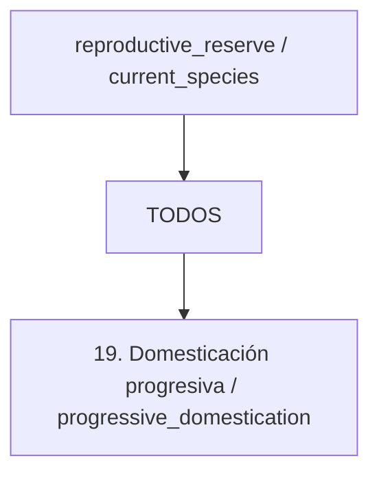

| Campo | Valor |
| --- | --- |
| scope | species |
| research.mode | points |
| research.cost | 100 research_point |
| research.onConditionFailure | pause_keep_progress |
| effects | unlock_capability: progressive_domestication (species; while_usage_conditions_met) |

| Condición | Expresión exacta |
| --- | --- |
| research.startConditions.all[0] | `{"type":"species_discovered","speciesId":"$speciesId"}` |
| research.startConditions.all[1] | `{"type":"species_material_accessible","speciesId":"$speciesId"}` |
| research.ongoingConditions.all | [] |
| usageConditions.all[0] | `{"type":"species_discovered","speciesId":"$speciesId"}` |
| usageConditions.all[1] | `{"type":"workers_assigned","minimumCount":1}` |
| usageConditions.all[2] | `{"type":"reproducing_crop_population_available","speciesId":"$speciesId"}` |

### Eurekas

| id | eventType | filters | counter | reward | repeatable |
| --- | --- | --- | --- | --- | --- |
| crop_generation_completed | crop_generation_completed | `{"speciesId": "$speciesId"}` | `{"mode": "sum_amount", "target": 3}` | `{"type": "add_research_points", "fractionOfBaseCost": 0.25}` | false |

> Research unlocks a management capability. Actual domestication requires generational simulation and species-specific criteria; completing research must not mark the species domesticated. Selection need not have been consciously understood.

## Technology line_comparison

**Comparación de líneas** — Mantiene líneas separadas y compara sus resultados.

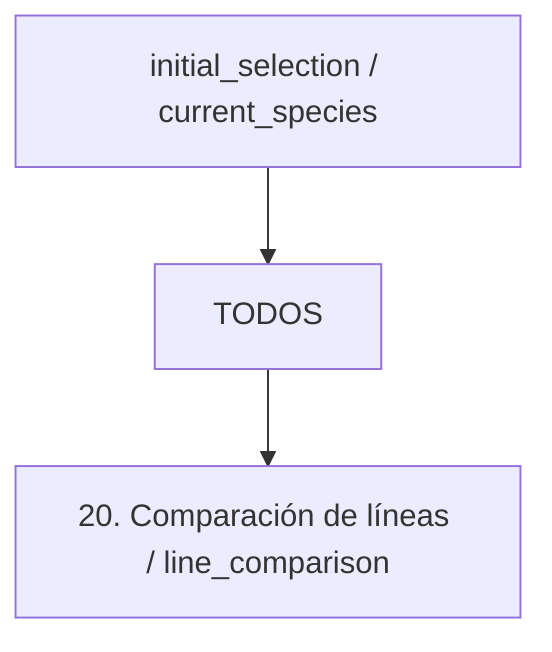

| Campo | Valor |
| --- | --- |
| scope | species |
| research.mode | points |
| research.cost | 100 research_point |
| research.onConditionFailure | pause_keep_progress |
| effects | unlock_capability: line_comparison (species; while_usage_conditions_met) |

| Condición | Expresión exacta |
| --- | --- |
| research.startConditions.all[0] | `{"type":"species_discovered","speciesId":"$speciesId"}` |
| research.startConditions.all[1] | `{"type":"species_material_accessible","speciesId":"$speciesId"}` |
| research.ongoingConditions.all | [] |
| usageConditions.all[0] | `{"type":"species_discovered","speciesId":"$speciesId"}` |
| usageConditions.all[1] | `{"type":"workers_assigned","minimumCount":1}` |
| usageConditions.all[2] | `{"type":"separate_identified_crop_lines_available","speciesId":"$speciesId","minimumLineCount":2}` |

### Eurekas

| id | eventType | filters | counter | reward | repeatable |
| --- | --- | --- | --- | --- | --- |
| separate_crop_line_harvest_completed | separate_crop_line_harvest_completed | `{"speciesId": "$speciesId"}` | `{"mode": "sum_amount", "target": 2}` | `{"type": "add_research_points", "fractionOfBaseCost": 0.25}` | false |

> The eureka counts distinct harvested line IDs, not repeated harvests of one line.

## Technology specialized_varieties

**Variedades especializadas** — Orienta la selección sostenida hacia características y usos concretos del cultivo.

```mermaid
flowchart TD
    p0["TODOS"]
    p1["line_comparison / current_species"]
    p1 --> p0
    p2["progressive_domestication / current_species"]
    p2 --> p0
    target["21. Variedades especializadas / specialized_varieties"]
    p0 --> target
```

| Campo | Valor |
| --- | --- |
| scope | species |
| research.mode | points |
| research.cost | 100 research_point |
| research.onConditionFailure | pause_keep_progress |
| effects | unlock_capability: specialized_varieties (species; while_usage_conditions_met) |

| Condición | Expresión exacta |
| --- | --- |
| research.startConditions.all[0] | `{"type":"species_discovered","speciesId":"$speciesId"}` |
| research.startConditions.all[1] | `{"type":"species_material_accessible","speciesId":"$speciesId"}` |
| research.ongoingConditions.all | [] |
| usageConditions.all[0] | `{"type":"species_discovered","speciesId":"$speciesId"}` |
| usageConditions.all[1] | `{"type":"workers_assigned","minimumCount":1}` |
| usageConditions.all[2] | `{"type":"species_domesticated","speciesId":"$speciesId"}` |
| usageConditions.all[3] | `{"type":"selectable_crop_lines_available","speciesId":"$speciesId"}` |

### Eurekas

| id | eventType | filters | counter | reward | repeatable |
| --- | --- | --- | --- | --- | --- |
| target_trait_reproduced | target_trait_reproduced | `{"speciesId": "$speciesId"}` | `{"mode": "sum_amount", "target": 3}` | `{"type": "add_research_points", "fractionOfBaseCost": 0.25}` | false |

> Only species-appropriate heritable traits can be selected. Trait gains are simulated locally rather than granted to every crop on research completion.

## Technology vegetative_propagation

**Propagación vegetativa** — Reproduce plantas compatibles mediante esquejes, división u otro material vegetativo.

```mermaid
flowchart TD
    p0["TODOS"]
    p1["plant_knowledge / current_species"]
    p1 --> p0
    target["22. Propagación vegetativa / vegetative_propagation"]
    p0 --> target
```

| Campo | Valor |
| --- | --- |
| scope | species |
| research.mode | points |
| research.cost | 100 research_point |
| research.onConditionFailure | pause_keep_progress |
| effects | unlock_capability: vegetative_propagation (species; while_usage_conditions_met) |

| Condición | Expresión exacta |
| --- | --- |
| research.startConditions.all[0] | `{"type":"species_discovered","speciesId":"$speciesId"}` |
| research.startConditions.all[1] | `{"type":"species_material_accessible","speciesId":"$speciesId"}` |
| research.ongoingConditions.all | [] |
| usageConditions.all[0] | `{"type":"species_discovered","speciesId":"$speciesId"}` |
| usageConditions.all[1] | `{"type":"workers_assigned","minimumCount":1}` |
| usageConditions.all[2] | `{"type":"species_supports_method","speciesId":"$speciesId","method":"vegetative_propagation"}` |
| usageConditions.all[3] | `{"type":"species_propagation_material_available","speciesId":"$speciesId","minimumAmount":1}` |
| usageConditions.all[4] | `{"type":"compatible_plot_available","speciesId":"$speciesId"}` |

### Eurekas

| id | eventType | filters | counter | reward | repeatable |
| --- | --- | --- | --- | --- | --- |
| vegetative_plant_established | vegetative_plant_established | `{"speciesId": "$speciesId"}` | `{"mode": "sum_amount", "target": 1}` | `{"type": "add_research_points", "fractionOfBaseCost": 0.25}` | false |

> Basic vegetative planting can be supported by initial cultivation; this technology represents deliberate specialized propagation, not a universal prerequisite for planting tubers or cuttings.

## Technology grafting

**Injerto** — Une material compatible de una variedad y un patrón para cultivos frutales adecuados.

```mermaid
flowchart TD
    p0["TODOS"]
    p1["vegetative_propagation / current_species"]
    p1 --> p0
    p2["cutting_tools / civilization"]
    p2 --> p0
    target["23. Injerto / grafting"]
    p0 --> target
```

| Campo | Valor |
| --- | --- |
| scope | species |
| research.mode | points |
| research.cost | 100 research_point |
| research.onConditionFailure | pause_keep_progress |
| effects | unlock_capability: grafting (species; while_usage_conditions_met) |

| Condición | Expresión exacta |
| --- | --- |
| research.startConditions.all[0] | `{"type":"species_discovered","speciesId":"$speciesId"}` |
| research.startConditions.all[1] | `{"type":"species_material_accessible","speciesId":"$speciesId"}` |
| research.ongoingConditions.all | [] |
| usageConditions.all[0] | `{"type":"species_discovered","speciesId":"$speciesId"}` |
| usageConditions.all[1] | `{"type":"workers_assigned","minimumCount":1}` |
| usageConditions.all[2] | `{"type":"compatible_grafting_material_available","speciesId":"$speciesId"}` |
| usageConditions.all[3] | `{"type":"resource_tag_available","tag":"grafting_tool","location":"site_equipment","minimumAmount":1}` |
| usageConditions.all[4] | `{"type":"resource_tag_available","tag":"grafting_binding","location":"inventory","minimumAmount":1}` |

### Eurekas

| id | eventType | filters | counter | reward | repeatable |
| --- | --- | --- | --- | --- | --- |
| graftable_orchard_established | graftable_orchard_established | `{"speciesId": "$speciesId"}` | `{"mode": "sum_amount", "target": 1}` | `{"type": "add_research_points", "fractionOfBaseCost": 0.25}` | false |

## Importaciones externas

- `stone_tools`
- `basketry`
- `woodworking`
- `pottery`
- `water_management`
- `canal_construction`
- `animal_traction`
- `metal_tools`
- `cutting_tools`

La configuración raíz también documenta políticas globales, alternativas de fabricación y manejadores. Consultar su [referencia completa](../../lang/es/json/data--technologies--agriculture.technologies.md). Investigar no produce materiales automáticamente.
