# Technologies — Complete reference diagrams

[Diagram index](../../lang/en/catalog-diagrams.md) · [English](DIAGRAMS.md) · [Español](DIAGRAMS.es.md)

[JSON](agriculture.technologies.json) · [Complete JSON structure](../../lang/en/json-structures.md)

Every catalog record is included. Several small diagrams in this file keep the reference readable. Arrows represent documented links, not yield, guaranteed presence or inferred evolution. Existing IDs are preserved.

## Index of all 23 technologies

| order | id | Name | scope |
| --- | --- | --- | --- |
| 1 | [basic_foraging](#technology-basic_foraging) | Basic Foraging | civilization |
| 2 | [plant_knowledge](#technology-plant_knowledge) | Plant Knowledge | species |
| 3 | [gathering_tools](#technology-gathering_tools) | Gathering Tools | civilization |
| 4 | [gathering_containers](#technology-gathering_containers) | Gathering Containers | civilization |
| 5 | [seed_handling](#technology-seed_handling) | Seed Handling | species |
| 6 | [wild_plant_management](#technology-wild_plant_management) | Wild Plant Management | species |
| 7 | [initial_sowing](#technology-initial_sowing) | Initial Sowing | civilization |
| 8 | [species_cultivation](#technology-species_cultivation) | Species Cultivation | species |
| 9 | [soil_preparation](#technology-soil_preparation) | Soil Preparation | civilization |
| 10 | [channel_irrigation](#technology-channel_irrigation) | Channel Irrigation | civilization |
| 11 | [agricultural_drainage](#technology-agricultural_drainage) | Agricultural Drainage | civilization |
| 12 | [organic_manuring](#technology-organic_manuring) | Organic Manuring | civilization |
| 13 | [animal_drawn_plough](#technology-animal_drawn_plough) | Animal-Drawn Plough | civilization |
| 14 | [improved_ploughs](#technology-improved_ploughs) | Improved Ploughs | civilization |
| 15 | [fallow_management](#technology-fallow_management) | Fallow Management | civilization |
| 16 | [crop_alternation](#technology-crop_alternation) | Crop Alternation | civilization |
| 17 | [reproductive_reserve](#technology-reproductive_reserve) | Reproductive Reserve | species |
| 18 | [initial_selection](#technology-initial_selection) | Initial Selection | species |
| 19 | [progressive_domestication](#technology-progressive_domestication) | Progressive Domestication | species |
| 20 | [line_comparison](#technology-line_comparison) | Line Comparison | species |
| 21 | [specialized_varieties](#technology-specialized_varieties) | Specialized Varieties | species |
| 22 | [vegetative_propagation](#technology-vegetative_propagation) | Vegetative Propagation | species |
| 23 | [grafting](#technology-grafting) | Grafting | species |

`order` is display order only. `ALL` requires every input; `ANY` accepts any input. `current_species` refers to the same species and `any_species` to any species of that civilization. External prerequisites are declared but not implemented here.

## Technology basic_foraging

**Basic Foraging** — Gather food from accessible edible wild plants.

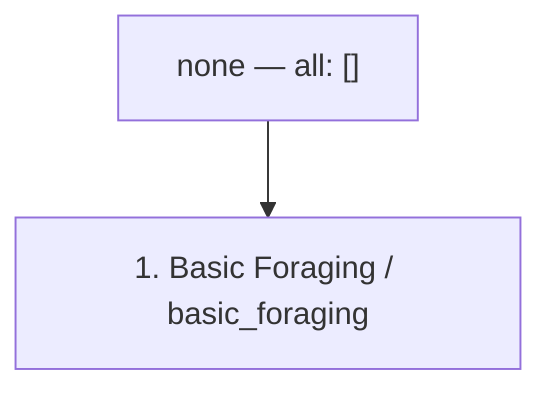

| Field | Value |
| --- | --- |
| scope | civilization |
| research.mode | initial_grant |
| research.cost | 0 research_point |
| research.onConditionFailure | pause_keep_progress |
| effects | unlock_capability: basic_foraging (civilization; while_usage_conditions_met) |

| Condition | Exact expression |
| --- | --- |
| research.startConditions.all | [] |
| research.ongoingConditions.all | [] |
| usageConditions.all[0] | `{"type":"workers_assigned","minimumCount":1}` |
| usageConditions.all[1] | `{"type":"accessible_edible_plants"}` |

**Eurekas:** none.

## Technology plant_knowledge

**Plant Knowledge** — Identify useful and reproductive parts of a particular plant species.

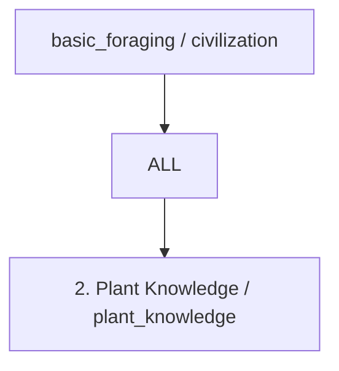

| Field | Value |
| --- | --- |
| scope | species |
| research.mode | points |
| research.cost | 100 research_point |
| research.onConditionFailure | pause_keep_progress |
| effects | unlock_capability: plant_knowledge (species; while_usage_conditions_met) |

| Condition | Exact expression |
| --- | --- |
| research.startConditions.all[0] | `{"type":"species_discovered","speciesId":"$speciesId"}` |
| research.startConditions.all[1] | `{"type":"species_material_accessible","speciesId":"$speciesId"}` |
| research.ongoingConditions.all | [] |
| usageConditions.all[0] | `{"type":"species_discovered","speciesId":"$speciesId"}` |
| usageConditions.all[1] | `{"type":"workers_assigned","minimumCount":1}` |
| usageConditions.all[2] | `{"type":"species_plants_accessible","speciesId":"$speciesId"}` |

### Eurekas

| id | eventType | filters | counter | reward | repeatable |
| --- | --- | --- | --- | --- | --- |
| plant_gathered | plant_gathered | `{"speciesId": "$speciesId"}` | `{"mode": "sum_amount", "target": 20}` | `{"type": "add_research_points", "fractionOfBaseCost": 0.25}` | false |

## Technology gathering_tools

**Gathering Tools** — Enable equipped workers to harvest plants more efficiently.

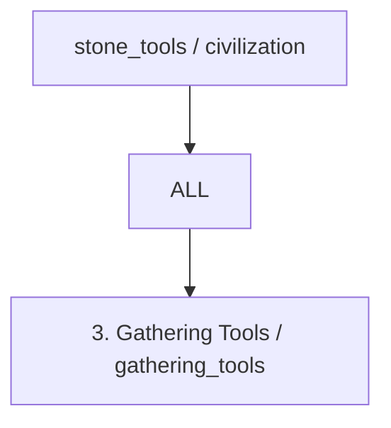

| Field | Value |
| --- | --- |
| scope | civilization |
| research.mode | points |
| research.cost | 100 research_point |
| research.onConditionFailure | pause_keep_progress |
| effects | unlock_capability: gathering_tools (civilization; while_usage_conditions_met) |

| Condition | Exact expression |
| --- | --- |
| research.startConditions.all | [] |
| research.ongoingConditions.all | [] |
| usageConditions.all[0] | `{"type":"workers_assigned","minimumCount":1}` |
| usageConditions.all[1] | `{"type":"accessible_edible_plants"}` |
| usageConditions.all[2] | `{"type":"resource_tag_available","tag":"gathering_tool","location":"site_equipment","minimumAmount":1}` |

### Eurekas

| id | eventType | filters | counter | reward | repeatable |
| --- | --- | --- | --- | --- | --- |
| item_crafted | item_crafted | `{"itemTag": "stone_gathering_tool"}` | `{"mode": "sum_amount", "target": 1}` | `{"type": "add_research_points", "fractionOfBaseCost": 0.25}` | false |

> Efficiency values belong to balance and production rules. Stone tools are the minimum technological prerequisite.

## Technology gathering_containers

**Gathering Containers** — Enable equipped workers to carry more gathered food.

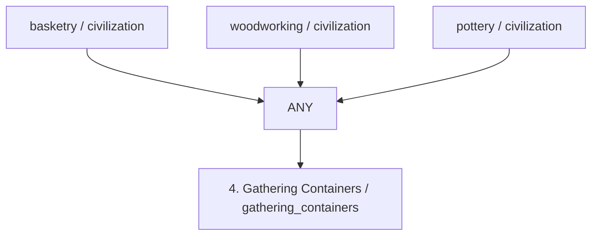

| Field | Value |
| --- | --- |
| scope | civilization |
| research.mode | points |
| research.cost | 100 research_point |
| research.onConditionFailure | pause_keep_progress |
| effects | unlock_capability: gathering_containers (civilization; while_usage_conditions_met) |

| Condition | Exact expression |
| --- | --- |
| research.startConditions.all | [] |
| research.ongoingConditions.all | [] |
| usageConditions.all[0] | `{"type":"workers_assigned","minimumCount":1}` |
| usageConditions.all[1] | `{"type":"accessible_edible_plants"}` |
| usageConditions.all[2] | `{"type":"resource_tag_available","tag":"gathering_container","location":"site_equipment","minimumAmount":1}` |

### Eurekas

| id | eventType | filters | counter | reward | repeatable |
| --- | --- | --- | --- | --- | --- |
| item_crafted | item_crafted | `{"itemTag": "gathering_container"}` | `{"mode": "sum_amount", "target": 1}` | `{"type": "add_research_points", "fractionOfBaseCost": 0.25}` | false |

> Any one container technology is sufficient. Raw materials are consumed by manufacturing recipes, not by researching or using this technology.

## Technology seed_handling

**Seed Handling** — Separate and preserve viable seeds or other propagation material.

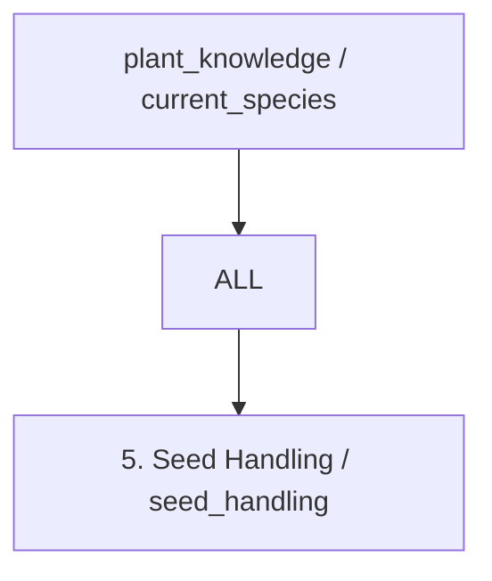

| Field | Value |
| --- | --- |
| scope | species |
| research.mode | points |
| research.cost | 100 research_point |
| research.onConditionFailure | pause_keep_progress |
| effects | unlock_capability: seed_handling (species; while_usage_conditions_met) |

| Condition | Exact expression |
| --- | --- |
| research.startConditions.all[0] | `{"type":"species_discovered","speciesId":"$speciesId"}` |
| research.startConditions.all[1] | `{"type":"species_material_accessible","speciesId":"$speciesId"}` |
| research.ongoingConditions.all | [] |
| usageConditions.all[0] | `{"type":"species_discovered","speciesId":"$speciesId"}` |
| usageConditions.all[1] | `{"type":"workers_assigned","minimumCount":1}` |
| usageConditions.all[2] | `{"type":"species_propagation_material_available","speciesId":"$speciesId","minimumAmount":1}` |
| usageConditions.all[3] | `{"type":"propagation_storage_available","speciesId":"$speciesId"}` |

### Eurekas

| id | eventType | filters | counter | reward | repeatable |
| --- | --- | --- | --- | --- | --- |
| propagation_material_collected | propagation_material_collected | `{"speciesId": "$speciesId"}` | `{"mode": "sum_amount", "target": 5}` | `{"type": "add_research_points", "fractionOfBaseCost": 0.25}` | false |

## Technology wild_plant_management

**Wild Plant Management** — Protect useful wild plants and clear competing vegetation.

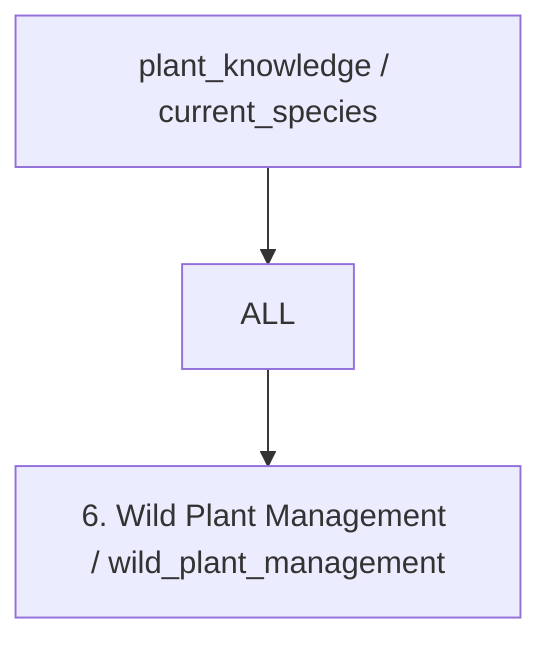

| Field | Value |
| --- | --- |
| scope | species |
| research.mode | points |
| research.cost | 100 research_point |
| research.onConditionFailure | pause_keep_progress |
| effects | unlock_capability: wild_plant_management (species; while_usage_conditions_met) |

| Condition | Exact expression |
| --- | --- |
| research.startConditions.all[0] | `{"type":"species_discovered","speciesId":"$speciesId"}` |
| research.startConditions.all[1] | `{"type":"species_material_accessible","speciesId":"$speciesId"}` |
| research.ongoingConditions.all | [] |
| usageConditions.all[0] | `{"type":"species_discovered","speciesId":"$speciesId"}` |
| usageConditions.all[1] | `{"type":"workers_assigned","minimumCount":1}` |
| usageConditions.all[2] | `{"type":"species_plants_accessible","speciesId":"$speciesId"}` |
| usageConditions.all[3] | `{"type":"accessible_land_available"}` |

### Eurekas

| id | eventType | filters | counter | reward | repeatable |
| --- | --- | --- | --- | --- | --- |
| plant_gathered | plant_gathered | `{"speciesId": "$speciesId"}` | `{"mode": "sum_amount", "target": 30}` | `{"type": "add_research_points", "fractionOfBaseCost": 0.25}` | false |

## Technology initial_sowing

**Initial Sowing** — Learn the general technique of planting viable propagation material.

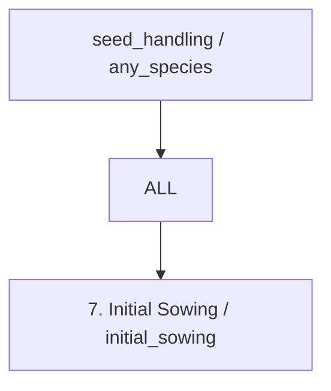

| Field | Value |
| --- | --- |
| scope | civilization |
| research.mode | points |
| research.cost | 100 research_point |
| research.onConditionFailure | pause_keep_progress |
| effects | unlock_capability: initial_sowing (civilization; while_usage_conditions_met) |

| Condition | Exact expression |
| --- | --- |
| research.startConditions.all | [] |
| research.ongoingConditions.all | [] |
| usageConditions.all[0] | `{"type":"workers_assigned","minimumCount":1}` |
| usageConditions.all[1] | `{"type":"any_viable_propagation_material_available"}` |
| usageConditions.all[2] | `{"type":"cultivable_land_available"}` |

### Eurekas

| id | eventType | filters | counter | reward | repeatable |
| --- | --- | --- | --- | --- | --- |
| propagation_material_reserved | propagation_material_reserved | `{}` | `{"mode": "sum_amount", "target": 10}` | `{"type": "add_research_points", "fractionOfBaseCost": 0.25}` | false |

> This general technique does not automatically unlock cultivation of every species.

## Technology species_cultivation

**Species Cultivation** — Apply sowing and crop care to one discovered species.

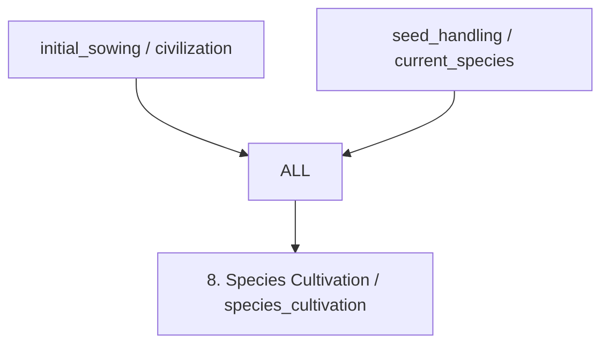

| Field | Value |
| --- | --- |
| scope | species |
| research.mode | points |
| research.cost | 100 research_point |
| research.onConditionFailure | pause_keep_progress |
| effects | unlock_capability: species_cultivation (species; while_usage_conditions_met) |

| Condition | Exact expression |
| --- | --- |
| research.startConditions.all[0] | `{"type":"species_discovered","speciesId":"$speciesId"}` |
| research.startConditions.all[1] | `{"type":"species_material_accessible","speciesId":"$speciesId"}` |
| research.ongoingConditions.all | [] |
| usageConditions.all[0] | `{"type":"species_discovered","speciesId":"$speciesId"}` |
| usageConditions.all[1] | `{"type":"workers_assigned","minimumCount":1}` |
| usageConditions.all[2] | `{"type":"species_propagation_material_available","speciesId":"$speciesId","minimumAmount":1}` |
| usageConditions.all[3] | `{"type":"compatible_plot_available","speciesId":"$speciesId"}` |

### Eurekas

| id | eventType | filters | counter | reward | repeatable |
| --- | --- | --- | --- | --- | --- |
| propagation_material_reserved | propagation_material_reserved | `{"speciesId": "$speciesId"}` | `{"mode": "sum_amount", "target": 10}` | `{"type": "add_research_points", "fractionOfBaseCost": 0.25}` | false |

> Wheat and maize use separate research instances identified by technologyId and speciesId. Wild ancestors and domesticated crops must be distinguished in the species catalog.

## Technology soil_preparation

**Soil Preparation** — Prepare larger plots with suitable agricultural hand tools.

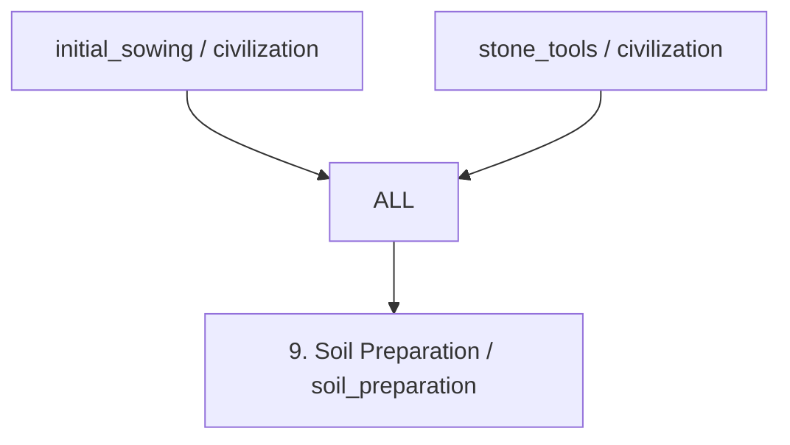

| Field | Value |
| --- | --- |
| scope | civilization |
| research.mode | points |
| research.cost | 100 research_point |
| research.onConditionFailure | pause_keep_progress |
| effects | unlock_capability: soil_preparation (civilization; while_usage_conditions_met) |

| Condition | Exact expression |
| --- | --- |
| research.startConditions.all | [] |
| research.ongoingConditions.all | [] |
| usageConditions.all[0] | `{"type":"workers_assigned","minimumCount":1}` |
| usageConditions.all[1] | `{"type":"cultivable_land_available"}` |
| usageConditions.all[2] | `{"type":"resource_tag_available","tag":"soil_working_tool","location":"site_equipment","minimumAmount":1}` |

### Eurekas

| id | eventType | filters | counter | reward | repeatable |
| --- | --- | --- | --- | --- | --- |
| item_crafted | item_crafted | `{"itemTag": "soil_working_tool"}` | `{"mode": "sum_amount", "target": 1}` | `{"type": "add_research_points", "fractionOfBaseCost": 0.25}` | false |

## Technology channel_irrigation

**Channel Irrigation** — Supply suitable fields through constructed irrigation channels.


| Field | Value |
| --- | --- |
| scope | civilization |
| research.mode | points |
| research.cost | 100 research_point |
| research.onConditionFailure | pause_keep_progress |
| effects | unlock_capability: channel_irrigation (civilization; while_usage_conditions_met) |

| Condition | Exact expression |
| --- | --- |
| research.startConditions.all | [] |
| research.ongoingConditions.all | [] |
| usageConditions.all[0] | `{"type":"workers_assigned","minimumCount":1}` |
| usageConditions.all[1] | `{"type":"site_feature_available","feature":"accessible_water_source"}` |
| usageConditions.all[2] | `{"type":"site_feature_available","feature":"operational_irrigation_channels"}` |

### Eurekas

| id | eventType | filters | counter | reward | repeatable |
| --- | --- | --- | --- | --- | --- |
| plot_established | plot_established | `{"siteFeature": "accessible_water_source"}` | `{"mode": "sum_amount", "target": 1}` | `{"type": "add_research_points", "fractionOfBaseCost": 0.25}` | false |

## Technology agricultural_drainage

**Agricultural Drainage** — Remove excess water where terrain and constructed drains permit it.

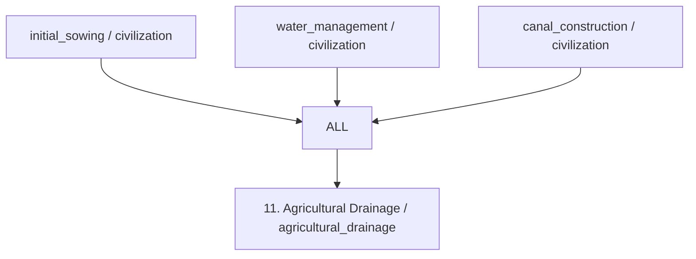

| Field | Value |
| --- | --- |
| scope | civilization |
| research.mode | points |
| research.cost | 100 research_point |
| research.onConditionFailure | pause_keep_progress |
| effects | unlock_capability: agricultural_drainage (civilization; while_usage_conditions_met) |

| Condition | Exact expression |
| --- | --- |
| research.startConditions.all | [] |
| research.ongoingConditions.all | [] |
| usageConditions.all[0] | `{"type":"workers_assigned","minimumCount":1}` |
| usageConditions.all[1] | `{"type":"site_feature_available","feature":"viable_drainage_outlet"}` |
| usageConditions.all[2] | `{"type":"site_feature_available","feature":"operational_drainage_channels"}` |

### Eurekas

| id | eventType | filters | counter | reward | repeatable |
| --- | --- | --- | --- | --- | --- |
| land_surveyed | land_surveyed | `{"siteFeature": "excess_soil_water"}` | `{"mode": "sum_amount", "target": 1}` | `{"type": "add_research_points", "fractionOfBaseCost": 0.25}` | false |

## Technology organic_manuring

**Organic Manuring** — Apply appropriate organic materials to cultivated soil.

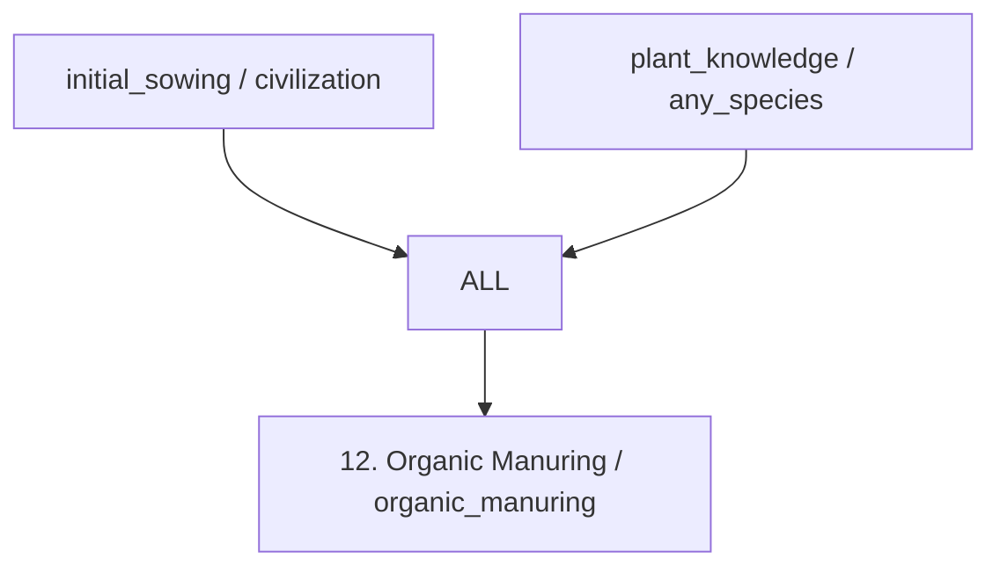

| Field | Value |
| --- | --- |
| scope | civilization |
| research.mode | points |
| research.cost | 100 research_point |
| research.onConditionFailure | pause_keep_progress |
| effects | unlock_capability: organic_manuring (civilization; while_usage_conditions_met) |

| Condition | Exact expression |
| --- | --- |
| research.startConditions.all | [] |
| research.ongoingConditions.all | [] |
| usageConditions.all[0] | `{"type":"workers_assigned","minimumCount":1}` |
| usageConditions.all[1] | `{"type":"cultivated_plot_available"}` |
| usageConditions.all[2] | `{"type":"resource_tag_available","tag":"suitable_organic_fertilizer","location":"inventory","minimumAmount":1}` |

### Eurekas

| id | eventType | filters | counter | reward | repeatable |
| --- | --- | --- | --- | --- | --- |
| resource_produced | resource_produced | `{"resourceTag": "livestock_manure"}` | `{"mode": "sum_amount", "target": 10}` | `{"type": "add_research_points", "fractionOfBaseCost": 0.25}` | false |

> Fertilizer quantities and soil responses are defined by production and soil rules.

## Technology animal_drawn_plough

**Animal-Drawn Plough** — Prepare more land using trained draft animals and a suitable plough.

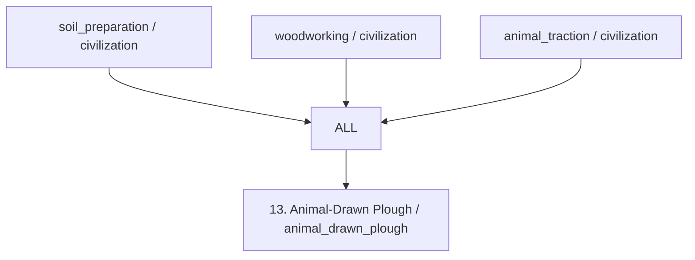

| Field | Value |
| --- | --- |
| scope | civilization |
| research.mode | points |
| research.cost | 100 research_point |
| research.onConditionFailure | pause_keep_progress |
| effects | unlock_capability: animal_drawn_plough (civilization; while_usage_conditions_met) |

| Condition | Exact expression |
| --- | --- |
| research.startConditions.all | [] |
| research.ongoingConditions.all | [] |
| usageConditions.all[0] | `{"type":"workers_assigned","minimumCount":1}` |
| usageConditions.all[1] | `{"type":"resource_tag_available","tag":"wooden_plough","location":"site_equipment","minimumAmount":1}` |
| usageConditions.all[2] | `{"type":"resource_tag_available","tag":"compatible_draft_harness","location":"site_equipment","minimumAmount":1}` |
| usageConditions.all[3] | `{"type":"trained_draft_animals_available"}` |
| usageConditions.all[4] | `{"type":"draft_animals_supported"}` |

### Eurekas

| id | eventType | filters | counter | reward | repeatable |
| --- | --- | --- | --- | --- | --- |
| draft_plough_team_assembled | draft_plough_team_assembled | `{}` | `{"mode": "sum_amount", "target": 1}` | `{"type": "add_research_points", "fractionOfBaseCost": 0.25}` | false |

> Wooden ploughs do not require metallurgy. Assembled teams require both suitable equipment and trained animals.

## Technology improved_ploughs

**Improved Ploughs** — Use more durable or soil-adapted plough designs.

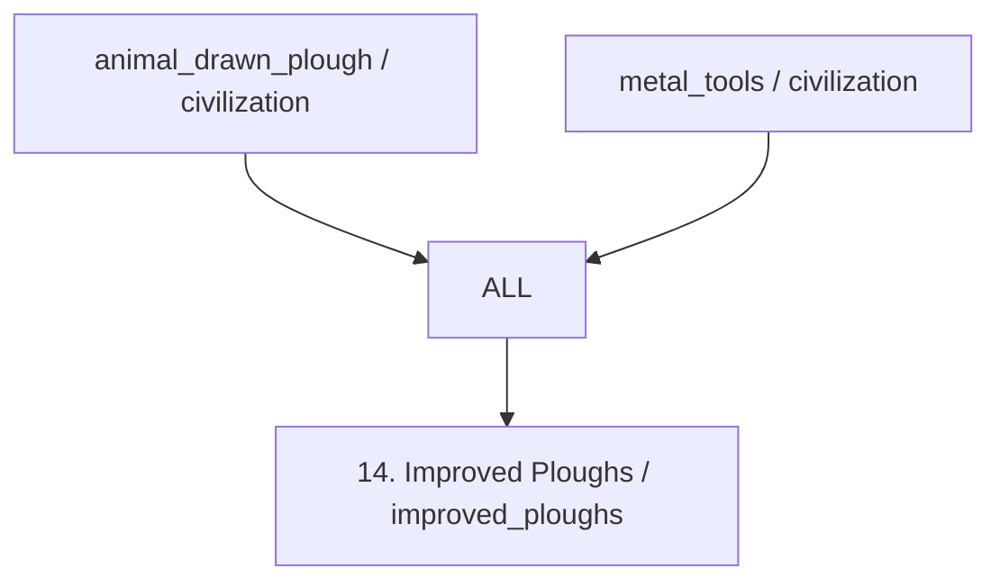

| Field | Value |
| --- | --- |
| scope | civilization |
| research.mode | points |
| research.cost | 100 research_point |
| research.onConditionFailure | pause_keep_progress |
| effects | unlock_capability: improved_ploughs (civilization; while_usage_conditions_met) |

| Condition | Exact expression |
| --- | --- |
| research.startConditions.all | [] |
| research.ongoingConditions.all | [] |
| usageConditions.all[0] | `{"type":"workers_assigned","minimumCount":1}` |
| usageConditions.all[1] | `{"type":"resource_tag_available","tag":"improved_plough","location":"site_equipment","minimumAmount":1}` |
| usageConditions.all[2] | `{"type":"site_feature_available","feature":"compatible_plough_soil"}` |
| usageConditions.all[3] | `{"type":"trained_draft_animals_available"}` |
| usageConditions.all[4] | `{"type":"draft_animals_supported"}` |

### Eurekas

| id | eventType | filters | counter | reward | repeatable |
| --- | --- | --- | --- | --- | --- |
| item_crafted | item_crafted | `{"itemTag": "metal_plough_component"}` | `{"mode": "sum_amount", "target": 1}` | `{"type": "add_research_points", "fractionOfBaseCost": 0.25}` | false |

## Technology fallow_management

**Fallow Management** — Schedule uncultivated periods to manage soil recovery.

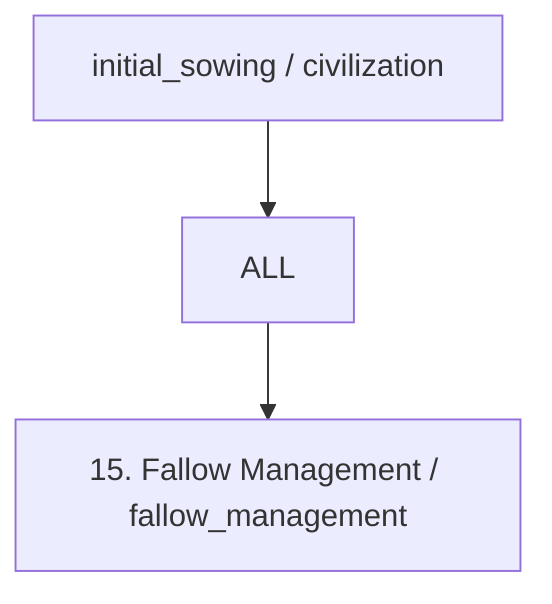

| Field | Value |
| --- | --- |
| scope | civilization |
| research.mode | points |
| research.cost | 100 research_point |
| research.onConditionFailure | pause_keep_progress |
| effects | unlock_capability: fallow_management (civilization; while_usage_conditions_met) |

| Condition | Exact expression |
| --- | --- |
| research.startConditions.all | [] |
| research.ongoingConditions.all | [] |
| usageConditions.all[0] | `{"type":"workers_assigned","minimumCount":1}` |
| usageConditions.all[1] | `{"type":"cultivated_plot_available"}` |
| usageConditions.all[2] | `{"type":"alternative_food_supply_available"}` |

### Eurekas

| id | eventType | filters | counter | reward | repeatable |
| --- | --- | --- | --- | --- | --- |
| plot_harvest_completed | plot_harvest_completed | `{"counterGroup": "plotId"}` | `{"mode": "sum_amount", "target": 3}` | `{"type": "add_research_points", "fractionOfBaseCost": 0.25}` | false |

> Actual recovery is controlled by soil simulation; it is not an instant fertility reset.

## Technology crop_alternation

**Crop Alternation** — Organize compatible crop sequences on cultivated land.

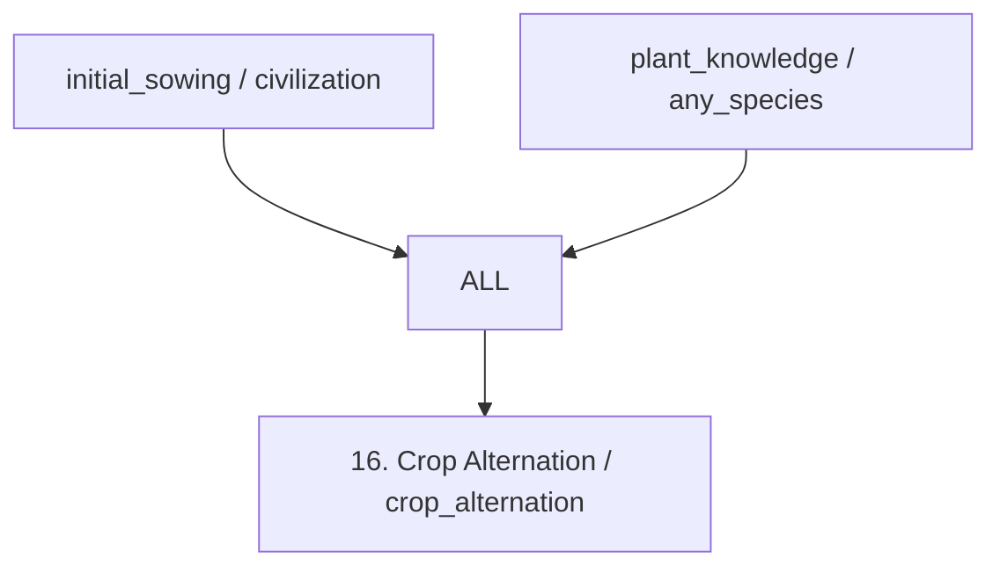

| Field | Value |
| --- | --- |
| scope | civilization |
| research.mode | points |
| research.cost | 100 research_point |
| research.onConditionFailure | pause_keep_progress |
| effects | unlock_capability: crop_alternation (civilization; while_usage_conditions_met) |

| Condition | Exact expression |
| --- | --- |
| research.startConditions.all | [] |
| research.ongoingConditions.all | [] |
| usageConditions.all[0] | `{"type":"workers_assigned","minimumCount":1}` |
| usageConditions.all[1] | `{"type":"compatible_crop_sequence_available","minimumSpeciesCount":2}` |

### Eurekas

| id | eventType | filters | counter | reward | repeatable |
| --- | --- | --- | --- | --- | --- |
| compatible_crop_species_harvested | compatible_crop_species_harvested | `{}` | `{"mode": "sum_amount", "target": 2}` | `{"type": "add_research_points", "fractionOfBaseCost": 0.25}` | false |

> The runtime must count distinct species in a compatible sequence for this event. No universal benefit is granted for arbitrary crop combinations.

## Technology reproductive_reserve

**Reproductive Reserve** — Reserve viable material from a harvest for future planting.

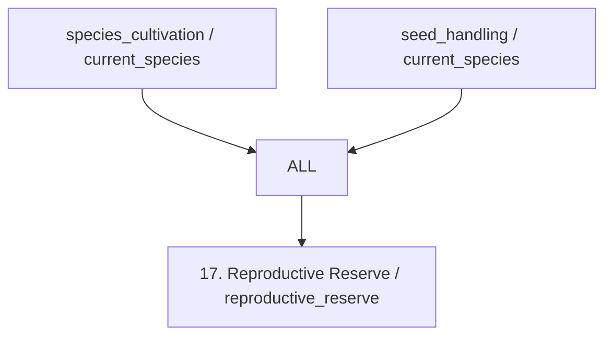

| Field | Value |
| --- | --- |
| scope | species |
| research.mode | points |
| research.cost | 100 research_point |
| research.onConditionFailure | pause_keep_progress |
| effects | unlock_capability: reproductive_reserve (species; while_usage_conditions_met) |

| Condition | Exact expression |
| --- | --- |
| research.startConditions.all[0] | `{"type":"species_discovered","speciesId":"$speciesId"}` |
| research.startConditions.all[1] | `{"type":"species_material_accessible","speciesId":"$speciesId"}` |
| research.ongoingConditions.all | [] |
| usageConditions.all[0] | `{"type":"species_discovered","speciesId":"$speciesId"}` |
| usageConditions.all[1] | `{"type":"workers_assigned","minimumCount":1}` |
| usageConditions.all[2] | `{"type":"species_propagation_material_available","speciesId":"$speciesId","minimumAmount":1}` |
| usageConditions.all[3] | `{"type":"propagation_storage_available","speciesId":"$speciesId"}` |

### Eurekas

| id | eventType | filters | counter | reward | repeatable |
| --- | --- | --- | --- | --- | --- |
| crop_harvest_completed | crop_harvest_completed | `{"speciesId": "$speciesId"}` | `{"mode": "sum_amount", "target": 1}` | `{"type": "add_research_points", "fractionOfBaseCost": 0.25}` | false |

## Technology initial_selection

**Initial Selection** — Select plants with useful observable traits for reproduction.

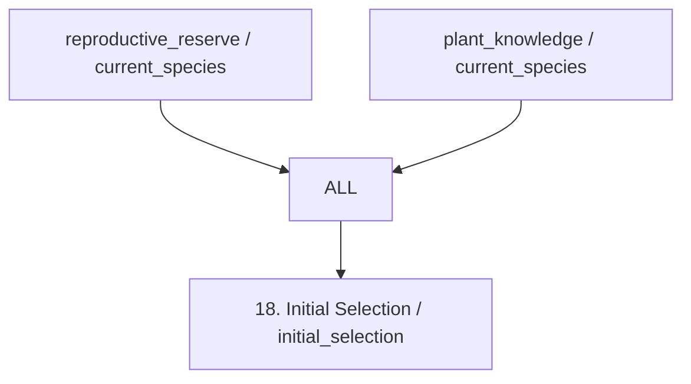

| Field | Value |
| --- | --- |
| scope | species |
| research.mode | points |
| research.cost | 100 research_point |
| research.onConditionFailure | pause_keep_progress |
| effects | unlock_capability: initial_selection (species; while_usage_conditions_met) |

| Condition | Exact expression |
| --- | --- |
| research.startConditions.all[0] | `{"type":"species_discovered","speciesId":"$speciesId"}` |
| research.startConditions.all[1] | `{"type":"species_material_accessible","speciesId":"$speciesId"}` |
| research.ongoingConditions.all | [] |
| usageConditions.all[0] | `{"type":"species_discovered","speciesId":"$speciesId"}` |
| usageConditions.all[1] | `{"type":"workers_assigned","minimumCount":1}` |
| usageConditions.all[2] | `{"type":"species_propagation_material_available","speciesId":"$speciesId","minimumAmount":1}` |
| usageConditions.all[3] | `{"type":"observable_trait_variation_available","speciesId":"$speciesId"}` |

### Eurekas

| id | eventType | filters | counter | reward | repeatable |
| --- | --- | --- | --- | --- | --- |
| useful_plant_trait_observed | useful_plant_trait_observed | `{"speciesId": "$speciesId"}` | `{"mode": "sum_amount", "target": 1}` | `{"type": "add_research_points", "fractionOfBaseCost": 0.25}` | false |

## Technology progressive_domestication

**Progressive Domestication** — Support generational changes in a cultivated population under human management.

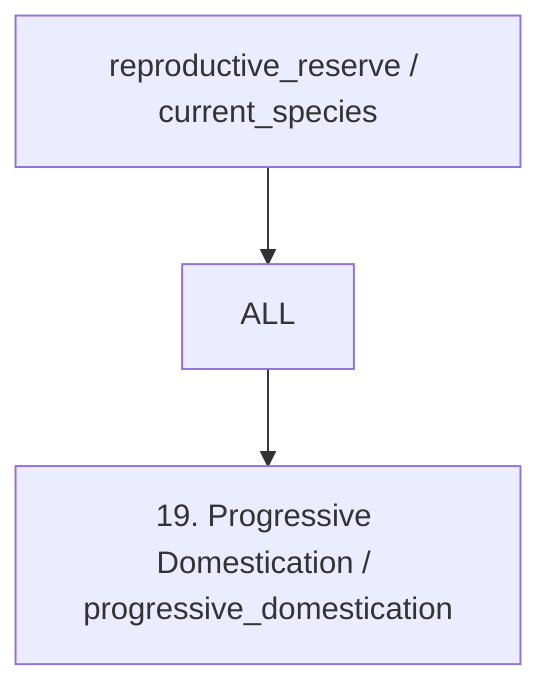

| Field | Value |
| --- | --- |
| scope | species |
| research.mode | points |
| research.cost | 100 research_point |
| research.onConditionFailure | pause_keep_progress |
| effects | unlock_capability: progressive_domestication (species; while_usage_conditions_met) |

| Condition | Exact expression |
| --- | --- |
| research.startConditions.all[0] | `{"type":"species_discovered","speciesId":"$speciesId"}` |
| research.startConditions.all[1] | `{"type":"species_material_accessible","speciesId":"$speciesId"}` |
| research.ongoingConditions.all | [] |
| usageConditions.all[0] | `{"type":"species_discovered","speciesId":"$speciesId"}` |
| usageConditions.all[1] | `{"type":"workers_assigned","minimumCount":1}` |
| usageConditions.all[2] | `{"type":"reproducing_crop_population_available","speciesId":"$speciesId"}` |

### Eurekas

| id | eventType | filters | counter | reward | repeatable |
| --- | --- | --- | --- | --- | --- |
| crop_generation_completed | crop_generation_completed | `{"speciesId": "$speciesId"}` | `{"mode": "sum_amount", "target": 3}` | `{"type": "add_research_points", "fractionOfBaseCost": 0.25}` | false |

> Research unlocks a management capability. Actual domestication requires generational simulation and species-specific criteria; completing research must not mark the species domesticated. Selection need not have been consciously understood.

## Technology line_comparison

**Line Comparison** — Maintain separate lines and compare their results.

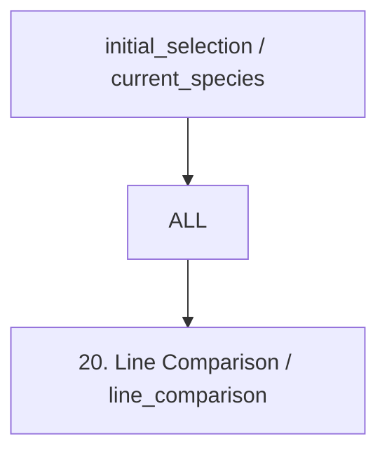

| Field | Value |
| --- | --- |
| scope | species |
| research.mode | points |
| research.cost | 100 research_point |
| research.onConditionFailure | pause_keep_progress |
| effects | unlock_capability: line_comparison (species; while_usage_conditions_met) |

| Condition | Exact expression |
| --- | --- |
| research.startConditions.all[0] | `{"type":"species_discovered","speciesId":"$speciesId"}` |
| research.startConditions.all[1] | `{"type":"species_material_accessible","speciesId":"$speciesId"}` |
| research.ongoingConditions.all | [] |
| usageConditions.all[0] | `{"type":"species_discovered","speciesId":"$speciesId"}` |
| usageConditions.all[1] | `{"type":"workers_assigned","minimumCount":1}` |
| usageConditions.all[2] | `{"type":"separate_identified_crop_lines_available","speciesId":"$speciesId","minimumLineCount":2}` |

### Eurekas

| id | eventType | filters | counter | reward | repeatable |
| --- | --- | --- | --- | --- | --- |
| separate_crop_line_harvest_completed | separate_crop_line_harvest_completed | `{"speciesId": "$speciesId"}` | `{"mode": "sum_amount", "target": 2}` | `{"type": "add_research_points", "fractionOfBaseCost": 0.25}` | false |

> The eureka counts distinct harvested line IDs, not repeated harvests of one line.

## Technology specialized_varieties

**Specialized Varieties** — Direct sustained selection toward specific crop traits and uses.

```mermaid
flowchart TD
    p0["ALL"]
    p1["line_comparison / current_species"]
    p1 --> p0
    p2["progressive_domestication / current_species"]
    p2 --> p0
    target["21. Specialized Varieties / specialized_varieties"]
    p0 --> target
```

| Field | Value |
| --- | --- |
| scope | species |
| research.mode | points |
| research.cost | 100 research_point |
| research.onConditionFailure | pause_keep_progress |
| effects | unlock_capability: specialized_varieties (species; while_usage_conditions_met) |

| Condition | Exact expression |
| --- | --- |
| research.startConditions.all[0] | `{"type":"species_discovered","speciesId":"$speciesId"}` |
| research.startConditions.all[1] | `{"type":"species_material_accessible","speciesId":"$speciesId"}` |
| research.ongoingConditions.all | [] |
| usageConditions.all[0] | `{"type":"species_discovered","speciesId":"$speciesId"}` |
| usageConditions.all[1] | `{"type":"workers_assigned","minimumCount":1}` |
| usageConditions.all[2] | `{"type":"species_domesticated","speciesId":"$speciesId"}` |
| usageConditions.all[3] | `{"type":"selectable_crop_lines_available","speciesId":"$speciesId"}` |

### Eurekas

| id | eventType | filters | counter | reward | repeatable |
| --- | --- | --- | --- | --- | --- |
| target_trait_reproduced | target_trait_reproduced | `{"speciesId": "$speciesId"}` | `{"mode": "sum_amount", "target": 3}` | `{"type": "add_research_points", "fractionOfBaseCost": 0.25}` | false |

> Only species-appropriate heritable traits can be selected. Trait gains are simulated locally rather than granted to every crop on research completion.

## Technology vegetative_propagation

**Vegetative Propagation** — Reproduce compatible plants through cuttings, division or other vegetative material.

```mermaid
flowchart TD
    p0["ALL"]
    p1["plant_knowledge / current_species"]
    p1 --> p0
    target["22. Vegetative Propagation / vegetative_propagation"]
    p0 --> target
```

| Field | Value |
| --- | --- |
| scope | species |
| research.mode | points |
| research.cost | 100 research_point |
| research.onConditionFailure | pause_keep_progress |
| effects | unlock_capability: vegetative_propagation (species; while_usage_conditions_met) |

| Condition | Exact expression |
| --- | --- |
| research.startConditions.all[0] | `{"type":"species_discovered","speciesId":"$speciesId"}` |
| research.startConditions.all[1] | `{"type":"species_material_accessible","speciesId":"$speciesId"}` |
| research.ongoingConditions.all | [] |
| usageConditions.all[0] | `{"type":"species_discovered","speciesId":"$speciesId"}` |
| usageConditions.all[1] | `{"type":"workers_assigned","minimumCount":1}` |
| usageConditions.all[2] | `{"type":"species_supports_method","speciesId":"$speciesId","method":"vegetative_propagation"}` |
| usageConditions.all[3] | `{"type":"species_propagation_material_available","speciesId":"$speciesId","minimumAmount":1}` |
| usageConditions.all[4] | `{"type":"compatible_plot_available","speciesId":"$speciesId"}` |

### Eurekas

| id | eventType | filters | counter | reward | repeatable |
| --- | --- | --- | --- | --- | --- |
| vegetative_plant_established | vegetative_plant_established | `{"speciesId": "$speciesId"}` | `{"mode": "sum_amount", "target": 1}` | `{"type": "add_research_points", "fractionOfBaseCost": 0.25}` | false |

> Basic vegetative planting can be supported by initial cultivation; this technology represents deliberate specialized propagation, not a universal prerequisite for planting tubers or cuttings.

## Technology grafting

**Grafting** — Join compatible scion and rootstock material for suitable fruit crops.

```mermaid
flowchart TD
    p0["ALL"]
    p1["vegetative_propagation / current_species"]
    p1 --> p0
    p2["cutting_tools / civilization"]
    p2 --> p0
    target["23. Grafting / grafting"]
    p0 --> target
```

| Field | Value |
| --- | --- |
| scope | species |
| research.mode | points |
| research.cost | 100 research_point |
| research.onConditionFailure | pause_keep_progress |
| effects | unlock_capability: grafting (species; while_usage_conditions_met) |

| Condition | Exact expression |
| --- | --- |
| research.startConditions.all[0] | `{"type":"species_discovered","speciesId":"$speciesId"}` |
| research.startConditions.all[1] | `{"type":"species_material_accessible","speciesId":"$speciesId"}` |
| research.ongoingConditions.all | [] |
| usageConditions.all[0] | `{"type":"species_discovered","speciesId":"$speciesId"}` |
| usageConditions.all[1] | `{"type":"workers_assigned","minimumCount":1}` |
| usageConditions.all[2] | `{"type":"compatible_grafting_material_available","speciesId":"$speciesId"}` |
| usageConditions.all[3] | `{"type":"resource_tag_available","tag":"grafting_tool","location":"site_equipment","minimumAmount":1}` |
| usageConditions.all[4] | `{"type":"resource_tag_available","tag":"grafting_binding","location":"inventory","minimumAmount":1}` |

### Eurekas

| id | eventType | filters | counter | reward | repeatable |
| --- | --- | --- | --- | --- | --- |
| graftable_orchard_established | graftable_orchard_established | `{"speciesId": "$speciesId"}` | `{"mode": "sum_amount", "target": 1}` | `{"type": "add_research_points", "fractionOfBaseCost": 0.25}` | false |

## External imports

- `stone_tools`
- `basketry`
- `woodworking`
- `pottery`
- `water_management`
- `canal_construction`
- `animal_traction`
- `metal_tools`
- `cutting_tools`

Root configuration also documents global policies, manufacturing alternatives and handlers. See its [complete reference](../../lang/en/json/data--technologies--agriculture.technologies.md). Research does not automatically produce materials.
