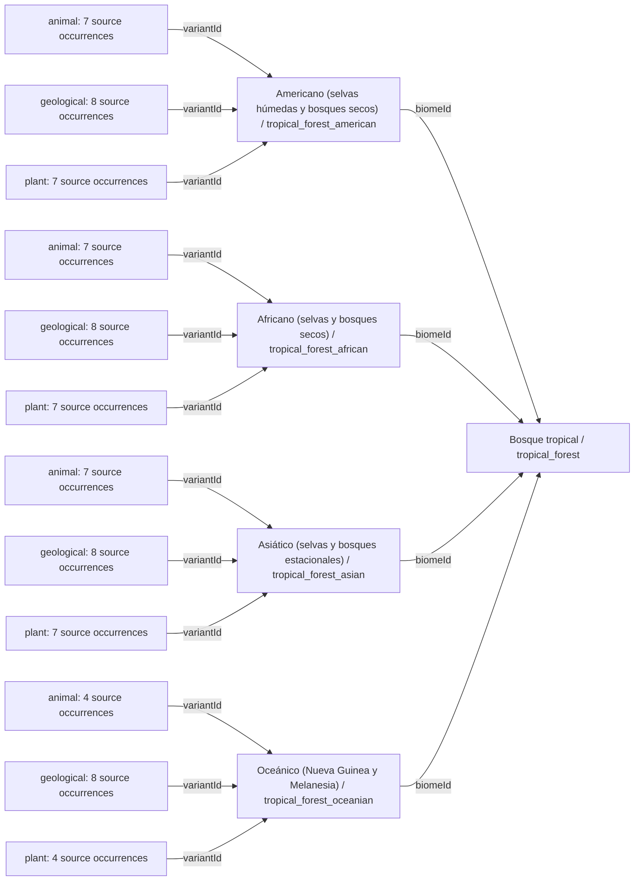
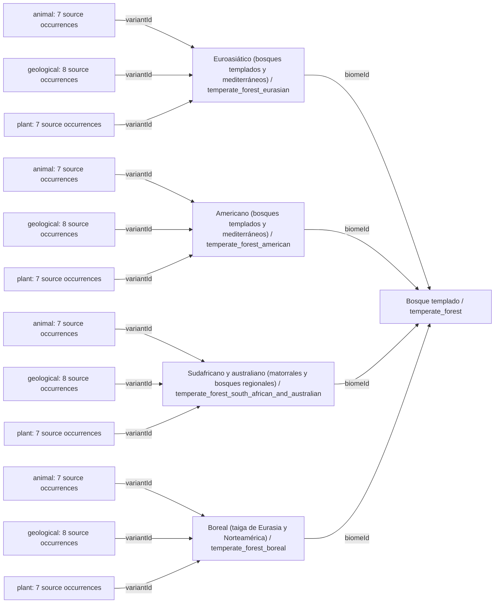
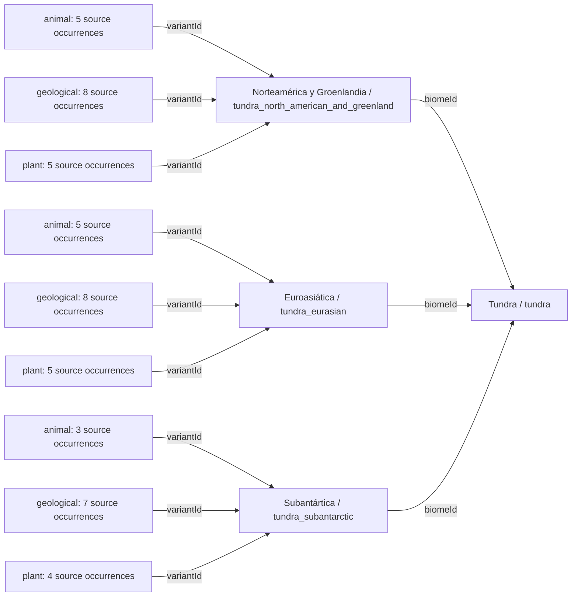
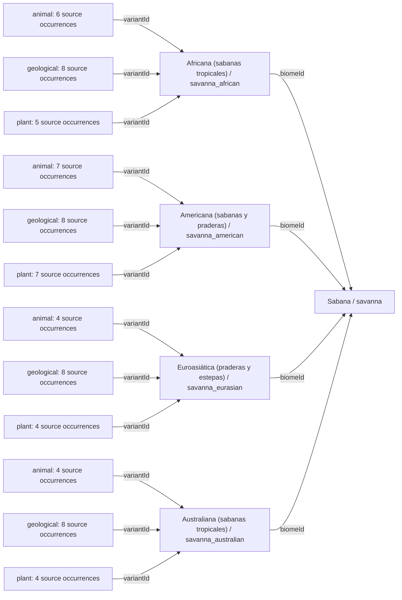
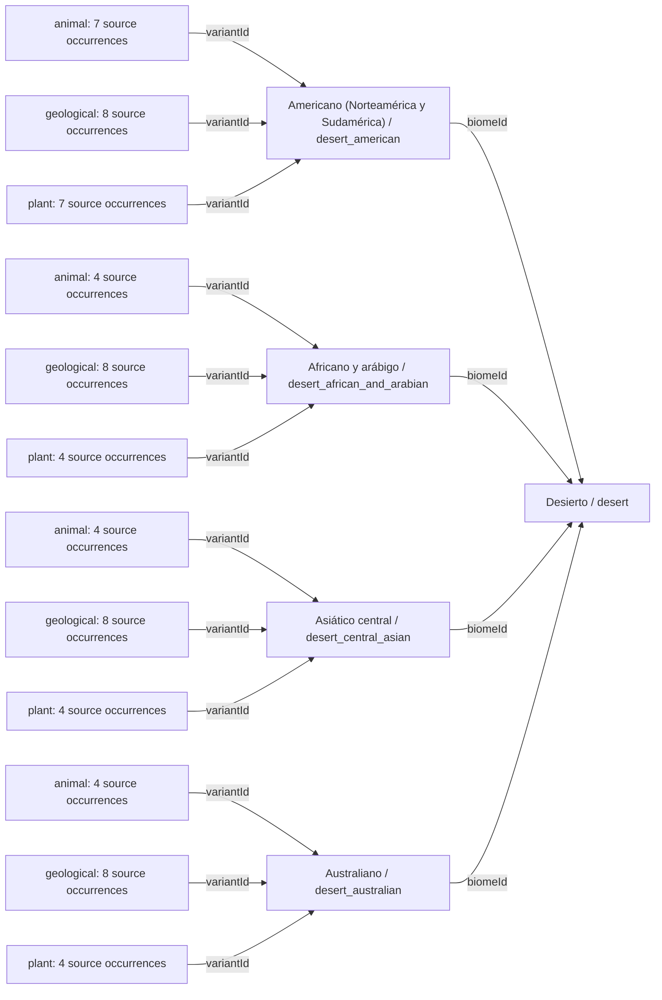
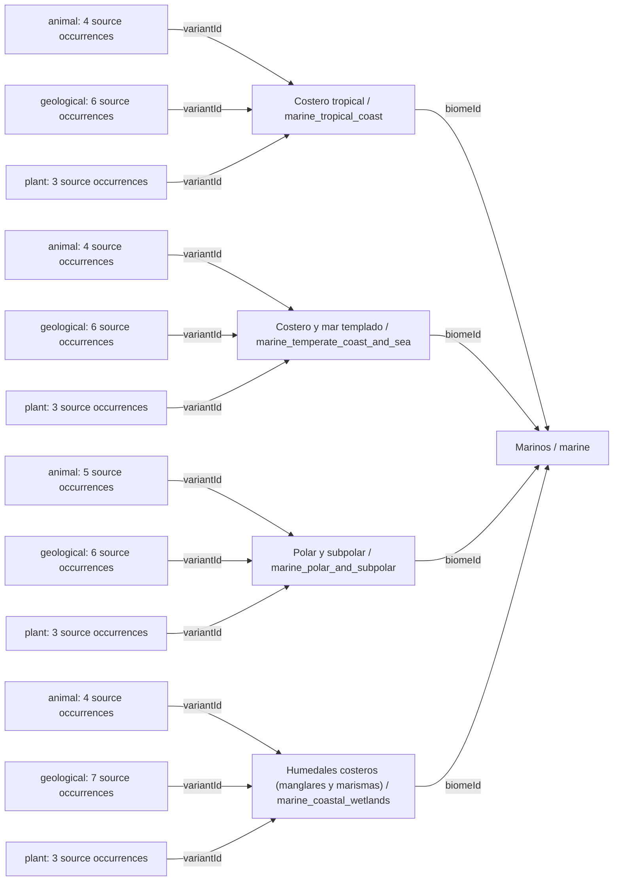
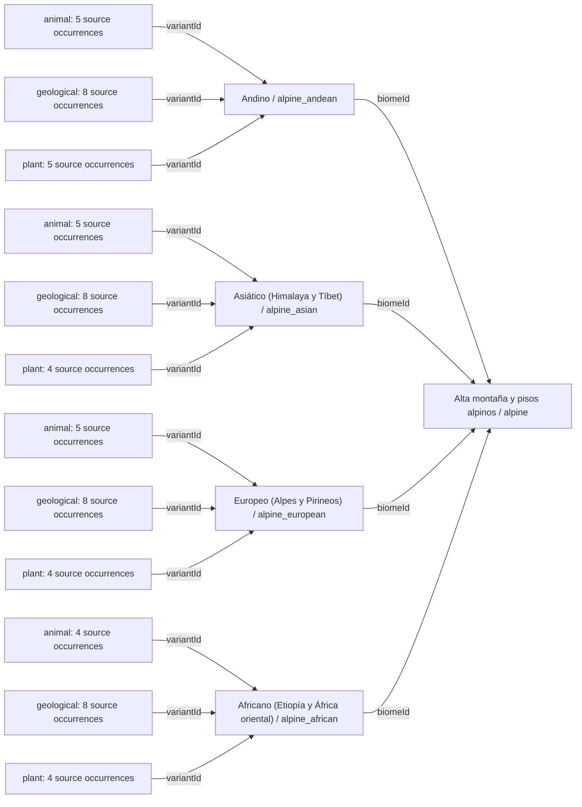

# Mundo — Diagramas completos de referencia

[Índice gráfico](../../lang/es/catalog-diagrams.md) · [English](DIAGRAMS.md) · [Español](DIAGRAMS.es.md)

[JSON](world.catalog.guide.json) · [Estructura completa del JSON](../../lang/es/json-structures.md)

Todos los registros del catálogo están incluidos. Se usan varios diagramas pequeños en este mismo archivo para facilitar la consulta. Las flechas representan vínculos documentados, no rendimiento, presencia garantizada ni evolución deducida. Los IDs actuales se conservan.

## Todos los biomas y variantes

Las cantidades son registros del documento, no poblaciones o depósitos ya generados. La distribución regional exacta y la probabilidad siguen pendientes.

### Bosque tropical / `tropical_forest`

### Bosque templado / `temperate_forest`

### Tundra / `tundra`

### Sabana / `savanna`

### Desierto / `desert`

### Marinos / `marine`

### Alta montaña y pisos alpinos / `alpine`

## `worldRules`

| Campo | Valor |
| --- | --- |
| hexagonalMap | `true` |
| dynamicWeatherEnabled | `false` |
| seasonsEnabled | `false` |
| dynamicClimateDisastersEnabled | `false` |
| staticEnvironmentalConditionsUsed | `true` |
| maximumRegionalVariantsPerBiome | `4` |
| resourceDiscoverySeparateFromExistence | `true` |
| potentialCultivationSeparateFromEstablishedCrops | `true` |

## `summary`

| Campo | Valor |
| --- | --- |
| biomeCount | `7` |
| regionalVariantCount | `27` |
| plantCandidateCount | `129` |
| animalCandidateCount | `134` |
| geologicalCandidateCount | `57` |
| sourceOccurrenceCount | `485` |
| agriculturalCropCandidateCount | `21` |

## `elevationLevels`

| id | Nombre | Reglas adicionales |
| --- | --- | --- |
| 0 | Nivel del mar | `{"ordinaryLandTraversal": "depends_on_land_or_water_surface"}` |
| 1 | Nivel medio | `{"ordinaryLandTraversal": true}` |
| 2 | Nivel alto | `{"ordinaryLandTraversal": true, "movementAndConstructionRestrictions": null}` |
| 3 | Cumbres infranqueables | `{"ordinaryLandTraversal": false, "conventionalSettlementsAllowed": false}` |

## `geographicModifiers`

| id | Nombre | Reglas adicionales |
| --- | --- | --- |
| river_floodplain | Río y llanura aluvial | `{}` |
| inland_wetland | Humedal, lago y pantano | `{}` |
| coast | Costa y litoral | `{}` |
| oasis | Oasis | `{}` |
| volcanic_terrain | Terreno volcánico | `{}` |
| slope_soil | Pendiente y suelo | `{}` |

## Orden de generación propuesto

1. `generate_terrain_water_static_climate_and_biogeographic_regions`
2. `assign_biomes_and_geographic_modifiers`
3. `generate_geological_provinces_and_candidate_deposits`
4. `distribute_native_wild_species_using_region_and_habitat`
5. `evaluate_soil_fertility_and_cultivation_suitability`
6. `apply_visibility_discovery_and_exploitation_capabilities`
7. `validate_alternative_development_trade_and_expansion_paths`

Las 485 apariciones individuales están completas en los archivos de [plantas](../plants/DIAGRAMS.es.md), [animales](../animals/DIAGRAMS.es.md) y [minerales](../minerals/DIAGRAMS.es.md), sin duplicar todo el inventario aquí. Las políticas de casillas, yacimientos y revisión están en la [estructura completa](../../lang/es/json/data--world--world.catalog.guide.md).
