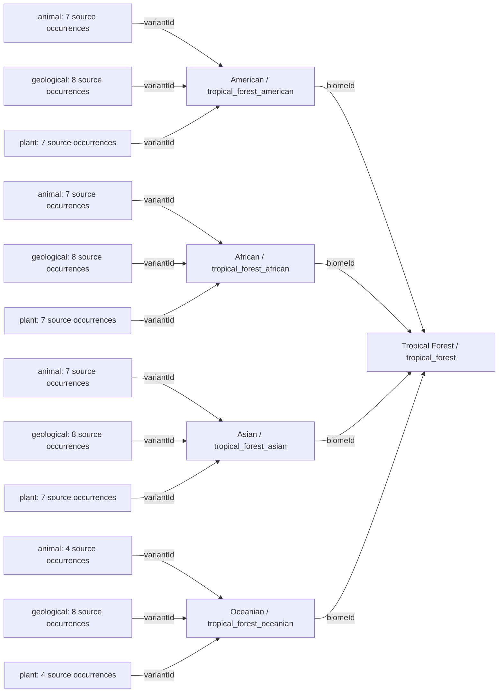
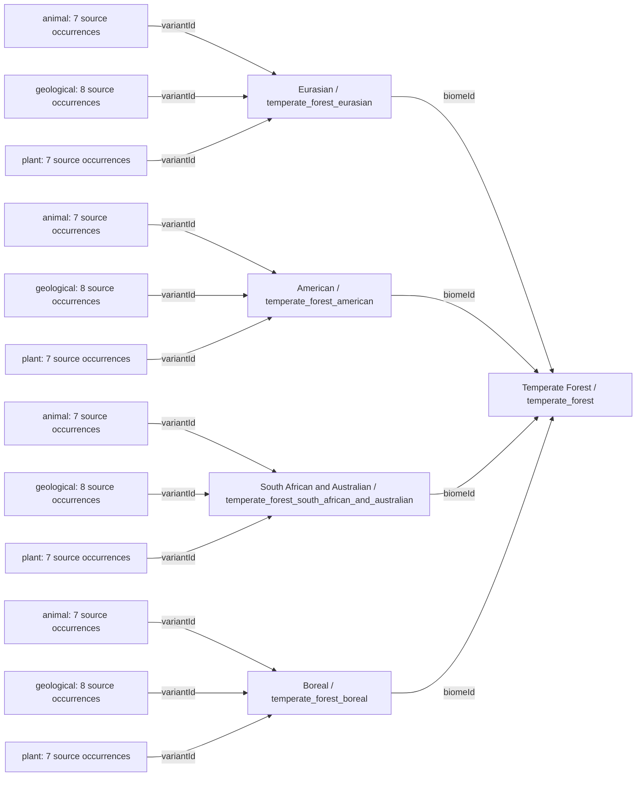
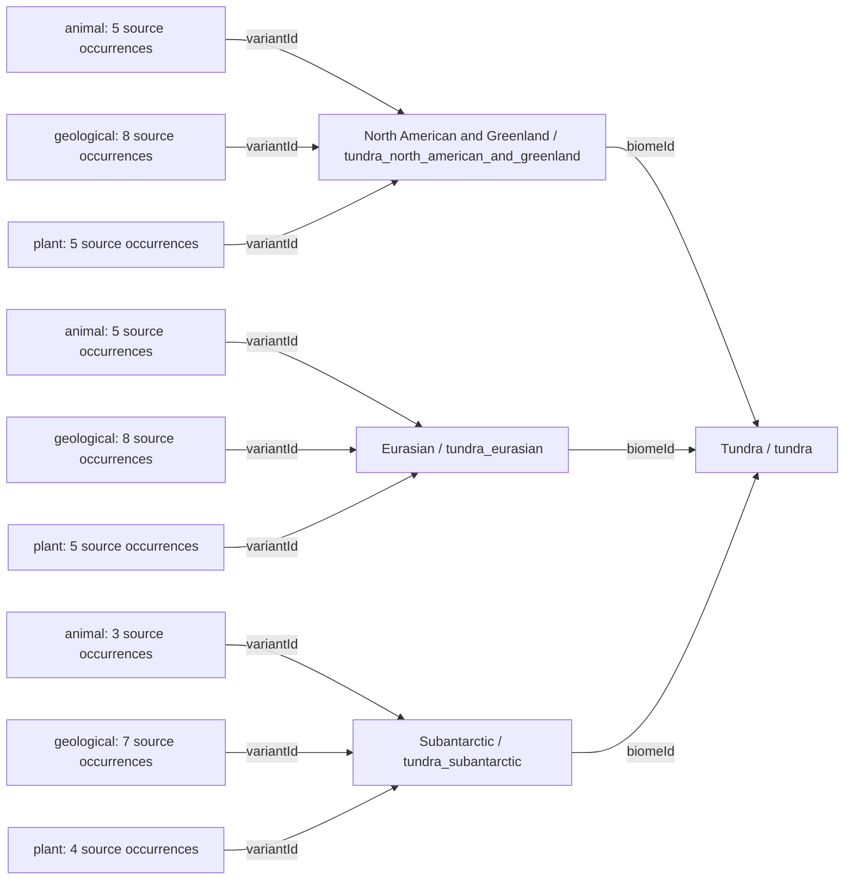
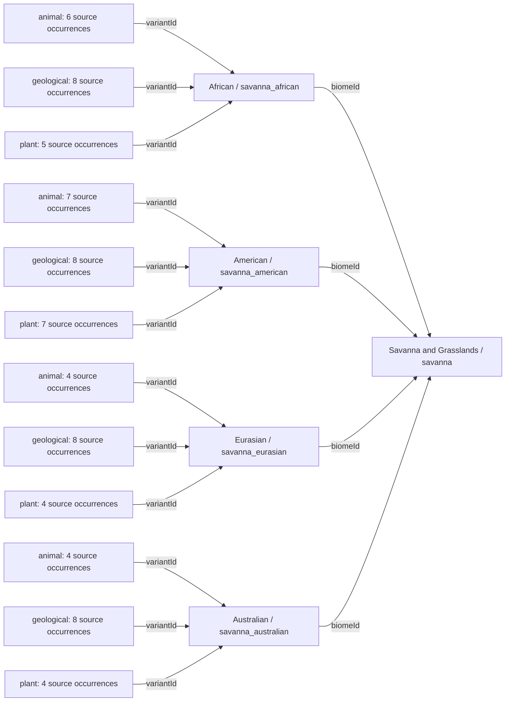
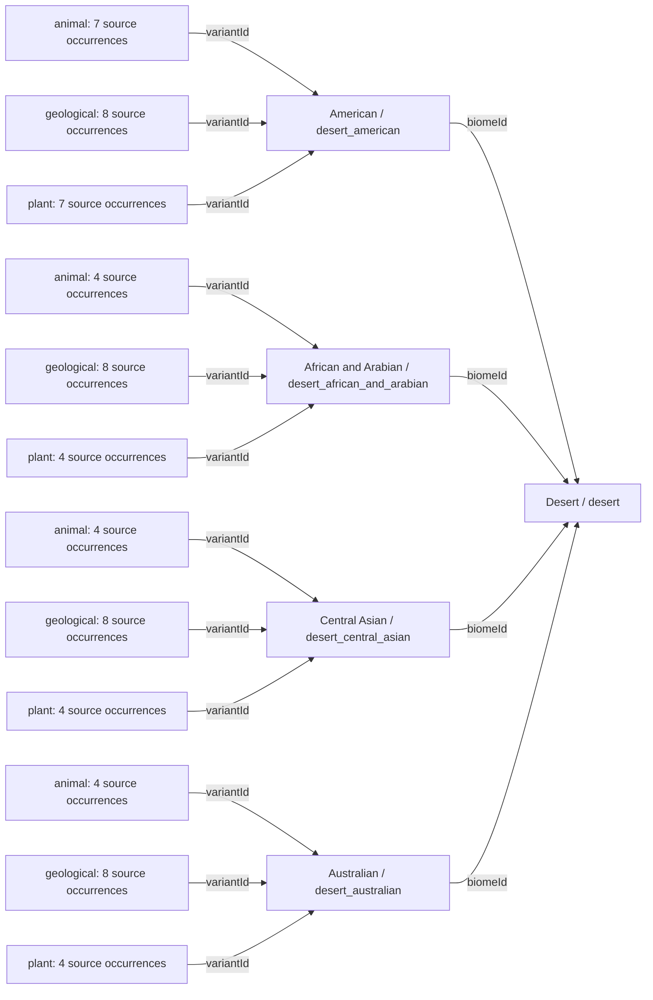
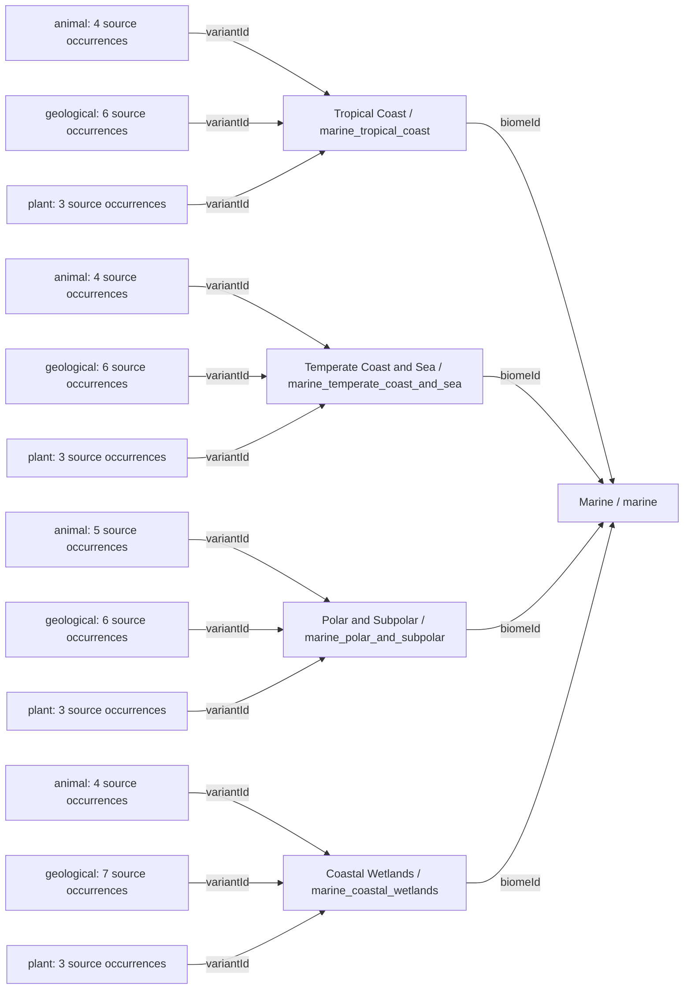
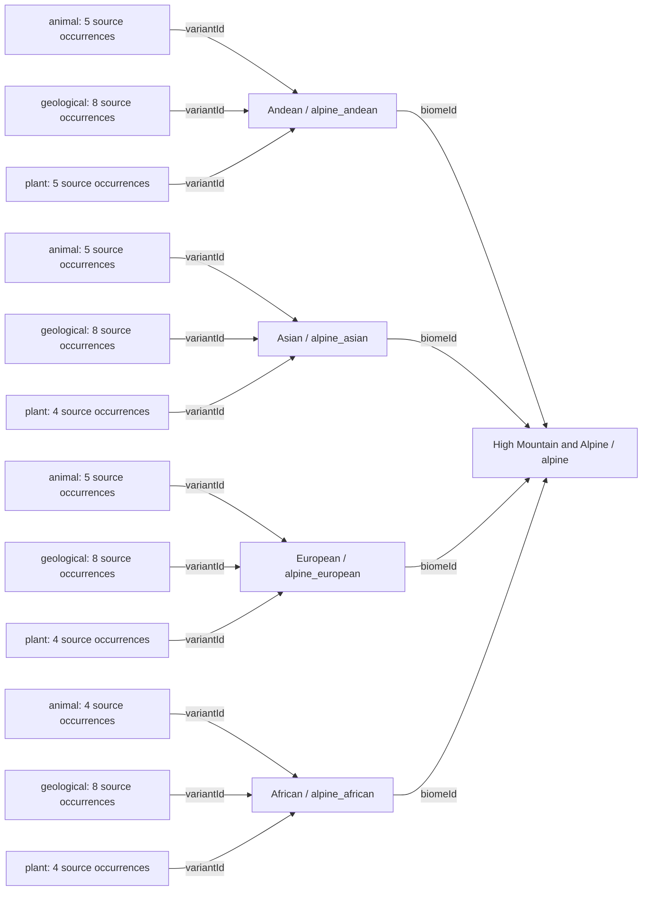

# World — Complete reference diagrams

[Diagram index](../../lang/en/catalog-diagrams.md) · [English](DIAGRAMS.md) · [Español](DIAGRAMS.es.md)

[JSON](world.catalog.guide.json) · [Complete JSON structure](../../lang/en/json-structures.md)

Every catalog record is included. Several small diagrams in this file keep the reference readable. Arrows represent documented links, not yield, guaranteed presence or inferred evolution. Existing IDs are preserved.

## All biomes and variants

Counts describe source listings, not generated populations or deposits. Exact native distribution and spawn probabilities remain unresolved.

### Tropical Forest / `tropical_forest`

### Temperate Forest / `temperate_forest`

### Tundra / `tundra`

### Savanna and Grasslands / `savanna`

### Desert / `desert`

### Marine / `marine`

### High Mountain and Alpine / `alpine`

## `worldRules`

| Field | Value |
| --- | --- |
| hexagonalMap | `true` |
| dynamicWeatherEnabled | `false` |
| seasonsEnabled | `false` |
| dynamicClimateDisastersEnabled | `false` |
| staticEnvironmentalConditionsUsed | `true` |
| maximumRegionalVariantsPerBiome | `4` |
| resourceDiscoverySeparateFromExistence | `true` |
| potentialCultivationSeparateFromEstablishedCrops | `true` |

## `summary`

| Field | Value |
| --- | --- |
| biomeCount | `7` |
| regionalVariantCount | `27` |
| plantCandidateCount | `109` |
| animalCandidateCount | `101` |
| geologicalCandidateCount | `57` |
| sourceOccurrenceCount | `485` |
| agriculturalCropCandidateCount | `21` |

## `elevationLevels`

| id | Name | Additional rules |
| --- | --- | --- |
| 0 | Sea Level | `{"ordinaryLandTraversal": "depends_on_land_or_water_surface"}` |
| 1 | Middle Elevation | `{"ordinaryLandTraversal": true}` |
| 2 | High Elevation | `{"ordinaryLandTraversal": true, "movementAndConstructionRestrictions": null}` |
| 3 | Impassable Summits | `{"ordinaryLandTraversal": false, "conventionalSettlementsAllowed": false}` |

## `geographicModifiers`

| id | Name | Additional rules |
| --- | --- | --- |
| river_floodplain | River and Floodplain | `{}` |
| inland_wetland | Inland Wetland, Lake or Swamp | `{}` |
| coast | Coast and Shoreline | `{}` |
| oasis | Oasis | `{}` |
| volcanic_terrain | Volcanic Terrain | `{}` |
| slope_soil | Slope and Soil | `{}` |

## Proposed generation order

1. `generate_terrain_water_static_climate_and_biogeographic_regions`
2. `assign_biomes_and_geographic_modifiers`
3. `generate_geological_provinces_and_candidate_deposits`
4. `distribute_native_wild_species_using_region_and_habitat`
5. `evaluate_soil_fertility_and_cultivation_suitability`
6. `apply_visibility_discovery_and_exploitation_capabilities`
7. `validate_alternative_development_trade_and_expansion_paths`

All 485 individual occurrences are retained in the [plants](../plants/DIAGRAMS.md), [animals](../animals/DIAGRAMS.md) and [minerals](../minerals/DIAGRAMS.md) files without repeating the complete inventory here. Tile/deposit and review policies are in the [complete structure](../../lang/en/json/data--world--world.catalog.guide.md).
