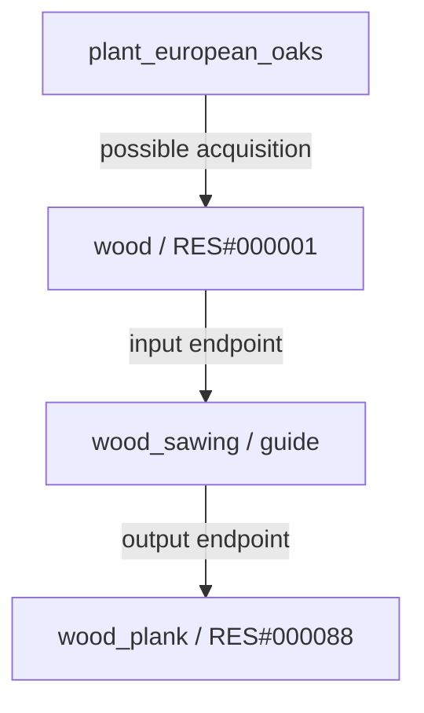
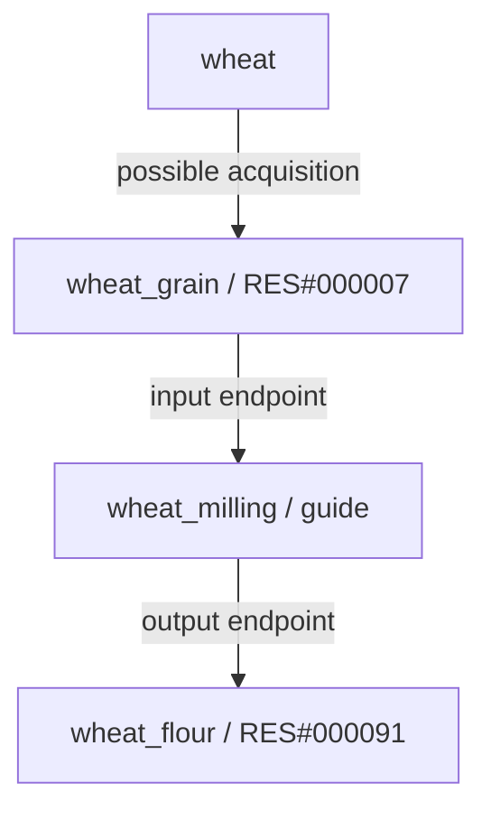
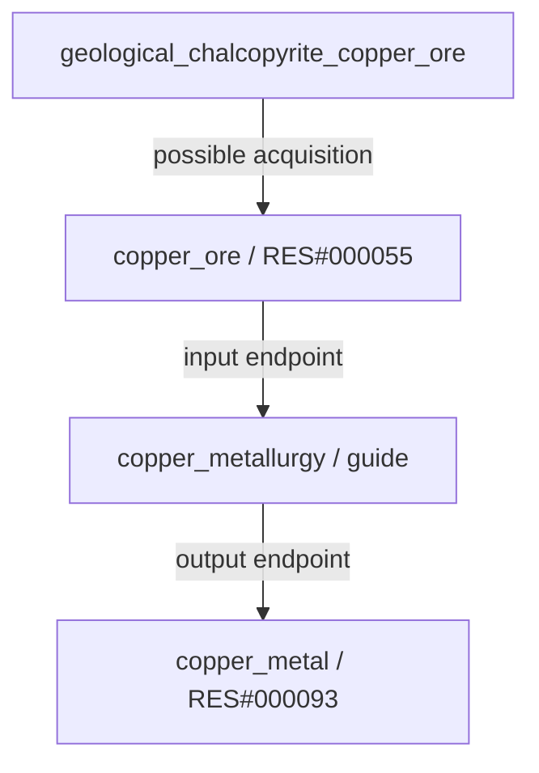

# Resources: catalog and relationships

[JSON](../../data/resources/resources.catalog.guide.json) · [Complete diagrams](../../data/resources/DIAGRAMS.md) · [Every field](json/data--resources--resources.catalog.guide.md)

## Purpose

This catalog defines storable materials. A plant or animal is a source; a resource is an acquired material; a process relates input and output materials. It contains **105 resources**, **301 source bindings**, **25 transformation guides** and **24 classified animal source tags**.

Scientific review and balance are not complete. Added crop/tree products are design proposals; amounts, exact conditions and recipes remain unresolved. The catalog and every relation are runtime-disabled.

## Flat collections

| Collection | Responsibility |
| --- | --- |
| `resources` | Identity, translations, category, material stage and unresolved storage metadata. |
| `sourceBindings` | Explicit candidate-to-resource possibilities, without guaranteed amounts. |
| `sourceTagMappings` | Maps existing animal tags to resources, services or unresolved alternatives. |
| `processingLinks` | Proposed transformation endpoints; not complete recipes. |
| `unresolvedSources` | Water, manure and generic plant fiber still need acquisition systems. |
| `reviewIssues` | Material compatibility, food preparation and historical scope. |
| `summary` | Counts used for integrity checks. |

## Identity and references

New resources use permanent `RES#000001` IDs and English `snake_case` tags. The catalog JSON is the initial allocation record: do not renumber by sorting, recycle retired IDs or change existing assignments. Generalized entity IDs have explicit aliases; technology IDs remain unchanged.

`sourceCollection` resolves to these collections:

| sourceCollection | JSON / collection |
| --- | --- |
| `plantSpeciesCandidates` | `data/plants/plants.catalog.guide.json` / `speciesCandidates` |
| `animalSpeciesCandidates` | `data/animals/animals.catalog.guide.json` / `speciesCandidates` |
| `agriculturalCropCandidates` | `data/plants/plants.catalog.guide.json` / `agriculturalCropCandidates` |
| `geologicalResourceCandidates` | `data/minerals/minerals.catalog.guide.json` / `geologicalResourceCandidates` |

Sources also point back to resources: `potentialProducts[].resourceId` on plants/animals, `products[].resourceId` on crops and `extractedResourceId` on geology. Original animal tags are preserved. `catalogFiles.resources` locates this catalog from the world guide.

## Wood



## Wheat



## Copper



Wheat also has straw as a proposed byproduct; flour links to water and bread. Metallurgy includes additional stages not yet modeled: a deposit never grants refined copper automatically. A source binding with `requiresProcessing: true` is not direct gathering either.

## Actual object example

```json
{
  "id": "RES#000001",
  "tag": "wood",
  "name": {
    "en": "Wood",
    "es": "Madera"
  },
  "description": {
    "en": "Wood: a material definition for inventory and future production rules; amounts and processing requirements remain provisional.",
    "es": "Madera: definición de material para inventario y futuras reglas de producción; cantidades y requisitos de procesamiento pendientes."
  },
  "category": "plant_material",
  "stage": "raw",
  "tags": [
    "wood",
    "fuel_candidate"
  ],
  "inventory": {
    "storable": true,
    "quantityUnit": null,
    "perishable": null,
    "storageRules": null
  },
  "definitionStatus": "design_guide_requires_review"
}
```

## Simulation boundaries

- `null` means unresolved, never zero or no requirement. Units, perishability, storage and amounts are not balanced.
- `draft_service`, `transport_service` and `work_service` are not inventory materials.
- `antlers_or_horns` has no resource ID until species anatomy is resolved. Never grant both. `shell` and `shells` explicitly map to one resource; animal `fiber` remains separate from plant fiber.
- Generic material IDs do not imply automatic substitution of species, ores or seeds. Future GameState lots must retain source species/material, viability and quality. Do not combine different species of seed as interchangeable stock.
- Grain is not automatically viable for propagation or safe to eat without preparation.
- Process guides do not define amounts, duration, technologies, facilities, fuels or byproducts. Listed inputs may be incomplete. Do not execute these as recipes.
- Nickel, manganese and seabed nodules retain scope and future-extraction review; defining a resource does not unlock exploitation.

## Schema and validation

`schemas/resource.guide.schema.json` describes the complete structure of the current catalog, including nested objects. It does not validate science, chemistry feasibility or cross-file references. The custom checker uses Python standard library and **does not execute a general JSON Schema validator**. It checks IDs, tags, references, inverse links, service separation, unresolved-data boundaries, counts and unexpected cycles in the initial guides.

```sh
python tools/validate_resources.py
python tools/generate_json_reference.py --check
python tools/generate_catalog_diagrams.py --check
python tools/validate_repository.py
```

Foxes: confirmed detailed outputs are hide, meat, bones and animal fat. Bones use new permanent allocation `RES#000105`. Acquisition and later uses remain pending; this choice does not extend to other entities.
