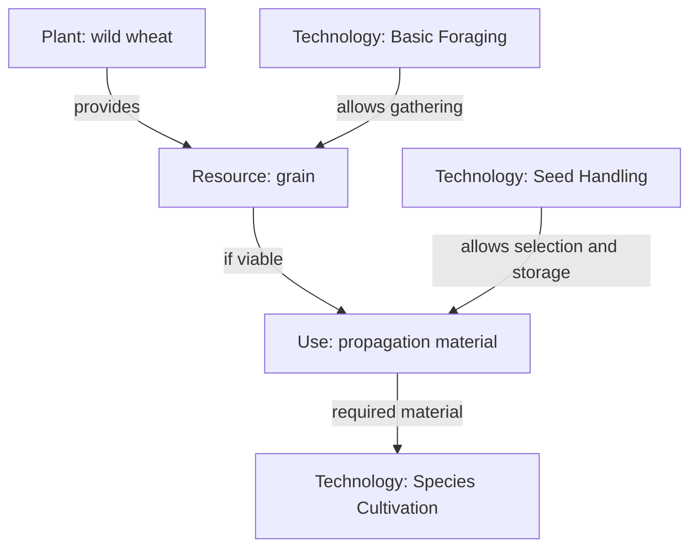
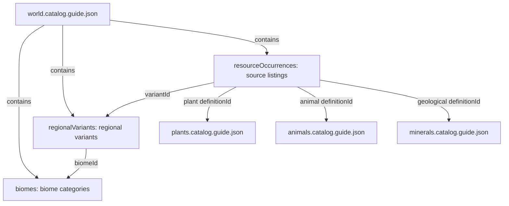
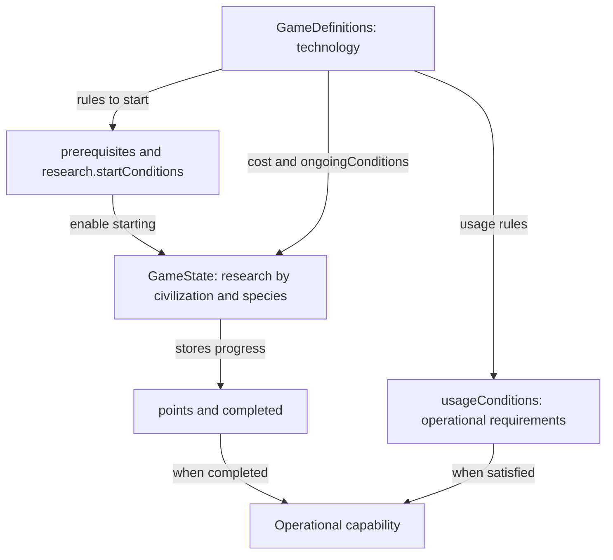

# Visual reference

Small diagrams for consulting the design. These are Mermaid blocks inside Markdown: open this file in GitHub's normal view to see the diagrams; `Raw` shows their editable source.

[Main documentation](README.md) · [JSON fields and examples](json-structures.md) · [Español](../es/visual-reference.md)

## Example: plant, resource and technology

Conceptual example, not an implemented production chain. Exact wild wheat species, resource definitions and yields still need design. This diagram does not list every technology prerequisite.

Gathering does not imply domestication. Grain must be viable and meet the action's conditions to serve as propagation material. Research does not automatically create plants or consume materials.

## World catalogs

Relationships already present in the JSON files. Arrows are references, not generation order. Plant and animal records are candidates awaiting species resolution.

Each occurrence references **one candidate** according to its kind, rather than all three catalogs at once. Related file paths are in `catalogFiles`. Records remain disabled for runtime generation until review is complete.

## Research definition and progress

A technology defines shared rules; each civilization stores independent progress. With `scope: species`, progress is also separated by species; with `scope: civilization`, `speciesId` is `null`.

A capability is operational only when both conditions hold: completed research and satisfied usage requirements. The runnable `simulation/` example demonstrates progress without implementing capability operation or production.

To edit a diagram, change its `mermaid` block and commit it. Diagrams are manually maintained summaries; JSON files and their detailed references retain the exact fields, prerequisites and relationships.
