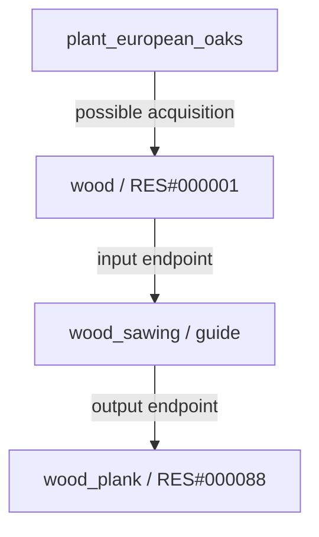
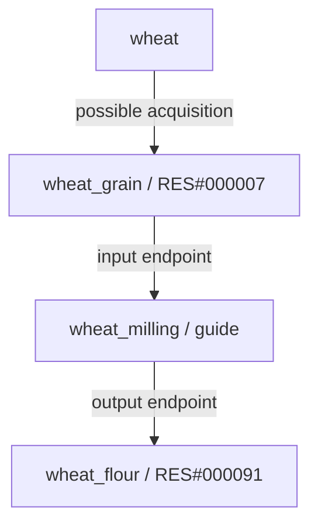
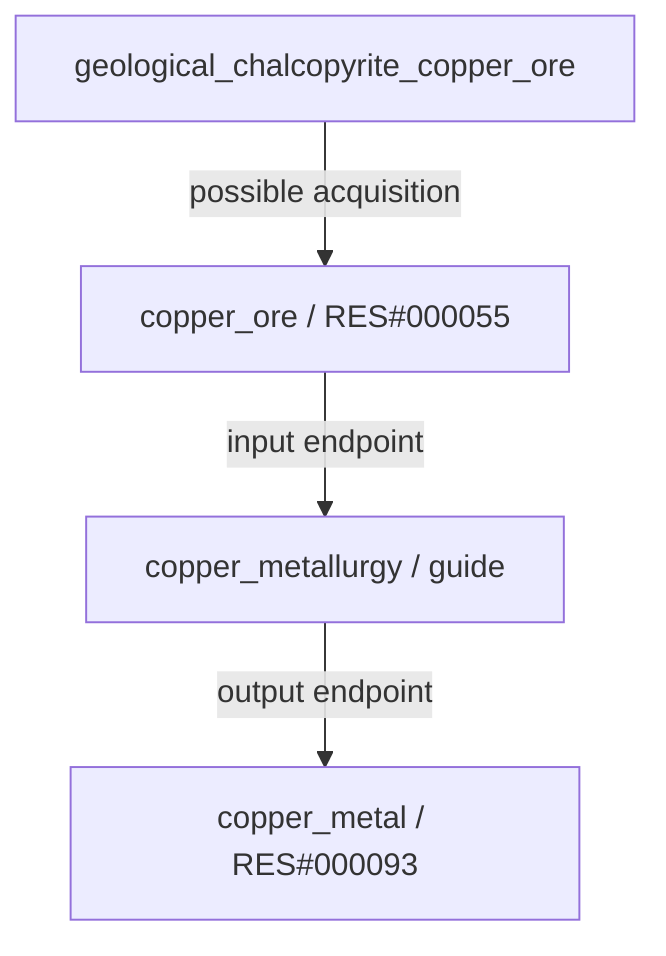

# Recursos: catálogo y relaciones

[JSON](../../data/resources/resources.catalog.guide.json) · [Diagramas completos](../../data/resources/DIAGRAMS.es.md) · [Todos los campos](json/data--resources--resources.catalog.guide.md)

## Qué define

Este catálogo define materiales almacenables. Una planta o animal es el origen; un recurso es el material obtenido; un proceso relaciona materiales de entrada y salida. Hay **106 recursos**, **594 vínculos de origen**, **28 guías de transformación** y **21 tags animales clasificados**.

No son datos científicos o de balance terminados. Los productos agregados de cultivos y árboles son propuestas de diseño; las cantidades, condiciones específicas y recetas quedan pendientes. El catálogo y todos sus vínculos tienen la ejecución deshabilitada.

## Colecciones al mismo nivel

| Colección | Función |
| --- | --- |
| `resources` | Identidad, traducciones, categoría, etapa y almacenamiento pendiente. |
| `sourceBindings` | Relación explícita entre candidato y recurso posible; sin cantidades garantizadas. |
| `sourceTagMappings` | Relaciona los tags actuales de materiales animales con sus recursos; servicios y anatomía ambigua ya se separaron. |
| `processingLinks` | Extremos de transformaciones propuestas; no recetas completas. |
| `unresolvedSources` | Agua, estiércol y fibra vegetal genérica requieren sistemas de obtención todavía pendientes. |
| `reviewIssues` | Compatibilidad de materiales, preparación de alimentos y alcance histórico. |
| `summary` | Conteos para verificar integridad. |

## Identificadores y referencias

Los recursos nuevos usan IDs permanentes `RES#000001` y tags en inglés `snake_case`. El JSON del catálogo actúa como registro de las asignaciones iniciales: no reordenar para reasignar números, no reutilizar IDs eliminados y registrar futuras asignaciones sin alterar las existentes. Los IDs de especies y tecnologías no cambian.

`sourceCollection` resuelve a estas colecciones:

| sourceCollection | JSON / collection |
| --- | --- |
| `plantSpeciesCandidates` | `data/plants/plants.catalog.guide.json` / `speciesCandidates` |
| `animalSpeciesCandidates` | `data/animals/animals.catalog.guide.json` / `speciesCandidates` |
| `agriculturalCropCandidates` | `data/plants/plants.catalog.guide.json` / `agriculturalCropCandidates` |
| `geologicalResourceCandidates` | `data/minerals/minerals.catalog.guide.json` / `geologicalResourceCandidates` |

Los orígenes también apuntan al recurso: `potentialProducts[].resourceId` en plantas y animales, `products[].resourceId` en cultivos y `extractedResourceId` en geología. Los tags originales de animales se conservan. `catalogFiles.resources` permite localizar el catálogo desde la guía del mundo.

## Madera



## Trigo



## Cobre



El trigo también tiene paja como subproducto propuesto, y la harina se relaciona con agua y pan. La metalurgia incluye etapas adicionales aún no modeladas: un yacimiento nunca entrega cobre refinado automáticamente. Un vínculo con `requiresProcessing: true` tampoco equivale a recolección directa.

## Ejemplo de objeto real

```json
{
  "id": "RES#000001",
  "tag": "wood",
  "name": {
    "en": "Wood",
    "es": "Madera"
  },
  "description": {
    "en": "Wood: a material definition for inventory and future production rules; amounts and processing requirements remain provisional.",
    "es": "Madera: definición de material para inventario y futuras reglas de producción; cantidades y requisitos de procesamiento pendientes."
  },
  "category": "plant_material",
  "stage": "raw",
  "tags": [
    "wood",
    "fuel_candidate"
  ],
  "inventory": {
    "storable": true,
    "quantityUnit": null,
    "perishable": null,
    "storageRules": null
  },
  "definitionStatus": "design_guide_requires_review"
}
```

## Límites que debe respetar la simulación

- `null` es pendiente, nunca cero o ningún requisito. Unidades, caducidad, almacenamiento y cantidades no están balanceados.
- Los servicios `draft_service`, `transport_service` y `work_service` no son materiales de inventario.
- La antigua alternativa `antlers_or_horns` se resolvió en astas o cuernos según anatomía del grupo. Concha/caparazón usa `animal_shell` y fibra textil animal usa `animal_fiber`, separada de la vegetal.
- Los IDs de materiales genéricos no permiten sustituir automáticamente especies, menas o semillas. Los futuros lotes de GameState deben conservar especie/origen, viabilidad y calidad. No sumar semillas de especies distintas como si fueran intercambiables.
- Tener grano no significa que sea viable para sembrar ni seguro para comer sin preparación.
- Las guías de procesos no fijan cantidades, duración, tecnologías, instalaciones, combustibles ni coproductos. Las entradas enumeradas pueden ser incompletas. No ejecutar como recetas.
- Materiales de níquel, manganeso y nódulos submarinos conservan revisión de alcance y extracción futura; definirlos no desbloquea su explotación.

## Esquema y validación

`schemas/resource.guide.schema.json` describe toda la estructura del catálogo actual, incluidos objetos internos. No valida ciencia, viabilidad química ni referencias entre archivos. El verificador propio usa la biblioteca estándar de Python y **no ejecuta un validador general JSON Schema**. Comprueba IDs, tags, referencias, vínculos inversos, separación de servicios, límites pendientes, conteos y ausencia de ciclos inesperados en las guías iniciales.

```sh
python tools/validate_resources.py
python tools/generate_json_reference.py --check
python tools/generate_catalog_diagrams.py --check
python tools/validate_repository.py
```

Zorros: opción detallada confirmada con piel, carne, huesos y grasa animal. Huesos usa la nueva asignación permanente `RES#000105`. La obtención está documentada y los usos posteriores siguen pendientes; el criterio detallado se extiende a todos los animales actuales.

La referencia detallada se aplica ahora a todos los animales: [materiales y obtención](animal-products.md). Los servicios se separaron de los tags de materiales, las alternativas de astas/cuernos se resolvieron por anatomía y se añadió `RES#000106` para tendones. Aceites y marfil conservan procesos y restricciones de origen.
