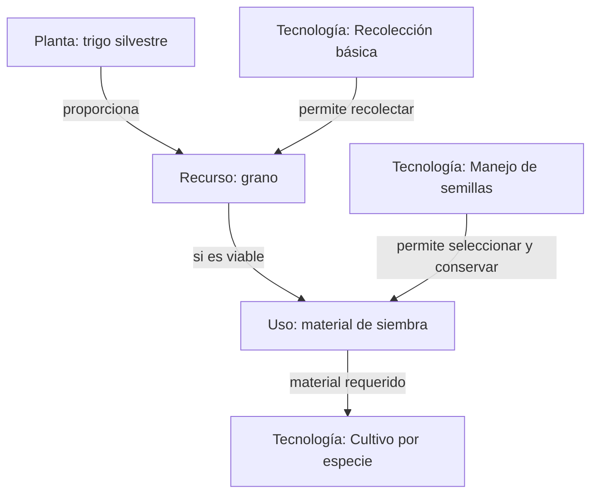
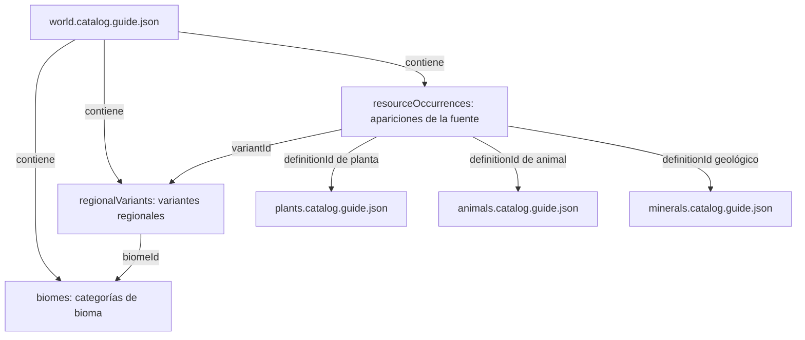
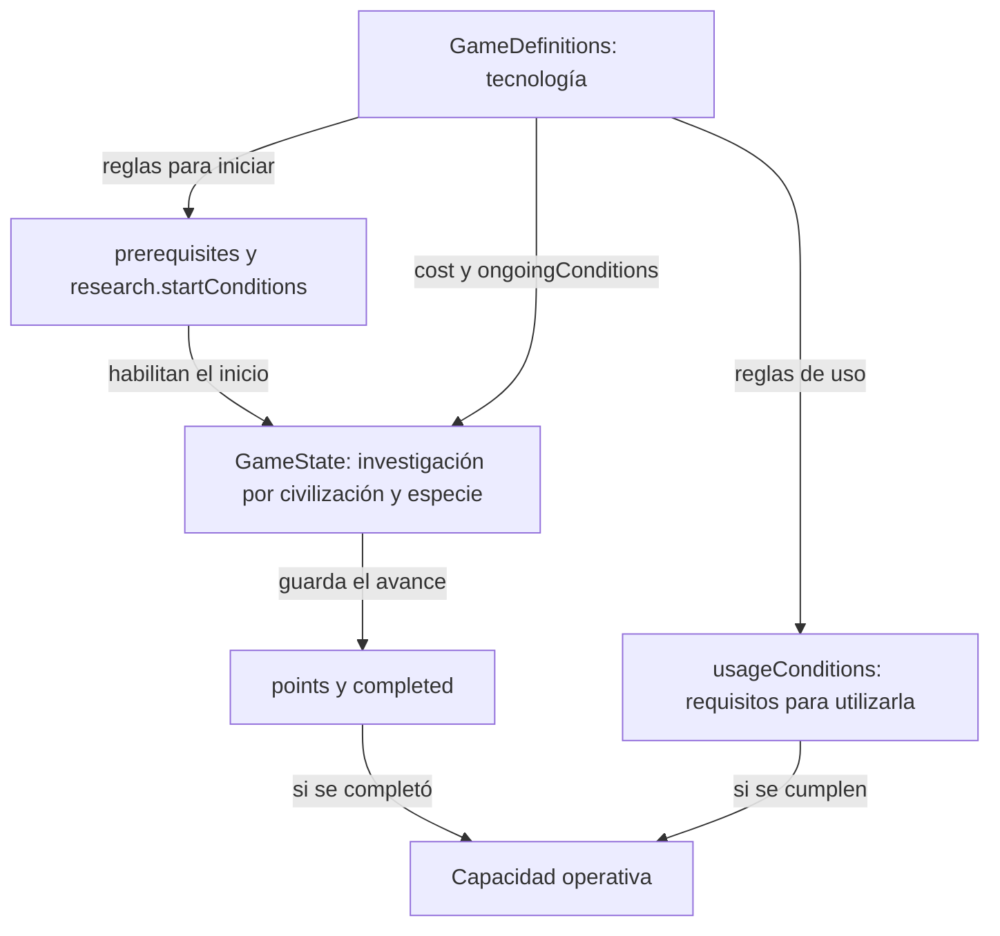

# Referencia visual

Diagramas sencillos para consultar el diseño. Están guardados como bloques Mermaid dentro de Markdown: en GitHub, abrir este archivo en la vista normal para verlos; `Raw` muestra el texto editable.

[Documentación principal](README.md) · [Campos JSON y ejemplos](json-structures.md) · [English](../en/visual-reference.md)

## Ejemplo: planta, recurso y tecnología

Ejemplo conceptual, no una cadena de producción ya implementada. Las especies exactas de trigo silvestre, los recursos y sus rendimientos todavía deben definirse. El diagrama no enumera todos los requisitos de las tecnologías.

Recolectar no equivale a domesticar. El grano debe ser viable y cumplir las condiciones de la acción para servir como material de siembra. Investigar no crea plantas ni consume materiales automáticamente.

## Catálogos del mundo

Relaciones que ya aparecen en los JSON. Las flechas representan referencias, no orden de generación. Plantas y animales conservan candidatos pendientes de resolver por especie.

Cada aparición apunta a **un candidato** según su tipo; no a los tres catálogos a la vez. Las rutas a los archivos relacionados están en `catalogFiles`. Los registros siguen deshabilitados para generación real hasta completar su revisión.

## Definición y avance de investigación

La tecnología define reglas comunes; cada civilización conserva su propio avance. Cuando `scope` es `species`, también se separa por especie; cuando es `civilization`, `speciesId` es `null`.

La capacidad es operativa únicamente cuando se cumplen ambas condiciones: investigación completada y requisitos de uso satisfechos. El ejemplo ejecutable de `simulation/` demuestra el avance, sin implementar la operación de capacidades ni producción.

Para editar un diagrama, cambiar su bloque `mermaid` y guardar un commit. Los diagramas son resúmenes mantenidos manualmente; los JSON y sus referencias detalladas conservan los campos, requisitos y relaciones exactas.
